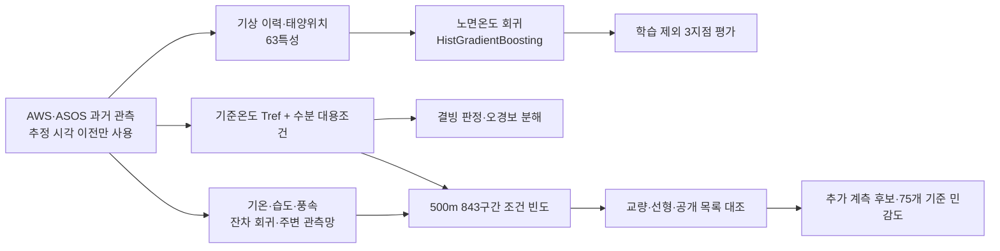
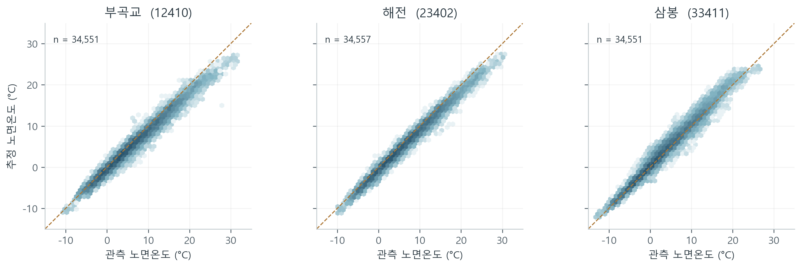
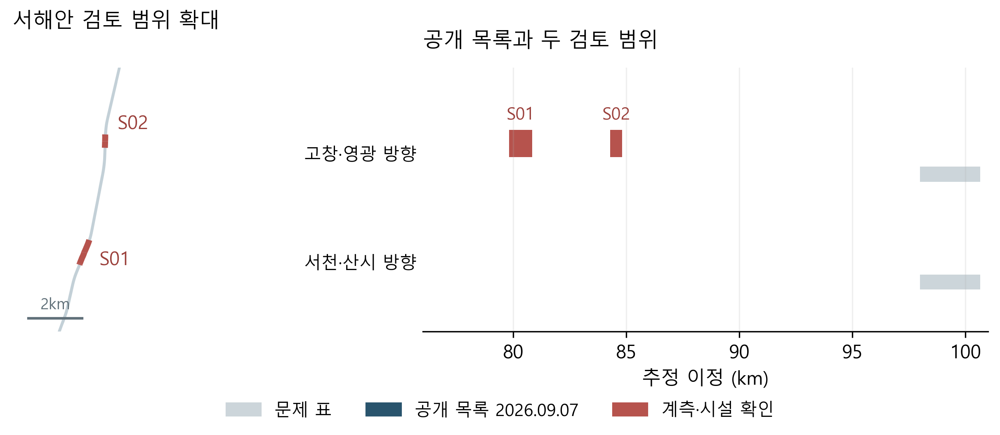
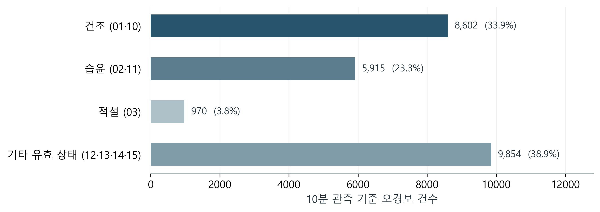
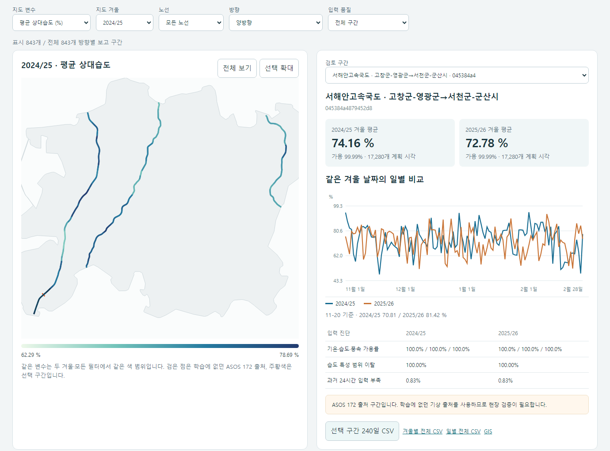

# icy-road-ai | 전북 고속도로 노면온도 추정과 결빙 취약구간 분석

 [](https://github.com/jinwon25/icy-road-ai/actions/workflows/checks.yml)

센서가 없는 고속도로 구간의 **노면온도와 기상을 주변 기상 관측으로 추정**하고, 그 결과를 교량·선형 정보와 기존 결빙 취약구간 목록에 연결해 **추가 계측과 현장 확인이 필요한 범위를 좁힌** 분석 프로젝트입니다. 2026 DATA·AI 분석 경진대회 문제해결 부문의 전북 고속도로 결빙 과제에 **로드투인사이트**(개인 참가)로 출전했습니다.

## 현재 상태

2026년 11월 6일 결과물을 제출했고, 11월 18일 발표 평가 대상 3팀에 로드투인사이트는 포함되지 않았습니다. 공식 심사 점수는 비공개입니다. 대회 마지막 날인 11월 25일에 저장소를 공개하고 참가자 제공 원자료와 관측값이 담긴 학습·검증 자료를 폐기했습니다. [발표 평가 공지](https://aida.kisti.re.kr/competition/main/selectNotice.do?bbsId=BBSMSTR_AAAAAAAAAAAA&nttId=822) · [대회 일정](https://aida.kisti.re.kr/competition/main/competition/COMP_000000000000050/detail.do) · [공개·폐기 기록](.github/PUBLICATION.md)

학습에서 제외한 3지점의 노면온도 MAE는 평균 **0.978°C**였습니다. 실제 결빙이 관측된 부곡교에서 날짜별 평균 정밀도는 **0.0195**에 그쳤습니다. 이 결과는 관측 공백을 보완하고 추가 계측 후보를 고르는 데 활용했습니다. [최종 분석 보고서](docs/delivery/FINAL_ANALYSIS_REPORT.md)

## 프로젝트 한눈에 보기

| 항목 | 내용 |
| --- | --- |
| 분석 질문 | 관측소가 없는 도로의 노면온도를 얼마나 정확히 추정할 수 있는가? 그 추정으로 결빙을 판정하고 추가 확인 구간을 고를 수 있는가? |
| 대회·참가 | 2026 DATA·AI 분석 경진대회(KISTI 주최) 문제해결 부문 · 전북 고속도로 결빙 위험도 과제 · 로드투인사이트(1인) |
| 관측 단위·자료 | 10분 시각 × 도로기상 관측소, 500m 도로 구간 843개. 2024년 11월–2025년 2월, 2025년 11월–2026년 2월의 두 겨울 |
| 사용 자료 | 대회 제공 도로기상(RWIS)·시설·중심선 자료, 기상청 AWS·ASOS, 한국도로공사 공개 취약구간·암거 목록, Copernicus GLO-30 DSM |
| 주요 방법 | 학습 제외 지점 평가 · 지역 단위 공간 제외 검증 · 기상 이력 회귀 · 기준온도+수분 조건 결빙 판정 · 오경보 원인 분해 · 선정 기준 민감도 분석 |
| 도구 | Python·pandas·scikit-learn(HistGradientBoosting)·CatBoost·GeoPandas·rasterio, 비교 실험에 LightGBM·XGBoost·PyTorch |
| 본인 역할 | 문제 정의·데이터 감사·모델링·검증 설계·공간 분석·보고서·데모 전체. AI 도구의 지원 범위는 [AI 활용 내역](AI_USAGE.md)에 구분 |
| 산출물 | [최종 보고서 원고](docs/delivery/FINAL_ANALYSIS_REPORT.md) · [제출 실행 소스·Notebook](submission/README.md) · [연구 기록 52건](docs/research/README.md) · 합성 테스트 502개 |

## 분석 구조



| 구분 | 실제 구성 |
| --- | --- |
| 평가 분리 | 대회 지정 평가 3지점(부곡교·해전·삼봉)은 학습·선택·주변 참조에서 모두 제외. 다른 지점의 같은 시각 노면상태도 입력하지 않음 |
| 노면온도 | 학습 허용 23지점의 유효 관측쌍 793,149개로 63특성 HistGradientBoosting 회귀 |
| 도로 기상 | 기상 관측값과 도로 관측값의 잔차 학습. 풍속은 반경 50km AWS 최대 4곳의 거리 가중 통계 35개를 더한 69특성 |
| 결빙 판정 | Tref 0°C 이하이면서 이슬점·최근 3시간 강수·적설 중 하나가 수분을 시사할 때 결빙. 수분 입력이 모두 없으면 보류 |
| 공간 결과 | 843구간의 두 겨울 저온·수분 조건 비율에 교량 코드와 중심선 방향 변화를 결합 |

## 주요 결과

### 노면온도: 학습하지 않은 지점에서 MAE 0.978°C

| 지점 | 유효쌍 | BIAS (°C) | MAE (°C) | RMSE (°C) |
| --- | ---: | ---: | ---: | ---: |
| 부곡교 | 34,551 | −0.970 | 1.113 | 1.441 |
| 해전 | 34,557 | −0.977 | 1.044 | 1.295 |
| 삼봉 | 34,551 | +0.300 | 0.776 | 1.088 |
| 지점 평균 | — | −0.549 | 0.978 | 1.275 |

세 지점의 유효 관측쌍은 총 103,659개입니다. 이 중 두 모형을 같은 시각·지점에서 비교할 수 있는 103,131쌍에서 기본 12특성 회귀(MAE 1.146°C) 대비 **MAE가 14.6% 낮았습니다.** 결빙 판단에 중요한 관측 −2–+2°C 범위에서도 11.4% 낮았습니다. 겨울별 7일 블록 부트스트랩 2,000회의 MAE 차이 95% 구간은 −0.202–−0.135°C입니다.



### 도로 기상: 지역 전체 제외 평가

| 대상 | 유효쌍 | AWS 기준선 MAE | 추정 MAE | 감소율 |
| --- | ---: | ---: | ---: | ---: |
| 기온 | 137,630 | 1.699°C | 1.324°C | 22.1% |
| 습도 | 137,450 | 6.530%p | 5.687%p | 12.9% |
| 풍속 | 137,498 | 0.983 m/s | 0.500 m/s | 49.1% |

대회 평가 3지점은 기온·습도·풍속 원본이 모두 결측이어서 이 표는 별도로 개발 4지역을 하나씩 통째로 제외한 평가입니다. 다른 관측소 값을 정답으로 대신 쓰지 않았습니다.

### 결빙 판정과 오경보

| 판정법 | Precision | Recall | F1 |
| --- | ---: | ---: | ---: |
| 기준온도 + 수분 대용조건(제출) | 0.0195 | 0.5936 | 0.0326 |
| ASOS 기온 0°C 기준선 | 0.0048 | 0.7353 | 0.0087 |

실제 Ice는 부곡교에서만 64시점·19일 관측됐고, 과제 규칙에 따라 날짜별 지표를 평균했습니다. 기온 기준선보다 오경보는 줄었지만 정밀도가 약 2%여서 **자동 경보의 단독 근거로 쓰기 어렵다**고 판단했습니다.

### 공간 결과: 추가 계측 후보 3구간·2개 범위

두 겨울 모두 기상 조건 상위 25%이고 교량·선형 조건과 판정 가용률 95% 이상을 충족하면서 공개 취약구간 ±250m 밖인 구간을 골랐습니다. 843구간 중 서해안 3구간(S01·S02, 총 1.5km)이 남았습니다. 기준을 바꾼 75개 조합에서 S01은 80%, S02는 64% 유지됐습니다.



## 분석 과정과 주요 판단

| 다룬 문제 | 수행한 분석·구현 | 내린 판단 |
| --- | --- | --- |
| 인접 관측소가 비슷해 검증이 낙관적이 됨 | 지역 전체·겨울 단위 제외 분할, 평가 지점은 학습부터 분리 | 무작위 분할 점수 대신 공간 제외 점수로 모형을 선택 |
| 개선 폭이 분모 차이로 부풀 수 있음 | 모든 방법이 유효한 관측쌍만 남겨 같은 시각·지점에서 비교 | 기준선 대비 개선은 공통 103,131쌍 기준으로만 보고 |
| 온도는 좋아졌는데 결빙은 맞지 않음 | 개발 9지점의 오경보 25,341건을 실제 노면상태로 분해 | 온도 개선을 결빙 탐지 개선으로 대신 평가하지 않음 |
| 같은 기상 입력을 쓰는 구간이 중복 집계됨 | 136개 관측소 조합의 14열 입력 2,350,080행을 대조해 중복 90개 제거 | 상위 문턱을 고유 입력 22·24개 기준으로 산정 |
| 선정 기준 하나에 결과가 좌우됨 | 기상·선형 백분위와 목록 여유를 바꾼 75개 조합 비교 | 기준 조합과 함께 유지율을 제시하고 확정 위험구간으로 부르지 않음 |

### 1. 평가 지점을 처음부터 격리

대회가 지정한 평가 3지점은 학습 대상뿐 아니라 주변 참조·하이퍼파라미터 선택에서도 제외했습니다. 결빙 판정법은 출력을 먼저 고정한 뒤 관측과 대조했고, 평가 결과를 본 뒤 문턱이나 지점별 보정을 바꾸지 않았습니다. 입력은 추정 시각보다 앞선 관측만 사용하고 AWS·ASOS의 허용 시간차는 용도별로 최대 15–60분으로 제한했습니다. [검증 설계](docs/validation/VALIDATION_PROTOCOL.md)

### 2. 결빙 오경보의 원인을 분해

개발 지점의 오경보 중 94.3%는 실제 노면온도가 영하였고, 98.8%는 주변 ASOS의 적설 근거가 있었습니다. 그러나 오경보 시점의 실제 노면 적설 상태는 3.8%뿐이었습니다. 이 결과로 **온도 부호와 주변 적설만으로는 도로 위 얼음을 구분할 수 없고**, 노면수분·염분·제설 시각 관측이 먼저 필요하다는 결론을 냈습니다.



### 3. 채택하지 않은 시도도 기록

ASOS·AWS 단기 기상 이력, 재분석 자료, 상태 전이 모형, 주변 관측망 확장 등의 후보를 같은 공간 제외 조건에서 비교했습니다. 예를 들어 감쇠 누적 기상 이력 후보 두 가지는 각각 20회 학습했지만 지역 제외 F1이 0.0038·0.0039로 고정 물리 기준 0.0294보다 낮아 채택하지 않았습니다. 실험별 입력·분할·미채택 이유는 [연구 기록](docs/research/)에 남겼습니다.

## 분석 결과 탐색 화면

노선·겨울·기상 변수별 지도와 구간별 일별 추정값, 입력 품질 진단을 서버 없이 브라우저에서 확인하는 오프라인 화면을 만들었습니다.



제출본에는 탐색 화면과 데모 영상을 담았습니다. 공개본에서는 위 화면 예시와 [화면 템플릿](src/templates/), [생성 스크립트](scripts/README.md)를 확인할 수 있습니다.

## 대회를 통해 얻은 점

노면온도 오차를 1°C 안쪽으로 줄여도 실제 결빙 판정 정밀도는 2%에 머물렀습니다. 좋은 회귀 점수가 현장의 의사결정 문제를 해결했다는 뜻은 아니라는 점을 숫자로 확인했습니다. 이 차이를 숨기지 않고 활용 범위를 관측 공백 보완과 현장 확인 대상 선정으로 좁혔습니다.

평가 분리, 분모 통일, 중복 입력 제거처럼 결과를 바꿀 수 있는 절차를 테스트로 고정한 것이 반복 실험 중 판단을 지키는 데 도움이 됐습니다. 공식 규정과 질의응답이 바뀔 때마다 집계 규칙을 다시 대조한 기록도 [대회 규정 대조](docs/competition/OFFICIAL_RULES_AND_RUBRIC_20261106.md)에 남겼습니다.

## 프로젝트 실행

Windows·Python 3.11·CPU 환경에서 개발했습니다. 공개 저장소에서는 합성 자료 테스트와 코드·문서 검사를 실행할 수 있습니다.

```powershell
git clone https://github.com/jinwon25/icy-road-ai.git
cd icy-road-ai
python -m pip install -r requirements-dev.txt
python -m pip install torch==2.7.1 --index-url https://download.pytorch.org/whl/cpu
$env:OMP_NUM_THREADS = '2'
$env:OPENBLAS_NUM_THREADS = '2'
python -m pytest -q tests
python scripts/check_repository.py
python scripts/check_markdown.py
```

테스트 502개와 하위 검사 7개로 시간 경계, 평가 지점 분리, 지표 분모, 중복 입력 집계를 확인했습니다. PyTorch는 비교 실험 테스트에 사용합니다. 전체 학습·추론에는 폐기한 대회 관측표가 필요합니다. 제출 당시의 실행 코드와 환경은 [제출 소스 안내](submission/README.md)에서 확인할 수 있습니다.

## 주요 문서와 파일 구조

| 경로 | 읽을 내용 |
| --- | --- |
| [docs/README.md](docs/README.md) | 목적별 문서 안내와 용어 |
| [docs/delivery/](docs/delivery/README.md) | 최종 보고서·제출 소스와 후보별 검토 기록 |
| [docs/STATUS.md](docs/STATUS.md) | 완료한 검증과 남은 한계 |
| [submission/](submission/README.md) | 제출 모델자료의 코드·Notebook·환경 명세(원본 바이트 보관) |
| [docs/research/](docs/research/) | 실험별 입력·분할·비교·미채택 이유 |
| [docs/competition/](docs/competition/) | 공식 규정·질의응답 시점별 대조 |
| [src/](src/) · [scripts/](scripts/README.md) · [config/](config/README.md) | 연구 코드·실행 진입점·실험 설정 |
| [notebooks/](notebooks/) · [tests/](tests/) | 출력을 비운 분석 흐름 · 합성 자료 검증 |
| [.github/PUBLICATION.md](.github/PUBLICATION.md) | 공개 범위와 공개 전 검토 |

## 데이터 범위와 해석 제한

- 평가 지점이 3곳이고 실제 결빙은 그중 1곳에서만 관측됐습니다. 결빙 성능은 추가 지점·겨울에서 확인해야 합니다.
- 공간 결과의 조건 비율은 결빙 확률·사고 확률·공식 위험등급이 아니며, 추가 계측 후보는 현장에서 검증하지 않았습니다.
- 기존 취약구간 목록은 두 겨울 이후 기준일(2026년 9월 7일)이라 독립 검증이 아니며, 목록 밖 구간을 비결빙 정답으로 쓰지 않았습니다.
- 두 겨울 통계는 10년 기후값을 대신하지 않습니다. 지형 지표는 DSM 기반 맥락이며 실제 일사·교량 높이를 측정한 값이 아닙니다.

## 출처와 이용 조건

대회 참가 서약은 제공 데이터의 제3자 열람·제공을 제한하고 대회 종료 후 폐기를 요구합니다. 공개본에는 코드·설정·출력을 비운 노트북·분석 문서·도표를 담았습니다. 한 연구 기록에서 인용한 개별 기상관측값은 기상청 공개 API에서 직접 조회한 사례입니다. 출처와 이용 조건은 [공유 범위](.github/PUBLICATION.md)에 기록했습니다.

외부 자료 출처는 [보고서 참고문헌](docs/delivery/FINAL_ANALYSIS_REPORT.md#참고문헌과-원천-자료)에 정리했습니다. 별도 라이선스 파일이 없으므로 코드 재사용 조건은 정하지 않은 상태입니다.

함께 볼 분석: [KBO 승부예측 대회 참가 결산](https://github.com/jinwon25/KBO-predictor) · [데이터 분석·예측 대회 기록](https://github.com/jinwon25/Dacon) · [LoL 패치·행동 분석](https://github.com/jinwon25/lol-live-ops-analytics).

최진원 · [GitHub](https://github.com/jinwon25) · 문서 검토일 2026-11-25
