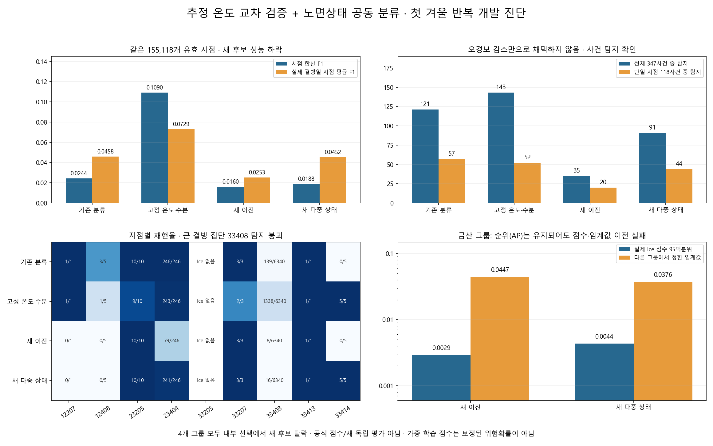

# 온도 교차 추정·노면상태 분류와 점수 이전 진단 — 2026-10-09

**새 이진·다중 상태 후보는 모두 미채택입니다.** 첫 겨울 같은 155,118개 유효 시점에서 F1은 각각 0.016046·0.018799로 기존 고정 온도·수분 가안의 0.109033보다 낮았습니다. 네 외부 그룹 모두 다른 그룹의 내부 결과만으로 채택 조건에서 탈락했습니다. 최종 모델·공식 점수·새 독립 성능의 개선으로 표현하지 않습니다.

금산 그룹에서는 순위 지표(AP)가 개선됐는데도 결빙 탐지가 붕괴했습니다. **지점마다 양성 비율과 점수 척도가 달라 임계값 이전이 실패하는 문제를** 다음 검증의 우선순위로 잡습니다. 이는 개발 결과에 근거한 가설이며, 원인을 단순한 양성 비율 변화로 확정한 것은 아닙니다.

[문서 목록](README.md) · [현재 상태](PROJECT_STATUS.md) · [이전 온도·수분 가안](THERMAL_ICE_AND_RESERVED_REVIEW_20261009.md) · [참고문헌](REFERENCES.md)

> 이 문서는 같은 날 수행한 이전 개발 단계의 기록입니다. 본문의 후속 계획·미실행 표기는 당시 상태이며, 이후 보정 실험·새 지점 평가·구간 분석의 완료 여부는 [최신 연구 인계](RESEARCH_DELIVERY_REVIEW_20261009.md)에서 확인합니다.

## 문헌에서 가설·실험으로 연결한 내용

| 근거 | 이번 반영 | 적용 한계 |
| --- | --- | --- |
| Karsisto, [RoadSurf 1.1, GMD, 2024](https://gmd.copernicus.org/articles/17/4837/2024/) | 에너지수지와 물·눈·얼음 저장량을 구분하는 관점을 참고해 추정 온도·이슬점 차이·과거 강수·적설을 함께 사용 | RoadSurf를 구현하거나 물리계수를 추정한 실험이 아님. 지역 열특성·복사·제설 입력이 불완전함 |
| [Vaisala RWS200 공식 센서 설명](https://docs.vaisala.com/r/M211607EN-AA/en-US/GUID-8FB4E70E-7340-403E-BD77-6ED1D7F3AA0A) | 수분·제빙제·눈·얼음 상태와 온도 관측을 구분하고, 관측 방식·면적·설치 영향이 대표성 문제를 만들 수 있음을 검토 | 이 대회 장비가 문서의 DSC211·DRS511이라는 증거는 없음. 센서 고장이나 잘못된 정답을 단정하지 않음 |
| [scikit-learn 1.6 StackingClassifier](https://scikit-learn.org/1.6/modules/generated/sklearn.ensemble.StackingClassifier.html) | 학습 행 자신의 그룹을 제외해 추정한 온도를 분류기에 입력. 외부·내부 평가 그룹도 온도 회귀에서 제외 | 기본 무작위 분할 대신 공간 단위를 직접 적용. 실제 상태를 입력하거나 같은 행으로 적합한 보조 예측을 사용하지 않음 |
| [scikit-learn 1.6 HGBClassifier](https://scikit-learn.org/1.6/modules/generated/sklearn.ensemble.HistGradientBoostingClassifier.html) | 같은 입력·가중치·매개변수로 이진 log loss와 다중 multinomial log loss 비교 | 다중 분류는 클래스마다 트리를 학습하므로 계산량까지 같지는 않음. 직접 상태 분류이며 별도 상태 예측을 쌓는 구조는 아님 |
| Lipton·Wang·Smola, [ICML 2018 분포 이동 보정](https://proceedings.mlr.press/v80/lipton18a.html) | 순위 품질·점수 척도·양성 비율을 분리해 후속 보정 가설 수립 | `p(x\|y)` 유지와 혼동행렬의 가역성 등 조건이 필요. 현재 자료에서 성립한다고 확인하지 않았으며 BBSE를 적용한 결과가 아님 |
| [scikit-learn 확률 보정 안내](https://sklearn.org/1.6/modules/generated/sklearn.calibration.CalibratedClassifierCV.html) | 보정기 학습도 모델·평가 정답과 분리해야 한다는 후속 실행 조건 명시 | 보정 실험은 아직 실행하지 않음. 희소 양성 자료에서 유연한 보정이 과적합할 수 있음 |

단순 저온 판정의 오경보를 상태 구분이 줄일 수 있다는 분석 가설을 검증했습니다. 문헌의 성능 수치나 영상 기반 상태 인식 결과를 이 기상 입력 모델의 성능으로 가져오지 않았습니다. 확인일은 2026-10-09이며 출처 URL·수집 시각·SHA256는 비공개 검토 폴더에 보존합니다.

## 사전에 고정한 설계

- 자료: 대회 개발 14개 지점·추가 9개 지점, **2024년 11월–2025년 2월만** 사용. 397,173행 중 상태 정답 유효행은 396,932행입니다.
- 정답: `04`만 Ice. `12`·`13`·`15`도 이진 평가에서는 음성입니다. 미정의·결측 241행은 학습 라벨에서 제외하고 원문을 보존합니다.
- 상태 후보: 건조, 습윤·축축, 눈, 제빙제 습윤, 임계 습윤, 눈·얼음 혼합, Ice, 기타의 8개 사전 범주. 이번 자료에는 기타 `10`이 없어 전체 관측 범주는 7개입니다. 개별 학습에 없는 비 Ice 클래스의 확률 열을 임의로 생성하지 않습니다.
- 입력 20개: 기존 기상·시간·거리·시차 14개, 과거 3시간 강수 최대, ASOS 적설, 추정 노면온도, 추정 온도와 이슬점·기온의 차이, 수분 근거입니다. 목표 실측 온도·실측 상태·지점 ID·장비 종류·주변 노면온도·주변 상태는 입력에 없습니다.
- 온도 보조 입력: 대회 지점별 14개 단위와 외부 공간 그룹 4개 단위를 이름순으로 정렬해 3개 블록에 배정했습니다. 결과값으로 배정을 바꾸지 않았습니다. 분류기 학습 행은 자신의 전체 블록을 제외한 회귀 예측을 받습니다.
- 외부 평가 그룹 G, 내부 평가 그룹 H를 분류기와 모든 온도 회귀에서 제외합니다. 쿼리 온도는 G 또는 G+H를 제외한 전체 학습 회귀를 사용합니다. 이전 감사의 같은 학습 행·제외 지점·입력·매개변수·파일 해시를 대조한 HGB 10개를 재사용했습니다.
- HGB는 학습률 0.05, 100회, 최대 잎 15개, 최소 잎 표본 100개, L2 10, 조기 종료 없음, seed 20260923입니다. 두 분류기 모두 Ice 가중치 20, 나머지 1이며 지점·사건 재가중치는 없습니다.
- 임계값은 고정한 403개를 내부 다른 세 그룹에서만 탐색했습니다. 내부 고정 온도·수분 가안의 FP 이하에서 실제 결빙일 지점 평균 F1을 우선하고, 시점 F1·높은 임계값 순으로 동률을 처리했습니다.
- 채택은 시점 F1·실제 결빙일 F1·고정 지점 F1의 비악화, 앞의 두 지표 중 엄격한 개선, FP 비증가, 단일 시점 사건 탐지 비감소, Ice 5행 이상 지점의 TP 비감소를 모두 요구했습니다. 미충족 시 기존 온도·수분 가안을 유지합니다.
- 추정 온도가 없는 외부 21행은 기존 대회 14개 지점 전용 분류 점수·판정으로 복귀합니다. 정답이 유효하면 모든 비교 분모에 남깁니다.

기존 기상 회귀 입력의 동일성, 18개 신규 회귀·20개 신규 분류 학습, 고유 28개 회귀 및 20개 분류 모델을 기록했습니다. 3개 보조 블록 중 동일 학습 제외 조합은 재사용했으므로 신규 회귀를 30번 중복 학습하지 않았습니다. 후보·임계값·내부 판단·예측을 저장하고 예측 해시를 고정한 뒤 외부 성능을 집계했습니다. 외부 결과를 보고 매개변수나 채택 조건을 바꾸지 않았습니다.

## 같은 분모의 실제 결과

외부 9개 지점의 유효 정답은 155,118행, Ice 6,611행입니다. 완전일 1,060일 중 실제 결빙일은 124일·8개 지점이며, 연속 10분 Ice 사건은 347개, 단일 시점 사건은 118개입니다. 아래 일별 보조지표는 실제 결빙일을 고정한 지점 평균이며 **미확정인 공식 일별 점수와 다릅니다.**

| 정책 | 시점 F1 | TP | FP | FN | 실제 결빙일 F1 | 사건 탐지 / 347 | 단일 탐지 / 118 |
| --- | --- | --- | --- | --- | --- | --- | --- |
| 기존 분류 | 0.024370 | 403 | 26,059 | 6,208 | 0.045809 | 121 | 57 |
| 기존 고정 온도·수분 | 0.109033 | 1,600 | 21,138 | 5,011 | 0.072892 | 143 | 52 |
| 새 이진 온도·기상 | 0.016046 | 101 | 5,877 | 6,510 | 0.025349 | 35 | 20 |
| 새 다중 상태 | 0.018799 | 276 | 22,476 | 6,335 | 0.045233 | 91 | 44 |
| 사전 내부 선택 정책 | 0.109033 | 1,600 | 21,138 | 5,011 | 0.072892 | 143 | 52 |

| 외부 그룹 | 이진 임계값 | 다중 임계값 | 내부 판단의 핵심 |
| --- | --- | --- | --- |
| 백양 | 0.047863 | 0.005070 | 모두 F1·지점 재현율 조건 실패. 이진은 단일 사건도 감소 |
| 서천 | 0.074989 | 0.089125 | 모두 F1·단일 사건·지점 재현율 조건 실패 |
| 금산 | 0.044668 | 0.037584 | 이진의 F1 조건은 통과했으나 단일 사건·지점 재현율 감소. 다중은 F1도 실패 |
| 서상 | 0.019498 | 0.017579 | 모두 F1·단일 사건·지점 재현율 조건 실패 |

모든 후보는 내부 FP 예산을 충족했습니다. 그러나 다중 상태 후보의 외부 FP는 22,476으로 기존 온도·수분의 21,138보다 많았습니다. **내부 오경보 제한이 새 지점에서도 유지된다고 보장하지 않습니다.**



## 놓쳤던 관점: 순위와 임계값 이전은 별개

첫 겨울 전체 23개 지점 Ice 6,784행 중 6,340행, **93.46%가 금산 그룹에** 있습니다. 금산을 평가로 제외하면 학습 양성은 444행으로 줄어듭니다. 외부 Ice 6,611행만 기준으로 하면 금산 비중은 95.90%입니다. 내부 또 다른 그룹까지 제외할 때 분포 차이는 더 커집니다. 희소 사례의 개수뿐 아니라 어떤 지점·기상·관측 조건의 사례인지가 핵심입니다.

| 외부 그룹 | Ice 비율 | 기존 분류 AP | 새 이진 AP | 새 다중 AP |
| --- | --- | --- | --- | --- |
| 백양 | 0.7471% | 0.084959 | 0.022616 | 0.016727 |
| 서천 | 0.0174% | 0.000708 | 0.003061 | 0.002015 |
| 금산 | 18.3779% | 0.206288 | 0.233451 | 0.213673 |
| 서상 | 0.0174% | 0.001695 | 0.003934 | 0.005956 |

두 새 후보는 세 그룹의 AP가 기존 분류보다 높았지만 백양에서는 하락했습니다. 특히 금산 이진 후보의 실제 Ice 점수 95백분위는 0.002928인데 내부 선택 임계값은 0.044668입니다. 다중 후보도 0.004356 대비 0.037584입니다. 33408의 TP는 온도·수분 가안 1,338에서 각각 8·16으로 줄었습니다. **순위를 일부 개선해도 다른 그룹에서 정한 점수 기준을 넘지 못하면 거의 경보하지 못합니다.**

그룹마다 서로 다른 모델·학습 양성 비율을 사용한 점수를 합친 AP는 이진 0.025375·다중 0.027598입니다. 유효 정답의 일정 점수 AP 기준인 전체 Ice 비율 0.042619보다 낮습니다. 이 합산 AP만으로 모든 그룹 안의 순위가 악화했다고 해석하면 위 차이를 놓칩니다. 가중 학습의 `predict_proba`도 보정된 운영 결빙 확률로 표현하지 않습니다.

다중 후보는 제빙제 `12`·임계 습윤 `13` 오경보를 각각 0으로 줄였지만, 건조 FP는 7,179→7,916, 축축 FP는 3,425→5,705로 늘었습니다. 일부 상태 구분의 개선이 전체 결빙 탐지 개선으로 이어지지 않았습니다. 제설 이력·수막·동결점 등의 미측정 입력과 관측 조건 차이가 남아 있으며 원인 확정에는 추가 증거가 필요합니다.

## 후속 실행안과 중단 조건

1. **점수 보정 검증을 우선합니다.** 고정 이진 모델의 점수에서 양성 가중치와 학습 양성 비율에 따른 척도 차이를 분리하고, 원점수 대비 보정 후보를 사전 명세합니다. 보정 학습에도 그룹 제외 예측만 사용합니다. 임계값·장비별 규칙을 이번 외부 정답으로 다시 정하지 않습니다.
2. **보정기를 추가할 때 세 번째 제외 그룹 K가 필요합니다.** 내부 H를 평가할 보정기의 학습 예측은 G+H+K 제외 분류기로 K에 생성해야 합니다. 기존 G+K 예측은 H 정답을 분류기 학습에 사용했으므로 내부 H 보정 검증에 그대로 쓸 수 없습니다. 네 개의 G+H+K 조합과 각 조합의 온도 보조 블록을 추가 생성한 뒤, 내부 H와 보정 학습 자료를 분리합니다. 최종 외부 G의 보정 학습은 G를 전혀 사용하지 않은 내부 예측으로 구성합니다.
3. **분포 이동 보정은 조건을 확인한 개발 후보로 제한합니다.** 예측만으로 양성 비율을 추정하는 접근은 클래스 조건부 입력 분포의 안정성과 혼동행렬 수치 안정성이 필요합니다. 조건이 맞지 않거나 단일 사건·지점 재현율을 해치면 탈락시킵니다. 현재 외부 정답의 실제 Ice 비율을 보정 상수로 넣는 방식은 금지합니다.
4. **입력 관측의 대표성을 확인합니다.** 운영기관에서 얻을 수 있다면 기간별 장비 종류·교체/처리 이력, 제설 시각·약품 사용 이력, 수막·동결점 측정의 정의와 가용성을 확인합니다. 제공 자료의 현재 장비 메타데이터만으로 과거 상태를 확정하거나 라벨을 삭제하지 않습니다.

위 보정 실험은 준비한 실행안이며 아직 실행하지 않았습니다. 이번 배치는 새 모델 탐색을 여기서 갈무리합니다. 보정이 개발에서 통과하더라도 **아직 개봉하지 않은 다른 지점·기간을 사전 고정해 별도 검증**해야 합니다. 보호 3개 지점과 완료된 다음 겨울 정답은 새 보정·선택·재평가에 재사용하지 않습니다. 최종 위험 지도와 공식 일별 출력 규격도 별도 미완료 항목입니다.

## 검증·재현·Git 포함 범위

별도 감사는 **48개 학습 기록, 온도 보조 예측 3,348,848행, 분류 쿼리 점수 1,242,056행, 임계값 3,224개, 외부 155,257행·5정책**을 검산했습니다. 새 회귀·이진·다중 모델 각 1개를 실제 재적합해 예측의 완전 일치를 확인했습니다. 21개 온도 결측 복귀행과 원래 155,118개 유효 상태 분모를 보존했고 외부 고정 파일 549개·원 보호 고정 파일 47개의 해시가 그대로입니다.

새 합성 6개 검사는 자기 단위·외부/내부 그룹 제외, 상태 코드와 결측, 실제 목표값의 입력 차단, 확률 열 순서, 고정 분모 및 단일 사건·지점 미탐 채택 차단을 다룹니다. 데이터·모델·키가 없는 별도 Git 복제본에서 **전체 합성 검사 129개, 추적 파일 254개, Markdown 34개 검사를 통과했습니다.** 실제 GFM 표·강조·코드 표시와 집계 그림도 확인했습니다.

```powershell
# 기존 첫 겨울 비공개 입력과 감사된 회귀 모델이 필요합니다.
$env:OMP_NUM_THREADS = '2'
$env:OPENBLAS_NUM_THREADS = '2'
python scripts/evaluate_joint_surface.py --output outputs/private/joint_surface_reproduction_v2
python scripts/audit_joint_surface.py --experiment outputs/private/joint_surface_reproduction_v2
python scripts/diagnose_joint_surface.py --experiment outputs/private/joint_surface_reproduction_v2
python scripts/plot_joint_surface.py --experiment outputs/private/joint_surface_reproduction_v2 --output outputs/private/joint_surface_reproduction_v2/review.png
```

세 번째 명령은 점수 선택을 바꾸지 않는 사후 순위·척도 진단 `ranking_diagnostics.json`을 생성합니다. 마지막 명령은 그 집계로 그림을 만듭니다. 모델 비교·누수/지표 감사 CLI는 이 추가 파일 없이 실행됩니다.

Git에는 코드·합성 검사·집계 그림·이 보고서와 최신 요약만 반영합니다. 원본, API 키, 신청서·서약 파일, 모델, 행 단위 입력·온도·상태 예측, 임계값 표, 개인 제출 묶음은 비공개 로컬 `outputs/private/`에 보존합니다. 최신 공식 여섯 Q&A·문제/데이터 본문·제출 공지·서약은 직전본과 일치했고 **633번 답변은 0건**입니다. 비공개 GitHub 반영과 공식 대회 제출은 구분합니다.
