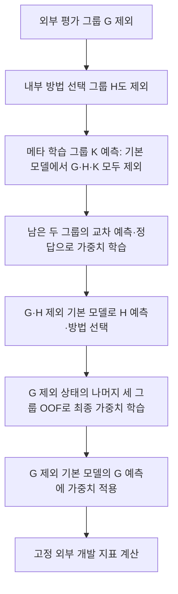
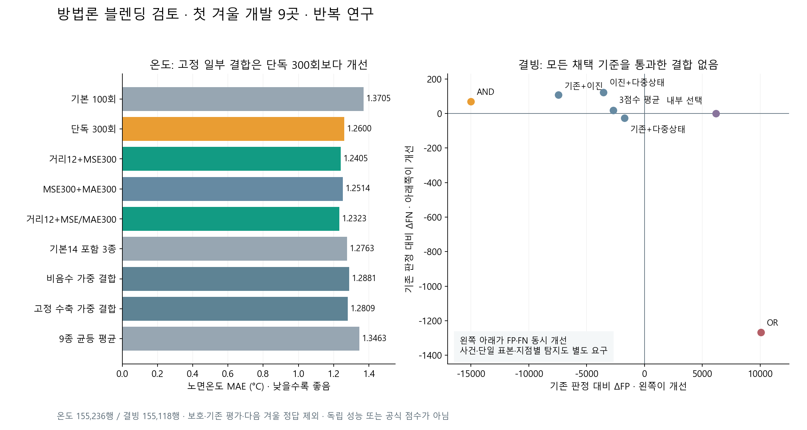

# 방법론 블렌딩의 검증과 후속 판단

**온도·결빙 점수·물리 판정은 각각 결합할 수 있습니다. 후속으로 고정한 기상12·MSE300·MAE300 평균은 개발 MAE1.232271°C로 단독300회1.260003°C를 약2.20% 개선했습니다.** 다만 그룹별 선택 정책은 전이 기준에 실패했고 결빙 판정의 사건·지점 손실도 남았습니다. 같은 첫 겨울 개발 자료를 반복 사용한 연구이며 독립·공식 성능이 아닙니다. 최종 모델을 승격하지 않았습니다.

[현재 상태](PROJECT_STATUS.md) · [앞선 평균·새 두 지점 실패](TEMPERATURE_MEAN_AND_BLIND_REVIEW_20261010.md) · [실행 안내](RUNBOOK.md) · [문헌](REFERENCES.md)

## 결합 가능한 방법과 조건

| 방법론 | 이번 결합 | 조건·판단 |
| --- | --- | --- |
| 기상14 HGB100·거리 제거12 | 온도 회귀의 성분 | 같은 첫 겨울·23개 개발 지점·유효행·공간 제외 |
| 기온 잔차14·열환경 직접24·열환경 잔차24 | 온도 회귀의 성분 | 잔차에 ASOS 기온을 더한 뒤 °C 단위로 결합 |
| MAE100·MSE300·MAE300 | 온도 회귀의 성분 | 같은 기상14·학습행. 반복 수·손실만 기존 고정 조건 적용 |
| Ridge100 | 온도 회귀의 성분 | 같은23곳·기상14. 중앙값 대체·결측 지시자·표준화는 학습 지점만 적합 |
| 기존 분류·온도 보조 이진·다중 노면상태 | 4개 고정 점수 평균 | 다중상태는 공식 Ice 클래스만 추출. 동일 공간 제외와 fallback 유지 |
| 0°C·수분 판정 | 회귀 결합 결과를 입력, 기존 분류와 AND/OR도 비교 | 온도와 점수의 단위는 다르므로 단계별 결합. 규칙·수분 임계값 변경 없음 |
| 점수 보정·사전확률 보정 | 이번 새 평균에 이식하지 않음 | 기존 보정은 기존 점수·해당 제외 그룹에 적합됨. 새 평균을 보정하려면 세 단계 공간 제외에서 별도 적합·평가 필요 |
| 주변 도로 온도·상태 참조 | 이번 기상 전용 온도 성분에서 제외 | 별도 관측망이 필요한 조건부 방법. 과거 시각·참조 가능성·최대 지연을 보장한 별도 공통 분할에서 재검증 필요 |
| 과거 CatBoost·시간 전진·물리 모형 실험 | 기존 예측을 그대로 가져오지 않음 | 14곳/23곳, 기간·입력·분할이 다름. 공통 첫 겨울 공간 분할로 재학습하기 전에는 직접 비교·결합 불가 |
| 도로 구간·시설·지형 노출 | 예측 모델의 입력·적용 범위 확인 자료 | 843개 정적 구간의 노출을 Ice 확률·위험 등급과 평균하지 않음 |

9종을 모두 평균하는 것과 서로 보완되는 일부 모델을 평균하는 것을 구분했습니다. 모델 수 자체가 독립적인 정보의 수를 뜻하지 않습니다.

## 문헌에서 반영한 검증 기준

| 일차 문헌·공식 문서 | 실제 반영 | 해석 제한 |
| --- | --- | --- |
| [Breiman1996, Stacked Regressions](https://statistics.berkeley.edu/sites/default/files/tech-reports/367.pdf) | 교차 검증 예측으로 비음수 최소제곱 가중치 학습, 단독 모델 대조 | 합1도 추가로 고정. 논문의 다른 자료 개선 수치를 전용하지 않음 |
| [van der Laan·Polley·Hubbard2007, Super Learner](https://biostats.bepress.com/ucbbiostat/paper222/)·[Polley·van der Laan2010](https://biostats.bepress.com/ucbbiostat/paper266/) | 기본 모델·가중치·방법 선택의 분리 | 점근적 이론이 현재9곳·공간 의존·전북 전이의 보증은 아님 |
| [Wang등2023, Forecast combinations](https://arxiv.org/abs/2205.04216) | 균등 평균을 대조군으로 두고 오차 상관·가중치 추정 불안정성 기록 | 상관은 진단 결과. 외부 정답으로 가중치를 바꾸지 않음 |
| [Roberts등2017, 구조적 교차 검증](https://www.biom.uni-freiburg.de/mitarbeiter/dormann/roberts-et-al-2017-ecography.pdf/at_download/file) | 외부·내부·메타 학습에서 노선 그룹 전체 제외 | 공간 블록만으로 계절·시설·기상 적용 영역이 보증되지 않음 |
| [Cawley·Talbot2010](https://jmlr.org/papers/v11/cawley10a.html) | 반복 개발과 새 독립 평가를 구별 | 중첩 분할을 적용해도 이전 연구에 따른 방법 제안의 선택 편향은 남음 |
| [scikit-learn1.6 StackingRegressor](https://scikit-learn.org/1.6/modules/generated/sklearn.ensemble.StackingRegressor.html) | 무작위 KFold·동일 학습행의 prefit 예측을 메타 학습에 사용하지 않음 | 기본 API 호출만으로 공간 누출이 해결되지 않음 |
| [scikit-learn1.6 VotingClassifier](https://scikit-learn.org/1.6/modules/generated/sklearn.ensemble.VotingClassifier.html) | 평균 점수를 보정된 확률로 표현하지 않음 | soft voting의 확률 보정 조건을 따로 확인해야 함 |

본문·PDF·조회시각·해시를 `outputs/private/method_blending_references_20261010_v1/`에 보존했습니다. 로컬 HTTP15건 중13건은200이고 Wiley403·WSL404를 보존한 뒤 저자 대학의17쪽 원문을 확보했습니다. Breiman 파일3쪽과 Roberts 파일1쪽을 렌더해 확인했습니다. 200응답 수나 참고문헌 개수를 품질·수상 가능성의 점수로 사용하지 않습니다.

공식 문제·제출 공지·참가 서약·Q&A633·게시판을 다시 조회했습니다. 숨김 입력 `nttCn`에 있는 제출·질의 본문도 추출했습니다. 서약 HWP는 앞서 검토한 원문과 SHA-256이 같고, Q&A633은 게시판 답변란 `-`로 미답변입니다. 제출 의무와 대회 중 공개 허용을 구별합니다. [공식 제출 공지](https://aida.kisti.re.kr/competition/main/selectNotice.do?bbsId=BBSMSTR_AAAAAAAAAAAA&nttId=564) · [참가 서약](https://aida.kisti.re.kr/competition/cmm/fms/FileDown.do?atchFileId=FILE_000000000003138&fileSn=0) · [Q&A633](https://aida.kisti.re.kr/competition/problem/PROB_000000000004604/detail/commuDetail.do?bbsId=BBSMSTR_000000000319&nttId=633)

## 세 단계 공간 검증

온도 학습은 첫 겨울 23곳으로 제한했습니다. 외부 개발 평가9곳은 서천·백양·금산·서상4그룹이고 대회14곳은 각 학습에서 허용된 기존 학습 지점입니다. 보호3곳·기존 새8/새4/새2 평가 지점·다음 겨울 정답을 새 학습·가중치·선택·점수 계산에 사용하지 않았습니다. 새 정답 API 요청은 없습니다.

내부 가중치 학습 때 G+K만 제외하면 H의 정답이 K 예측을 만드는 기본 모델에 들어갑니다. 이를 차단하려고 3그룹 제외4조건×9모델을 새로 적합했습니다. 기존1/2그룹 제외 모델90개를 동일성 확인 후 재사용했습니다.

가중치 목적함수는 **지점별 동일 비중 MSE**이며 비음수·합1·절편 없음입니다. 균등 가중치 방향의 제곱 수축은 λ=0.1 하나만 고정했고 계수를 탐색하지 않았습니다. 균등9종, 기상14/12/MSE300 균등3종, 비음수 가중 결합, 고정 수축 가중 결합4가지를 새 결과 계산 전에 설정 파일에 기록했습니다.

온도 후보는 내부 지점 평균 MAE·RMSE 동시 개선, 모든 지점 MAE 악화5% 이하, 관측 −2~2°C 표본이 존재하며 MAE 비악화를 요구했습니다. 적격 최소 지점 평균 MAE로 선택합니다. 외부 결과를 보고 성분·가중치·수축계수를 바꾸지 않았습니다.

## 첫 비교: 9종·학습형 온도 결합

온도 유효행은 모든 방법에 동일한155,236행이며 −2~2°C는42,268행입니다. 합산 MAE/RMSE와 지점 평균은 서로 다른 지표입니다.

| 방법 | 합산 MAE°C | 합산 RMSE°C | 지점 평균 MAE°C | 저온 MAE°C | 기본14 기준 | 기존300 추가 개선 |
| --- | --- | --- | --- | --- | --- | --- |
| 기본14·100회 | 1.370541 | 1.794299 | 1.370252 | 1.227619 | 기준 | — |
| 기존14·300회 단독 | 1.260003 | 1.674237 | 1.259744 | 1.137201 | 기존 개발 개선 | 기준 |
| 9종 균등 평균 | 1.346348 | 1.764778 | 1.345879 | 1.228123 | 실패 | 실패 |
| 3종 균등 평균 | 1.276251 | 1.689776 | 1.276031 | 1.149997 | 통과 | 실패 |
| 비음수 가중 결합 | 1.288120 | 1.696123 | 1.287852 | 1.170198 | 통과 | 실패 |
| 고정 수축 가중 결합 | 1.280949 | 1.690501 | 1.280686 | 1.164333 | 통과 | 실패 |

네 내부 선택 모두 **3종 균등 평균**을 선택했습니다. 기본14 대비 합산 MAE는 약6.88% 감소했고9곳 모두 개선됐습니다. 그러나 기존300회 단독보다 MAE가 약1.29% 높습니다. 더 복잡한 학습형 블렌딩도 단독300을 넘지 못했습니다. 이는 이번 네 후보의 결과이며 모든 가능한 앙상블의 불가능성을 입증하지 않습니다.

9종 평균은33205의 MAE가7.62% 악화했고 저온 오차도 증가했습니다. 낮은 상관만 보고 약한 모델을 넣는 방식은 이번 자료에서 도움이 되지 않았습니다. 외부 개발 오차에서 MSE300과 기상100/거리 제거12의 상관은 각각0.9699/0.9412, Ridge는0.7518이지만 Ridge 단독 MAE는1.803088°C였습니다. 이 상관은 같은 개발 정답을 사용한 사후 설명용입니다.

학습형 가중치는 그룹에 따라 달랐습니다. 예를 들어 비음수 가중 결합의 거리 제거12 비중은 서천45.3%, 백양72.4%, 금산78.1%, 서상0%입니다. 그룹별 가중치를 외부 정답으로 최적화한 것이 아니라 각 외부 그룹을 제외한 OOF에서 학습했습니다. 독립 그룹4개인 조건에서 추정된 비중을 물리적 중요도·전국 적용 비중으로 해석하지 않습니다.

## 첫 온도 결합을 같은 물리 규칙에 넣은 결과

유효 상태155,118행·Ice6,611행, 완전일1,060개·실제 결빙일124개·사건347개·단일 표본 사건118개를 고정했습니다. 단순 저온·수분 규칙은 공식 Ice의 완전한 물리 정의가 아닙니다.

| 온도 입력 | TP | FP | FN | micro F1 | 잠정 일별 F1 | 탐지 사건 | 탐지 단일 표본 |
| --- | --- | --- | --- | --- | --- | --- | --- |
| 기본14 | 1,600 | 21,138 | 5,011 | 0.109033 | 0.030168 | 143 | 52 |
| 단독300 | 1,609 | 21,171 | 5,002 | 0.109489 | 0.030049 | 147 | 56 |
| 선택된3종 평균 | 1,628 | 20,812 | 4,983 | 0.112079 | 0.030265 | 147 | 54 |
| 비음수 가중 결합 | 1,658 | 21,128 | 4,953 | 0.112801 | 0.030509 | 149 | 56 |
| 고정 수축 가중 결합 | 1,655 | 21,128 | 4,956 | 0.112608 | 0.030501 | 149 | 56 |

3종 평균의 추가TP28행 중27행은33408, 1행은12408입니다. 전체FP는326행 줄었지만12408·23404·33205·33408에서는 각각29·5·39·49행 늘었습니다. 내부 온도 기준으로 선택한 결과와 외부 결빙 지표가 가장 높았던 가중 결합을 구분하며 후자를 사후 채택하지 않습니다. 기상만으로 실제 공식 상태 코드04를 충분히 구별했다는 결론도 내리지 않습니다.

## 분류 점수·AND/OR 결합 결과

기존 점수+이진, 기존+다중상태, 이진+다중상태의1:1 평균과3점수 균등 평균을 고정했습니다. 각 외부 그룹의 다른3그룹에서만403개 임계값을 평가했습니다. 내부 FP/FN 예산 충족 후보 중 실제 결빙일 F1·micro F1·임계값 순으로 하나 선택하고 전체 안전 기준에 실패하면 채택하지 않습니다. 다른 임계값으로 재탐색하지 않았습니다.

전체 FP/FN 비증가, 모든 양성 지점의TP 비감소, 사건·단일 표본 탐지 비감소, micro·지점 평균·잠정 완전일·실제 결빙일 F1 비악화와 최소 한 개선을 함께 요구했습니다. 양성5개 미만 지점도 보호합니다. 미정의 일별 값은 기존 잠정 처리와 같으며 Q&A633 답변 전까지 공식 점수로 표현하지 않습니다.

| 방법 | TP | FP | FN | micro F1 | 탐지 사건/347 | 단일 표본/118 | 외부 개발 탈락 이유 |
| --- | --- | --- | --- | --- | --- | --- | --- |
| 기존 판정 | 403 | 26,059 | 6,208 | 0.024370 | 121 | 57 | 기준 |
| 기존+이진 | 296 | 18,627 | 6,315 | 0.023185 | 105 | 52 | FN·사건 손실 증가 |
| 기존+다중상태 | 430 | 24,327 | 6,181 | 0.027416 | 114 | 55 | 지점별TP·사건·잠정 일별 기준 실패 |
| 이진+다중상태 | 280 | 22,508 | 6,331 | 0.019048 | 92 | 45 | FN·사건 손실 증가 |
| 3점수 평균 | 385 | 23,371 | 6,226 | 0.025356 | 113 | 55 | FN·사건 손실 증가 |
| 기존 AND 물리14 | 333 | 11,068 | 6,278 | 0.036975 | 92 | 42 | FP 감소와 함께 FN·짧은 사건 손실 증가 |
| 기존 OR 물리14 | 1,670 | 36,129 | 4,941 | 0.075208 | 170 | 67 | FN 감소와 함께 FP 증가 |
| 내부 선택 정책 | 403 | 32,246 | 6,208 | 0.020530 | 121 | 57 | FP 증가·F1 악화 |

내부 선택은 백양만 기존+다중상태, 나머지3그룹은 기존 판정이었습니다. 내부 적격이 외부 개선을 보증하지 않는 사례입니다. AND는 FP를 줄이는 대신 FN을 늘릴 수 있고 OR는 그 반대이며 실데이터에서도 단조성을 확인했습니다. F1 하나만 보면 AND/OR를 쉽게 채택할 수 있지만 오경보·놓친 사건을 함께 보니 채택할 근거가 부족합니다.

## 후속: 기본100회 포함을 강제하지 않는 고정 결합

첫 비교 이후 단독300회가 더 우수한 점을 보고 거리 제거12+MSE300, MSE300+MAE300, 거리 제거12+MSE300+MAE300의세 평균을 추가로 고정했습니다. `temperature_pair_blending_experiment.json`에 같은 비중·가중치 학습0·신규 기본 적합0·같은 분모·기존300회 주 대조군·동일 지점 손실 기준을 계산 전에 기록했습니다. 이 제안 자체는 앞선 개발 결과를 본 후의 연구 선택이므로 독립 사전 평가로 표현하지 않습니다.

| 후속 고정 후보 | 합산 MAE°C | 합산 RMSE°C | 지점 평균 MAE°C | 저온 MAE°C | 단독300 대비 최악 지점 MAE | 전체 개발 기준 |
| --- | --- | --- | --- | --- | --- | --- |
| 거리12+MSE300 | 1.240512 | 1.650208 | 1.240317 | 1.122201 | 33205 +3.65% | 통과 |
| MSE300+MAE300 | 1.251425 | 1.655245 | 1.251149 | 1.134256 | 33207 +5.92% | 실패 |
| 거리12+MSE300+MAE300 | 1.232271 | 1.636496 | 1.232051 | 1.117190 | 33207 +0.40% | 통과 |
| 내부 선택 정책 | 1.268220 | 1.673340 | 1.267976 | 1.146679 | 33207 +5.92% | 실패 |

내부 선택은 서천의3종 평균, 백양/금산의거리12+MSE300, 서상의MSE300+MAE300으로 달랐습니다. 고정 일부 후보의 전체 평균 개선과 실제 중첩 선택 정책의 실패를 구분합니다. 외부 결과에서 가장 낮은 평균을 보였다는 이유로 해당 고정 후보를 최종 선택했다고 기록하지 않습니다.

고정3종의 같은 물리 판정은 단독300 대비TP1,609→1,629, FP21,171→20,889, FN5,002→4,982였지만 탐지 사건147→145개로 줄었습니다. 추가TP21행이33408에 집중되고12408에서는TP1행을 잃었습니다. 고정2종은TP1,643/FP20,656/FN4,968·사건148개였지만 단일 표본 탐지가56→55개로 줄었습니다. 따라서 온도 개선 후보2개가 생겼어도 결빙 결과물을 승격할 근거는 부족합니다. 후속 산출물은 `outputs/private/temperature_pair_blending_20261010_v1/`이며 별도 산술·내부 선택·지표 검산을 수행했습니다.

## 보존·검산과 후속 순서

완료본은 `outputs/private/method_blending_20261010_v2/`·`score_blending_20261010_v2/`·`temperature_pair_blending_20261010_v1/`입니다. 실패한v1도 보존했습니다. 온도v1은 계산 중 공유 모듈의 분류 검사 추가로 소스 변경 검사가 중단돼36개 적합을 포함한 전체 계산을v2에서 다시 실행했습니다. 온도 고유 신규 조건36건과 별도로 중단본36건의 중복 적합이 있었음을 기록합니다. 분류v1은 fallback 점수의 유한 값 계약 오류로 결과 계산 전에 중단됐고, 원래 fallback 점수와 판정의 복귀 동작을 유지해v2를 실행했습니다.

별도 계산은 저장 기본 모델 재예측, 대표 모델 재적합, 지점별 동일 비중 목적함수의511개 활성 집합 최적값 대조, 세 단계 제외·내부 선택·물리 판정·일별/사건 지표와 모든 임계값을 검산합니다. Ridge를 다른 행 배치로 재예측하면1.8×10⁻¹⁵°C 차이가 생긴 검산 중단 기록을 보존했고, 수치 비교는 절대1×10⁻¹⁰°C 허용·상대 허용0으로 명시했습니다. 정답·선택 기준·예측 값을 바꾼 조정이 아닙니다. 이전47/549개 고정 파일과 새8/4/2 평가의 봉인을 보존하며 기존 평가 지점을 새 블렌딩으로 다시 채점하지 않았습니다. 최종 검산 수치와 전체 테스트 결과는 [현재 상태](PROJECT_STATUS.md)에 기록합니다.

후속 작업은 다음 조건부터 충족해야 합니다.

1. **기상 관측의 실제 확장**: 이미 고정한 AWS614·647·730·914의 첫 겨울 원문 확보와 품질 검토. 마지막 실제 API 확인의403이 미해결이며 이번에는 인증 호출·계정 로그인·승인 신청을 추가로 하지 않았습니다. 지점 메타데이터를 관측값으로 대체하지 않습니다.
2. **평가 위치·시설 근거**: 33407의709.6m 위치 차이와 실제 센서 대장, 전북 내 미개봉 지점의 참조 가능성 확인. 기존 거리·분리 조건을 모두 만족하는 전북 미개봉 지점은 앞선 검토에서0곳이었습니다. 이번 개봉 지점 재사용으로 독립 평가를 만들지 않습니다.
3. **확장 입력을 고정한 일회 평가**: 단독300·균등3종·학습형 결합의 학습 영역·보정·임계값을 정답 요청 전에 봉인하고 사전 기준으로 평가. 이번 반복 개발 결과만으로 최종 후보를 확정하지 않습니다.
4. **도로 결과물의 근거 보완**: 공식 방향·이정과 교량/터널의843구간 대응, 적용 범위·관측 공백·사례 검증을 확인한 뒤 위험 등급을 정합니다. 현재 미완료인 현장·시설 검증을 문헌 사례로 대신하지 않습니다.
5. **제출 재현**: 공식 규정에 맞춘 환경·노트북·실패 대안·참가자 검토·데모영상 준비. 수상 또는 제출 완료로 표현하기에는 독립 전이와 최종 구간 위험도의 근거가 부족합니다.
