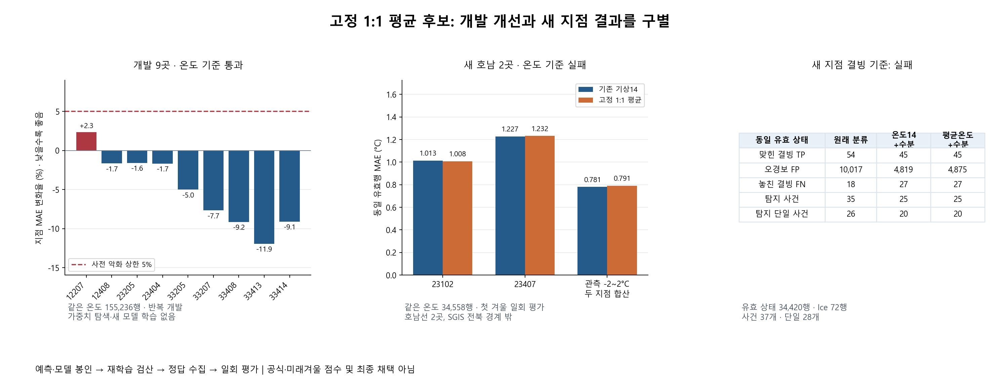

# 고정 평균 온도 후보와 새 호남 지점 검증 — 2026-10-10

기상14·거리 제거 기상12의 **고정 1:1 평균**을 구현했습니다. 반복 개발에서는 온도 기준을 통과했으나, 예측을 먼저 봉인한 새 호남선 두 지점에서는 저온 구간 오차와 결빙 오경보가 늘어 **온도·결빙 기준 모두 실패**했습니다. 후보를 최종 모델로 채택하지 않습니다. 개발 개선·새 위치 검증·전북 목표 영역·결빙 성능을 구분하며 대회 제출은 하지 않았습니다.

[현재 상태](PROJECT_STATUS.md) · [앞선 거리·기상망 검토](WEATHER_DISTANCE_AND_NETWORK_REVIEW_20261010.md) · [재현 절차](RUNBOOK.md) · [참고문헌](REFERENCES.md)

## 개발에서 바꾼 것

앞선 거리 제거 모델은 평균 MAE를 줄였으나 12207에서 5.937% 악화해 사전 5% 제한을 넘었습니다. 추가 가중치 탐색 없이 기존 두 모델의 예측을 같은 비중으로 평균했습니다. 두 성분의 유한 예측 행이 같아야 하며, 한 성분의 결측을 다른 성분으로 채우지 않습니다.

기존 첫 겨울 개발23곳·397,173입력행과 동일한 4개 공간 그룹을 유지했습니다. 보호3곳·개봉8/4곳·완료된 다음 겨울 정답은 후보 학습·선택·추가 성능 계산에서 제외했습니다. 개발 비교는 기존 감사 모델과 예측을 재사용했으므로 **새 모델 적합0건·가중치 탐색0건**입니다. 외부/내부 그룹을 제외한 예측을 사용하지만, 같은 개발 자료를 반복 검토해 제안한 후보이므로 새로운 독립 성능이라고 부르지 않습니다.

| 같은 개발 온도 155,236행 | 기존 기상14 | 거리 제거 기상12 | 고정 1:1 평균 |
| --- | --- | --- | --- |
| 합산 MAE / RMSE (°C) | 1.370541 / 1.794299 | 1.271942 / 1.682143 | 1.302902 / 1.718086 |
| 지점 평균 MAE / RMSE (°C) | 1.370252 / 1.771089 | 1.271769 / 1.654853 | 1.302698 / 1.693589 |
| 관측 −2~2°C MAE (42,268행) | 1.227619 | 1.160773 | 1.173620 |
| 12207 지점 MAE 악화 | 기준 | +5.937% | +2.333% |
| 전체 개발 온도 기준 | 기준 | 실패 | 통과 |

평균 후보는 8곳 개선·1곳 악화이며 네 내부 그룹 모두에서 선택됐습니다. 두 모델의 개발 오차 상관은 **0.959901**로 높습니다. 낮은 상관의 독립 모델을 결합한 것으로 설명하지 않으며, `MSE(평균)=0.25 MSE(A)+0.25 MSE(B)+0.5 평균(eA·eB)`를 실제 오차로 검산했습니다. 평균화가 언제나 더 좋은 모델보다 우수하다는 보장은 없습니다.

## 개발 결빙: 개선 집중과 지점 손실

기존 0°C·이슬점/과거3시간 강수/적설 규칙과 결측21행의 원래 분류 복귀를 유지했습니다. 같은 유효 상태155,118행·Ice6,611행, 완전일1,060개·실제Ice일124개/양성8곳, 사건347개·단일118개입니다.

| 온도 입력 | TP / FP / FN | 시점 F1 | 일별→지점 F1 | 실제 Ice일 F1 | 탐지 사건 / 단일 |
| --- | --- | --- | --- | --- | --- |
| 기존 기상14 | 1,600 / 21,138 / 5,011 | 0.109033 | 0.030168 | 0.072892 | 143/347 · 52/118 |
| 고정 평균 | 1,635 / 20,681 / 4,976 | 0.113043 | 0.030216 | 0.073278 | 146/347 · 53/118 |

추가 TP35행은 모두33408에 집중됐습니다. 23205·33205·33408의 FP는 각각5·25·60행 증가했습니다. 전체 FP 감소와 일부 지점 악화를 함께 기록하며, 이를 보편적인 결빙 개선으로 표현하지 않습니다. 미정의 일별 F1 처리는 여전히 [Q&A633](https://aida.kisti.re.kr/competition/problem/PROB_000000000004604/detail/commuDetail.do?bbsId=BBSMSTR_000000000319&nttId=633)의 확정 답변이 없으므로 자체 보조지표입니다.

## 새 평가의 사전 설계와 적용 범위

공식 정적 목록과 모든 기존 요청 기록만 읽어 정답 미조회·상태 관측 가능 후보32곳을 점검했습니다. 현재 첫 겨울 기상망의 개발 거리 상한(AWS20.818km·ASOS48.673km)을 만족하는 곳은3곳이었습니다. 12208은 기존 도로 관측 위치와11.1m여서 제외하고, 5km 이상 떨어진 나머지2곳 **전부**를 사전에 고정했습니다. 정답을 보고 위치를 고르거나 자료 없는 위치를 대체하지 않습니다.

| 고정 지점 | 정적 명칭·종류 | AWS / ASOS 최근접 거리 | 기존 도로 위치 최소 거리 |
| --- | --- | --- | --- |
| 23102 | 곡성기차마을휴(도) · 거점 | 8.715 / 12.729km | 20.934km |
| 23407 | 대덕터널(도) · 목표(결빙) | 10.813 / 13.630km | 13.626km |

두 곳 모두 **SGIS2024 전북 경계 밖**입니다. 이번 평가는 같은 첫 겨울의 호남선 외부 공간 이전이며 전북 전체·세 노선·미래 겨울·공식 보호3곳 평가가 아닙니다. 원래 후보32곳 중 전북 안에서 거리·5km 분리 조건을 모두 만족하는 곳은0곳입니다. 기상 거리 상한은 간단한 메타데이터 기준으로, 지형·센서·기상 분포의 전체 적용 범위를 입증하지 않습니다.

기존23곳의 유효 온도397,126행으로 HGB100 기상14 모델을 동일성 확인 후 재사용하고 기상12 모델1개를 새로 적합했습니다. 전체10분 격자34,560행과 모델·입력·원래Ice/고정수분 판정을 봉인했습니다. 정답 요청 전에 두 모델을 다시 학습해 성분 예측69,120개·평균34,560개·원래Ice점수34,560개를 검산했습니다. 이후 첫 겨울120일×2곳만 수집했습니다. 가중치·임계값·위치·기간은 개봉 뒤 바꾸지 않습니다.

## 새 호남 두 지점 결과

240개 일 구간을 모두 수집했습니다. 255개 정상 원문·270회 요청, 간격269개 모두1.3초 이상(최소1.300069초)입니다. 원문에서 정확한10분 격자34,560행을 별도로 재파싱해 캐시·평가표와 대조했습니다. 상태 미정의140행을 그대로 남겨 유효 상태는34,420행, Ice72행입니다. 온도는 동일 유효34,558행, 저온 구간은9,542행입니다. 정적 목록과 응답 좌표는9.1/11.1m 차이로 반올림 허용 범위 안이며, 실제 센서 이력 전체가 확인됐다는 의미는 아닙니다.

| 온도 비교 | 기존 기상14 | 고정 평균 | 판단 |
| --- | --- | --- | --- |
| 지점 평균 MAE / RMSE (°C) | 1.120225 / 1.580351 | 1.119990 / 1.578669 | 개선 폭 미미 |
| 23102 MAE (17,279행) | 1.013250 | 1.007614 | 0.56% 개선 |
| 23407 MAE (17,279행) | 1.227200 | 1.232366 | 0.42% 악화, 5% 상한 안 |
| 관측 −2~2°C 합산 MAE | 0.781423 | 0.790567 | **1.17% 악화, 사전 조건 실패** |
| 합산 편향 (°C) | −0.639640 | −0.698597 | 더 차갑게 추정 |

전체 MAE가0.000235°C 줄었다는 사실로 채택하지 않습니다. 저온 구간 비악화 조건은 수집 전에 고정했고 결과 확인 후 삭제하거나 허용 오차를 만들지 않았습니다. 개발의 따뜻한 편향과 새 위치의 차가운 편향은 방향이 다릅니다. 이를 기술하지만 새 지점의 정답으로 보정기를 적합하지 않습니다.

| 결빙 판정 (같은34,420행·Ice72행) | TP / FP / FN | 시점 F1 | 일별→지점 F1 | 실제 Ice일 F1 | 탐지 사건 / 단일 |
| --- | --- | --- | --- | --- | --- |
| 원래 분류 | 54 / 10,017 / 18 | 0.010648 | 0.007810 | 0.092536 | 35/37 · 26/28 |
| 기상14 온도+수분 | 45 / 4,819 / 27 | 0.018233 | 0.014933 | 0.075007 | 25/37 · 20/28 |
| 평균 온도+수분 | 45 / 4,875 / 27 | 0.018029 | 0.014978 | 0.075288 | 25/37 · 20/28 |

완전일228개·실제Ice일14개/양성2곳입니다. 평균은 기상14 규칙과 비교해 FP가56행 증가해 **결빙 기준도 실패**했습니다. 두 온도·수분 규칙 모두 원래 분류보다 FN을18→27행으로 늘리고 사건·단일 탐지를 줄였습니다. 시점/일별 F1 증가만으로 더 안전한 판정이라고 판단하지 않습니다.

23102의 평균 규칙은TP25·FN4·FP2,423이고23407은TP20·FN23·FP2,452입니다. 기상14 대비 추가 오경보는 각각43/31행, 제거한 오경보는6/12행이며 결빙 판정 자체는 두 규칙에서 동일합니다. 원래 분류와는 결빙8행을 새로 찾았지만17행을 놓쳤습니다. 특히23407의 Ice43행 중11행은 관측 노면온도가0°C보다 높습니다. 상태04 정답을 삭제·재분류하지 않으며, 이 사실만으로 센서 오류나 원인을 확정하지 않습니다.

## 문헌과 대체 자료에 적용한 판단

| 일차 출처 | 적용 | 제한 |
| --- | --- | --- |
| [Clemen1989, 예측 결합 검토](https://scholars.duke.edu/publication/765653) | 단순 평균을 추가 비교할 방법론적 근거 | 논문 전문을 모두 확보했다고 주장하지 않음. 도로 Ice 성능의 직접 근거가 아님 |
| [Wang·Hyndman·Li·Kang2023](https://robjhyndman.com/publications/combinations/) · [저자 공개 원고](https://arxiv.org/abs/2205.04216) | 가중치 추정의 불안정성과 모델 오차 상관을 함께 점검. 고정 평균과 MSE 항 검산 | 읽은 PDF는2022년 사전공개 원고56쪽. 2023년 최종 출판본을 모두 대조했다고 주장하지 않음 |
| [Hyndman·Athanasopoulos, FPP3](https://otexts.com/fpp3/combinations.html) | 단순 평균을 비교 기준으로 사용 | 예제 대상·수치·효과 크기를 국내 노면온도 결과로 옮기지 않음 |
| [scikit-learn1.6 VotingRegressor](https://scikit-learn.org/1.6/modules/generated/sklearn.ensemble.VotingRegressor.html) | 예측 평균과 가중치 정의 확인 | 해당 API의 재적합을 쓰지 않고 감사된 그룹 제외 예측을 직접 평균 |
| [Cawley·Talbot2010](https://jmlr.org/papers/v11/cawley10a.html) · [Roberts등2017](https://doi.org/10.1111/ecog.02881) | 반복 개발의 선택 편향과 공간 그룹 제외·일회 정답 개봉을 구별 | 이번2곳이 모든 목표 영역을 대표한다는 보장 없음 |

공식 문제·2026소개·공지·서약·Q&A633을 다시 확인했습니다. 새 출처 조회16건 중15건은 정상 응답이고 저자 소개 페이지의403은 보존했습니다. 논문은 arXiv 공개 원고로 읽었으며 단순 평균·오차 상관을 설명한 파일5/6쪽을 렌더해 확인했습니다. 참고자료 개수 자체를 분석 품질이나 창의성의 점수로 사용하지 않습니다.

AWS733 첫 겨울11분 확인 요청은 이번에도403입니다. [공식 AWS 안내](https://apihub.kma.go.kr/apiList.do?seqApi=2&seqApiSub=239)와 첨부 명세서의 오류 구분에 따라 서비스 승인 상태 확인이 필요하며,403만으로 인증키 오류라고 단정하지 않습니다. [공개 포털](https://data.kma.go.kr/data/grnd/selectAwsRltmList.do?pgmNo=56)의 정상CSV 경로와 공개JavaScript 로그인 분기도 확인했습니다. 익명 세션 상태는1이고 정상 자료 다운로드 분기는2를 요구합니다. 계정 로그인·활용신청·AWS 관측 다운로드는 하지 않았습니다.

[날씨누리 상세관측](https://www.weather.go.kr/w/weather/land/aws-obs.do)은 필요한 첫 겨울 전체·변수·품질 규격 충족을 확인하지 못했습니다. [국립환경과학원 제공 기상자료](https://www.data.go.kr/data/15150439/fileData.do)는2024년·8,783행 **샘플**이며 전체 원문을 기상청에서 확인하도록 안내합니다. 둘을 기존 AWS와 교체하거나 확장 성능을 보고하지 않습니다. 계획 AWS614·647·730·914의 첫 겨울 원문·시간/변수/좌표 감사와 같은 분모 학습은 여전히 남아 있습니다.

## 검산·심사 관점의 다음 조건

개발 평균 예측621,028개·내부 선택4개·온도/결빙4종을 별도 코드로 검산했습니다. 새 평가의255개 원문·성분 예측69,120개·평균34,560개·지표·개봉 순서·모든 요청 간격·사전 온도/결빙 조건도 검산 일치했습니다. **감사 통과와 후보 채택 실패는 다른 결론**입니다. 사후 실패 기술 표는 모델·라벨·판정을 바꾸지 않습니다.

새 합성 검사14개를 포함해 **전체193개 테스트가 통과**했습니다(테스트 실행25.165초, 로그 저장 포함27.465초). 그림의 마이너스 글리프 오류가 있는 초안·소스·영수증을 보존하고 수정했습니다. 기존 보호47개·다음겨울549개 고정 파일과 개봉8/4곳 봉인, 원본 ZIP·인증정보·미커밋 작업을 보존합니다. 이번2곳도 이제 개봉됐으므로 새 독립 평가로 재사용할 수 없습니다.

| 우선순위 | 남은 조건 | 완료를 판단할 근거 |
| --- | --- | --- |
| 1 | AWS 서비스 접근·계획4곳 첫 겨울 자료 확보 | 정상 원문, 단위·누락·시각·좌표 감사, 확장만 바꾼 중첩 비교 |
| 2 | 전북 목표 영역의 새 검증·센서/위치 이력 | 이미 개봉한 지점의 재사용을 피한 사전 설계, 실제 관측 대장·교정/제빙 기록 |
| 3 | 공식 일별 미정의·이정/시설 대응 확정 | Q&A633 답변, 공식 방향·이정과 시설 경계 근거 |
| 4 | 현장 효과와 최종 산출물 검토 | 희소 결빙 미탐·지점/사건 손실 없는 결과, 검증 범위에 맞는 지도·재현 패키지 |

평균 후보의 온도 개선만으로 결빙 예측·전북 위험 등급·수상 수준의 효과성 입증이 끝났다고 판단하지 않습니다. 개발 실험은 `outputs/private/temperature_mean_20261010_v1/`, 새 일회 평가는 `temperature_mean_blind_20261010_v1/`, 메타데이터 설계와 지리 검토는 `temperature_mean_validation_design_20261010_v1/`, 출처·접근 기록은 `temperature_mean_references_20261010_v1/`에 있습니다. 모두 비공개이며 외부 공개·최종 제출은 수행하지 않았습니다.
