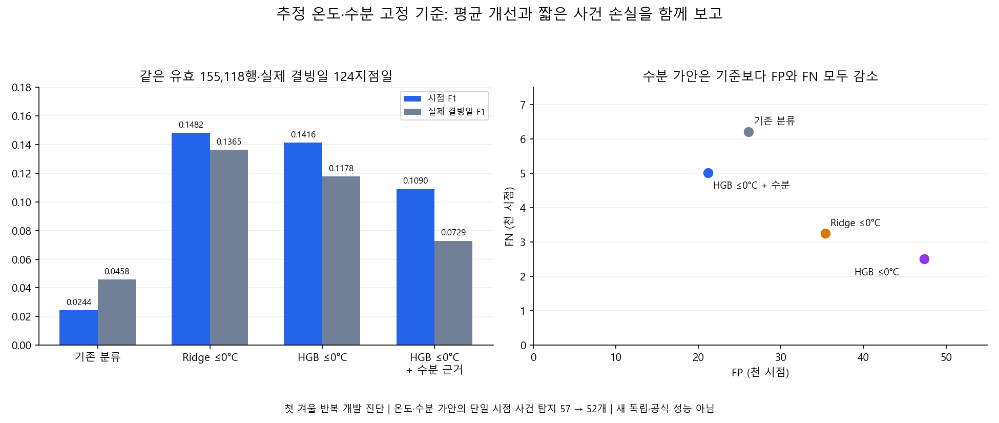

# 추정 온도·수분 결빙 가안과 완료된 다음 겨울 검증 — 2026-10-09

첫 겨울에서 추정 온도·수분 고정 기준은 기존 분류보다 FP와 FN을 함께 줄였다. 같은 정답의 F1은0.024370→0.109033, FP26,059→21,138, FN6,208→5,011이었다. 그러나 단일 시점 사건과 일부 지점은 악화했고, 개선 대부분은33408에서 나왔다. 다음 개발의 비교 기준 후보로 보존하며 최종 모델로 채택하지 않았다.

[문서 목록](README.md) · [현재 상태](PROJECT_STATUS.md) · [실행 안내](RUNBOOK.md)

후속 [온도 교차 추정·상태 분류 비교](JOINT_SURFACE_REVIEW_20261009.md)는 완료했으며 두 새 후보는 미채택입니다. 이 문서의 온도·수분 가안은 다음 개발의 비교 기준으로 유지합니다.

별도로, 사전에 고정한 **기존 모델**의 다음 겨울 수집·일회 평가·독립 감사를 완료했다. 그 모델의 다음 겨울 F1은0.008725였다. 새 온도·수분 가안의 다음 겨울 점수가 아니다. 외부9지점 Ice가6,611→76건,33408은6,340→14건으로 바뀌어 강한 겨울별 분포 차이가 확인됐다. 개발 성능을 수상·운영 성능으로 옮겨 해석하지 않는다.

## 고정 물리 가안을 실제 비교한 방법

앞선 [기상 단독 온도 비교](WEATHER_FALLBACK_REVIEW_20261009.md)의 외부 그룹 제외 예측을 사용했다. 각 그룹의 HGB는 해당 그룹 전체를 학습·전처리·모델 선택에서 제외했다. 온도 모델 선택에는 다른 세 그룹의 온도 정답만 사용했다. 목표 실제 온도·상태·Ice는 물리 가안의 입력에 넣지 않았다.

세 가안을 분류 정답 집계 전에 고정했다. 첫째는 기존 Ridge의 추정 온도≤0°C, 둘째는 새 HGB의 추정 온도≤0°C, 셋째는 HGB의 추정 온도≤0°C이면서 다음 중 한 조건이 있는 경우다: 추정 노면온도≤AWS 이슬점, 이전3시간15분 강수 최대>0, ASOS 적설>0. 마지막 조건은 기상 기반 수분 근거이며 목표 도로의 수막이나 염도를 측정한 값이 아니다.

온도 추정이 없으면 기존 분류기로 돌아간다. 수분 가안은 세 수분 입력이 모두 결측일 때도 기존 분류기로 돌아가며 결측을 건조로 단정하지 않는다. 이번 대체 행은 모두21개다. 전체 유효 상태155,118행을 그대로 평가했다. 04만 양성이고13·15 등 정의된 다른 상태는 음성,0/-999와 미정의는 제외했다. 정답 삭제·온도에 따른 정답 변경·평활화는 하지 않았다.

0°C는 이번 고정 물리 기준이며 공식 최적 임계값이나 도로의 실제 결빙점이 아니다. 제빙제·수막·센서 차이는 이 기준이 다루지 못한다. 임계값 탐색이나 정답을 보고 지점별 기준 변경은 수행하지 않았다. 가안들의 실험 결과를 보고 논의하는 것은 반복 개발 분석이며 새로운 독립 검증이 아니다. 자동 후보 선택은 하지 않았다.

## 같은 첫 겨울 정답의 결과

| 개발 가안 | 시점 F1 | TP | FP | FN | 실제 결빙일 F1 | 무결빙일 오경보일 |
|---|---:|---:|---:|---:|---:|---:|
|기존 분류|0.024370|403|26,059|6,208|0.045809|523|
|Ridge 추정온도≤0°C|0.148235|3,359|35,350|3,252|0.136520|552|
|HGB 추정온도≤0°C|0.141580|4,108|47,312|2,503|0.117755|607|
|HGB 추정온도≤0°C + 수분 근거|0.109033|1,600|21,138|5,011|0.072892|260|

완전 관측1,060지점일, 실제 결빙이 있는124지점일·8지점을 모든 가안에서 고정했다. 실제 결빙일 F1은 날짜별 F1을 지점 안에서 평균한 뒤 지점 평균이며 공식 미확정 세부 규격을 대체하지 않는 잠정 지표다. 결빙·예측 결빙이 모두 없는 날짜의 F1은 미정의다.

온도≤0°C만으로 판정하면 F1이 더 높지만 FP와 무결빙일 오경보가 늘었다. 온도 모델의 MAE가 낮아졌다고 결빙 F1이 자동으로 높아지는 것도 아니다: HGB 단순 저온 가안의 F1은Ridge 가안보다 낮다. 물리적 저온과 공식 상태04를 구분해야 한다.

수분 가안은 Precision1.523%→7.037%, Recall6.096%→24.202%다. FP4,921건·FN1,197건 감소, 무결빙일 오경보523→260일이지만 여전히 오경보21,138건·미탐5,011건이 남았다. 보정된 결빙 확률이나 현장 경보 정책으로 표현하지 않는다. 분류의 순위 점수 AP는 이 고정 이진 판정의 비교 지표로 추가하지 않았다.

## 지점과 사건에서 남은 손실

수분 가안의 지점 F1은5개선·3악화·1동일이다. 33408의TP139→1,338, FN6,201→5,002, Recall2.19%→21.10%로 개선됐지만, 여전히 이 지점 Ice의78.9%를 놓친다. 나머지8지점의TP는264→262건이었다. 전체 개선은 대부분33408에서 얻었으므로 모든 지점의 탐지가 개선된 것으로 말하지 않는다.

12408은양성5건 중TP3→1·Recall60%→20%,33207은3건 중TP3→2였다. 23205는10건 중TP10→9,23404는246건 중TP246→243이었다. 33414는5건 중TP0→5로 개선했다. 오경보는33207·33413·33414에서 오히려 늘었다. 양성이 매우 적은 지점의 비율은 불안정하므로 건수를 함께 보고한다.

347개 사건 중 한 시점 이상 잡은 사건은121→143개(34.87%→41.21%)였다. 연속229사건은64→91개지만 **단일 시점118사건은57→52개**로 줄었다. 이 손실을 삭제·평활화로 숨기지 않는다.

수분 가안의 오경보 상태는Dry7,179·Wet4,727·Damp3,425·Chemically wet2,391·Snow/ice2,539·Snow830·Critically wet47건이다. 기상 수분 근거가 있어도 실제 도로가 건조하거나 제빙제가 작용하거나 상태04와 다른 노면일 수 있다. 이 구분을 위한 상태 보조 예측과 관측 체계 근거가 다음 과제다.

## 다음 겨울 기존 고정 평가를 완료했다

기존 예측155,520행·모델·임계값·입력·소스549파일을2026-10-09 06:12:13 UTC에 고정한 뒤,06:13:56 UTC에 수집을 시작했다. 2,160요청의 완료는09:31:17 UTC, 일회 평가 완료는09:35:10 UTC였다. 준비된 별도 감사가09:36:33 UTC에 지점·시각·판정·점수·온도 예측의 일치, 상태04 정의, 지표·분모·그룹/지점/관측 커버리지를 재검산했다. 보호3지점은 요청하지 않았다.

| 기존 고정 모델의2025-2026겨울 | 결과 |
|---|---:|
|계획 예측 행|155,520|
|실제 정확10분 관측 행|155,488|
|유효 상태 행|155,464|
|실제 Ice|76|
|TP / FP / FN|64 / 14,530 / 12|
|시점 F1|0.008725|
|Recall / Precision|84.21% / 0.4385%|
|Average Precision|0.032627|
|잠정 일별 지점 평균 F1|0.002311|
|실제 결빙일 F1|0.076506|
|무결빙일 오경보일|498|
|완전 상태 관측일 / 부분·미정의일|1,049 / 31|

기존 내부 선택이분류4그룹 모두기준을유지했으므로 baseline과selected의다음겨울분류예측은같다. 새가안의F1이0.008725라는뜻이아니다. 이완료정답으로새가안의모델·0°C기준·수분규칙을바꾸거나추가점수를계산하지않았다.

고정 온도 보강 모델의 동일154,855행 MAE는1.48347→1.46070°C(1.54% 감소),RMSE2.01884→2.01624°C,BIAS+0.62426→+0.21470°C였다. 3지점 개선·4악화·2동일이며33413은1.01351→1.21344°C로악화했다. 새HGB의MAE1.37054°C는첫겨울개발값으로이표의모델과다르다.

이는외부9지점의독립겨울진단이지공식보호3지점의대회점수가아니다. 공식3지점의기존평가·정답은다시읽거나변경하지않았다. 기존고정47파일과제출초안도보존했다.

## 완료 정답의 분포 변화와 해석

| 같은9지점 | 첫겨울개발 | 다음겨울고정평가 |
|---|---:|---:|
|유효 상태 행|155,118|155,464|
|Ice|6,611|76|
|Ice 비율|4.2619%|0.04889%|
|실제 노면온도≤0°C 비율|34.60%|29.86%|
|33408 Ice|6,340|14|
|33408 Ice 비율|36.72%|0.0810%|
|33408 실제 온도≤0°C 비율|38.43%|33.46%|

33408의Dry는5,322→14,443행,Wet은4,269→2,272행,Snow/ice는1,090→68행이었다. 저온 비율의 변화보다 상태04 빈도의 변화가 훨씬 크다. 그래도 기상·수분·제설·장비·판정/처리 중 원인이 무엇인지 이집계만으로 확정할 수 없다. 실제 온도는 완료 평가의 분포 기술용으로만 사용했으며 예측 입력이나 새 선택 조건으로 넣지 않았다.

가장 시급한 확인은33408·33409의두겨울 장비/판정/측정위치·점검·제설 이력과 상태코드 처리의일관성이다. 공식관리자료를얻지못한항목은원인미확정으로유지한다. 다음겨울정답은이후새모델의학습·보정·후보선택에재사용하지않는다. 새독립성능에는아직열지않은별도지점·기간과예측사전고정이필요하다.

## 완료 검증·산출물

고정물리가안의합성3개테스트와독립4가안·36지점/가안행·4,240일별행·347사건·44사건집단검산을통과했다. 다음겨울감사는고정155,520예측행의정확한일치·분류/온도/커버리지·동점AP·지점/그룹보고를재검산했다. 새모델적합·추가예측·고정평가재실행은하지않았다. 온도회귀의별도합성4개·독립32학습기록·HGB재적합검증은[이전보고](WEATHER_FALLBACK_REVIEW_20261009.md)와검증영수증에보존했다.

- 고정 물리 가안 요약 (로컬 전용: `outputs/private/thermal_ice_diagnostics_20261009_v1/summary.json`)
- 가안 독립 검산 (로컬 전용: `outputs/private/thermal_ice_diagnostics_20261009_v1/independent_verification.json`)
- 가안 지점별 결과 (로컬 전용: `outputs/private/thermal_ice_diagnostics_20261009_v1/station_metrics.csv`)
- 비교 그림 (로컬 전용: `outputs/private/thermal_ice_diagnostics_20261009_v1/thermal_ice_rules_review.png`)
- 기존 다음 겨울 일회 평가 (로컬 전용: `outputs/private/releases/20261007/outputs/private/external_reserved_assessment_v1/summary.json`)
- 다음 겨울 독립 감사 (로컬 전용: `outputs/private/releases/20261007/outputs/private/external_reserved_result_audit_v1/summary.json`)
- 두 겨울 분포 진단 (로컬 전용: `outputs/private/completed_reserved_shift_20261009_v1/summary.json`)

이번결과는개발가안의가능성과기존모델의일반화한계를함께보여준다. 다음단계는추정온도·수분·12/13/15보조예측을그룹제외OOF로결합하고짧은사건·오경보를같이보는분류가안이다. 센서/제설근거와새독립검증이없는상태에서현재모델을최종위험지도나제출모델로승격하지않는다. 공식04규칙과일별집계의미확정사항은[공식검토](OFFICIAL_TABS_REVIEW_20261007.md)를따른다.

## 집계 결과 그림

