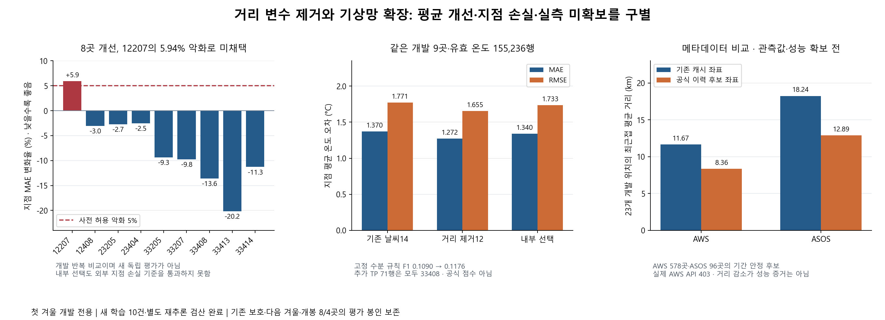

# 거리 변수 제거·기상망 확장 후속 검토 — 2026-10-10

**거리 2개를 제거한 모델은 개발 평균 오차를 줄였지만 지점별 손실 제한을 통과하지 못해 채택하지 않았습니다.** 공개 기상청 지점 이력 2,767건을 확보·검산해 다음 AWS 확장 비교의 대상과 입력 규칙을 고정했습니다. 실제 AWS 자료 조회는 HTTP 403을 반환하므로 기상망 확장 학습과 성능 검증은 아직 완료하지 않았습니다.

[현재 상태](PROJECT_STATUS.md) · [앞선 미해결 검토](UNRESOLVED_EVIDENCE_REVIEW_20261010.md) · [자료·문헌](REFERENCES.md) · [실행 안내](RUNBOOK.md)

## 문제와 비교 범위

앞선 새 4곳은 제한된 AWS 캐시의 학습 거리 범위를 벗어났습니다. 이에 ‘같은 기상 관측값에서 거리 변수를 제거’하는 비교와 ‘기상 관측망을 늘리는’ 비교를 분리했습니다. 거리가 실패의 유일한 원인이라는 가정은 두지 않았습니다.

이번 학습은 기존 첫 겨울 개발 23곳만 사용했습니다. 대회 개발 14곳과 외부 개발 9곳의 397,173행 중 학습에 필요한 노면온도·ASOS 기온이 유효한 397,126행을 사용하며, 외부 9곳은 동일한 4개 공간 그룹으로 나눴습니다. 보호 3곳·이미 개봉한 추가 8/4곳·완료된 다음 겨울 정답은 학습·선택·새 후보 성능 평가에서 제외했습니다. 반복 개발 결과이며 새 독립 평가·공식 점수가 아닙니다.

기상14의 HGB 제곱 손실100회를 기준으로 AWS·ASOS 거리만 제거한 기상12 후보 하나를 추가했습니다. 나머지 입력·학습 행·제외 그룹·모델 설정은 같습니다. 외부 그룹 G와 내부 그룹 H를 모두 학습에서 제외한 중첩 비교이며, 내부 선택 조건은 지점 평균 MAE/RMSE 동시 개선·각 지점 MAE 악화 5% 이하·관측 -2~2°C의 MAE 비악화입니다. 새 임계값은 탐색하지 않았습니다. 기준 모델 10개를 해시 확인 후 재사용하고 후보 10개를 새로 학습했습니다.

## 온도: 평균 개선과 지점 손실이 함께 발생

같은 외부 9곳의 유효 온도 **155,236행**에서 비교했습니다. 지점 평균은 지점별 지표를 같은 비중으로 평균하며, 합산은 모든 유효 행의 평균입니다.

| 비교 | 합산 MAE / RMSE (°C) | 지점 평균 MAE / RMSE (°C) | 관측 -2~2°C MAE (42,268행) |
| --- | --- | --- | --- |
| 기존 기상14 | 1.370541 / 1.794299 | 1.370252 / 1.771089 | 1.227619 |
| 거리 제거 기상12 | 1.271942 / 1.682143 | 1.271769 / 1.654853 | 1.160773 |
| 내부 검증으로 선택한 모델 | 1.340217 / 1.759213 | 1.339981 / 1.733440 | 1.208566 |

거리 제거 후보는 8곳에서 MAE가 감소했지만 **12207은 1.451172→1.537332°C, 5.937% 악화**했습니다. 사전 5% 제한을 넘었습니다. 후보의 합산 편향도 +0.117256→+0.304034°C로 더 따뜻한 방향으로 증가했습니다. 평균 오차 감소를 모든 지점의 개선으로 해석하지 않습니다.

내부 선택은 서해안·금산 그룹에서 후보, 호남·서상 그룹에서 기준을 선택했습니다. 선택 절차의 합산 MAE는 1.340217°C이며, 모든 외부 결과를 본 뒤 고른 기상12의 1.271942°C와 구별해야 합니다. 내부 선택도 외부 12207의 손실을 막지 못했습니다. 전체 개발 채택 조건은 실패했으며 새 독립 검증으로 승격하지 않았습니다.

## 결빙: 탐지 증가는 한 지점에 집중

기존 0°C·이슬점/과거3시간 강수/ASOS 적설 판정에 온도 추정값만 바꿨습니다. 필요한 입력이 없는 21행은 기존 원래 Ice 판정으로 복귀합니다. 같은 유효 상태 **155,118행·Ice 6,611행**, 완전일 1,060개, 실제 Ice일 124개/양성 지점 8곳, 사건 347개 중 단일 시점 사건 118개에서 비교했습니다.

| 온도 입력 | TP / FP / FN | 시점 합산 F1 | 일별→지점 평균 F1 | 고정 실제 Ice일 F1 | 탐지 사건 / 단일 사건 |
| --- | --- | --- | --- | --- | --- |
| 기존 기상14 | 1,600 / 21,138 / 5,011 | 0.109033 | 0.030168 | 0.072892 | 143/347 · 52/118 |
| 거리 제거 기상12 | 1,671 / 20,125 / 4,940 | 0.117647 | 0.030433 | 0.073666 | 150/347 · 56/118 |
| 내부 선택 모델 | 1,671 / 20,978 / 4,940 | 0.114217 | 0.030703 | 0.073486 | 150/347 · 56/118 |

**추가 TP 71행은 모두 33408에서 발생했고 다른 8곳의 TP는 그대로입니다.** 거리 제거에서 33408의 FP도 135행 증가했으며 23205에서 2행, Ice가 없는 33205에서 41행 증가했습니다. 총 FP 감소와 일부 지점 악화를 함께 보고합니다. 비결빙 완전일의 오경보일은 260→238일로 줄었습니다.

일별 F1은 완전한 144개 유효 시점의 날에서 직접 `2TP/(실제 양성+예측 양성)`으로 계산하고 양쪽 모두 0인 날은 미정의로 둡니다. 미정의 정책은 [앞선 검토](UNRESOLVED_EVIDENCE_REVIEW_20261010.md)와 같습니다. 운영진의 최종 미정의 처리 답변은 미확정이므로 이 수치를 공식 대회 점수로 표현하지 않습니다.

## 공개 지점 이력: 확보한 것과 아직 없는 것

[기상자료개방포털 관측지점정보](https://data.kma.go.kr/tmeta/stn/selectStnList.do?pgmNo=123)의 정상 조회·CSV 다운로드 절차로 AWS 2,619건, ASOS 148건의 공개 이력을 확보했습니다. 처음 다운로드가 HTML을 반환한 시도와 성공한 CSV의 URL·조건·시각·SHA256을 모두 보존했습니다. API 인증 없이 제공되는 공개 지점 메타데이터이며 실제 기상 관측값과 다릅니다.

시작·종료일은 날짜까지만 제공됩니다. `[2024-11-01, 2025-03-01)` 전체를 덮는 단일 기록만 후보에 남겼으며, 기간 중 변경·첫날 경계·잘못된 좌표의 26개 지점 그룹을 제외했습니다. 후보는 **AWS 578곳·ASOS 96곳**입니다. 시작일을 자정으로 추정하지 않았고, 종료일 공백도 관측값 제공의 증거로 해석하지 않았습니다.

개발 23개 위치에서 종류별 가까운 3곳, 총138개를 순위화했습니다. 현재 캐시에 없는 최근접 지점은 AWS 8개 도로 위치·ASOS 6개 위치에서 발견했습니다. 아래 거리는 지점 이력과 좌표만으로 계산한 값이며 실제 관측 가용성과 성능은 미확인입니다.

| 기상 종류 | 기존 캐시의 평균 / 최대 최근접 거리 | 공식 이력 후보의 평균 / 최대 최근접 거리 |
| --- | --- | --- |
| AWS | 11.675 / 20.818km | 8.364 / 17.391km |
| ASOS | 18.236 / 48.673km | 12.893 / 28.516km |

기존 좌표 캐시에는 두 겨울을 합쳐 AWS 34곳이 있고, 실제 첫 겨울 AWS 관측은 33곳입니다. AWS341은 공식 이력과 원본 캐시 모두 **2025-12-10 시작**, 캐시11,664행이며 첫 겨울은 0행입니다. 이동 이력 누락으로 단정할 수 없는 정상적인 뒤늦은 시작입니다. 23개 개발 위치의 최근접 지점은 이를 제외해도 같고, 전체 캐시의 상위3 후보는 23203에서만 달라집니다. 기존 첫 겨울 입력 생성기는 비어 있는 관측소를 제외하므로 이 지점이 첫 겨울 동적 참조로 사용됐다고 판단하지 않습니다.

기존 기상 좌표44개 중43개는 첫 겨울 안정 이력과 연결됩니다. ASOS146은162.6m,172는77.8m,245는28.7m 차이가 있으며 나머지40개는11.2m 이하입니다. 좌표 표기나 메타데이터 불일치 원인은 미확정입니다. 원본 좌표·캐시·평가 예측을 수정하지 않았습니다.

## 다음 비교의 구체적인 조건

비공개 `metadata_analysis/aws_expansion_plan.json`에 **AWS614·647·730·914 추가**를 관측 확보 전에 고정했습니다. ASOS238·264 확장은 별도 후속 비교로 남겼습니다. 첫 비교는 기존 ASOS·기상14 모델 설정을 유지해 AWS 관측망 추가 효과를 구별합니다. 가까운3곳의 전체 확장이나 새로운 가중 보간은 아직 실행하지 않았습니다.

[AWS 매분자료 명세서](https://apihub.kma.go.kr/getAttachFile.do?fileName=AWS%EB%A7%A4%EB%B6%84%EC%9E%90%EB%A3%8C%EC%A1%B0%ED%9A%8C_API%EB%AA%85%EC%84%B8%EC%84%9C.pdf)의 출력·응답·오류 표를 추출·렌더링해 확인했습니다. 대회 AWS 원본 헤더와 대조하여 풍속은1분평균 `WS1` 대신 **10분평균 `WS10`**, 기온 `TA`, 습도 `HM`, 15분강수 `RN-15m`, 이슬점 `TD`로 고정했습니다. API의 -50 이하 오류 규칙은 새 API 응답에만 적용하며, 기존 대회 결측/유효 온도 규칙을 바꾸지 않습니다.

계획은 KST 첫 겨울·개발23곳에 한정합니다. 단일 지점 최대24시간 요청, 최소1.3초 간격, 원문 보존·해시·좌표/단위/시각/중복 감사 후 입력을 만듭니다. 목표 시각보다 엄격히 이른 관측만60분 이내로 연결하며, 초기3/72시간 이력 부족은 커버리지로 남깁니다. 실제 자료가 없는데 관측 시각이나 값을 채우지 않습니다.

현재 기존 개발 AWS733의11분 확인 요청과 AWS/ASOS 지점정보 API 요청이 모두 HTTP403을 반환했습니다. 명세서는403에 활용신청 안내를,401에 인증키 오류를 적고 있습니다. **403만으로 키 자체가 틀렸다고 단정하지 않으며 해당 서비스 승인 상태 확인이 필요합니다.** 공개 지점 CSV 확보로 메타데이터 경로는 해결했지만 실제 AWS 관측 확보는 남아 있습니다. 인증키·인증 URL·응답 본문은 공개 기록에 넣지 않았습니다. 추가 활용신청이나 외부 연락은 수행하지 않았습니다.

## 문헌을 적용한 범위

| 일차 자료 | 적용한 판단 | 적용하지 않은 주장 |
| --- | --- | --- |
| [Roberts 등(2017), 구조가 있는 자료의 교차검증](https://doi.org/10.1111/ecog.02881) | 무작위 행 분할보다 공간 이전 목적에 맞는 그룹 제외를 유지. 블록 분할도 환경 외삽을 만들 수 있음을 고려 | 현재4그룹이 모든 새 노선·미래 겨울을 대표한다는 보장 |
| [Dumitrescu(2026), 희소 관측망의 기상 격자화](https://gmd.copernicus.org/articles/19/8895/2026/) | 미사용 지점 사전 분리와 관측망/지형 대표성을 따로 점검하는 설계 참고 | 루마니아 일평균 기온·강수의 결과를 한국10분 노면온도·Ice 성능으로 이전 |
| [Cawley·Talbot(2010), 모델 선택 편향](https://jmlr.org/papers/v11/cawley10a.html) | 후보 선택과 외부 평가 분리, 이미 반복 사용한 개발 점수의 한계 기록 | 내부 선택을 했다는 이유로 개발 결과를 새 독립 성능으로 표현 |
| [scikit-learn1.6 HGB](https://scikit-learn.org/1.6/modules/generated/sklearn.ensemble.HistGradientBoostingRegressor.html) | 같은 HGB 설정으로 입력2개만 제거하는 비교 | 알고리즘 변경·기상망 확대의 효과까지 확인했다는 주장 |

Dumitrescu 연구의130개 학습 지점·26개 사전 고정 테스트 지점과 시간 분할은 참고 설계이며 이번 구현은 해당 신경망을 이식한 것이 아닙니다. Roberts 논문은 웹으로 본문을 확인했고 로컬 원문 다운로드 실패도 출처 목록에 보존했습니다. 공식 문제·소개·공지·참가서약을 다시 확인했으며 게시판은6건, [Q&A633](https://aida.kisti.re.kr/competition/problem/PROB_000000000004604/detail/commuDetail.do?bbsId=BBSMSTR_000000000319&nttId=633)는 여전히 미답변입니다.

## 검산과 남은 우선순위

거리 실험은10개 모델·학습 지점/행·제외 그룹·예측 **1,242,056개**·선택4개·온도3종/결빙3종 지표를 별도 코드로 검산했습니다. 최초 감사의 추론 지점 범위 조건 오류는 수정 전 코드·중단 기록을 보존하고 회귀 테스트를 추가했습니다. 원본 모델이나 예측을 고친 것은 아닙니다.

기상 이력 감사는 생산 모듈의 기간 필터·순위 함수를 호출하지 않고 공개 CSV 2,767행, 후보 578/96개, 제외 26그룹, 개발 23곳, 순위 138개, 기존 좌표 44개와 AWS341 기간을 다시 계산했습니다. 두 감사 모두 통과했습니다. 최종 그림을 육안 확인했으며 범례가 수치를 가리던 초안도 보존했습니다. 새 합성 테스트 12개를 포함해 **전체 179개 테스트가 통과**했습니다(74.261초). 기존 47/549개 고정 파일과 개봉 8/4곳의 봉인을 유지했습니다.

| 순서 | 후속 작업 | 완료를 판단할 증거 |
| --- | --- | --- |
| 1 | AWS 서비스 승인 상태 확인·계획4곳의 실제 첫 겨울 자료 확보 | 정상 원문·빠진 구간·시각/좌표/변수 감사.403이나 지점CSV를 관측자료로 간주하지 않음 |
| 2 | AWS 확장만 바꾼 같은 분모의 중첩 개발 비교 | 온도 평균·지점 손실·영도 부근과 고정 결빙/사건 지표.거리 제거 결과와 별도 기록 |
| 3 | 개선 후보가 지점 손실 기준을 통과하면 새 미사용 검증 설계 | 개발·이미 개봉한8/4곳·완료 다음겨울·보호 지점과 분리한 사전 계획 |
| 병행 | Q&A633·33407 실제 센서 이력·공식 이정과 시설 경계 | 운영진 답변·장비 대장·공식 선형 근거.현재 지도나 문헌만으로 완료 처리하지 않음 |

실험 원문은 `outputs/private/weather_distance_20261010_v1/`, 기상망 출처·CSV·명세서·후속 계획은 `outputs/private/weather_network_review_20261010_v1/`에 있습니다. 원본 자료나 키를 Git에 넣지 않았고 외부 공개·대회 제출·수상 또는 현장 효과 입증은 수행하지 않았습니다.
