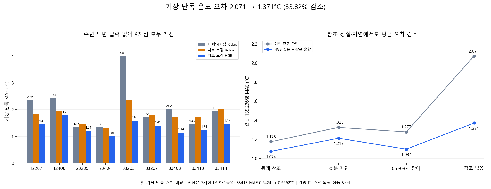

# 기상 단독 온도 모델 개선과 관측소 대표성 후속 검토 — 2026-10-09

주변 노면 관측을 쓰지 않는 온도 가안의 MAE를 2.07085→1.37054°C로 낮췄다. 같은 155,236행에서 33.82% 감소했고 9지점 모두 개선했다. 이전 참조 혼합을 유지한 결합 가안은 MAE 1.17533→1.07445°C지만 33413이 6.03% 악화했다. 이번 개선은 첫 겨울 개발 근거이며 새 독립 성능·결빙 F1 개선·고정 모델 교체를 뜻하지 않는다.

[문서 목록](README.md) · [현재 상태](PROJECT_STATUS.md) · [실행 안내](RUNBOOK.md)

이후 그룹을 제외해 추정한 온도의 [이진/다중 상태 후속 비교](JOINT_SURFACE_REVIEW_20261009.md)를 완료했지만 결빙 성능은 개선되지 않아 새 후보를 채택하지 않았습니다. 별도 상태 보조 예측을 쌓는 구조와 점수 보정은 아직 수행하지 않았습니다.

결빙 쪽에서는 같은 ‘목표(결빙)’ 종류라도 상태 분포가 크게 다름을 확인했다. 대회 개발 5지점의 첫 겨울 Ice는 36건인 반면 추가 5지점은 6,597건이며, 그중 96.10%가 33408 한 곳에 있다. 종류별 보정만으로 지점 이전 문제가 해결된다고 가정할 수 없다.

## 실행한 온도 비교

기존 온도 기준은 대회 개발 14지점의 첫 겨울로 학습한 Ridge(alpha=100)다. 기상·시간 변수는 ASOS 기온, AWS 기온·습도·풍속·15분 강수·이슬점, 관측 나이와 거리, 시간·계절의 사인/코사인으로 총 14개다. 기존 저장 모델을 이 입력으로 직접 실행해 이전 혼합에서 분리한 기상 성분과 예측이 일치함을 확인했다.

비교 후보는 자료 보강 Ridge와 자료 보강 HGB 회귀다. 두 후보의 입력·학습 행·전처리 적합 범위는 동일하다. 노면온도 정답과 ASOS 기온이 유효한 행만 학습한다. Ridge는 학습 행에서만 중앙값 대치·결측 지시자·표준화를 적합한다. HGB는 기존의 고정 소형 설정을 사용했다: 학습률0.05·100회·최대 잎15·최소 잎 표본100·L2 10·조기 종료 없음·고정 시드. 결과를 보고 추가 설정을 탐색하지 않았다.

23개 개발 지점 397,173행을 사용하며, 목표의 실제 온도·상태·Ice·지점ID·주변 노면온도·주변 상태를 예측 입력에서 제외했다. 각 외부 그룹의 모든 지점을 제외하고 나머지 세 그룹의 내부 OOF로 모델을 선택했다. 내부 OOF는 외부 제외 그룹과 해당 내부 검증 그룹을 모두 학습·전처리에서 제외한다. 대회 개발 14지점은 공통 학습 자료다.

후보는 내부 지점 평균 MAE와 RMSE가 모두 기존 기준보다 개선하고, 어느 내부 지점의 MAE도 기준보다 5% 넘게 악화하지 않을 때만 허용했다. 허용 후보는 지점 평균 MAE, RMSE 순으로 선택했다. 모든 외부 그룹에서 HGB가 선택됐다. 선택은 외부 그룹 예측·집계 전에 저장했다. 내부 HGB의 지점별 최대 상대 악화는 네 제외 그룹 각각 −6.84%, +1.80%, −10.72%, −11.36%였다. 이 내부 제한이 외부 지점의 악화를 보장해서 막는 것은 아니다.

학습 기록은 32건, 고유 학습 조합은 20개다. 두 그룹의 제외 순서만 다르고 행·정답·입력 서명이 같은 내부 적합은 재사용했다. 보호3지점과 외부 다음 겨울 정답은 사용하지 않았다. 두 고정 파일 집합 549개·47개는 유지했다.

## 온도 성능과 범위

외부 9지점의 첫 겨울 온도 정답은 155,257행이다. 기존 기준과 같은 ASOS 유효 입력 조건을 유지해 21행에서는 모두 예측을 미정의로 두었다. 성능 비교는 동일 155,236행이다. 새 모델만 예측 가능한 행을 추가해 분모를 바꾸지 않았다.

| 기상 단독 가안 | 합산 MAE°C | RMSE°C | BIAS°C | 지점 평균 MAE°C |
|---|---:|---:|---:|---:|
| 대회14지점 Ridge | 2.07085 | 2.65442 | +1.19112 | 2.06957 |
| 자료 보강 Ridge | 1.80309 | 2.31445 | +0.11075 | 1.80249 |
| 자료 보강 HGB / 내부 선택 | 1.37054 | 1.79430 | +0.11726 | 1.37025 |

Ridge 자료 보강도 평균 오차를 줄였고, 같은 자료의 HGB는 더 낮은 MAE·RMSE를 얻었다. 이 비교로 자료 보강 효과와 모델 종류의 차이를 구분한다. HGB의 BIAS 절댓값은 보강 Ridge보다 약간 크므로 모든 지표가 우월한 것으로 보고하지 않는다.

| 지점 | 기존 기상 MAE°C | HGB MAE°C |
|---|---:|---:|
|12207|2.35678|1.45117|
|12408|2.43612|1.79081|
|23205|1.34904|1.21151|
|23404|1.34588|1.00916|
|33205|4.00186|1.59579|
|33207|1.71850|1.41067|
|33408|2.02189|1.14417|
|33413|1.44892|1.24408|
|33414|1.94717|1.47490|

주간06–18시 MAE는 2.41087→1.53194°C, 야간은1.73082→1.20914°C였다. **실제 관측** −2–2°C 42,268행에서 MAE1.98250→1.22762°C, BIAS+1.50223→+0.23938°C였다. 이 구간은 결과 진단에만 썼으며 실제 온도로 후보 입력이나 임계값을 정하지 않았다. 외부 제외 그룹의 BIAS는 서천+0.98729°C·호남−0.47488°C·금산+1.04087°C·서상−0.68689°C로, 전체 편향이 작아져도 지점군별 편향은 남아 있다.

## 같은 주변 혼합을 붙인 장애 시험

이전 다른 그룹 자료로 정한 거리·시간대별 참조 가중치를 그대로 유지했다. 이번 결과를 보고 혼합 비율을 다시 선택하지 않았다. 원래 참조·30/60분 전달 지연·매일KST06~08시 네트워크 장애·참조 전혀 없음의 다섯 합성 조건을 적용했다. 전달 지연은 이전에 받은 값을 사용하되, 원래 관측 나이에 지연을 더해 60분 이내일 때만 보관한다.

| 같은 온도 분모 | 이전 기상 성분 + 이전 혼합 MAE°C | HGB 성분 + 같은 혼합 MAE°C |
|---|---:|---:|
|원래 참조|1.17533|1.07445|
|30분 전달 지연|1.32583|1.21198|
|60분 전달 지연|2.07085|1.37054|
|매일06~08시 장애|1.27709|1.09725|
|참조 없음|2.07085|1.37054|

60분 지연은 원래 엄격히 이전인 관측 나이를 더하면 허용60분을 넘어 참조 없음과 같다. 원래 참조의 혼합 RMSE는1.55681→1.46997°C, BIAS는+0.46071→+0.19259°C였다. 관측−2–2°C 혼합 MAE는1.04755→0.92204°C였다.

원래 참조 혼합은 이전 가안 대비7지점 개선·1악화·1동일이다. **33413은0.94240→0.99920°C(6.03% 악화)**, 23404는동일하다. 새 기상 성분이 해당 지점에서 좋아졌어도 기존 혼합이 그 이점을 그대로 보존하지 않았다. 새 기상 성분을 기준으로 혼합 정책도 내부 검증에서 다시 검토해야 하며, 33413 결과만 보고 해당 지점 비율을 직접 지정하지 않는다.

이는 실제 API 장애 빈도나 서비스 운영 성능을 측정한 시험이 아니다. 기상 관측 전달 자체의 지연·상실을 함께 모사한 시험도 아니다. 관측 나이·거리와 ASOS 필수 조건에 따른 예측 공백을 후속 가용성 검증에서 따로 다룬다.

## 결빙 관측소 종류별 대표성

제공 정적 메타데이터의 종류를 23지점 첫 겨울 라벨에 연결했다. 관측소 종류가 같다는 사실은 센서 모델·측정 위치·제설 이력이 같다는 증거가 아니다.

| 목표(결빙) 개발 집단 | 지점 수 | 유효 상태 행 | Ice | 양성률 |
|---|---:|---:|---:|---:|
|대회 개발|5|86,327|36|0.04170%|
|추가 개발 전체|5|86,320|6,597|7.64249%|
|추가 개발 중33408외, 분포 설명용|4|69,055|257|0.37217%|

대회 개발의 33409·33410은 이 겨울 Ice가0건이었다. 추가 목표결빙의 양성6,597건 중33408이6,340건(96.10%)이다. 33408외 집계는 집중도를 설명하기 위한 것으로, 모델 학습·선택·전체 평가에서 해당 정답을 삭제한 결과가 아니다.

종류별 점수도 별도로 보존했다. 대회 목표결빙 OOF는TP31·FP22,686·FN5·F1 0.002725였다. 임계값을 같은 OOF에서 선택했으므로 이 수치는 선택 편향이 있는 개발 진단이다. 새 독립 성능으로 해석하지 않는다. 추가 목표결빙 기준은TP389·FP12,952·FN6,208·F1 0.039021이고, 이전 가중치 실험의 선택 가안은TP265·FP5,867·FN6,332·F1 0.041637이었다. 합산 F1이 조금 올라도 Recall5.90%→4.02%, AP0.08176→0.05310으로 하락했다.

대회 최종3지점과 같은 종류를 별도 평가하는 것은 필요하지만, 종류만으로 양성 빈도나 임계값을 이전하는 것은 충분하지 않다. 목표결빙 지점별 양성 표본 부족·강한 집중·수분/제설/판정체계의 미관측 요인이 남아 있다. 온도 MAE 개선이 이 문제를 해결한 것은 아니다. 원래04 정답과13/15의 구분을 유지한다.

## 후속 적용과 미완료 범위

기상 단독 HGB는 다음 개발 비교의 우선 온도 후보로 둔다. 최종 고정 모델이나 제출 모델로 승격하지 않았다. 이미 수집 중인 다음 겨울에는 기존 고정 모델만 일회 평가한다. 새 온도 후보의 독립 성능을 주장하려면 정답이 아직 열리지 않은 별도 지점·기간을 정하고 입력·모델·전체 예측을 먼저 고정해야 한다.

다음 분류 후보는 목표 실제 온도를 쓰지 않고, **평가 그룹을 제외한 추정 온도와 상태 보조 예측**을 결합한다. 학습 행에도 자기 정답으로 적합한 보조 예측을 바로 넣지 않고 내부 OOF만 사용해야 한다. 현재 외부 OOF155,257행만으로 대회14지점의 보조 입력 검증까지 완료된 것으로 처리하지 않는다. 상태 보조 분류·새 혼합 정책·전체 구간 위험 지도·최종 제출은 아직 남아 있다.

## 실제 검증과 산출물

별도 합성4개 테스트를 통과했다. 독립 감사가 원 정답과14변수·397,173행 입력,32개 학습 기록·전처리 적합 범위·모델 설정·후보 선택·총1,242,056개 내부/외부 예측을 재현했다. Ridge16기록의 중앙값·표준화 평균/분산을 학습 행으로 직접 검산했고 장애5조건의220지표를 재계산했다. 관측소23개프로필·5개종류집단·7개점수집단도 별도 검산했다. 그림을 원본으로 열어 제목·축·수치·범례·악화 표시를 확인했다. 등록100단계·51셀노트북·기존112개코어테스트 기록·제출초안은 유지했다.

- 온도 비교 요약 (로컬 전용: `outputs/private/weather_fallback_20261009_v1/summary.json`)
- 온도 독립 검증 (로컬 전용: `outputs/private/weather_fallback_20261009_v1/independent_verification.json`)
- 지점별 온도 결과 (로컬 전용: `outputs/private/weather_fallback_20261009_v1/station_metrics.csv`)
- 장애 시나리오 결과 (로컬 전용: `outputs/private/weather_fallback_20261009_v1/stress_metrics.csv`)
- 결과 그림 (로컬 전용: `outputs/private/weather_fallback_20261009_v1/weather_fallback_review.png`)
- 관측소 대표성 요약 (로컬 전용: `outputs/private/sensor_representation_20261009_v1/summary.json`)
- 대표성 독립 검증 (로컬 전용: `outputs/private/sensor_representation_20261009_v1/independent_verification.json`)

실행 소스는 원본 `outputs/private/train_weather_fallback_20261009.py`, `test_weather_fallback_20261009.py`, `verify_weather_fallback_20261009.py`, `audit_sensor_representation_20261009.py`, `interpret_weather_fallback_20261009.py`다. 완료 폴더와 검증 영수증은 덮어쓰지 않는다.

[scikit-learn HGB 공식 문서](https://scikit-learn.org/stable/modules/generated/sklearn.ensemble.HistGradientBoostingRegressor.html)의 결측 처리와 조기 종료 설정을 확인했다. HGB의 결측 분기는 학습 때 적합하며, 이 실험에서는 공간 분할 밖의 무작위 행 검증이 생기지 않도록 조기 종료를 껐다. 이 알고리즘 설명이 현재 자료의 성능을 보장하는 것은 아니다. 대회 규격과 관측소 종류의 근거는 [공식 탭·Q&A 검토](OFFICIAL_TABS_REVIEW_20261007.md)를 따랐다. 공식588 페이지의 이번 웹 재조회는 도구에서 오류가 났으며 보존한 공식 원문과 최신 정정 기준을 유지했다.

## 집계 결과 그림

