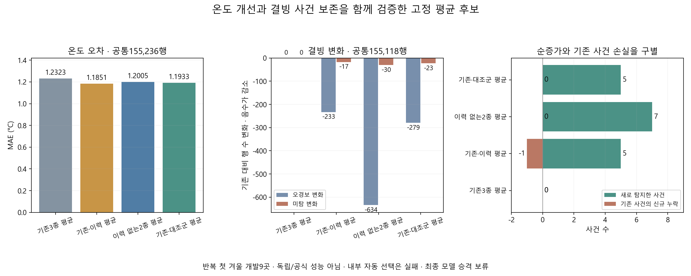
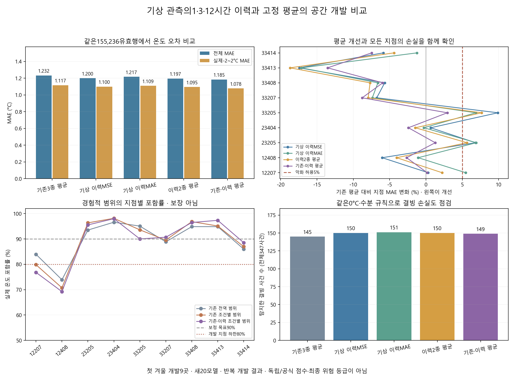

# 기상 이력 대조군과 온도·결빙 균형 후보 — 2026-10-13

추가 대조군에서 **온도·결빙·기존 사건 보존 기준을 함께 통과한 고정 평균2후보**를 확인했습니다. 간단한 기상12·MSE/MAE300 평균은 기존 대비 MAE2.58%·오경보634행·미탐30행을 줄이고 기존 탐지 사건을 모두 유지했습니다. 이력 결합은 온도 MAE3.83% 감소로 가장 낮았지만 결빙 사건1개를 새로 놓쳤습니다. 반복 개발 결과이므로 새로운 독립 검증 전에는 최종 모델을 승격하지 않습니다.

[문서 목록](README.md) · [현재 상태](PROJECT_STATUS.md) · [직전 결빙·범위 연구](ICE_METHODOLOGY_REVIEW_20261010.md) · [공식 정보](OFFICIAL_UPDATE_20261013.md)

## 온도와 결빙을 함께 개선한 대조군

이력 후보의 개선에 거리 제거·학습 길이·시간 이력이 섞여 있음을 확인하고 대조군20모델을 추가했습니다. 같은 학습 행·기상12·300회·MSE/MAE 조건에서 **과거 특징30개만 제거**했습니다. 기존 모델·분모·물리 규칙·임계값은 유지했습니다. 이 대조군은v2 결과 이후 제안한 반복 개발 연구이며 새로운 독립 평가가 아닙니다.

| 고정 후보 | 전체 MAE°C | 저온 MAE°C | FP / FN | 탐지 사건 | 기존 사건 신규 누락 | 온도·결빙·사건 기준 |
| --- | --- | --- | --- | --- | --- | --- |
| 기존3종 평균 | 1.232271 | 1.117190 | 20,889 /4,982 | 145 | 기준 | 기준 |
| 기존·기상 이력 평균 | 1.185115 | 1.078330 | 20,656 /4,965 | 149 | 1 | 실패 |
| **이력 없는 기상12·MSE/MAE300 평균** | **1.200531** | **1.099361** | **20,255 /4,952** | **152** | **0** | **개발 통과** |
| **기존 평균·대조군1:1 결합** | **1.193290** | **1.088010** | **20,610 /4,959** | **150** | **0** | **개발 통과** |

두 후보는 모든 양성 지점의 TP 비감소, FP/FN 비증가, 시점·지점 평균·실제 결빙일·전체 완전일 F1 비악화, 사건·단일 사건 비감소와 기존 사건 각각의 보존을 함께 통과했습니다. 온도 기준의 최대 지점 악화는 각각4.82%·1.85%이며 내부 자동 선택은 두 경우 모두 저온 기준에 실패했습니다. 고정 후보를 전체에서 비교한 성과를 내부 선택·독립 성능으로 바꾸지 않습니다.

기상12의2종 평균은 RMSE1.590065°C·시점F1 0.116319·지점평균F1 0.054236·실제결빙일F1 0.075373·전체완전일F1 0.030633입니다. 추가 TP30행 중29행은33408,1행은12408입니다. 기존 사건145개를 모두 유지하고7개를 새로 잡았지만 FP는23205 +54·23404 +15·33205 +15·33408 +75행으로 일부 지점에서 늘었습니다. 절대 미탐4,952행과 편중이 남아 실용적인 결빙 탐지·전북 전체 일반화를 입증한 것은 아닙니다.

이력 없는 대조군 결합의 MAE1.193290→이력 결합1.185115°C는 **추가0.69%**, 저온은1.088010→1.078330°C로 추가0.89% 감소입니다. 따라서 기존 대비3.83% 전체 개선을 시간 이력만의 효과로 설명하지 않습니다. MSE 단독에 이력을 추가하면 저온 오차는 오히려0.48% 악화했습니다. 같은 조건의 MAE모델·2종 평균·기존 결합에서는 온도 기준을 통과했습니다.



추가20모델·재예측1,242,056값·고정 평균1,242,056값·4선택·온도10종·물리5종·사건표를 별도 검산하고 대표2모델도 재적합했습니다. 전체 신규 적합은 **60건**, 검산 재적합은 **6건**입니다. 완료본은 `weather_memory_controls_20261013_v1/`·`weather_memory_tradeoffs_20261013_v1/`입니다.

기상12·2모델 평균의 별도 묶음은8파일493,856바이트, 약494KB입니다. 하루144행의 저장2모델·예측/고정 판정576값이 접속 차단 상태에서 일치했습니다. 실제 정답·원본ZIP·키는 없고 해당 하루에 입력 누락이 없음을 검사합니다. 일반 결측 환경의 기존fallback 모델까지 모두 포장한 운영 모델은 아닙니다.

```powershell
.\.venv_research\Scripts\python.exe -X utf8 outputs/private/weather_control_offline_bundle_20261013_v1/run_offline.py
```

최종 전체232테스트·저장소·로컬 GFM·모든 봉인 검사와 대조군의 품질 영수증은 `outputs/private/weather_memory_quality_20261013_v2/completion_receipt.json`입니다. 아래는 먼저 완료한 이력 후보·수치 수정·범위 실패의 상세 근거로 보존합니다.

## 자료와 공간 검증

| 항목 | 범위 |
| --- | --- |
| 기간 | 2024-11-01부터2025-03-01 전까지, KST10분 |
| 개발 입력 | 대회14곳·외부9곳, 첫 겨울397,173행 |
| 공간 평가 단위 | 서천·백양·금산·서상4그룹의 외부 개발9곳 |
| 공통 분모 | 온도155,236유효행, 실제−2~2°C42,268행. 상태155,118유효행·Ice6,611행 |
| 기존 기준 | 기상12·기상MSE300·기상MAE300의 고정3종 평균 |
| 새 모델 | 거리 없는 기상12개+과거 특징30개, HGB300의 MSE/MAE2종 |
| 고정 결합 | 새2종1:1 평균, 기존 평균과 새 평균의1:1 결합 |
| 학습 경계 | 외부G 예측은G 전체 제외. 내부H 예측은G와H 전체 제외 |
| 제외 정답 | 보호3곳·이미 개봉한8/4/2곳·다음 겨울·공식 평가 |

평가9곳은12207·12408·23205·23404·33205·33408·33207·33413·33414입니다. 여러 방법을 연구한 개발 자료이므로 새로운 독립 성능이나 공식 점수가 아닙니다. 내부 선택과 전체 고정 후보의 사후 비교도 구별합니다.

새 특징은 ASOS기온, AWS기온·습도·이슬점·15분 강수·풍속의 과거 평균18개와 정확한1·3시간 변화량12개입니다. 평균은 `[t-w,t)`에서 예정10분 슬롯의80% 이상이 유효할 때 제공하며 정확한 과거 시점이 없으면 변화량도 결측입니다. 실제 노면온도·상태·지점ID·좌표는 특징으로 쓰지 않습니다. 강수 평균은 강수량 누적이나 잔류 노면수분 실측이 아닙니다.

80%는 결합된10분 기상값의 가용률입니다. 시간 단위 ASOS값이 여러 슬롯에서 재사용되므로 서로 독립적인 원시 관측80%라는 뜻은 아닙니다. 현재 기상값은 기존에 감사된 시각 결합을 유지하며 미래 보간하지 않습니다. 정답 결측 행도 기상 이력 계산에 남겨 정답 유효성에 따른 이력 누락을 피합니다.

## 최종 수정본의 온도 결과

| 후보 | 전체 MAE°C | 전체 RMSE°C | 실제−2~2°C MAE°C | 최대 지점 MAE 악화 | 온도 기준 |
| --- | --- | --- | --- | --- | --- |
| 기존3종 평균 | 1.232271 | 1.636496 | 1.117190 | 기준 | 기준 |
| 기상 이력MSE300 | 1.200060 | 1.586384 | 1.100122 | 33205의9.90% | 실패 |
| 기상 이력MAE300 | 1.217379 | 1.615453 | 1.109199 | 23205의6.93% | 실패 |
| 이력2종 평균 | 1.196655 | 1.585990 | 1.094984 | 33205의7.67% | 실패 |
| **기존·이력1:1 평균** | **1.185115** | **1.581696** | **1.078330** | **33205의2.94%** | **통과, 연구 후보** |
| 내부 검증으로 선택 | 1.229300 | 1.630561 | 1.122212 | 33205의7.67% | 실패 |

고정 결합은 전체 MAE3.83%·RMSE3.35%·저온 MAE3.48% 감소입니다. 지점 평균 MAE는1.232051→1.185002°C, 지점 평균 RMSE는1.611661→1.556247°C입니다.9곳 중6곳은 개선하고3곳은 악화했습니다. 지점 MAE 변화는12207 +0.17%,12408 −2.66%,23205 +1.28%,23404 −2.41%,33205 +2.94%,33207 −8.77%,33408 −5.94%,33413 −13.53%,33414 −7.46%입니다.

선택 조건은 내부 지점 평균 MAE/RMSE 동시 감소·모든 지점 MAE 악화5% 이하·저온 MAE 비악화입니다. 서천·백양은 기존·이력 평균, 금산은 이력2종 평균, 서상은 기존 평균을 선택했습니다. 이 정책은 금산 지점 손실과 전체 저온 조건에 실패했습니다. 전체에서 좋아 보이는 고정 후보의 결과를 자동 선택 성능으로 소개하지 않습니다. 고정 결합의 지점 평균 편향도+0.126554→+0.231432°C로 높아졌습니다.



## 사건 순증가에 가려진 결빙 손실

온도마다 기존0°C·수분 규칙을 그대로 적용했습니다. 결측 시 기존 판정으로 되돌리는21행도 같고 임계값 탐색이나 새 분류 학습은 없습니다.

| 항목 | 기존3종 평균 | 기존·이력 평균 |
| --- | --- | --- |
| TP / FP / FN | 1,629 /20,889 /4,982 | 1,646 /20,656 /4,965 |
| 시점 F1 | 0.111847 | 0.113859 |
| 지점 평균 F1, 미정의0 | 0.053826 | 0.053880 |
| 실제 결빙일·지점 평균 F1 | 0.074146 | **0.073516, 악화** |
| 잠정 전체 완전일·지점 평균 F1 | 0.030231 | 0.030256 |
| 탐지 사건, 전체347 | 145 | 149 |
| 탐지 단일 시점 사건, 전체118 | 56 | 57 |
| 기존 탐지 사건의 신규 누락 | 기준 | **1개,12408** |
| 기존에 놓쳤으나 새로 잡은 사건 | 기준 | 5개 |

TP17행 증가는 모두33408에 집중됩니다. 다른 양성 지점의 TP 수는 같지만12408에서는 탐지 시점이 다른 사건으로 이동해 기존 사건1개를 놓쳤습니다. 총 사건145→149만 보면 이 손실을 알 수 없습니다.4개 고정 후보와 내부 선택 모두 기존 사건1개를 새로 놓쳤습니다.

추가 검토에서는347사건의 `station/start_kst/slots`를 맞추고 기존 탐지 사건을 각각 유지하는지 검사했습니다. 행별 판정에서6개 정책의 사건표를 별도로 재구성해 원래CSV와 대조했습니다. `src/event_retention.py`와4개 검사는 사건 순증가가 기존 단일 사건 누락을 덮는 경우를 거부합니다. 이 기준은 이번 개발 결과를 본 뒤 추가했으며 원래 선택·점수·영수증을 바꾸지 않았습니다.

지점별 FP 변화는12207 −116,12408 −35,23205 +37,23404 +32,33205 +13,33207 −74,33408 +30,33413 −51,33414 −69행입니다. 전체 FP·FN 감소를 모든 구간의 결빙 개선으로 해석하지 않습니다. 상태 분모155,118행·완전일1,060개·실제 결빙일124개·양성 지점8곳은 같고 일별 값은 명시한 잠정 정책이며 공식 점수가 아닙니다.

## 전역 범위와 조건별 범위

고정5후보 각각에 전역 및 예측온도3구간×KST시간대2구간의 경험적90% 오차 범위를 계산했습니다. 범위 보정은G를 제외한 내부H의 예측 오차만 사용하고 기본 모델도G/H를 제외했습니다. 조건별 유효500행·2지점 미만은 전역 반경으로 되돌립니다. 실제 정답온도로 조건을 나누지 않습니다.06–18시는 시각 대용값이며 실제 일사나 일출·일몰이 아닙니다.

| 후보·범위 | 전체 실제 포함률 | 평균 폭°C | 평균 interval score | 12408 포함률 |
| --- | --- | --- | --- | --- |
| 기존 평균·전역 | 89.73% | 5.423453 | 7.433871 | 73.91% |
| 기존 평균·조건별 | 89.67% | 5.458892 | 7.408897 | 70.73% |
| 새 고정 결합·전역 | 89.55% | 5.289539 | 7.217307 | 73.02% |
| 새 고정 결합·조건별 | 89.17% | 5.274380 | 7.277784 | **69.23%** |

`interval score = (상한−하한)+20·max(하한−정답,0)+20·max(정답−상한,0)`으로 폭과 범위 밖 오차를 함께 평가합니다. 작을수록 좋습니다. 새 전역 범위는 평균 점수를 줄였지만 취약 지점 포함률은 낮습니다. 조건별 구분도 이를 해결하지 못해5후보 모두 최소 지점80%·지점 평균89%·저온90%·점수/폭 기준을 함께 통과하지 못했습니다.

공간 교환가능성·정상성·mixing 조건이나 공변량 이동의 밀도비를 확인하지 않았고 보정 모델과 최종 예측 모델의 학습 크기도 다릅니다. 따라서 LSCP 재현, 보장된 conformal90% 범위, 결빙 확률로 소개하지 않습니다. 전역 범위도 제한을 표시한 진단용입니다.

## 입력 길이에 따른 수치 문제 수정과 재현

v1은 Pandas 부동소수점 이동평균을 사용했습니다. 전체 겨울과12시간 준비 입력의 특징 차이는1e-10 이내였지만 트리 분기 경계를 넘어 하루144행 중2행의 예측이 달라졌습니다. 첫 실패 로그의 최대 차이는0.02098948°C입니다. 입력 특징의 작은 허용 오차만으로 모델 재현을 판정하면 놓치는 문제였습니다.

v2는 이력용 기상값을 소수6자리 정수로 바꿔 정수 누적합으로 평균을 계산하고 평균도 소수6자리로 처리합니다. 정확한 과거 변화량도 같은 정수값에서 계산합니다. 학습과 추론의 처리는 같고 현재 기상12개 입력은 유지합니다. 정수 누적합 범위도 검사합니다. v1·v2 각각20모델을 실제 학습했으며 **신규 적합40건과 별도 감사의 대표 재적합4건**을 구별합니다. v1 모델·지표·감사·실패 묶음은 보존했습니다. 현재 결과와 그림은v2이며 재현 실패 수정 뒤의 개발 결과를 새 독립 평가로 바꾸지 않습니다.

| 산출물·검사 | 실제 확인 |
| --- | --- |
| `weather_memory_temperature_20261013_v2/` | 20모델·11,915,190이력 값·모델 재예측1,242,056값·고정 평균1,242,056값 |
| 별도 계산 | 완전10분 격자의 정수 합성곱으로 이력 값 정확히 일치. 대표2종 재적합·4선택·온도7종·범위10종·물리6종 대조 |
| 오차 범위 | 반경160개·경계3,105,140값 검산. 기존 평균의 전역 범위도 이전 결과 그대로 재현 |
| `weather_memory_event_review_20261013_v1/` | 6정책의347사건을 행별로 재구성, 기존 사건 손실·새 탐지 구별 |
| `weather_memory_offline_bundle_20261013_v2/` | 12개 소스/모델/입력 파일1,821,419바이트, 약1.82MB·1.74MiB |
| 별도 Python 실행 | 12시간72행 준비+하루144행.5모델·특징6,048값 정확히 일치·예측/경계1,296값 허용오차1e-10 이내 |
| 실행 경계 | DNS·주요 소켓 차단, 접속 시도0·새 학습0. 원본ZIP·실제 노면/상태 정답·인증키 미포함 |
| 보존 | 기존 고정47/549파일·8/4/2평가 봉인 유지. 새 독립 평가·모델 승격·제출 없음 |

전체 합성 검사232개와 새 파일을 포함한 저장소·로컬 GFM 검사를 완료했습니다. 품질 영수증은 `outputs/private/weather_memory_quality_20261013_v1/completion_receipt.json`입니다. Python 소켓 가드는 동기 재현의 호출을 검사하며 OS 전체 격리 보장은 아닙니다. 설치된 고정 환경에서 작은 묶음을 다시 실행할 수 있습니다.

```powershell
.\.venv_research\Scripts\python.exe -X utf8 outputs/private/weather_memory_offline_bundle_20261013_v2/run_offline.py
```

## 일차 문헌의 적용과 한계

| 출처 | 적용·판단 |
| --- | --- |
| [Li 등2026, GMD의 LSTM·스태킹](https://gmd.copernicus.org/articles/19/9035/2026/) | 다시간 열 이력·서로 다른 학습기의 OOF 결합을 검토. 논문의 과거 대상RST·24시간 입력·시간 단위 미래1/3/6시간 예보를 미관측 도로 상태 추정에 그대로 적용하지 않음 |
| [Jiang·Xie2026, 공간 국소 분위수](https://proceedings.mlr.press/v306/jiang26at.html) | 공간 이질성을 평균 포함률로 덮지 않고 지점별 평가. 주변 잔차 분위수 모델이나 이론 가정을 재현했다고 주장하지 않음 |
| [Tibshirani 등2019, 공변량 이동](https://arxiv.org/abs/1904.06019) | 밀도비·분포 변화 가정 없이 거리·분위수 가중치만으로 보장된 포함률을 주장하지 않음 |
| [Gneiting·Raftery2007, 구간 점수](https://sites.stat.washington.edu/raftery/Research/PDF/Gneiting2007jasa.pdf) | 식43의 폭+범위 밖 오차 평가를 사용. 포함률만 높이려고 범위를 넓히는 비교를 피함 |
| [Cawley·Talbot2010, 선택 편향](https://jmlr.org/papers/v11/cawley10a.html) | 반복 개발과 독립 평가, 고정 후보와 내부 선택을 구별 |
| [HGB 공식 문서1.6](https://scikit-learn.org/1.6/modules/generated/sklearn.ensemble.HistGradientBoostingRegressor.html) | 같은300회·15잎·최소100행·L2=10·학습률0.05·조기 종료 없음에서 MSE/MAE 비교 |

익명 HTTP10건 중9건200, 논문PDF5개 전체 텍스트와 대표 페이지를 확인했습니다. 원문·시각·해시는 `weather_memory_references_20261013_v1/`에 보존합니다. METRo 출판사 원문은403이어서 이번 새 확보본으로 계산식을 가져오지 않았습니다. 과거 보존한 FHWA·공간 검증·블렌딩 문헌은 기존 적용 범위 안에서 참고했습니다.

## 제출 전 우선순위

1. 이력 결합은 온도 후보, 대조군의 두 고정 평균은 온도·결빙 균형 후보로 유지합니다. 내부 선택 실패와 반복 개발·지역 편중이 남아 새 독립 검증 전 최종 모델이나 위험 등급을 승격하지 않습니다.
2. AWS614·647·730·914의 첫 겨울 실제 관측 확보·품질 감사가 우선입니다. 마지막 실제 API403은 미해결이며 이번 추가 인증 요청·신청은 없습니다. 확보 뒤 입력 확장만 바꾼 고정 비교와 아직 개봉하지 않은 적격 전북 지점 검증이 필요합니다.
3. 센서 위치·제빙/시설 이력과843구간의 공식 이정 대응을 확인해야 합니다. 대상 지점 노면온도를 못 쓰는 조건을 유지하면서 위치별 이질성의 원인을 확보하는 단계가 남았습니다.
4. 공식 목록·제출564·질문633을 재조회했습니다.10월12일 FAQ 이후 새 공지를 확인하지 못했고 결과물 제출 날짜·방법은 별도 공지 대기입니다. 한국 시간23:59 안내와 참가신청 종료11월6일을 구별합니다. [공식 제출 안내](https://aida.kisti.re.kr/competition/main/selectNotice.do?bbsId=BBSMSTR_AAAAAAAAAAAA&nttId=564)

이번 결과는 재현 가능한 온도 개선 후보와 추가 사건 손실 검사입니다. 전북 전체·다음 겨울 일반화, 최종 위험 지도, 수상 가능성을 입증한 결과는 아닙니다.
