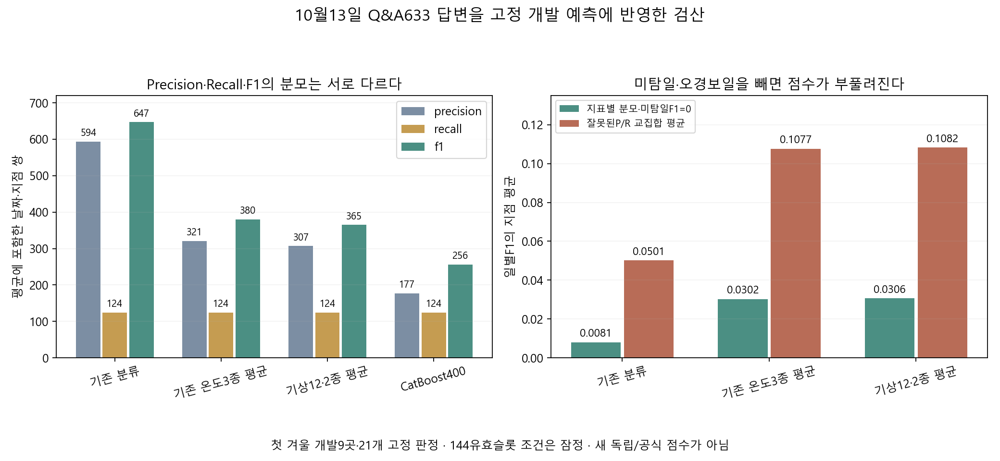

# 공식 Q&A633 답변과 일별 평가 후속 검증 — 2026-10-13

> **읽는 범위:** 아래 내용은 해당 문서의 작성·실험 시점 기록입니다. 현재 모델·마감·완료 상태는 [진행 현황](../STATUS.md)을 기준으로 읽고, 약어와 지표는 [처음 읽는 안내](../START_HERE.md)에서 확인합니다.

**문제별 Q&A6건 모두 답변 완료이며633에10월13일 새 답변이 올라왔습니다.** 미탐일의 Precision은 평균에서 제외하고 Recall·F1은0으로 남기는 처리입니다. 기존 구현이 이 규칙과 일치해 개발 판정21종의 F1은 바뀌지 않았습니다. 지표별 분모·부분 날짜 민감도·잘못된 평균의 부풀림을 CSV와 별도 검산으로 확인하고 최신 설정·문서를 갱신했습니다. 새로운 공식 점수나 모델 승격은 아닙니다.

[문서 목록](../README.md) · [현재 상태](../STATUS.md) · [온도·결빙 후보](../research/WEATHER_MEMORY_REVIEW_20261013.md) · [직전 공식 스냅샷](OFFICIAL_UPDATE_20261013.md)

## 현재 공식 사이트에서 확인한 내용

| 항목 | 최신 확인 | 적용 |
| --- | --- | --- |
| [문제별633](https://aida.kisti.re.kr/competition/problem/PROB_000000000004604/detail/commuDetail.do?bbsId=BBSMSTR_000000000319&nttId=633) | 10월13일 새 답변, 댓글ID648. 기존 미답변 상태가 변경됨 | 미탐일의 지표별 처리 확정 |
| 문제별620·603·588·556·555 | 모두 완료, 이전 본문·댓글과 같음 | 04만 결빙·결측 제외·공공 기상·보호 배제·지점별 평균 유지 |
| 일반 Q&A | 현재2026년 게시글16건 모두 완료. 최신10건 본문은 기존과 같고 이전6건도 확인 | 신청·AI/API·팀 구성 안내 유지. 다른 참가자의 승인을 본인 승인으로 해석하지 않음 |
| [공지 목록](https://aida.kisti.re.kr/competition/main/notice.do)·제출564·FAQ639 | 10월12일 FAQ 이후 새 공지를 확인하지 못함. 숨김 공지 본문도 이전과 같음 | 결과물 제출 시작일·마감 날짜·구체 방법은 별도 공지 대기 |
| 문제·데이터 본문 | 두 내용 SHA256이 이전과 같고 수정 시각2026-10-07 14:06:07 | 배포20261007·평가 대상·기간·자료 경계 유지 |
| 빈 참가양식 | 222,720바이트·SHA256 동일 | 자필서명·제안서·서약 유지. 참가자의 신청서 변경 없음 |
| 공개 평가·결과제출·정답제출 경로 | 익명GET은 로그인 화면으로 이동 | 접수 가능 여부·계정 승인·최종 CSV를 확인한 것으로 해석하지 않음 |
| 공개 리더보드 | 공개 기간이 아니며 표시된 평가 내역 없음 | 순위나 경쟁팀 점수를 추정하지 않음 |

공개 응답39건을 익명GET으로 보존했습니다. 앞선 스냅샷은 `official_updates_20261013_v1/`, 이번은 `official_updates_20261013_v2/`입니다. 공지4개·문제별6개·일반2026년16개·목록/페이지·문제 본문·현재 양식을 포함합니다.39건의 최종HTTP는200이며 일부 경로가 반환한 것은 인증 화면입니다. 로그인·문의·자료 신청·대회 제출은 하지 않았습니다. 승인 사용자용 전체ZIP도 다시 받지 않아 ZIP 바이트 동일성을 새로 주장하지 않습니다.

[일반524](https://aida.kisti.re.kr/competition/main/selectQna.do?bbsId=BBSMSTR_BBBBBBBBBBBB&nttId=524)의 이전8월 답변에는 최종 발표·시상을11월25일 KISTI 본원 키움관에서 진행할 계획이라고 적혀 있습니다. **세부 일정은 추후 안내라는 예정 정보**이며 결과물 제출 마감으로 사용할 수 없습니다. 참가신청 종료2026-11-06과 결과물 제출 마감 날짜도 구별합니다.

## 새 답변을 계산에 적용한 방식

| 날짜의 유효 관측·예측 | Precision | Recall | F1 |
| --- | --- | --- | --- |
| 실제·예측 결빙 모두0 | 평균에서 제외 | 평균에서 제외 | 평균에서 제외 |
| 실제 결빙>0·예측 결빙0 | 미정의·평균 제외 | 0·평균 포함 | 0·평균 포함 |
| 실제 결빙0·예측 결빙>0 | 0 | 분모0·null 유지, 이 경우의 평균 정책은 명시 답변 없음 | 0 |
| 실제·예측 결빙 모두>0 | 일별TP/FP/FN으로 계산 | 같은 방식 | 같은 방식 |

633의 첫 문장에는 ‘시각’이라는 표현이 있고 질문은 날짜별 평균에 관한 것입니다. TP·FP·FN 기반 세 지표에는 TN이 들어가지 않으므로 실제·예측 모두 비결빙인 시점을 분모에서 빼도 지표값은 같고, 하루 전체가 이 조건이면 지표가 미정의입니다. **TN 시점을 관측 결측으로 바꿔144슬롯 가용성을 낮추지 않았습니다.** 실제 유효 관측 수와 지표의 활동 슬롯 수를 따로 저장합니다.

날짜별F1을 먼저 계산하고 지점별 일평균, 지점별 값의 단순 평균을 계산합니다. Precision·Recall의 평균을 먼저 구해 그 둘의 조화평균을 F1으로 만들지 않습니다. P/R가 모두 정의된 날의 교집합만 남기는 방식도 사용하지 않습니다. 지표마다 포함 날짜·지원 지점을 따로 기록하며, 어떤 지점의 지표가 전 기간 미정의이면 모든 지점을 포함한 평균은null로 둡니다. 정의된 지점만의 평균은 별도 이름입니다.

## 기존 고정 개발 판정21종의 결과

대상은 첫 겨울 외부 개발9곳의155,257행·유효상태155,118행입니다. 보호3곳·이미 개봉한8/4/2곳·다음 겨울을 새로 채점하지 않았습니다. 모델·임계값·예측은 전혀 바꾸지 않았고 새 학습도0건입니다. 아래는 기존과 비교하기 위한 **144유효슬롯 조건의 개발 지표**입니다. 이 관측량 조건 자체는 공식 확정 규칙이 아닙니다.

| 고정 판정 | Precision 평균 | Recall 평균 | F1 평균 | P / R / F1 날짜·지점 쌍 |
| --- | --- | --- | --- | --- |
| 기존 분류 | 0.022738 | 0.695246 | 0.008073 | 594 /124 /647 |
| 기존 온도3종 평균·수분 | 0.055359 | 0.753175 | 0.030231 | 321 /124 /380 |
| 기상12·2종 평균·수분 | 0.052803 | 0.774688 | 0.030633 | 307 /124 /365 |
| 기존 평균·이력 없는 대조군 결합 | 0.053501 | 0.774518 | 0.030598 | 310 /124 /368 |
| 기존 평균·시간 이력 결합 | 0.053425 | 0.753836 | 0.030256 | 315 /124 /373 |
| CatBoost400 | 0.053990 | 0.427095 | 0.027005 | 177 /124 /256 |

표는 지표가 정의된 지점의 평균입니다. Precision/F1은9곳, Recall은 실제 양성 관측이 있는8곳이 지원됩니다.9곳 전체의 Recall 평균을 임의0으로 보완하지 않았습니다. 공식 대상3곳의 점수도 아닙니다. 기존 판정21종의 이 조건 F1은 이전 `provisional_daily_station_f1`과 모두 같았습니다. 답변 확인 자체를 모델 성능 상승으로 소개하지 않습니다.

**기상12·2종 평균은 FP/FN과F1·Recall을 개선했지만 일평균 Precision은 기존 온도 평균보다 낮습니다.** FP 감소가 날짜별 Precision 평균의 증가를 보장하지 않습니다. 앞선 온도·FP/FN·F1·사건 기준의 통과와 공식형 세 지표의 동시 개선을 구별하며 최종 채택은 계속 보류합니다.

기상12·2종 평균에서는 실제 결빙이 있는데 예측이0인58일을 Precision 평균에서 제외하면서 Recall/F1에는0으로 넣었습니다. 잘못된 P/R 교집합만 계산하면 이58일과 오경보만 발생한241일이 빠져 F1이 **0.030633→0.108246**으로 부풀려집니다. 기존 분류도0.008073→0.050115가 됩니다. 이 큰 값들은 잘못된 집계의 진단이며 대회 성능이 아닙니다.

## 아직 확정되지 않은 부분 날짜 처리

| 최소 유효슬롯·잠정 조건 | 포함 날짜·지점 쌍 | 누락되는 실제 결빙일 | 기상12·2종 평균 F1 |
| --- | --- | --- | --- |
| 144 | 1,060 /예정1,080 | 1 | 0.030633 |
| 130 | 1,075 /1,080 | 0 | 0.030115 |
| 72 | 1,078 /1,080 | 0 | 0.030115 |
| 1 | 1,079 /1,080 | 0 | 0.030115 |

관측 부족 기준에 따라 실제 결빙일1개가 제외됩니다. 유리한 조건을 골라 주점수로 바꾸지 않고144·130·72·1의4조건을 모두 기록했습니다. 모든 유효 관측을 사용한 경우도 단순 민감도 값이며 주최 측의 공식 최소 관측량 답변을 대신하지 않습니다. 무관측 날짜는 비결빙으로 채우지 않고 예정 날짜표에 남겼습니다.

## 후속 코드·CSV와 검증

| 산출물 | 역할 |
| --- | --- |
| `config/official_requirements_20261013_v2.json` | 633답변 유무·날짜·미탐일 정책·계속 미정인 항목·새 원문 해시 |
| `src/qa633_metrics.py` | 지표별 날짜 포함·KST예정 날짜·미정의 지점·관측량 분모 |
| `qa633_development_20261013_v1/research_daily_metrics.csv` | 21판정×4조건×9곳×120일,90,720행 |
| `research_station_metrics.csv` | 같은 범위의 지점별 평균·지표별 날짜 수,756행 |
| `wrong_intersection_comparison.csv` | 21판정의 올바른 값·잘못된 교집합 값·빠진 실패 날짜 수 |
| 별도 감사 | 저장 판정3,260,397값·일별90,720행·지점756행·84보고서 일치 |
| 검사 | 새8개 합성 사례·전체240검사·저장소·로컬 GFM·그림 확인 |

위 CSV는 **연구용 계산·검산 표**이며 주최 측이 승인한 제출CSV 스키마가 아닙니다. 최종 열·행키·결측 표기·파일명은 아직 확인하지 못했습니다. 기존 평가 설정·모델·예측·영수증은 보존하고 새 설정 버전으로만 반영했습니다. 품질 영수증은 `outputs/private/qa633_quality_20261013_v1/completion_receipt.json`입니다.

## 제출 준비의 다음 순서

1. 새 답변으로 해결된 미탐일 Precision 질문은 완료 처리합니다. 부분 날짜 최소 관측량, 오경보만 있는 날의 Recall 처리, 전 기간 미정의 지점의 평균, 최종CSV 규격은 계속 구별해 기록합니다. 문의를 발송하지 않았습니다.
2. 새 지점·실제 기상 확장 검증 전 모델을 승격하지 않습니다. 이번에는 재학습·임계값 재탐색 없이 계산 정책과 분모를 검증했습니다. AWS확장·센서/제빙 이력·공식 이정 대응·위험 등급의 미해결 조건도 그대로입니다.
3. 문제의10분 예측·지점별/세 지점 평균 CSV·구간 환경/상관분석·위험 기준·공간파일·재현 코드/매뉴얼을 최종 묶음에서 연결해야 합니다. 현재 작은 오프라인 묶음과 기존 제출 초안은 최종 제출 완료가 아닙니다.
4. [일반547](https://aida.kisti.re.kr/competition/main/selectQna.do?bbsId=BBSMSTR_BBBBBBBBBBBB&nttId=547)의 결과파일·코드·분석보고서·발표자료 안내도 확인했습니다. 질문은 다른 어선 항적 문제이므로 그 스코어 열·확장 구현을 결빙 과제 규격으로 옮기지 않습니다. 최종 보고서·발표자료의 통합 준비 항목으로 참고하며 이번에 완성된 발표자료가 있다고 표시하지 않습니다.
