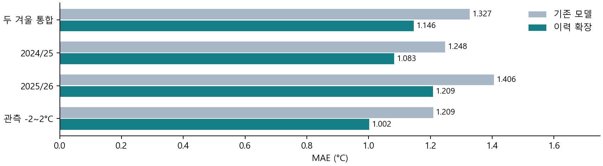
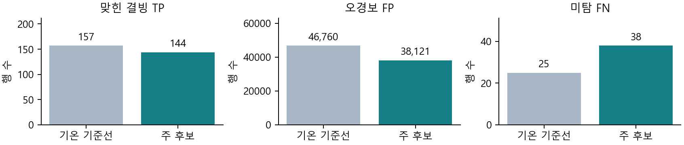
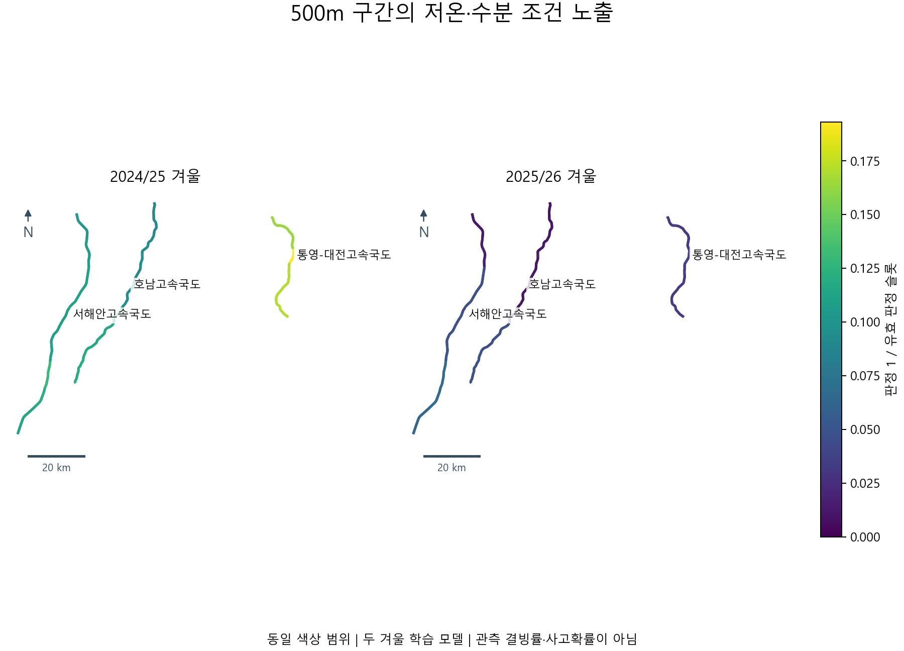

# 미관측 고속도로 구간의 노면온도 추정과 결빙 탐지

10월 25일 후보 보고서 원고입니다. 실제 제출 결과와 평가 분모는 [11월 6일 최종 보고서](FINAL_ANALYSIS_REPORT.md)에 정리했습니다.

2026 DATA·AI 분석 경진대회 · 전북 고속도로 과제 · 분석 기준일 2026년 10월 25일

## 초록

도로 센서는 제한된 지점에 설치되어 있어 구간 전체의 노면 상태를 직접 관측하기 어렵다. 본 연구는 공공 기상 관측의 시간 이력으로 미관측 지점의 노면온도를 추정하고, 결빙 탐지와 공간적 활용 가능성을 별도로 평가하였다. 학습에는 허용된 23개 지점의 두 겨울 자료를 사용하였다. 개발 성능은 9개 지점을 네 지역으로 묶어 평가 지역 전체를 학습에서 제외한 예측으로 비교하였다.

기상·열 이력과 태양 위치를 결합한 63변수 나무 모델의 온도 MAE는 1.145698°C로, 동일 조건의 기존 모델 대비 13.66% 감소하였다. 두 겨울과 네 지역에서 모두 개선되었다. 반면 유지한 결빙 판정의 일별 지점 평균 F1은 0.026554로, 기온 0°C 기준선의 0.036601보다 낮았다. 별도로 예측을 사전 고정한 새 4지역 평가에서도 주 후보의 평균 F1은 증가했으나 재현율 하락과 기존 탐지 8사건의 손실이 발생하였다. 해당 후보는 채택하지 않았다.

온도 추정의 개선은 확인되었지만 결빙 탐지의 일반화는 미해결 과제이다. 이에 500m·1km 구간의 추정값, 조건 노출, 입력 가용 범위를 함께 제공하고, 지도에서 확인한 조건을 실제 결빙률이나 사고확률로 해석하지 않도록 결과의 사용 범위를 명시하였다.

| 연구 질문 | 확인한 결과 | 해석 범위 |
| --- | --- | --- |
| 기상 이력이 온도 오차를 줄이는가? | MAE 1.326890 → 1.145698°C | 같은 개발 지역에서 반복 비교한 결과 |
| 결빙을 기온 기준선보다 잘 탐지하는가? | 현재 F1 0.026554 < 0.036601 | 기준선 초과 성능을 입증하지 못함 |
| 새 지역에서도 개선되는가? | 주 후보의 재현율 하락·8사건 손실 | 자료 품질 조건도 미충족, 미채택 |
| 결과를 구간별로 검토할 수 있는가? | 지도·CSV·실행 노트북·데모 제공 | 관측 없는 구간의 조건 탐색 지원 |

**읽는 순서.** 1–2절은 자료와 검증 설계, 3–5절은 성능과 독립 평가, 6–7절은 활용 및 한계, 8절은 재현 절차이다. 수치는 공식 대회 점수가 아니며, 보호 지점의 정답을 새 학습·후보 선택·평가에 사용하지 않았다.

<!-- page -->

## 1. 문제 정의와 자료

분석 대상은 서해안·통영-대전중부·호남 고속도로이다. 목표는 노면 센서가 없는 위치에 대해 10분 간격의 노면온도와 결빙 조건을 추정하는 것이다. 관측 시각까지의 기상으로 같은 시각의 상태를 추정하므로 미래 수 시간의 예보 성능을 검증한 연구와 구별한다.

| 자료 또는 범위 | 사용 내용과 규모 |
| --- | --- |
| 기간 | 2024.11–2025.02 / 2025.11–2026.02, 각 120일 |
| RWIS 도로 관측 | 대회 14곳·추가 9곳, 총 23지점. 온도 학습 유효 793,149쌍 |
| 온도 개발 비교 | 9지점·4지역, 두 겨울 유효 310,091쌍 |
| ASOS·AWS 기상 | 기온·습도·바람·강수·적설·지면온도·일사 등 |
| 공간 자료 | 도로망, 교량·터널 속성, 구간 중점과 기상 연결 |
| 보호 지점 | 부곡교 12410·삼봉 33411·해전 23402 |
| 추가 지역 평가 | 이천휴·진천터널외부·성암교·쌍암천교 |

RWIS는 도로의 노면온도와 상태를 측정하는 관측 장비이다. 학습 정답은 노면온도와 원본 상태 코드이며, 결빙은 공식 해석에 따라 `04` Ice만 양성으로 정의하였다. 나머지 유효 상태는 음성으로, 결측·미정의 상태는 평가 제외로 처리하였다. 기온이 높다는 이유로 Ice를 음성으로 바꾸지 않았다.

### 시간 연결과 결측 처리

기상은 목표 시각보다 엄격히 이른 관측 중 60분 이내 자료를 연결하였다. 과거 특징은 목표 시각을 제외한 구간에서 계산하며 필요한 유효 슬롯 비율은 80%이다. 미래 관측으로 보간하지 않고, 결측 강수를 무강수로 간주하지 않았다. 시각은 한국 표준시를 사용한다.

최종 온도 학습의 원시 행은 794,545개, 입력 유효 행은 793,209개, 온도 정답까지 유효한 쌍은 793,149개이다. 이 수치는 서로 다른 제외 조건을 적용한 결과다. 원천 자료 재연결에서 발견한 학습 입력 113행·540값의 차이는 정정 후 다시 학습하였으며, 이전 실험은 별도 기록으로 보존하였다.

### 자료 이용 범위

대회 제공 자료와 허용된 공개 기상자료를 사용하였다. 추가 RWIS 9지점은 개발 자료이며, 별도로 확보한 새 4지역의 정답은 사전 고정 평가에만 사용하였다. 외국 도로 학습 자료와 외부 사전학습 가중치는 사용하지 않았다. CCTV 시설 목록은 위치 진단의 보조 자료이며 모델 입력이나 결빙 정답으로 사용하지 않았다. 센서 정비·시각별 제설 이력은 아직 확보하지 못했다.

<!-- page -->

## 2. 모델과 검증 설계

온도 모델은 절대오차 손실을 사용하는 히스토그램 기반 그래디언트 부스팅(HGB)이며, 학습 반복 수는 1,200회이다. 입력 63개는 기상 12개, 열·수분 10개, 과거 기상 30개, 과거 열 상태 9개, 태양 위치 2개로 구성하였다. 과거 노면 정답은 입력에 포함하지 않았다.

노면온도는 대기 상태뿐 아니라 이전 열 상태와 복사 조건의 영향을 받는다. Li 등(2026)의 시간 이력 접근과 RoadSurf의 열·수분 상태 구분을 설계 배경으로 참고하였다[1, 2]. 본 연구는 해당 물리 모형이나 LSTM을 재현한 것이 아니라, 관측 가능한 기상 이력을 나무 모델의 입력으로 구성한 것이다. 태양 위치는 NOAA 계산식을 참고하였고 실제 일사량과 구별하였다[3].

| 검증 단계 | 제외·고정한 대상 | 답할 수 있는 질문 |
| --- | --- | --- |
| 온도 개발 비교 | 평가 지역의 모든 지점·두 겨울을 학습에서 제외 | 같은 개발 지역에서 방법 간 차이는 얼마인가? |
| 결빙 중첩 선택 | 외부 평가 지역과 내부 선택 지역을 함께 학습에서 제외 | 임계값 선택 절차가 다른 지역에 전이되는가? |
| 최종 실행 모델 | 허용 23지점으로 적합, 보호 정답 제외 | 포함 입력으로 추론을 재현할 수 있는가? |
| 새 4지역 평가 | 정답 요청 전에 후보·모델·예측·평가 코드 고정 | 처음 보는 지역에서 고정 후보가 유지되는가? |

같은 개발 지역을 반복 비교하였으므로 지역 제외만으로 모델 선택 편향이 사라지지는 않는다[4]. 온도 성능은 반복 개발 결과로 제시한다. 추가 4지역은 새 공간 평가이지만, 두 겨울 자체가 학습 기간과 겹치므로 미래 겨울 검증은 아니다. 과거에 완료한 보호 평가 기록을 새 후보의 선택 근거로 재사용하지 않았다.

### 지표와 채택 기준

온도는 MAE·RMSE·BIAS를 °C로 보고한다. BIAS는 추정값에서 관측값을 뺀 평균이다. 결빙은 날짜 안에서 정밀도·재현율·F1을 계산한 뒤 지점별 평균을 구한다. 주 비교는 하루 144개 공통 유효 슬롯을 사용하며, 부분 날짜 기준은 민감도로 구별한다. 이는 공식 답변이 확정하지 않은 자체 검증 가정을 포함한다.

실제·예측 결빙이 모두 없는 날의 F1은 미정의이다. 오경보가 사라져 이런 날이 늘면 평균의 분모도 달라질 수 있다. 따라서 F1과 함께 날짜 수, 미탐, 기존 탐지 사건 손실을 확인하였다. 사건은 같은 지점에서 10분 간격으로 연속 관측된 Ice이며 실제 사고 건수가 아니다. 겨울·지점·정밀도·재현율 비악화와 사건 보존은 연구의 보수적 채택 조건으로, 공식 배점 규정과는 다르다.

<!-- page -->

## 3. 노면온도 추정 결과

같은 개발 9지점의 지역 제외 예측에서 기존 기상 모델과 이력 확장 모델을 비교하였다. 유효 온도 쌍은 310,091개이다. 이력 확장 모델의 통합 MAE는 1.145698°C, RMSE는 1.602392°C, BIAS는 +0.304301°C였다. 통합 MAE 감소율은 13.66%이며 네 지역 모두 개선하였다.



| 평가 범위 | 기존 모델 MAE | 이력 확장 MAE |
| --- | --- | --- |
| 두 겨울 통합 | 1.326890 | 1.145698 |
| 2024/25 | 1.247911 | 1.082808 |
| 2025/26 | 1.406063 | 1.208743 |
| 관측 -2~2°C | 1.209004 | 1.002049 |

표의 단위는 °C이다. 결빙점 부근의 오차 감소는 저온 경계 추정에 유용하지만 Ice 상태를 더 잘 맞힌다는 증거와는 구별된다. 모든 지점에 동일한 오차를 보장하지 않으며, 세부 지점 결과는 포함된 개발 온도 CSV에서 확인할 수 있다.

### 복잡도와 불확실성

학습을 2,400회로 늘린 추가 MAE 감소는 약 0.10%, 세 시드 평균은 약 0.37%였다. 사전 복잡도 기준인 추가 0.5% 개선에 못 미쳐 단일 모델을 선택하였다. 가장 낮은 점추정값을 가진 조합이라는 의미는 아니다.

7일 날짜 블록을 2,000회 재표집한 개선율의 2.5·50·97.5 백분위는 12.10·13.63·15.31%였다. 고정된 지점과 후보에 조건부인 날짜 민감도이며, 새 지역의 오차나 반복 후보 선택의 불확실성을 포함한 신뢰구간으로 해석하지 않는다.

<!-- page -->

## 4. 결빙 탐지와 기온 기준선의 차이

현재 결빙 판정은 기존 두 온도 모델의 평균이 0°C 이하이고 이슬점·강수·적설에서 수분 근거가 있는 조건이다. 새 온도 모델로 교체한 결빙 방식이 채택 조건을 통과하지 못해 온도 추정과 결빙 판정의 모델을 구분하였다. CSV에는 각각의 온도를 별도 열로 제공한다.

| 방법 | 통합 F1 | 2024/25 F1 | 2025/26 F1 |
| --- | --- | --- | --- |
| 현재 온도·수분 조건 | 0.026554 | 0.030187 | 0.009466 |
| ASOS 기온 0°C 기준선 | 0.036601 | 0.071179 | 0.001444 |

동일 입력 가용 범위의 일별 지점 평균이다. 현재 판정의 정밀도·재현율은 0.040055·0.739628, 기온 기준선은 0.033386·0.966799이다. F1 평균에 포함된 날짜·지점 수는 각각 487·1,495개이며, 재현율은 양성이 있는 8지점의 140개 날짜에서 정의된다. **현재 판정이 기온 기준선보다 전반적으로 우수하다는 결론은 성립하지 않는다.** 과거 CSV에 남은 기준선 F1 0.036392는 결측 기온 처리 정책이 달라 직접 혼합하지 않는다.

### 확인된 차이와 남은 가설

| 구분 | 관찰 또는 가설 | 의미 |
| --- | --- | --- |
| 확인한 미탐 원인 | 기준선이 찾던 Ice 중 수분 조건에서 2,668행, 노면온도 조건에서 1,490행 제외 | 조건을 추가하면서 실제 결빙도 줄임 |
| 지역별 차이 | 33408의 F1 감소가 6개 지점의 개선을 초과 | 통합 점수만으로 지역 간 균형을 설명할 수 없음 |
| 입력 구별력 진단 | 기존 15기상 변수에서 Ice 6,687행 모두 음성과 같은 입력을 공유 | 같은 입력으로 서로 다른 관측 상태가 나타남 |
| 미확인 요인 | 제설·노면 물성·센서 교정·공간 대표성 | 원인 후보이며 인과적으로 확인된 설명은 아님 |

동일 입력 진단에서 관측 Ice를 모두 탐지하면 최소 24,527행의 오경보가 함께 발생한다. 현재 표본과 입력 조건에서 계산한 진단값으로, 공식 일별 F1의 한계나 미래 성능의 상한은 아니다. 기준선의 오경보는 117,723행으로 이보다 많아 추가 개선 여지는 남는다.

### 유지 결정의 의미

기온 기준선으로 일괄 교체하거나 후속 분류기를 적용한 경우 겨울·지점·정밀도·재현율·기존 사건 보존을 동시에 충족하지 못하였다. 따라서 기존 판정을 유지하되 평균 F1 미달을 별도 성능 과제로 둔다. 이 보수적 결정이 공식 점수 최대화를 입증하는 것은 아니다. 잔차 학습의 사후 최고 F1 0.037423도 기존 탐지 47사건을 잃었으며, 추가 정보 없는 재탐색만으로 안정적인 개선을 확인하지 못했다.

<!-- page -->

## 5. 새 4지역의 사전 고정 평가

기존 개발 지역에서의 작은 개선이 새로운 도로에 유지되는지 확인하기 위해 4곳의 138,240행 예측을 먼저 고정하였다. 10월 25일 19:53:52에 봉인하고 19:54:38부터 정답을 요청하였다. 시각과 해시는 로컬 재현 기록이며 제3자 시각 인증은 아니다. 주 후보는 기온 기준선의 문턱을 최대 1°C 낮추는 날짜 균형 로지스틱 회귀로 고정하였다.

| 사전 고정 방법 | 일별 F1 | 일별 재현율 | 탐지 사건 |
| --- | --- | --- | --- |
| 기온 0°C 기준선 | 0.005454 | 0.764250 | 83 / 102 |
| 기온 -0.5°C 대조 | 0.006185 | 0.755411 | 82 / 102 |
| 회귀 주 후보 | 0.006758 | 0.660669 | 75 / 102 |
| HGB 보조 후보 | 0.006837 | 0.681503 | 76 / 102 |

F1·재현율은 144개 유효 슬롯을 가진 924개 날짜·지점 중 지표가 정의되는 날짜를 지점별 평균한 값이다. F1 미정의 지점은 자체 비교에서 0으로 포함한 고정 4지점 평균이다. 사건 수는 부분 날짜도 포함한 전체 공통 유효 135,692행에서 계산하였다. 관측 Ice는 182행, 관측 사건은 102개이며 지표와 사건의 분모는 다르다.



### 독립 평가의 자료 품질 한계

진천터널외부는 둘째 겨울 유효 정답이 85.39%로 사전 90% 조건에 미달하였다. 성암교는 공식 목록과 API 좌표가 22.29km 달라 위치 일관성 조건을 통과하지 못했다. 충돌 관측은 성능 계산 전에 완전 동일 중복만 합치고 다른 값이 있는 시각 전체를 격리하였다. 이 예외 처리는 원래 봉인 이후의 분석 전 품질 보완으로 기록하였다.

주 후보는 평균 F1이 23.90% 증가했지만 재현율 하락·8사건 손실·2지역 악화와 자료 품질 문제로 11개 사전 조건 중 5개에 실패하였다. HGB의 사후 점수가 조금 높다는 이유로 주 후보를 교체하지 않았다. 새 4지역은 이후 학습·후보 선택·재평가에 사용하지 않았다.

<!-- page -->

## 6. 구간 결과와 활용 방법

노선별 도로를 500m와 1km로 나누고 구간 중점에서 기상을 연결하여 추정값을 산출하였다. 500m 843개와 1km 423개는 같은 도로를 다른 규모로 나눈 결과이며, 합계 1,266개를 서로 독립인 검증 표본으로 세지 않는다. 기상 연결이 같은 위치는 138개 공유 그룹으로 저장하였다.



조건 노출 비율은 유효 판단 시점 중 저온·수분 조건이 함께 나타난 시점의 비율이다. 조건 충족 슬롯 수를 6으로 나눈 값은 시간 상당량으로, 연속 빙판 지속시간이 아니다. 결측 시점은 비결빙으로 채우지 않고 유효 슬롯 수와 함께 표시한다.

### 검토자가 따라갈 사용 절차

1. 노선·구간 규모·겨울을 선택하고 추정 온도와 조건 노출을 확인한다.
2. 입력 가용률, 모델 간 온도 차이, 교량·터널 속성을 함께 살펴본다.
3. 관심 날짜의 10분 결과를 CSV로 열고 기상 입력 부족 여부를 확인한다.
4. 제설 우선순위에 활용하려면 현장 상태·교통·작업 이력과 별도로 대조한다.

지도와 데모는 검토 대상 구간을 좁히는 분석 도구이다. 센서가 없는 구간의 실제 결빙과 조치 효과를 검증하지 않았으므로, 자동 제설 지시나 안전 판정의 근거로 사용하는 단계에는 도달하지 않았다. 현장 적용 전 오경보에 따른 점검 비용과 미탐 비용을 함께 측정해야 한다.

<!-- page -->

## 7. 해석의 한계와 후속 검증

### 온도 개선과 결빙 개선이 다른 이유

온도 회귀는 연속값의 평균 오차를 줄이는 문제이며, 결빙은 수분·염분·노면 상태와 센서 판정을 함께 반영하는 희소 사건이다. 결빙점 부근 오차가 줄어도 모든 지점의 Ice 탐지가 개선되지는 않았다. 현재 자료는 이 차이의 존재를 보여주지만, 센서 오차와 실제 노면 현상을 구별할 근거는 부족하다.

### 자료 품질 진단의 결론

성암교의 좌표 불일치와 진천터널외부의 결측·상태 중복은 API 재요청에서도 확인되었다. 이는 후처리만의 문제가 아님을 보여준다. 그러나 센서 설치 위치·정비 이력을 확보하지 못했으므로 좌표의 정답이나 장비 고장 원인을 단정할 수 없다. CCTV 시설 목록 2,999건은 노선·이정의 보조 확인에만 유효하다.

### 영향 분석의 범위

구간별 환경 속성과 추정값의 상관은 기술통계로 제공하였다. 다수 구간이 같은 기상을 공유하고 지형 자료에 건물·수목 영향이 포함될 수 있으므로, 교량·터널·고도의 독립 효과나 인과관계로 해석하지 않는다. 조건 노출에 임의의 안전등급을 부여하지 않았다. 실제 노면 결빙에 대한 영향 인자·임계값의 현장 검증은 남아 있다.

| 우선순위 | 필요한 근거 | 확보 후 수행할 검증 |
| --- | --- | --- |
| 1 | 센서 좌표·설치·교정·정비 이력 | 위치 차이와 상태 충돌의 원인 확인 |
| 2 | 시각·구간·살포량이 있는 제설 이력 | 당시 이용 가능한 정보만 연결한 대조 |
| 3 | 충분한 유효 관측을 가진 미사용 지역 | 후보·예측 재고정 후 한 번 평가 |
| 4 | 현장 점검·사고·운영 비용 자료 | 경보 기준과 조치 효과의 별도 검증 |

새 자료를 받으면 출처·이용조건·대회 적용 범위와 당시 가용 시각부터 확인해야 한다. 공개 기상자료의 활용 허용을 행정·센서 자료 전체의 허용으로 확장하지 않는다. 외부 자료 없이 반복 탐색한 결과가 둔화되었다는 사실은 개선 가능성을 소진했다는 의미가 아니다.

### 결론

기상 이력 기반 모델은 개발 지역의 노면온도 추정 오차를 낮추었다. 결빙 탐지는 단순 기온 기준선보다 낮은 평균 성능과 지역별 편차가 남았다. 현재 결과물의 기여는 온도 추정 개선과 구간별 검토·재현 체계이며, 결빙 탐지의 현장 신뢰성을 주장하려면 추가 관측과 독립 검증이 필요하다.

<!-- page -->

## 8. 재현과 산출물 안내

실행 환경은 Windows·Python 3.11·CPU이다. GPU나 외부 예측 API는 필요하지 않다. 주요 라이브러리 버전은 포함된 `requirements.txt`와 `requirements-notebook.txt`에 고정하였다. 최초 의존성 설치에는 패키지 접근이 필요하며, 설치 후 예제 추론과 최종 모델 재학습은 포함 자료를 사용한다.

| 확인할 내용 | 제출 검토 묶음 안의 경로 |
| --- | --- |
| 현재 보고서 | reports/analysis_report_v7.pdf |
| 모델·학습 계획 | model/ · extended_training_plan.json |
| 학습·추론 진입점 | code/train.py · code/predict.py |
| 실행 노트북 | notebooks/submission_review_v7.ipynb |
| CSV·공간 결과 | exports/ · figures/ |
| 구간 탐색 화면 | demo/review/index.html |
| 실제 화면 조작 영상 | demo/review_walkthrough.webm |
| 추론 출력 시각화 영상 | demo/extended_inference.mp4 |
| 파일·실행 검증 | scripts/review_submission_bundle.py |
| 자료 이용·AI 지원 | licenses/ · AI_USAGE.md |

묶음 루트에서 아래 순서로 실행한다. 검사 결과는 원래 파일과 분리된 `local_review/`에 저장한다. 기존 결과 파일이 있으면 새 출력 이름을 사용한다.

```powershell
python -m pip install -r requirements-notebook.txt
python scripts/review_submission_bundle.py
python scripts/review_submission_bundle.py --smoke --output local_review/smoke.json
```

첫 검사는 파일 목록·크기·해시·경로를 확인한다. 실행 검사는 예제 예측 144행을 기준 파일과 정확히 대조하고 노트북 5개 코드 셀을 실행한다. 이 예제는 실행 확인이며 독립 성능평가가 아니다. 전체 연구 탐색에는 원 비공개 작업 공간의 입력이 추가로 필요하다.

보호 3지점 예측은 103,680행이며 입력 부족 18행을 NA로 유지한다. CSV의 `estimated_road_temp_c`는 현재 온도 추정값, `icing_reference_temperature_c`는 결빙 판정에 실제 사용한 별도 온도이다. 모델 간 차이가 0이라는 값은 예측오차 0을 뜻하지 않는다. 상세 단위·집계 규약은 [CSV 설명](CSV_CONTRACT.md)에 있다.

### 제출 준비 상태

10월 25일 23:50 KST 공식 재확인에서 결과물 접수 날짜·경로는 별도 공지 예정이었다. 11월 6일은 참가신청 종료일이다. 문제별 최종 CSV 양식과 일부 미정의 지표 규약은 추가 확인이 필요하다. 이 묶음은 비공개 검토 후보이며 대회 접수 완료본이 아니다[5, 6].

<!-- page -->

## 참고문헌과 작성 이력

[1] Li, W., et al. (2026). A hybrid method for winter road surface temperature prediction using improved LSTMs and stacking-based ensemble learning. *Geoscientific Model Development*, 19, 9035–9061. [원문](https://gmd.copernicus.org/articles/19/9035/2026/). 시간 이력 설계의 배경으로 참고하였으며 논문의 모델·가중치·성능을 재사용하지 않았다.

[2] Karsisto, V. E. (2024). RoadSurf 1.1: open-source road weather model library. *Geoscientific Model Development*, 17, 4837–4853. [원문](https://gmd.copernicus.org/articles/17/4837/2024/). 열·수분 상태의 물리적 구분을 참고하였으며 물리 모형을 실행하지 않았다.

[3] NOAA Global Monitoring Laboratory. General Solar Position Calculations. [계산식](https://gml.noaa.gov/grad/solcalc/solareqns.PDF). 위도·경도·시각에 따른 태양 위치 계산에 참고하였다.

[4] Cawley, G. C., & Talbot, N. L. C. (2010). On Over-fitting in Model Selection and Subsequent Selection Bias in Performance Evaluation. *Journal of Machine Learning Research*, 11(70), 2079–2107. [원문](https://jmlr.org/papers/v11/cawley10a.html). 반복 후보 선택과 독립 평가의 구분에 참고하였다.

[5] KISTI AIDA. 2026 DATA·AI 분석 경진대회 문제 설명 및 평가 질의응답. [문제 페이지](https://aida.kisti.re.kr/competition/main/problem/PROB_000000000004604/detail.do) · [평가 Q&A 633](https://aida.kisti.re.kr/competition/problem/PROB_000000000004604/detail/commuDetail.do?bbsId=BBSMSTR_000000000319&nttId=633). 결빙 정의·보호 지점·일별 지표 해석의 근거이다.

[6] KISTI AIDA. Data·AI 분석 경진대회 결과물 제출방법, 공지 564. [원문](https://aida.kisti.re.kr/competition/main/selectNotice.do?bbsId=BBSMSTR_AAAAAAAAAAAA&nttId=564). 실행환경·노트북·데모·외부 자료·AI 활용 기록의 요구사항을 확인하였다. 공식 상세·참가서약은 2026년 10월 25일 23:50 KST에 재확인하였다.

### 수치의 추적 경로

온도 수치는 `research/extended/selection.json`, 기존 결빙 비교는 `research/extended/audit.json` 및 확장 비교 기록에 연결된다. 새 지역 결과는 `research/latest/blind_icing_20261025_v2/summary.json`, 후속 진단은 `research/latest/`의 집계와 감사 기록에 있다. 보고서 생성 영수증에는 원고·그림·수치 근거의 해시를 기록하였다.

### AI 지원과 참가자 검토

Codex가 문헌 탐색, 분석·검산 코드, 실험 실행, 결과 해석, 문서 초안과 편집을 지원하였다. 사용자는 연구 목표와 검토 방향을 지시하였다. AI가 수행한 검산을 참가자가 직접 수행한 검증으로 바꾸어 기록하지 않았다. 참가자가 직접 확인한 항목과 최종 선택은 실제 검토 후 별도 기록해야 한다. 구체적인 지원 범위·실패 사례·선택 근거는 [AI 활용 기록](../../AI_USAGE.md)에 보존한다.

보고서 구성은 공개된 유사 대회 산출물의 전달 방식을 참고하여 개편하였다. 타인의 문장·그림·분석 코드·데이터를 복사하지 않았다. 참고 범위와 실제 반영 사항은 [산출물 비교 검토](BENCHMARK_REVIEW_20261025.md)에 정리하였다. 이 보고서 개편에서 모델·예측·평가 결과는 변경하지 않았다.
