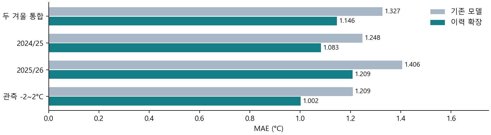
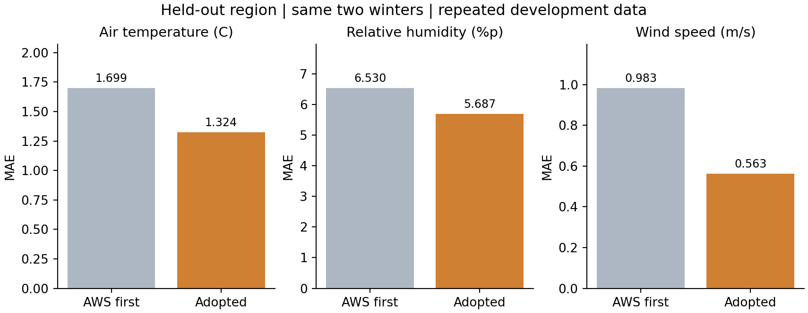
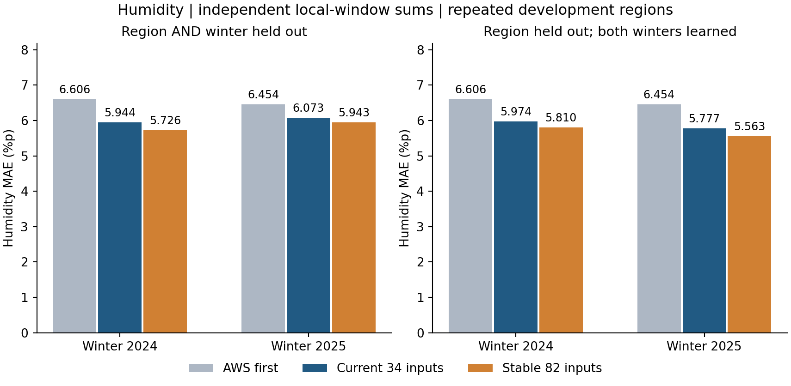
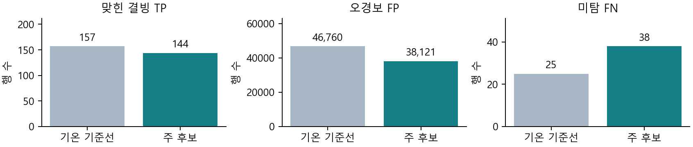
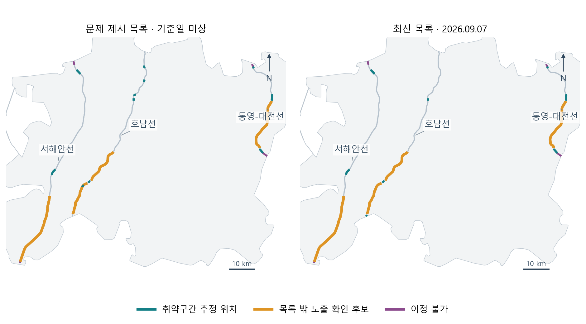
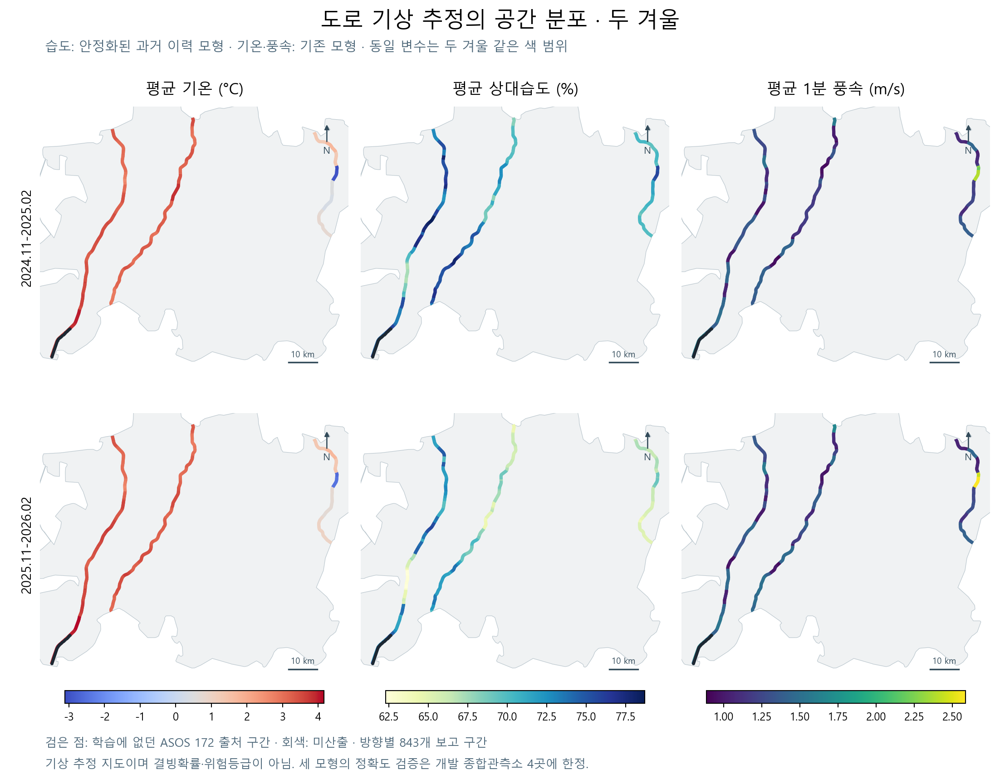

# 미관측 고속도로 구간의 기상·노면온도 추정과 결빙 조건

2026 DATA·AI 분석 경진대회 · 전북 고속도로 과제 · 분석 기준일 2026년 11월 1일

## 초록

도로 센서는 제한된 지점에 설치되어 있어 구간 전체의 노면 상태를 직접 관측하기 어렵다. 본 연구는 공공 기상 관측의 시간 이력으로 미관측 지점의 노면온도를 추정하고, 도로 기온·습도·풍속 추정을 별도 개발하였다. 결빙 탐지와 공간적 활용 가능성도 구분해 평가하였다. 학습에는 허용된 23개 지점의 두 겨울 자료를 사용하였다. 개발 성능은 9개 지점을 네 지역으로 묶어 평가 지역 전체를 학습에서 제외한 예측으로 비교하였다.

기상·열 이력과 태양 위치를 결합한 63변수 나무 모델의 온도 MAE는 1.145698°C로, 동일 조건의 기존 모델 대비 13.66% 감소하였다. 두 겨울과 네 지역에서 모두 개선되었다. 새 기상 보완 모형은 개발 4지역 제외 비교에서 AWS 우선 기준 대비 기온·습도·풍속 MAE를 각각 22.10·12.91·42.67% 줄였다. 반면 유지한 결빙 판정의 일별 지점 평균 F1은 0.026554로, 기온 0°C 기준선의 0.036601보다 낮았다. 별도로 예측을 사전 고정한 새 4지역 평가에서도 주 후보의 평균 F1은 증가했으나 재현율 하락과 기존 탐지 8사건의 손실이 발생하였다. 해당 후보는 채택하지 않았다.

습도에는 과거 기상 이력을 추가해 기존 기상 모형 대비 지역 제외 MAE를 3.22%, 지역·겨울 동시 제외 MAE를 2.90% 줄였다. 온도·습도 추정의 개선은 확인되었지만 결빙 탐지의 일반화는 미해결 과제이다. 이에 500m·1km 구간의 추정값, 조건 노출, 입력 가용 범위와 최신 공식 취약구간의 추정 위치를 함께 제공하고, 지도에서 확인한 조건을 실제 결빙률이나 사고확률로 해석하지 않도록 결과의 사용 범위를 명시하였다.

| 연구 질문 | 확인한 결과 | 해석 범위 |
| --- | --- | --- |
| 기상 이력이 온도 오차를 줄이는가? | MAE 1.326890 → 1.145698°C | 같은 개발 지역에서 반복 비교한 결과 |
| 도로 기상을 더 잘 추정하는가? | 기온·습도·풍속의 평균 오차 감소 | 기상 정답이 있는 개발 4곳 비교 |
| 결빙을 기온 기준선보다 잘 탐지하는가? | 현재 F1 0.026554 < 0.036601 | 기준선 초과 성능을 입증하지 못함 |
| 새 지역에서도 개선되는가? | 주 후보의 재현율 하락·8사건 손실 | 자료 품질 조건도 미충족, 미채택 |
| 결과를 구간별로 검토할 수 있는가? | 지도·CSV·실행 노트북·데모 제공 | 관측 없는 구간의 조건 탐색 지원 |

**읽는 순서.** 1-2절은 자료·검증 설계, 3-4-3절은 온도·기상 추정 개선과 실행 안정성, 5-7절은 결빙 한계와 미채택 실험, 8-10절은 공간 비교·새 기상 지도, 11-12절은 한계·재현 절차이다. 수치는 공식 대회 점수가 아니며, 보호 지점의 정답을 새 학습·후보 선택·평가에 사용하지 않았다.

<!-- page -->

## 1. 문제 정의와 자료

분석 대상은 서해안·통영-대전중부·호남 고속도로이다. 목표는 노면 센서가 없는 위치에 대해 10분 간격의 노면온도와 결빙 조건을 추정하는 것이다. 관측 시각까지의 기상으로 같은 시각의 상태를 추정하므로 미래 수 시간의 예보 성능을 검증한 연구와 구별한다.

| 자료 또는 범위 | 사용 내용과 규모 |
| --- | --- |
| 기간 | 2024.11-2025.02 / 2025.11-2026.02, 각 120일 |
| RWIS 도로 관측 | 대회 14곳·추가 9곳, 총 23지점. 온도 학습 유효 793,149쌍 |
| 온도 개발 비교 | 9지점·4지역, 두 겨울 유효 310,091쌍 |
| ASOS·AWS 기상 | 기온·습도·바람·강수·적설·지면온도·일사 등 |
| 공간 자료 | 도로망, 교량·터널 속성, 구간 중점과 기상 연결 |
| 보호 지점 | 부곡교 12410·삼봉 33411·해전 23402 |
| 추가 지역 평가 | 이천휴·진천터널외부·성암교·쌍암천교 |

RWIS는 도로의 노면온도와 상태를 측정하는 관측 장비이다. 학습 정답은 노면온도와 원본 상태 코드이며, 결빙은 공식 해석에 따라 `04` Ice만 양성으로 정의하였다. 나머지 유효 상태는 음성으로, 결측·미정의 상태는 평가 제외로 처리하였다. 기온이 높다는 이유로 Ice를 음성으로 바꾸지 않았다.

### 시간 연결과 결측 처리

기상은 목표 시각보다 엄격히 이른 관측 중 60분 이내 자료를 연결하였다. 과거 특징은 목표 시각을 제외한 구간에서 계산하며 필요한 유효 슬롯 비율은 80%이다. 미래 관측으로 보간하지 않고, 결측 강수를 무강수로 간주하지 않았다. 시각은 한국 표준시를 사용한다.

최종 온도 학습의 원시 행은 794,545개, 입력 유효 행은 793,209개, 온도 정답까지 유효한 쌍은 793,149개이다. 이 수치는 서로 다른 제외 조건을 적용한 결과다. 원천 자료 재연결에서 발견한 학습 입력 113행·540값의 차이는 정정 후 다시 학습하였으며, 이전 실험은 별도 기록으로 보존하였다.

### 자료 이용 범위

대회 제공 자료와 허용된 공개 기상자료를 사용하였다. 추가 RWIS 9지점은 개발 자료이며, 별도로 확보한 새 4지역의 정답은 사전 고정 평가에만 사용하였다. 외국 도로 학습 자료와 외부 사전학습 가중치는 사용하지 않았다. CCTV 시설 목록은 위치 진단의 보조 자료이며 모델 입력이나 결빙 정답으로 사용하지 않았다. 센서 정비·시각별 제설 이력은 아직 확보하지 못했다.

<!-- page -->

## 2. 모델과 검증 설계

온도 모델은 절대오차 손실을 사용하는 히스토그램 기반 그래디언트 부스팅(HGB)이며, 학습 반복 수는 1,200회이다. 입력 63개는 기상 12개, 열·수분 10개, 과거 기상 30개, 과거 열 상태 9개, 태양 위치 2개로 구성하였다. 과거 노면 정답은 입력에 포함하지 않았다.

노면온도는 대기 상태뿐 아니라 이전 열 상태와 복사 조건의 영향을 받는다. Li 등(2026)의 시간 이력 접근과 RoadSurf의 열·수분 상태 구분을 설계 배경으로 참고하였다[1, 2]. 본 연구는 해당 물리 모형이나 LSTM을 재현한 것이 아니라, 관측 가능한 기상 이력을 나무 모델의 입력으로 구성한 것이다. 태양 위치는 NOAA 계산식을 참고하였고 실제 일사량과 구별하였다[3].

| 검증 단계 | 제외·고정한 대상 | 답할 수 있는 질문 |
| --- | --- | --- |
| 온도 개발 비교 | 평가 지역의 모든 지점·두 겨울을 학습에서 제외 | 같은 개발 지역에서 방법 간 차이는 얼마인가? |
| 결빙 중첩 선택 | 외부 평가 지역과 내부 선택 지역을 함께 학습에서 제외 | 임계값 선택 절차가 다른 지역에 전이되는가? |
| 최종 실행 모델 | 허용 23지점으로 적합, 보호 정답 제외 | 포함 입력으로 추론을 재현할 수 있는가? |
| 새 4지역 평가 | 정답 요청 전에 후보·모델·예측·평가 코드 고정 | 처음 보는 지역에서 고정 후보가 유지되는가? |

같은 개발 지역을 반복 비교하였으므로 지역 제외만으로 모델 선택 편향이 사라지지는 않는다[4]. 온도 성능은 반복 개발 결과로 제시한다. 추가 4지역은 새 공간 평가이지만, 두 겨울 자체가 학습 기간과 겹치므로 미래 겨울 검증은 아니다. 과거에 완료한 보호 평가 기록을 새 후보의 선택 근거로 재사용하지 않았다.

### 지표와 채택 기준

온도는 MAE·RMSE·BIAS를 °C로 보고한다. BIAS는 추정값에서 관측값을 뺀 평균이다. 결빙은 날짜 안에서 정밀도·재현율·F1을 계산한 뒤 지점별 평균을 구한다. 주 비교는 하루 144개 공통 유효 슬롯을 사용하며, 부분 날짜 기준은 민감도로 구별한다. 이는 공식 답변이 확정하지 않은 자체 검증 가정을 포함한다.

실제·예측 결빙이 모두 없는 날의 F1은 미정의이다. 오경보가 사라져 이런 날이 늘면 평균의 분모도 달라질 수 있다. 따라서 F1과 함께 날짜 수, 미탐, 기존 탐지 사건 손실을 확인하였다. 사건은 같은 지점에서 10분 간격으로 연속 관측된 Ice이며 실제 사고 건수가 아니다. 겨울·지점·정밀도·재현율 비악화와 사건 보존은 연구의 보수적 채택 조건으로, 공식 배점 규정과는 다르다.

<!-- page -->

## 3. 노면온도 추정 결과

같은 개발 9지점의 지역 제외 예측에서 기존 기상 모델과 이력 확장 모델을 비교하였다. 유효 온도 쌍은 310,091개이다. 이력 확장 모델의 통합 MAE는 1.145698°C, RMSE는 1.602392°C, BIAS는 +0.304301°C였다. 통합 MAE 감소율은 13.66%이며 네 지역 모두 개선하였다.



| 평가 범위 | 기존 모델 MAE | 이력 확장 MAE |
| --- | --- | --- |
| 두 겨울 통합 | 1.326890 | 1.145698 |
| 2024/25 | 1.247911 | 1.082808 |
| 2025/26 | 1.406063 | 1.208743 |
| 관측 -2~2°C | 1.209004 | 1.002049 |

표의 단위는 °C이다. 결빙점 부근의 오차 감소는 저온 경계 추정에 유용하지만 Ice 상태를 더 잘 맞힌다는 증거와는 구별된다. 모든 지점에 동일한 오차를 보장하지 않으며, 세부 지점 결과는 포함된 개발 온도 CSV에서 확인할 수 있다.

### 복잡도와 불확실성

학습을 2,400회로 늘린 추가 MAE 감소는 약 0.10%, 세 시드 평균은 약 0.37%였다. 사전 복잡도 기준인 추가 0.5% 개선에 못 미쳐 단일 모델을 선택하였다. 가장 낮은 점추정값을 가진 조합이라는 의미는 아니다.

7일 날짜 블록을 2,000회 재표집한 개선율의 2.5·50·97.5 백분위는 12.10·13.63·15.31%였다. 고정된 지점과 후보에 조건부인 날짜 민감도이며, 새 지역의 오차나 반복 후보 선택의 불확실성을 포함한 신뢰구간으로 해석하지 않는다.

<!-- page -->

## 4. 미관측 도로의 기온·습도·풍속 추정

노면온도와 별도로 도로의 기온·상대습도·1분 풍속을 추정했다. 허용 23지점 중 세 기상 정답이 있는 곳은 13곳이다. 개발 네 지역의 모든 지점을 두 겨울 모두 학습에서 제외하고, 종합 기상관측이 있는 4곳의 오차를 비교했다. 보호 3곳과 이미 개봉한 별도 결빙 4지역의 정답은 사용하지 않았다.

AWS는 15분 이내 과거 관측을 우선하고 없으면 60분 이내 ASOS로 대체했다. 이 기준값의 잔차를 절대오차 HGB 300회로 학습하고 지점·겨울의 총 가중치를 맞췄다. 기온·풍속은 34특성 모형을 유지했다. 습도에는 현재 기상 외에 과거 3시간·24시간 이력을 더한 82특성을 사용했다. 지점 번호·연도·목표 도로의 실제 과거 습도·노면온도·Ice는 모형 특성이 아니다.



| 목표 | AWS 우선 MAE | 채택 모형 MAE | 감소율 |
| --- | --- | --- | --- |
| 기온 (°C) | 1.699319 | 1.323764 | 22.10% |
| 상대습도 (%p) | 6.530284 | 5.686973 | 12.91% |
| 1분 풍속 (m/s) | 0.982751 | 0.563455 | 42.67% |

공통 유효 쌍은 각각 137,630·137,450·137,498개다. 전체 MAE는 유효 행 가중 평균이며 공식 보호 3지점의 성적이 아니다. 지역·겨울별 지표도 함께 제공한다. 풍속 상관 0.579446·R² 0.268789, 일부 지역 기온의 악화 등은 기존 모형의 한계로 유지된다.

최초 34특성 모형은 학습 관측 중앙값·잔차 상수 보정과도 비교했다. 이후 습도 이력의 추가 가치는 이 모형과 직접 비교해 판단했다. 기상별 보정·공간 대표성의 배경은 문헌[10-13]을 참고했으며 문헌 성능을 이 연구의 수치로 사용하지 않았다.

<!-- page -->

## 4-1. 습도 이력의 두 가지 제외 검증

기존 기상 입력 34개에 ASOS·AWS 8변수의 과거 평균·현재값과 평균의 차이·유효 입력 비율을 추가했다. 3시간은 18슬롯 중 6개, 24시간은 144슬롯 중 48개 이상 유효할 때 평균을 제공한다. 이력은 같은 도로의 과거 기상만 사용하고 다른 도로·다른 겨울에서 채우지 않는다. 결측 습도·강수를 0으로 바꾸지 않았다.

첫 검증은 두 겨울의 다른 지역을 학습에 사용해 같은 기간의 미관측 지역을 복원한다. 두 번째는 평가 지역의 두 겨울뿐 아니라 평가 겨울 전체를 학습에서 제외한다. 2024년 겨울로 2025년 겨울을 추정하는 순방향과 반대 방향의 사후 재현을 구분했다. 역방향을 미래 예측 성능으로 해석하지 않는다.



| 검증 조건 | 기존 34특성 MAE | 최종 82특성 MAE | 추가 감소 |
| --- | --- | --- | --- |
| 지역 전체 제외 | 5.875898 | 5.686973 | 3.22% |
| 지역·겨울 동시 제외 | 6.008156 | 5.834129 | 2.90% |

두 조건 모두 전체 MAE 2% 이상 감소, 양 겨울 비악화, 지역 악화 10% 이내, ASOS 기온 ±3°C 구간 비악화, 7일 날짜 블록 차이 상한 0 미만의 사전 기준을 통과했다. 모델 용량·학습 횟수·가중치·창 길이는 비교 중 조정하지 않았다. 같은 개발 자료를 사용했으므로 신규 독립 평가라고 부르지 않는다.

<!-- page -->

## 4-2. 개선 범위와 지역별 한계

지역 제외의 유효 137,450쌍에서 습도 RMSE는 7.950451→7.747100%p, BIAS는 +2.446025→+2.061275%p, R²는 0.841654→0.849650으로 변했다. 평균 오차와 편향은 줄었지만 양의 편향은 남아 있다. 첫·둘째 겨울 MAE는 각각 5.974275→5.810189%p, 5.777153→5.563298%p로 감소했다.

| 개발 지역 | 기존 MAE (%p) | 최종 MAE (%p) | 변화 |
| --- | --- | --- | --- |
| 호남 백양 | 4.939195 | 4.528809 | 8.31% 감소 |
| 서해안 서천 | 5.513134 | 5.576702 | 1.15% 증가 |
| 통영 금산 | 5.119334 | 4.965218 | 3.01% 감소 |
| 통영 서상 | 7.917464 | 7.663631 | 3.21% 감소 |

모든 지역에서 개선된 것은 아니다. 서천의 소폭 악화는 사전 허용 범위 안이지만 그대로 보고한다. 서상은 MAE 7.663631%p·BIAS +6.772757%p로 오차가 가장 크다. 고도·관측 높이·센서 교정·미세 환경을 추가 검증해야 하며, 이 비교만으로 도로별 습도 정확도를 보장할 수 없다.

ASOS 기온이 ±3°C인 공통 51,142쌍의 MAE는 5.841444→5.610078%p로 3.96% 감소했다. 목표 습도가 아닌 같은 입력 기온으로 범위를 정했다. 이 저온 구간의 개선도 결빙 분류 정확도 향상은 아니다.

7일 날짜 블록 2,000회 재표집에서 MAE 차이의 2.5-97.5백분위는 지역 제외 [-0.227743, -0.152968]%p, 지역·겨울 동시 제외 [-0.216418, -0.135412]%p였다. 이는 기존 네 지역에 조건부인 날짜 구성 민감도이며 새 지역 모집단의 신뢰구간이 아니다. 지점 수를 500m 지도 구간 수로 늘려 해석하지 않는다.

기온 이력은 지역 제외 개선 0.37%와 첫 겨울 악화, 풍속 이력은 지역·겨울 동시 제외의 악화로 채택하지 않았다. 이력이라는 방법을 세 목표에 일괄 적용하지 않고 습도에만 사용했다.

<!-- page -->

## 4-3. 수치 안정성과 독립 실행 검증

첫 실행 묶음을 실제 추론할 때 같은 24시간 입력 앞에 더 오래된 기상을 붙이면 432행 중 4행의 습도 추정이 달라졌다. 최대 차이는 약 0.117%p였다. 과거 창 평균의 약 10^-13 수준 부동소수점 차이가 나무 분기에서 증폭되는 문제로 진단했다. 예측 비교의 허용오차를 넓혀 통과시키지 않았다.

최종 구현은 결측 시각을 10분 달력에 놓고 각 18·144슬롯 창을 독립 합산한다. 창보다 앞선 누적 보상 상태를 이어받지 않고 값을 반올림하지 않는다. 이 계산으로 지역·겨울 8개와 지역 4개 모형을 다시 학습해 앞의 결과를 얻었다. 65,152,690개 특성 값의 수학적 동치, 188,928개 문맥 변경 특성 값의 비트 단위 일치와 대표 4개 모형의 정확한 재학습을 검산했다.

| 실행 검사 | 확인한 내용 |
| --- | --- |
| 최종 적합 | 허용 기상 정답 13곳·유효 447,794행으로 습도 재학습 |
| 과거 문맥 | 48시간 입력과 더 긴 전체 과거 입력의 선택일 432행 차이 0 |
| 별도 위치 | 폴더 복제 후 실제 CLI 432행·Jupyter 3코드 셀 실행 |
| 전체 재학습 | 포함 자료로 습도 전체 재학습 후 432행 추론 정확히 일치 |
| 기존 성분 | 기온·풍속 저장 모형과 동일 정규 입력의 추론값 보존 |

출력일 앞의 24시간 기상을 입력에 포함하고 추론 후 출력 구간을 선택한다. 입력을 먼저 출력일로 자르면 필요한 이력을 잃는다. `humidity_history_status`는 제공 입력의 충실도, `humidity_history_outside_training_range`는 학습 최솟값·최댓값 범위 이탈이다. 두 값은 오차·신뢰구간·결빙확률을 뜻하지 않는다.

새 묶음은 `research/weather_history_supplement/`에 학습 자료·저장 모형·버전 고정 환경·재학습 및 추론 노트북을 포함한다. 설치 후 GPU·외부 AI API·인증정보 없이 실행한다. 예제는 학습 범위 내 재현 검사이며 성능 평가에 사용하지 않는다. 기존 기온 추정의 0°C 결빙 정책은 앞선 비교에서 F1 하락·38사건 손실로 미채택했고, 이번 습도 개선으로 결빙 성능이 올랐다고 주장하지 않는다.

<!-- page -->

## 5. 결빙 탐지와 기온 기준선의 차이

현재 결빙 판정은 기존 두 온도 모델의 평균이 0°C 이하이고 이슬점·강수·적설에서 수분 근거가 있는 조건이다. 새 온도 모델로 교체한 결빙 방식이 채택 조건을 통과하지 못해 온도 추정과 결빙 판정의 모델을 구분하였다. CSV에는 각각의 온도를 별도 열로 제공한다.

| 방법 | 통합 F1 | 2024/25 F1 | 2025/26 F1 |
| --- | --- | --- | --- |
| 현재 온도·수분 조건 | 0.026554 | 0.030187 | 0.009466 |
| ASOS 기온 0°C 기준선 | 0.036601 | 0.071179 | 0.001444 |

동일 입력 가용 범위의 일별 지점 평균이다. 현재 판정의 정밀도·재현율은 0.040055·0.739628, 기온 기준선은 0.033386·0.966799이다. F1 평균에 포함된 날짜·지점 수는 각각 487·1,495개이며, 재현율은 양성이 있는 8지점의 140개 날짜에서 정의된다. **현재 판정이 기온 기준선보다 전반적으로 우수하다는 결론은 성립하지 않는다.** 과거 CSV에 남은 기준선 F1 0.036392는 결측 기온 처리 정책이 달라 직접 혼합하지 않는다.

### 확인된 차이와 남은 가설

| 구분 | 관찰 또는 가설 | 의미 |
| --- | --- | --- |
| 확인한 미탐 원인 | 기준선이 찾던 Ice 중 수분 조건에서 2,668행, 노면온도 조건에서 1,490행 제외 | 조건을 추가하면서 실제 결빙도 줄임 |
| 지역별 차이 | 33408의 F1 감소가 6개 지점의 개선을 초과 | 통합 점수만으로 지역 간 균형을 설명할 수 없음 |
| 입력 구별력 진단 | 기존 15기상 변수에서 Ice 6,687행 모두 음성과 같은 입력을 공유 | 같은 입력으로 서로 다른 관측 상태가 나타남 |
| 미확인 요인 | 제설·노면 물성·센서 교정·공간 대표성 | 원인 후보이며 인과적으로 확인된 설명은 아님 |

동일 입력 진단에서 관측 Ice를 모두 탐지하면 최소 24,527행의 오경보가 함께 발생한다. 현재 표본과 입력 조건에서 계산한 진단값으로, 공식 일별 F1의 한계나 미래 성능의 상한은 아니다. 기준선의 오경보는 117,723행으로 이보다 많아 추가 개선 여지는 남는다.

### 유지 결정의 의미

기온 기준선으로 일괄 교체하거나 후속 분류기를 적용한 경우 겨울·지점·정밀도·재현율·기존 사건 보존을 동시에 충족하지 못하였다. 따라서 기존 판정을 유지하되 평균 F1 미달을 별도 성능 과제로 둔다. 이 보수적 결정이 공식 점수 최대화를 입증하는 것은 아니다. 잔차 학습의 사후 최고 F1 0.037423도 기존 탐지 47사건을 잃었으며, 추가 정보 없는 재탐색만으로 안정적인 개선을 확인하지 못했다.

<!-- page -->

## 6. 새 4지역의 사전 고정 평가

기존 개발 지역에서의 작은 개선이 새로운 도로에 유지되는지 확인하기 위해 4곳의 138,240행 예측을 먼저 고정하였다. 10월 25일 19:53:52에 봉인하고 19:54:38부터 정답을 요청하였다. 시각과 해시는 로컬 재현 기록이며 제3자 시각 인증은 아니다. 주 후보는 기온 기준선의 문턱을 최대 1°C 낮추는 날짜 균형 로지스틱 회귀로 고정하였다.

| 사전 고정 방법 | 일별 F1 | 일별 재현율 | 탐지 사건 |
| --- | --- | --- | --- |
| 기온 0°C 기준선 | 0.005454 | 0.764250 | 83 / 102 |
| 기온 -0.5°C 대조 | 0.006185 | 0.755411 | 82 / 102 |
| 회귀 주 후보 | 0.006758 | 0.660669 | 75 / 102 |
| HGB 보조 후보 | 0.006837 | 0.681503 | 76 / 102 |

F1·재현율은 144개 유효 슬롯을 가진 924개 날짜·지점 중 지표가 정의되는 날짜를 지점별 평균한 값이다. F1 미정의 지점은 자체 비교에서 0으로 포함한 고정 4지점 평균이다. 사건 수는 부분 날짜도 포함한 전체 공통 유효 135,692행에서 계산하였다. 관측 Ice는 182행, 관측 사건은 102개이며 지표와 사건의 분모는 다르다.



### 독립 평가의 자료 품질 한계

진천터널외부는 둘째 겨울 유효 정답이 85.39%로 사전 90% 조건에 미달하였다. 성암교는 공식 목록과 API 좌표가 22.29km 달라 위치 일관성 조건을 통과하지 못했다. 충돌 관측은 성능 계산 전에 완전 동일 중복만 합치고 다른 값이 있는 시각 전체를 격리하였다. 이 예외 처리는 원래 봉인 이후의 분석 전 품질 보완으로 기록하였다.

주 후보는 평균 F1이 23.90% 증가했지만 재현율 하락·8사건 손실·2지역 악화와 자료 품질 문제로 11개 사전 조건 중 5개에 실패하였다. HGB의 사후 점수가 조금 높다는 이유로 주 후보를 교체하지 않았다. 새 4지역은 이후 학습·후보 선택·재평가에 사용하지 않았다.

<!-- page -->

## 7. 추가 기상과 누적 조건의 통제 비교

최신 자료나 복잡한 입력이 자동으로 성능을 높이지는 않는다. 10월 31일에는 같은 학습 범위와 공간 분리를 유지하면서 손실 함수, 외부 지표면 상태, 누적 기상 조건의 추가 가치를 비교하였다. 아래는 이미 본 개발 지역에서의 반복 비교이며 공식 보호 지점과 개봉된 별도 4지역 정답을 사용하지 않았다.

| 비교 | 기준 성능 | 주 결과 | 판단 |
| --- | --- | --- | --- |
| 손실 함수 4종, 40적합 | ASOS F1 0.036601 | F1 0.035621 | 기존 사건 60개 손실 |
| ERA5-Land 온도, 8적합 | MAE 1.145698°C | MAE 1.227861°C | 같은 유효쌍에서 악화 |
| ERA5-Land 분류, 30적합 | ASOS F1 0.036601 | F1 0.004359 | 기존 사건 206개 손실 |
| 누적 기상 조건, 20적합 | ASOS F1 0.036601 | F1 0.035632 | 누적 후보 미선택 |

### 외부 지표면 자료

Open-Meteo의 ERA5-Land를 명시하여 23곳·두 겨울의 140,208시간을 확보하였다[7]. 기온·습도·이슬점, 두 깊이의 토양온도·토양수분과 적설 깊이, 과거 6·24·72시간 평균을 비교하였다. 목표 시각보다 이전인 시간만 연결했고 기존 평가 행을 유지하였다. 약 0.1도 격자의 사후 재분석이므로 500m 도로의 독립 관측이나 당시 실시간 자료가 아니다.

원변수 8개를 추가한 온도 모델은 기존 63변수와 동일한 1,200회 학습·절대오차 손실을 사용했다. 이력까지 추가한 보조 모델의 MAE도 1.222635°C로 기존 모델보다 나빴다. 결빙 분류는 같은 HGB·가중치에서 ASOS만, 재분석 원변수 추가, 이력 추가를 비교하고 지역 내부에서 임계값을 선택했다. 추가 입력의 성능 이득을 확인하지 못했다.

### 냉각·수증기 조건의 이력

Yi와 Seo의 2026년 사전공개 연구에서 실제 노면온도 이력으로 계산한 누적 조건을 참고하였다[8]. 여기서는 미관측 지점에 사용할 수 있는 ASOS 기온·지면온도와 AWS 기온을 대리변수로 썼다. 원 논문의 Snow/Ice 포함 정답과 온도에 따른 사건 제외 규칙은 가져오지 않았다.

순간 40변수와 누적 이력을 더한 64변수를 같은 BCE·160단계·보정 한계로 비교하였다. 30분·6시간 감쇠 냉각, 서리점 대비 수증기 조건, 부호 전환과 1시간 변화를 추가했다. 누적 후보는 네 지역 모두 내부 선택에서 탈락했다. 주 선택은 순간 입력 대조와 같고, F1·두 겨울 성능 모두 기온 기준선을 넘지 못했다.

### 실패에서 남긴 근거

추가 정보의 일반적인 무용성을 결론 내리지 않는다. 현재 기상 대리변수만으로 실제 노면의 수분·염분·제설 상태를 충분히 구별했다는 근거가 없다는 결과이다. 외부 자료와 모델의 값, 학습 분리, 선택, 지표는 별도 구현으로 검산했다. 기상청 500m 격자 API는 한 시간 시험 요청에서 HTTP 403으로 실제 값을 확보하지 못했다. 상세 실행·실패 기록은 연구 문서와 검산 영수증에 남겼다.

<!-- page -->

## 8. 공식 취약구간과 두 겨울 조건의 비교

500m 843개·1km 423개 구간에 대해 추정값과 조건 노출을 제공한다. 같은 도로의 서로 다른 분할이며 독립 검증 표본이 아니다. 이번에는 공식 암거의 좌표·이정을 사용해 500m 구간 821개의 이정을 제한적으로 보간하고, 문제 제시 목록과 2026년 9월 7일 기준 최신 목록을 실제 전북 경계에 연결하였다[9].



문제 제시 3개 노선 17개 목록 중 11개, 최신 전국 목록 중 8개가 전북 도형에 연결되었다. 최신 8개에는 광주전남본부 관할인 호남선 경계 구간도 포함한다. 본부 관할을 전북 행정구역과 같다고 처리하면 이 구간을 누락한다. 목록 기준일이 서로 달라 지정 해제의 이유나 위험 개선 효과를 추정할 수 없다.

조건 노출은 유효 시각 중 추정 저온·수분 조건이 함께 나타난 비율이다. 관측 Ice 비율·사고확률·공식 A/B/C 등급은 아니다. 공식 위험 등급은 기존 목록에 표시된 범위만 보존하며 새 위험등급을 만들어 부여하지 않는다. 최신 목록은 분석 기간 이후 자료로, 두 겨울의 학습 정답이나 당시 지정 현황으로 소급하지 않았다.

두 겨울 모두 기준 이상이고 최신 목록의 확장 범위 밖인 318개 보고 구간을 방향별 8개 연속 확인 구간으로 묶었다. 같은 입력과 동률 때문에 넓게 선정된 공간이다. 이를 318개의 독립적인 신규 위험 발견으로 해석하지 않는다.

<!-- page -->

## 9. 위치 오차와 현장 확인 범위

암거 원문 10,601행의 CSV·DBF 속성과 SHP 좌표를 대조하고, 도로에서 100m 이내인 시설 중 서로 다른 454개 위치를 이정 보간에 사용했다. 양방향 연결 기록 908개를 독립 측량점 908곳으로 세지 않았다. 외삽과 3km를 넘는 보간 공백은 허용하지 않았다.

| 위치 확인 방식 | MAE | 95백분위 절대오차 | 해석 |
| --- | --- | --- | --- |
| 같은 암거 자료의 5km 공간 블록 제외 | 28.81m | 78.01m | 자료 내부 보간 성능 |
| 별도 CCTV 이름-이정 연결 진단 | 292.56m | 1,538.46m | 이름 연결·이정 오류 가능 |

두 결과의 차이를 숨기지 않는다. 암거 내부 검증을 실제 도로 측량 정확도로 주장할 수 없으며 CCTV 진단도 정답 좌표로 확정하지 않았다. 보간 가능한 방향별 길이는 전체의 97.63%이고, 22개 보고 구간은 이정 불가로 남겼다. 100·250·500m 경계 민감도는 가정한 이동 범위이지 통계적 신뢰구간이 아니다.

### 넓은 후보를 연속 구간으로 읽기

| 노선 | 방향을 함께 요약한 추정 이정 범위 | 방향별 길이 | 확인 범위 |
| --- | --- | --- | --- |
| 서해안 | 약 59.8-89.3km | 약 29.5km | 양방향 2개 |
| 통영-대전 | 약 134.4-155.3km | 약 21.0km | 양방향 2개 |
| 호남 | 약 117.4-131.6km | 약 14.0km | 양방향 2개 |
| 호남 | 약 133.4-148.6km | 약 15.0km | 양방향 2개 |

방향마다 보간 끝점이 다르므로 표는 개략 범위이다. 정확한 추정값은 `corridors.csv`에서 확인한다. 총 길이 159km는 양방향을 각각 센 값이다. 실제 안전·위험의 경계나 새 지정 구간의 제안으로 확정하지 않았다.

### 입력을 공유하는 지도 해상도

노선별 길이 가중 75백분위 이상에 동률을 전부 포함하면 선정 길이는 서해안 33.70%, 통영-대전 64.05%, 호남 41.99%이다. 정확히 상위 25%를 고른 결과가 아니다. 500m의 기상 입력 묶음은 겨울별 각각 31·13·24개로, 보고 구간 수보다 적다. 공간 분할을 촘촘히 했다는 이유로 독립적인 기상 관측이 늘어나지 않는다.

오프라인 탐색 화면에서는 노선·방향·목록 버전, 두 겨울의 노출과 유효 시간, 추정 이정·위치 불일치 표시를 함께 본다. 관심 구간을 선택하면 CSV와 GIS로 이어진다. 이 도구의 목적은 센서·현장 조사 위치를 검토하는 것이며 자동 제설 지시나 사고확률 판정이 아니다.

<!-- page -->

## 10. 세 기상 변수의 500m 구간 적용

기온·풍속을 유지하고 새 습도 이력 모형을 포함한 세 기상 추정기를 방향별 843개 500m 구간 중점에 적용했다. 두 겨울 240일의 10분 추정값 29,134,080행을 계산하고, 구간·겨울 요약 1,686행과 일별 요약 202,320행을 만들었다. 지도는 겨울 평균이며 구간 간 실제 정확도나 극한값을 검증한 결과는 아니다.



가까운 ASOS와 순서가 고정된 AWS 후보 세 곳의 조합은 68개다. 세 기상값은 위치·태양 조건도 사용하지만 도로 분할마다 독립 관측이 있는 것은 아니다. 기존 노면온도·저온 수분 조건 노출은 보존하고 새 기상 통계와 나란히 연결했다. 새 위험등급·결빙확률을 부여하지 않았다.

50구간은 도로 기상 학습에 등장하지 않은 ASOS 172 출처를 사용한다. 지도에 검은 점으로 구별하고 출처·입력 범위 이탈을 CSV에 남겼다. 범위 이탈은 학습 입력의 최솟값·최댓값을 벗어난 값의 존재이며 예측오차·확률·통계적 신뢰도를 뜻하지 않는다. 이 범위에서는 현장 검증이 특히 필요하다.

일별 자료에는 세 추정 평균과 각각의 유효 10분 수를 제공한다. 겨울 요약에는 분위수·세 변수 간 상관·상관 유효 쌍 수를 포함한다. GeoPackage 두 레이어와 CSV로 확인할 수 있으며, 추정값끼리의 상관을 실제 결빙의 영향 인자나 인과 효과로 해석하지 않는다. 새 습도 전량 집계·대표 19구간 API 재추론과 기존 기온·풍속·노면온도·조건 노출 보존을 검산했다. 과거 입력 부족과 새 습도 특성 범위 이탈도 따로 기록했다.

<!-- page -->

## 11. 해석의 한계와 후속 검증

### 온도 개선과 결빙 개선이 다른 이유

온도 회귀는 연속값의 평균 오차를 줄이는 문제이며, 결빙은 수분·염분·노면 상태와 센서 판정을 함께 반영하는 희소 사건이다. 결빙점 부근 오차가 줄어도 모든 지점의 Ice 탐지가 개선되지는 않았다. 현재 자료는 이 차이의 존재를 보여주지만, 센서 오차와 실제 노면 현상을 구별할 근거는 부족하다.

### 자료 품질 진단의 결론

성암교의 좌표 불일치와 진천터널외부의 결측·상태 중복은 API 재요청에서도 확인되었다. 이는 후처리만의 문제가 아님을 보여준다. 그러나 센서 설치 위치·정비 이력을 확보하지 못했으므로 좌표의 정답이나 장비 고장 원인을 단정할 수 없다. CCTV 시설 목록 2,999건은 노선·이정의 보조 확인에만 유효하다.

### 영향 분석의 범위

구간별 환경 속성과 추정값의 상관은 기술통계로 제공하였다. 다수 구간이 같은 기상을 공유하고 지형 자료에 건물·수목 영향이 포함될 수 있으므로, 교량·터널·고도의 독립 효과나 인과관계로 해석하지 않는다. 조건 노출에 임의의 안전등급을 부여하지 않았다. 실제 노면 결빙에 대한 영향 인자·임계값의 현장 검증은 남아 있다.

| 우선순위 | 필요한 근거 | 확보 후 수행할 검증 |
| --- | --- | --- |
| 1 | 센서 좌표·설치·교정·정비 이력 | 위치 차이와 상태 충돌의 원인 확인 |
| 2 | 시각·구간·살포량이 있는 제설 이력 | 당시 이용 가능한 정보만 연결한 대조 |
| 3 | 충분한 유효 관측을 가진 미사용 지역 | 후보·예측 재고정 후 한 번 평가 |
| 4 | 현장 점검·사고·운영 비용 자료 | 경보 기준과 조치 효과의 별도 검증 |

새 자료를 받으면 출처·이용조건·대회 적용 범위와 당시 가용 시각부터 확인해야 한다. 공개 기상자료의 활용 허용을 행정·센서 자료 전체의 허용으로 확장하지 않는다. 외부 자료 없이 반복 탐색한 결과가 둔화되었다는 사실은 개선 가능성을 소진했다는 의미가 아니다.

### 결론

기상 이력 기반 모델은 개발 지역의 노면온도 추정 오차를 낮추었다. 결빙 탐지는 단순 기온 기준선보다 낮은 평균 성능과 지역별 편차가 남았다. 현재 결과물의 기여는 도로 기상·노면온도 추정 개선과 구간별 검토·재현 체계이며, 결빙 탐지의 현장 신뢰성을 주장하려면 추가 관측과 독립 검증이 필요하다.

<!-- page -->

## 12. 재현과 산출물 안내

실행 환경은 Windows·Python 3.11·CPU이다. GPU나 외부 예측 API는 필요하지 않다. 주요 라이브러리 버전은 포함된 `requirements.txt`와 `requirements-notebook.txt`에 고정하였다. 최초 의존성 설치에는 패키지 접근이 필요하며, 설치 후 예제 추론과 최종 모델 재학습은 포함 자료를 사용한다.

| 확인할 내용 | 제출 검토 묶음 안의 경로 |
| --- | --- |
| 현재 보고서 | reports/analysis_report_v10.pdf |
| 모델·학습 계획 | model/ · extended_training_plan.json |
| 학습·추론 진입점 | code/train.py · code/predict.py |
| 실행 노트북 | notebooks/submission_review_v10.ipynb |
| CSV·공간 결과 | exports/ · figures/ |
| 구간 탐색·조작 영상 | demo/review/index.html · demo/review_walkthrough.webm |
| 공식 목록 비교 화면 | research/latest/official_inventory_viewer_20261031_v1/index.html |
| 추론 출력 시각화 | demo/extended_inference.mp4 |
| 현재 기상 학습·추론 | research/weather_history_supplement/README.md |
| 자료 이용·AI 지원 | licenses/ · AI_USAGE.md |

묶음 루트에서 아래 순서로 실행한다. 검사 결과는 원래 파일과 분리된 `local_review/`에 저장한다. 기존 결과 파일이 있으면 새 출력 이름을 사용한다.

```powershell
python -m pip install -r requirements-notebook.txt
python scripts/review_submission_bundle.py
python scripts/review_submission_bundle.py --smoke --output local_review/smoke.json
```

새 습도는 위 기상 폴더의 README·노트북을 따른다. 출력일 앞의 24시간 기상을 함께 넣고 추론 후 날짜를 선택한다. 예제 432행·전체 재학습 일치는 별도 검증했으며 기온·풍속은 기존 모형을 사용한다.

첫 검사는 파일 목록·크기·해시·경로를 확인한다. 실행 검사는 기존 예측 144행·노트북 5코드 셀을 확인한다. 예제는 독립 성능평가가 아니며 전체 연구 탐색은 원 비공개 입력이 추가로 필요하다.

보호 3지점 예측은 103,680행이며 입력 부족 18행을 NA로 유지한다. CSV의 `estimated_road_temp_c`는 현재 온도 추정값, `icing_reference_temperature_c`는 결빙 판정에 실제 사용한 별도 온도이다. 모델 간 차이가 0이라는 값은 예측오차 0을 뜻하지 않는다. 상세 단위·집계 규약은 [CSV 설명](CSV_CONTRACT.md)에 있다.

### 제출 준비 상태

10월 27일 공식 공지는 결과물 접수 개시를 안내했고 제출 화면에는 문서자료와 모델자료의 별도 ZIP 업로드 칸이 있다. 자료는 각각 하나의 최상위 폴더로 압축한다. 제공 공지 본문에는 마감 날짜가 없어 미확인이며 11월 6일 참가신청 종료일로 대신 확정하지 않는다. 일부 미정의 지표 규약은 추가 확인이 필요하다. 이 묶음은 비공개 검토 후보이며 대회 접수 완료본이 아니다[5, 6].

<!-- page -->

## 참고문헌과 작성 이력

[1] Li, W., et al. (2026). A hybrid method for winter road surface temperature prediction using improved LSTMs and stacking-based ensemble learning. *Geoscientific Model Development*, 19, 9035-9061. [원문](https://gmd.copernicus.org/articles/19/9035/2026/). 시간 이력 설계의 배경으로 참고하였으며 논문의 모델·가중치·성능을 재사용하지 않았다.

[2] Karsisto, V. E. (2024). RoadSurf 1.1: open-source road weather model library. *Geoscientific Model Development*, 17, 4837-4853. [원문](https://gmd.copernicus.org/articles/17/4837/2024/). 열·수분 상태의 물리적 구분을 참고하였으며 물리 모형을 실행하지 않았다.

[3] NOAA Global Monitoring Laboratory. General Solar Position Calculations. [계산식](https://gml.noaa.gov/grad/solcalc/solareqns.PDF). 위도·경도·시각에 따른 태양 위치 계산에 참고하였다.

[4] Cawley, G. C., & Talbot, N. L. C. (2010). On Over-fitting in Model Selection and Subsequent Selection Bias in Performance Evaluation. *Journal of Machine Learning Research*, 11(70), 2079-2107. [원문](https://jmlr.org/papers/v11/cawley10a.html). 반복 후보 선택과 독립 평가의 구분에 참고하였다.

[5] KISTI AIDA. 2026 DATA·AI 분석 경진대회 문제 설명 및 평가 질의응답. [문제 페이지](https://aida.kisti.re.kr/competition/main/problem/PROB_000000000004604/detail.do) · [평가 Q&A 633](https://aida.kisti.re.kr/competition/problem/PROB_000000000004604/detail/commuDetail.do?bbsId=BBSMSTR_000000000319&nttId=633). 결빙 정의·보호 지점·일별 지표 해석의 근거이다.

[6] KISTI AIDA. Data·AI 분석 경진대회 결과물 제출방법, 공지 564. [원문](https://aida.kisti.re.kr/competition/main/selectNotice.do?bbsId=BBSMSTR_AAAAAAAAAAAA&nttId=564). 실행환경·노트북·데모·외부 자료·AI 활용 기록의 요구사항을 확인하였다. 공식 상세·참가서약은 2026년 10월 31일에 재확인하였다.


[7] Muñoz-Sabater, J., et al. (2021). ERA5-Land: a state-of-the-art global reanalysis dataset for land applications. [원 논문](https://essd.copernicus.org/articles/13/4349/2021/) · [Open-Meteo 자료 설명](https://open-meteo.com/en/docs/historical-weather-api). 사후 지표면 상태의 입력 추가 비교에 사용했다.

[8] Yi, C., & Seo, Y. A. (2026). Early warning of road icing from antecedent meteorological conditions without consistent critical slowing down. [사전공개 원문](https://arxiv.org/abs/2609.33528). 실제 노면온도와 다른 정답을 쓰는 연구이며 여기서는 누적 조건의 가설을 자체 구현했다.

[9] 한국도로공사. [결빙취약구간 현황](https://www.data.go.kr/data/15102132/fileData.do), 2026.09.07 기준·10.27 갱신. [고속도로 암거현황](https://www.data.go.kr/data/15159523/fileData.do), 2026.05.14 기준. 최신 목록 비교와 추정 이정 보간에 활용했다.

<!-- page -->

## 참고문헌 · 도로 기상 보완 연구

[10] Hieta, L., & Partio, M. (2025). 기온·습도·바람의 운영 예보 편향 보정 연구. *Meteorological Applications*. [원문](https://rmets.onlinelibrary.wiley.com/doi/10.1002/met.70074). 기상 변수별 부스팅 보정과 직접 예보 비교를 참고했다. 원 연구는 NWP·최근 관측 오차와 별도 시간 평가를 사용하므로 미관측 도로에 같은 입력·정확도를 가정하지 않았다.

[11] 전국 일평균 기온의 고도 보정 크리깅 연구 (2026). *Atmosphere*, 17(2), 148. [원문](https://www.mdpi.com/2073-4433/17/2/148). 국내 기상망의 공간 대표성·고도 보정·지점 제외 평가를 참고했다. 일평균·매일 바뀌는 제외 지점은 이 연구의 10분 기상·두 겨울 지역 제외와 다르다. 논문 격자나 고정 감률을 새 모형 입력으로 사용하지 않았다.

[12] Van Wyk de Vries, M., et al. (2024). AtsMOS. *Geoscientific Model Development*, 17, 7629-7643. [원문](https://gmd.copernicus.org/articles/17/7629/2024/). 기상별 통계 보정을 입력·모형·출력 단계로 나누어 재현하는 방식을 참고했다. 관측이 있는 산악 지점의 예보 보정 성능을 이 프로젝트의 성능 근거로 차용하지 않았다.

[13] Shin, et al. (2022). 국내 농업용 고해상도 풍속 연구. *International Journal of Biometeorology*. [원문](https://link.springer.com/article/10.1007/s00484-022-02287-1). 관측 높이·지표 거칠기·지형에 따른 풍속 비교의 한계를 참고했다. 원 연구의 10m에서 3m로의 변환을 RWIS에 적용하거나 도로 관측 높이를 임의로 설정하지 않았다.

### 문헌·외부 자료와 자체 결과를 구별하기

추가 논문 페이지·저자 소속 기관 기록은 2026년 10월 31일 확인했다. 외부 학습 가중치·코드·그림을 복사하지 않았다. 문헌은 방법의 배경이고, 이 프로젝트의 수치 근거는 포함된 지역 제외 예측·비교 집계·검산 기록이다.

공공 기상 관측의 이용 조건과 출처는 기존 자료 기록을 따른다. ASOS 172의 추가 공개 기상 5,762시간을 확보해 지도 입력을 보완했다. 해당 출처가 도로 기상 학습에 없었다는 사실을 별도 표시했다. 도로 관측 정답을 추가 취득한 단계가 아니며 보호 평가 범위를 열지 않았다.

<!-- page -->

## 수치 추적과 AI 활용

### 수치의 추적 경로

노면온도는 `research/extended/selection.json`, 기존 결빙은 `research/extended/audit.json`, 새 4지역은 `research/latest/blind_icing_20261025_v2/summary.json`에 연결된다. 보고서 생성 영수증에 원고·그림·수치 근거의 해시를 기록했다.

`research/latest/`에는 목적함수 40회, 재분석 온도 8회·분류 30회, 누적 조건 20회의 비교·검산을 보존한다. 공식 목록·위치 비교는 `official_chainage_alignment_20261031_v1`, `vulnerability_map_comparison_20261031_v1`, `official_inventory_viewer_20261031_v1`에서 방향별 8개 연속 구간·동률·위치 오차를 확인한다. 원천 입력 구축과 모든 연구 재실행에는 원 비공개 작업 공간 자료가 추가로 필요하다.

### 현재 기상 모형과 실행 증거

앞선 `research/weather_observation_supplement/`는 기존 34특성의 세 기상 모형·448,298행 자료·재학습 코드를 보존한다. 초기 공간 비교·단순 보정·실패한 기온 결빙 정책은 `road_weather_transfer_20261031_v1`, `weather_calibration_controls_20261031_v1`, `transferred_air_icing_20261031_v1`에서 확인한다.

최종 습도는 `weather_humidity_stable_20261101_v1`의 8+4 제외 모형·지표·독립 검산을 따른다. 초기 구현의 문맥 의존 사례와 실패 묶음도 보존했다. 적합 수 카운터·완료 기록 키 참조는 학습·선택 기준을 바꾸지 않고 고쳤으며 수정 전 소스와 최소 변경 대조를 남겼다. 수정 전 수치를 최종 성과로 합산하지 않았다.

현재 실행 폴더는 `research/weather_history_supplement/`이다. `validation/weather_history_full_refit.json`은 별도 위치 CLI·실제 Jupyter 전체 재학습의 432행 일치 근거다. 현재 지도는 `research/latest/weather_history_segment_projection_20261101_v1/`의 전량 집계·기존 성분 보존·대표 재추론을 따른다. 전체 구간 10분 캐시는 원 작업 공간에 보존하고 보호 정답·인증정보는 제출 자료에 포함하지 않는다.

### AI 지원과 참가자 검토

Codex가 문헌 탐색, 분석·검산 코드, 실험 실행, 해석, 보고서·화면 제작을 지원했고 사용자는 목표·작업 범위·공식 안내를 제공했다. AI 검산을 참가자의 수동 검토로 기재하지 않는다. 참가자의 직접 확인과 최종 판단은 실제 수행 후 기록해야 한다. [AI 활용 기록](../../AI_USAGE.md)에 지원·실패·선택 근거, [산출물 비교 검토](BENCHMARK_REVIEW_20261025.md)에 공개 보고서의 구성 참고 범위를 기록했다. 타인의 문장·그림·분석 코드·데이터를 복사하지 않았다.

11월 6일은 사용자 제공 작업 마감 기준이며 공식 상세 날짜의 독립 확인과 구별한다. 11월 1일 공개 목록 조회는 성공했으나 상세·브라우저 연결은 실패해 마지막 성공한 10월 31일 서약·규정 확인을 유지했다. 대회 업로드·외부 발송·공개는 수행하지 않았다.
