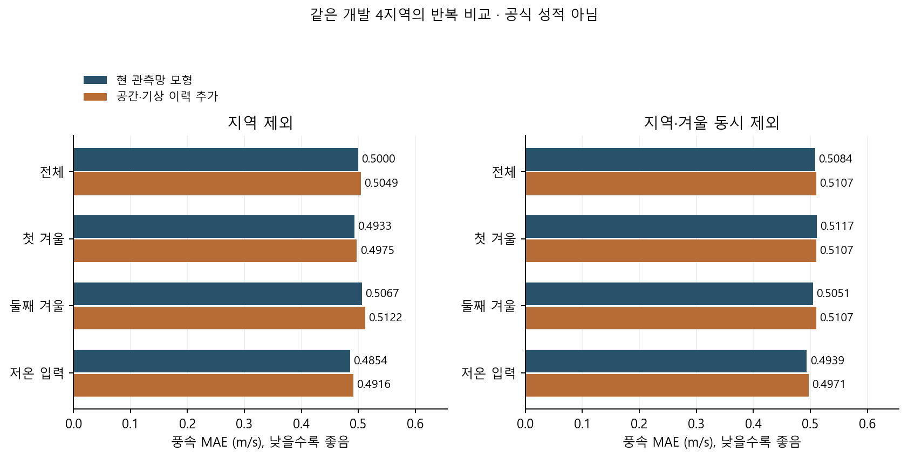
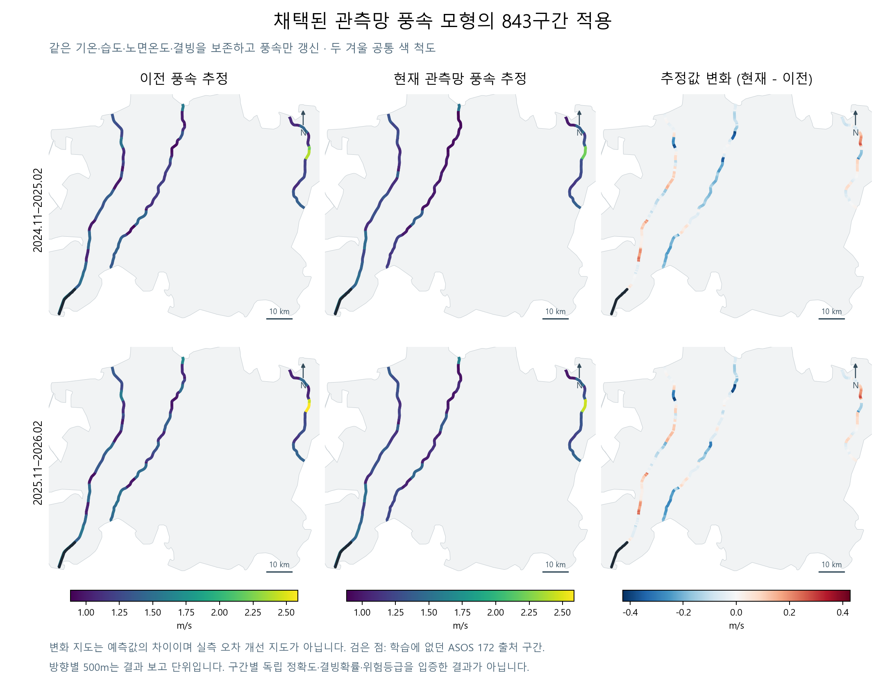

# 11월 2일 프로젝트 점검과 후속 고도화

기존 v12는 실행·문서·지도·검토용 압축 묶음까지 갖춰져 있습니다. 후속 점검에서 실제 파일·ZIP·풍속 CLI를 다시 확인하고, 추가 이력 후보의 비교·검산을 완료했습니다. **채택된 69특성 풍속을 843구간·두 겨울에 적용해 새 지도·일별 CSV·GIS를 만들었습니다.** 핵심 미해결 과제는 결빙 탐지이며, 기상 오차 개선을 결빙 F1 개선으로 대신하지 않습니다.

[현재 현황](../STATUS.md) · [v12 구성](REVIEW_BUNDLE_V12_20261101.md) · [고정 실험 계획·참고자료](../research/NETWORK_HISTORY_PLAN_20261102.md) · [공식 확인 범위](../competition/OFFICIAL_UPDATE_20261102.md)

## 현재 확보한 결과와 남은 차이

| 영역 | 현재 근거 | 후속 판단 |
| --- | --- | --- |
| 노면온도 | 개발 9곳·두 겨울 310,091유효쌍, MAE 1.145698°C | v3 유지. 미관측 도로에서 과거 실제 노면온도를 요구하지 않는 경로 |
| 기온 | AWS 우선 대비 MAE 22.10% 감소 | 채택 모형 유지. 같은 4개 개발 지역의 반복 비교 |
| 상대습도 | MAE 5.686973%p, AWS 우선 대비 12.91% 감소 | 82특성 이력 모형 유지. 서천 악화·서상 편향은 잔존 |
| 풍속 | 지역 제외 MAE 0.499955m/s, 지역·겨울 동시 제외 0.508379m/s | 현재 채택 69특성 주변 관측망 모형을 후속 비교의 기준으로 사용 |
| 결빙 | 기존 v2 일별 지점 F1 0.026554, ASOS 0°C 기준선 0.036601 | 기준선 미달이 가장 큰 모델링 한계. 이미 실패한 문턱·손실 탐색과 구별 |
| 공간 결과 | 기존 500m 843구간·1km 423구간과 별도 새 풍속 500m 843구간 결과 | 기존 지도 보존. 새 69특성 풍속은 11월 2일 별도 CSV·GIS·지도에서 확인 |
| 제출 준비 | 24쪽 보고서·노트북·코드·환경·학습 자료·두 ZIP | 실제 대회 업로드와 별개인 로컬 검토 후보 |

결빙의 F1 우선 프로필은 이미 알려진 기온 기준선의 실행 선택입니다. 평균 F1·재현율이 높지만 정밀도와 둘째 겨울 F1은 낮습니다. 기본 실행의 기존 v2와 대안 프로필의 출력 경로를 섞지 않습니다. [정확한 비교·실행 방법](COMPETITION_PROFILES_20261101.md)

## 이번에 다시 실행한 검증

- v12 모델 폴더 **2,465개 파일·667,343,873바이트**를 manifest의 크기·SHA-256과 대조했습니다.
- 문서 ZIP **8개**, 모델 ZIP **2,465개** 구성원의 이름·단일 최상위 폴더·바이트·해시를 전량 대조했습니다. 문서 ZIP은 1,399,998바이트, 모델 ZIP은 561,361,402바이트이며 기존 영수증과 같습니다.
- 실제 풍속 CLI를 새 출력 경로에서 실행하고 **432행 전체를 기준 CSV와 정확히 대조**했습니다. 이번 점검에서 최종 풍속 전체 재학습을 다시 실행한 것은 아닙니다. 앞선 11월 1일 별도 위치 재학습 근거는 보존합니다.
- 전체 테스트 **479개·하위 검사 7개 통과**, 기존 pandas FutureWarning 1개가 남습니다. 새 테스트 4개는 미래 변경의 영향, 지점·겨울 분리, 누락 시각의 달력 창, 문맥에 무관한 계산을 검증합니다.
- 보호 봉인 47+549개와 별도 일회 평가의 입력·예측 봉인을 대조했습니다. 보호 정답과 이미 평가한 별도 4지역 정답은 추가로 읽지 않았습니다.

점검 영수증은 `outputs/private/project_review_20261102_v1/receipt.json`과 같은 폴더의 `wind_cli_verification.json`입니다. 기존 제출 폴더·ZIP을 수정하지 않았으며, 원자료·인증정보·사용자 미커밋 변경을 보존했습니다.

## 후속 연구의 범위

현재 기상 34개·현재 관측망 35개에 기상 이력 48개와 주변 관측망 이력 30개를 더한 **147특성 단일 후보**를 고정했습니다. 새 관측소·정답·외부 가중치를 반입하지 않았습니다. 기존과 같은 137,498개 유효 개발 쌍에서 지역 제외 4회, 지역·겨울 동시 제외 8회로 비교합니다.

[Baïle & Muzy의 풍속 연구](https://arxiv.org/html/2207.14679v2), [openAMUNDSEN 기상 지역화](https://doc.openamundsen.org/des/meteo), [scikit-learn의 그룹 제외 원칙](https://scikit-learn.org/1.6/modules/generated/sklearn.model_selection.LeaveOneGroupOut.html)을 대조했습니다. 원 연구의 관측 지점 예측을 이번 미관측 도로 추정과 같다고 보지 않고, 해당 도로의 과거 정답이나 관측되지 않은 풍향을 입력으로 넣지 않았습니다.

결빙 후속 방향에는 [RoadSurf 1.1](https://gmd.copernicus.org/articles/17/4837/2024/)의 열수지·수분 저장·초기화를 참고했습니다. 해당 연구의 관측 초기화와 복사 입력, 노면 관측을 이용한 결합 보정을 현재 입력으로 재현했다고 주장하지 않습니다. 새로 읽은 자료의 적용·제외 범위는 [계획 문서](../research/NETWORK_HISTORY_PLAN_20261102.md)에 정리했습니다.

## 공간·기상 이력의 완료 결과: 미채택

| 비교 | 현 69특성 MAE (m/s) | 새 147특성 MAE (m/s) | 변화 |
| --- | ---: | ---: | ---: |
| 지역 전체 제외 | 0.499955 | 0.504858 | 0.98% 악화 |
| 지역·겨울 동시 제외 | 0.508379 | 0.510674 | 0.45% 악화 |
| 지역 제외·저온 입력 | 0.485410 | 0.491589 | 1.27% 악화 |
| 지역·겨울 제외·저온 입력 | 0.493908 | 0.497097 | 0.65% 악화 |

지역 제외에서는 두 겨울 모두 악화했습니다. 지역·겨울 동시 제외에서는 첫 겨울만 소폭 개선했지만 둘째 겨울과 저온 구간이 악화했습니다. 서천도 두 검증에서 악화했습니다. 날짜 블록 차이의 2.5–97.5백분위는 지역 제외 `[+0.002678,+0.007177]`, 지역·겨울 제외 `[−0.001093,+0.005788]`m/s입니다. 사전 조건 중 각 지역의 10% 악화 한도만 통과하고, 전체 2% 개선·두 겨울 비악화·저온 비악화·날짜 민감도 조건은 실패했습니다.

**현재 69특성 풍속 모형을 유지합니다.** 입력이 늘어난 것 자체를 고도화 성과로 세지 않으며, 실패 뒤 창·모형·손실을 추가 탐색하지 않았습니다. 이 비교는 기존 4개 개발 지역을 반복 사용한 결과로 새로운 독립 평가·공식 성적이 아닙니다.

별도 계산으로 **116,798,115개 특성 값**, **549,992개 예측 값**, **200개 지표**를 검산했습니다. 대표 2개 모형의 정확한 재학습과 127,008개 문맥 불변 특성 값도 확인했습니다. `weather_network_history_20261102_v1/independent_verification.json`이 `passed`이며, `network_history_review_20261102_v1/`에는 32행 지표 CSV와 22행 입력 조건별 진단 CSV가 있습니다. 모든 폴더는 `outputs/private/` 아래입니다. 조건별 진단을 보고 후보를 다시 선택하지 않았습니다.

## 실제 고도화: 채택된 풍속을 843구간에 적용

추가 이력은 미채택했지만, 이미 개발 검증을 통과한 69특성 풍속은 앞서 독립 실행 경로에만 있었습니다. 이 모형을 방향별 500m 843구간·두 겨울의 **29,134,080개 10분 시점**에 적용했습니다. 새 일별 표는 202,320행, 겨울별 표는 1,686행이며 GIS 두 레이어와 노선별 비교 CSV 6행을 함께 만들었습니다. 모형을 다시 학습하거나 결빙 규칙을 바꾸지 않았습니다.

| 구간 길이 가중 기술통계 | 2024/25 겨울 | 2025/26 겨울 |
| --- | ---: | ---: |
| 이전 추정 풍속 평균 (m/s) | 1.289395 | 1.331831 |
| 현재 추정 풍속 평균 (m/s) | 1.237852 | 1.288793 |
| 새 풍속 69입력의 범위 이탈 시점 비율 | 26.40% | 30.39% |

유효 10분 시점 29,071,710개 중 29,065,379개의 추정이 달라졌고 평균 절대 변화는 0.164917m/s입니다. **추정값 차이이며 새 실측 오차 감소가 아닙니다.** 학습에 없던 ASOS 172 출처 50구간을 그대로 표시합니다. 범위 이탈은 학습 69입력의 유한 최솟값·최댓값 밖에 있는지를 확인한 진단이고 정확도나 확률이 아닙니다. [열·단위·결측·분모](CSV_CONTRACT.md#관측망-풍속-구간-적용--2026-11-02)를 함께 봅니다.

전량 검산은 **1,718,034개 집계·GIS 대조**, **203,938,560개 기존 시점 값 보존**, **대표 19구간 3,939,840개 API 재추론 값의 정확한 일치**를 통과했습니다. 기존 기온·습도·노면온도·결빙 조건·공간 선형과 일별 비풍속 열을 보존했습니다. 새 CSV와 Parquet도 전량 대조했습니다. 기존 v12 ZIP과 기존 지도는 덮어쓰지 않았습니다.

| 새 로컬 경로 (`outputs/private/` 아래) | 내용 |
| --- | --- |
| `wind_network_segment_projection_20261102_v1/` | 843구간 10분 캐시·일별/겨울별 CSV·GIS·학습 입력 범위·계획·완료 및 독립 검산 |
| `wind_network_projection_review_20261102_v2/` | 노선별 길이 가중 비교·지도 영수증·시각 검토 |
| `wind_network_projection_audit_fix_20261102_v1/` | CSV/GIS 관측소 식별자 형식 차이로 실패한 초기 검산 코드와 수정 사유 |

처음 GIS 대조에서 CSV가 숫자로 추론한 ASOS 번호와 GIS 문자열 번호를 빼려다 검산기가 중단됐습니다. 식별자를 문자열로 대조하도록 고친 뒤 전량 검사를 다시 통과했습니다. 지도 제목의 글꼴 미지원 기호도 교체했고 초기 그림·코드를 보존했습니다. 예측·모형·입력·선택 기준은 이 교정으로 바꾸지 않았습니다.

## 남은 작업의 우선순위

1. **결빙 근거와 제출 해석 확정:** 알려진 F1 프로필의 손해를 함께 제시하고, 센서·제설·도로 수분 이력의 부재를 결과와 연결합니다. 같은 개발 정답에서 임계값 후보 수를 늘리는 작업은 우선순위가 낮습니다.
2. **후속 결과의 제출 묶음 통합:** 새 풍속 CSV·GIS·지도는 별도 폴더에서 검산을 완료했습니다. 기존 v12 ZIP과 240일 오프라인 탐색은 이전 풍속 결과를 보존합니다. 최종 재포장 시 새 공간 결과·모형 설명·탐색 화면의 버전을 함께 맞추는 작업이 남아 있습니다.
3. **독립 자료와 위치 품질:** 성암교 좌표 불일치·진천터널외부의 관측 부족·상태 충돌을 해결할 자료가 필요합니다. 이미 평가한 4지역을 새 독립 표본으로 다시 사용하지 않습니다. 기존 요청 초안은 미발송 상태로 유지합니다.
4. **제출 마감 상세 확인:** 공식 공개 문제·공지 목록은 11월 2일 다시 확인했고 상세 공지 접근은 실패했습니다. 11월 6일 이전 작업 완료 기준을 유지하며, 참가신청 종료일과 실제 결과물 마감일을 구분합니다.

현재 최신 실행 묶음은 v12입니다. 이번 연구 코드·결과 설명을 기존 v12 ZIP에 자동으로 포함한 것으로 기록하지 않으며, 새 버전 재포장 전까지 11월 1일 검토 영수증과 11월 2일 후속 점검을 함께 읽습니다. 대회 업로드·외부 발송·공개 전환·Git 커밋·푸시는 이번 작업에서 수행하지 않았습니다.
