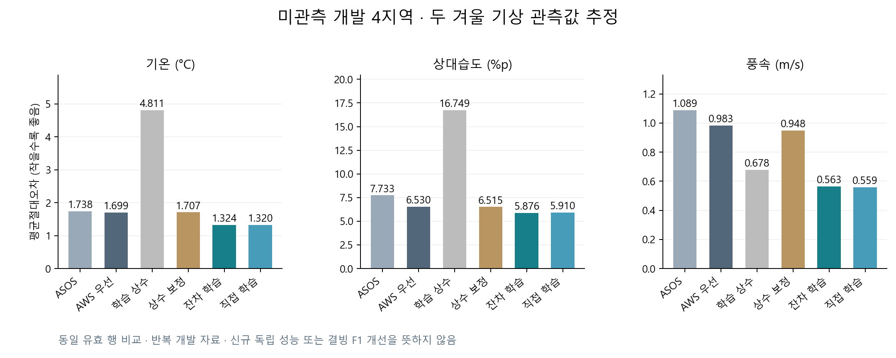

# 기온·습도·풍속 보완 모형의 실행과 검증

세 모형과 843구간·두 겨울의 일별·겨울별 CSV·GIS를 [v9 묶음](REVIEW_BUNDLE_V9_20261031.md)에 통합합니다. [공간 적용과 검산](../research/WEATHER_SEGMENT_PROJECTION_20261031.md)에서 새 출처 50구간·입력 범위 표시와 기존 결과 보존을 확인합니다.

세 기상 목표의 미관측 지역 추정이 개선돼 별도 실행 묶음을 만들었습니다. 기존 노면온도 v3·결빙 v2와 완료 v8 제출 ZIP은 보존합니다. 아직 대회 사이트에 제출한 파일은 없습니다.

| 항목 | 로컬 경로 |
| --- | --- |
| 실행 묶음 | `outputs/private/weather_observation_supplement_20261031_v1/` |
| 실행 설명 | 위 폴더의 `README.md` |
| 학습·추론 노트북 | `notebooks/weather_observation_supplement.ipynb` |
| 학습 입력과 기상 정답 | `data/training.parquet` |
| 기온·습도·풍속 모형 | `model/` |
| 144행 재현 예시 | `data/inference_example.csv`, `data/expected_predictions.csv` |
| 별도 위치 실행 검증 | `outputs/private/weather_supplement_validation_20261031_v1/receipt.json` |
| 전체 후보·기준선 지표 | `outputs/private/road_weather_review_20261031_v1/observation_estimation_metrics.csv` |
| 10분 기상 예측 | 같은 검토 폴더의 `air_temperature_10min.csv.gz`, `relative_humidity_10min.csv.gz`, `wind_speed_10min.csv.gz` |

Windows·Python 3.11.2·CPU에서 검증했습니다. `requirements.txt`에 실행·노트북 라이브러리 버전을 고정했습니다. GPU·외부 AI API·인증정보가 필요하지 않습니다. 실행 묶음 폴더를 작업 디렉터리로 사용합니다.

```powershell
python scripts/predict_weather_supplement.py --model model --input data/inference_example.csv --output prediction.csv
python scripts/retrain_weather_supplement.py --bundle . --output model_retrained
```

입력은 28개 기상 열이고 내부 파생값을 포함한 특성은 34개입니다. ASOS는 엄격한 과거 60분, AWS는 엄격한 과거 15분 이내를 사용합니다. 가용하지 않은 행은 NA로 둡니다. 학습 목표는 기온·상대습도·풍속이며 노면온도·Ice 정답은 입력에 넣지 않습니다.

별도 위치로 복제한 묶음에서 실제 CLI의 144행이 기준 CSV와 정확히 일치했습니다. 실제 Jupyter 커널에서 3개 코드 셀을 실행하고 `RUN_REFIT=True`로 세 모형을 처음부터 다시 학습해 예시 추론이 정확히 같음을 확인했습니다. 원 묶음 28파일의 해시와 기존 보호 봉인 47+549개도 유지했습니다. 검증 상태는 `weather_supplement_verified`입니다.

성능은 전체 적합 모형의 예시로 평가하지 않습니다. 지역 전체를 학습에서 제외한 네 지역의 두 겨울에서 AWS 우선 대비 MAE가 기온 22.10%, 습도 10.02%, 풍속 42.67% 줄었습니다. 추가 학습 상수·잔차 상수 기준선도 비교했습니다. 지역별 반례·낮은 풍속 상관·습도 편향을 포함한 [전체 연구 기록](../research/ROAD_WEATHER_TRANSFER_20261031.md)을 함께 확인합니다.



이 기온을 0°C 기준으로 결빙에 적용한 별도 정책은 F1 하락과 기존 38사건 손실로 미채택했습니다. 보완 모형의 성과는 기상 관측값 추정이며 결빙 분류·공식 성적·신규 독립 지역 정확도를 뜻하지 않습니다. 생성형 AI 활용과 실제 검증 주체는 [AI 활용 기록](../../AI_USAGE.md)에 구분합니다.
