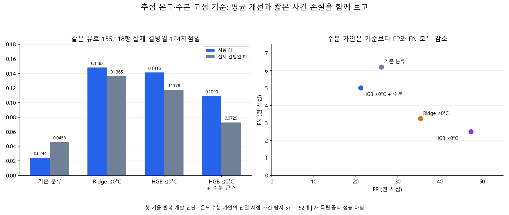

# 2026년 10월 14일까지의 프로젝트 소개 원문

> **읽는 범위:** 아래 내용은 해당 문서의 작성·실험 시점 기록입니다. 현재 모델·마감·완료 상태는 [진행 현황](../STATUS.md)을 기준으로 읽고, 약어와 지표는 [처음 읽는 안내](../START_HERE.md)에서 확인합니다.

구조 정리 전 README의 상세 결과·진행 기록입니다. 현재 안내는 [프로젝트 입구](../../README.md)를 확인합니다.

# icy-road-ai · 도로 결빙 위험 추정


[](https://github.com/jinwon25/icy-road-ai/actions/workflows/checks.yml)

전북도 고속도로의 기상·도로환경 자료를 결합해 **관측 장비가 없는 도로의 노면온도와 결빙 여부를 추정**하는 개인 분석 프로젝트입니다. 새로운 지점·겨울에서도 성능이 유지되는지 검증하고, 구간별 위험정보에 필요한 조건과 한계를 정리합니다.

## 문서 읽기 안내

- [모델·보고서 고도화](../delivery/MODEL_REPORT_UPGRADE_20261014.md): 결빙점 가중 20모델·고정 결합 검증, MAE 집계 명칭 수정, 오류 사례와 날짜·지역 민감도 분석
- [10월14일 대회 현황·제출 후보 후속 검토](../delivery/COMPETITION_STATUS_20261014.md): 새 Q&A653·FAQ 본문 변경, 현재17개 일반 답변·제출 일정, 압축본 재현과 입력 공백 감사
- [제출 후보 패키지·추가 판정 검증](../delivery/SUBMISSION_CANDIDATE_20261013.md): 18개 열·수분 가설의 미채택, 두 겨울 보호 예측·구간 지도·보고서·실제 실행과 CSV 정밀도 수정
- [Q&A633 새 답변·일별 검산](../competition/OFFICIAL_QNA_20261013.md): 문제별6건 모두 완료, 미탐일Precision 제외·Recall/F1=0,21개 고정 판정의 지표별 분모·부분 날짜·CSV 확인
- [기상 이력 온도 개선·사건별 손실](../research/WEATHER_MEMORY_REVIEW_20261013.md): 고정 결합MAE3.83% 개선, 수치 재현 문제 수정, 기존 결빙 사건1개 손실과5모델 오프라인 재현
- [10월13일 공식 정보·로컬 재현](../competition/OFFICIAL_UPDATE_20261013.md): 새 FAQ·신청서·접수 공지 변경, AI/API 답변과 모델4개의 접속 차단 재현
- [결빙 여섯 방법·온도 오차 범위](../research/ICE_METHODOLOGY_REVIEW_20261010.md): 새 분류70모델, CatBoost의 오경보 감소와 사건 손실, 평가 그룹을 제외한 온도 범위의 지점별 포함률
- [방법론 블렌딩의 검증](../research/METHOD_BLENDING_REVIEW_20261010.md): 온도9종·세 단계 공간 가중치·4개 점수 평균·AND/OR의 실제 비교와 단독 모델 대조
- [고정 평균 후보·새 호남 2개 지점 검증](../research/TEMPERATURE_MEAN_AND_BLIND_REVIEW_20261010.md): 개발 온도 기준 통과 후 새 위치의 저온 오차·오경보 증가로 미채택한 결과와 적용 범위
- [거리 제거·기상망 확장 후속 검토](../research/WEATHER_DISTANCE_AND_NETWORK_REVIEW_20261010.md): 같은 입력의 새 학습 10건, 지점 손실로 미채택한 결과와 공개 지점 이력·AWS 확장 계획
- [미해결 사항의 순차 검토](../research/UNRESOLVED_EVIDENCE_REVIEW_20261010.md): 21개 지점 위치·96개 지표 조건·기상 입력 범위와 후속 실행 조건
- [심사 관점 후속 연구·새 4개 지점](../research/AWARD_READINESS_REVIEW_20261010.md): 온도 후보·일별 임계값의 실제 비교, 봉인 평가 실패와 좌표 불일치
- [연구 결과물과 마감 판단](../delivery/RESEARCH_DELIVERY_REVIEW_20261009.md): 현재 결과와 최종 제출에 남은 조건
- [새 8개 지점의 고정 평가](../research/FRESH_STATION_REVIEW_20261009.md): 지점별 온도 오차와 결빙 탐지 손실
- [구간·환경 분석](../research/SEGMENT_EXPOSURE_REVIEW_20261009.md): 두 겨울의 조건 노출과 집계 기준
- [전체 문서 목록·용어 풀이](../README.md): 검증 규약, 실행 안내, 과거 실험 기록

## 현재 상태

**10월 14일 추가 연구에서 결빙점 가중 학습과 보고서를 고도화했습니다.** 새 가중 평균은 -2~2°C 온도 오차를 16.96% 줄였지만 기존 탐지 사건 2개를 놓쳤습니다. 고정 결합도 사건 손실이 있어 실행 후보를 유지했습니다. 지점별 결과·오류 유형·실제 사례·날짜 블록 민감도를 담은 새 보고서를 작성했습니다. [결과와 채택 판단](../delivery/MODEL_REPORT_UPGRADE_20261014.md)

현재 후보의 **전체 행 MAE는 1.200531°C, 지점 균등 MAE는 1.200440°C**입니다. 이전 보고서에서 전체 행 값을 지점 평균으로 부른 표기를 바로잡습니다. 예측·점수 파일은 그대로이며 두 집계의 개선율은 각각 2.58%, 2.57%입니다.

최신 로컬 제출 후보는 `submission_candidate_20261014_v3.zip`이며 약 212MB입니다. 12쪽 보고서·13개 참고 자료와 실행·검증 코드를 묶고, 파일 해시 925개와 합성 테스트 259개를 확인했습니다. 원본·모델·예측·PDF·압축본은 Git에서 제외하며, 저장소에는 재현 코드·설정·집계 문서만 보관합니다. 공식 제출이나 새 지점 성능 입증은 아직 완료하지 않았습니다.

**10월14일 공식 사이트 재확인과 제출 후보 검증을 완료했습니다.** 문제별6건·올해 일반17건 모두 답변 완료입니다. 새653과FAQ에서 중복 신청 허용·중복 수상 불가, 손글씨 폰트 타이핑 서명도 반려된다는 설명을 확인했습니다. 문제·배포 목록·기존 답변·빈 양식은 유지되며 결과물 제출 날짜·최종CSV는 추가 공지 대기입니다. [최신 현황](../delivery/COMPETITION_STATUS_20261014.md)

<details>
<summary>이전 개발·제출 후보 준비 이력</summary>

보고서 개편 전 약 155MB의 비공개 후보 압축본을 별도 폴더에서 파일 해시·무손실 CSV 추론·개발 지표로 검증했습니다. 개발 입력 공백 21행은 모두 비결빙 라벨이고 보호 예측 공백 18행은 정답을 보지 않고 null로 유지했습니다. 새 학습·독립 성능 입증·최종 모델 승격·공식 제출을 수행한 것은 아닙니다.

**10월 13일 비공개 제출 후보를 통합했습니다.** 허용 첫 겨울 23곳의 실행용 2모델, 보호 3곳 두 겨울 103,680행, 500m 843개·1km 423개 구간의 추정·공간파일·지도, 한국어 보고서와 실제 실행 데모를 준비했습니다. 입력 부족 18행은 null로 남깁니다. 기상 특징 약 3,338만 값과 추론 약 715만 값을 독립 검산했고 실제 CSV 실행의 반올림 문제를 무손실 파서로 수정했습니다. 새 독립 성능 입증·최종 승격·공식 제출은 계속 구별합니다. [패키지와 검증 범위](../delivery/SUBMISSION_CANDIDATE_20261013.md)

추가 열·수분 18가설은 네 공간 그룹의 내부 선택에서 모두 기준에 실패했습니다. F1과 Precision이 높아진 조합도 기존 결빙 사건 3개를 놓쳤으므로 채택하지 않았습니다. 기존 모델·평가·봉인은 보존합니다.

**10월13일 Q&A633 답변을 확인해 평가 정책을 갱신했습니다.** 문제별6건·일반2026년16건 모두 답변 완료입니다. 미탐일Precision을 평균에서 제외하고 Recall/F1에0을 넣는 처리는 기존 구현과 같아 개발21판정의 F1은 바뀌지 않았습니다. 지표별 날짜 분모와 부분 관측4조건을 CSV로 구분하고 별도 검산했습니다. 전체240검사·코드·문서·기존 봉인 보존을 확인했습니다. [최신 공식 후속 작업](../competition/OFFICIAL_QNA_20261013.md)

기상12·2종 평균의 일평균Precision은0.052803으로 기존 온도평균0.055359보다 낮고, Recall/F1은 높습니다. 앞선 FP/FN·F1·사건 기준 통과를 공식형 세 지표의 동시 개선으로 확대하지 않습니다. 결과물 마감 날짜·최종 CSV·부분 날짜 정책은 계속 미확정이고 새 독립 검증·최종 제출은 수행하지 않았습니다.

**추가 대조군에서는 온도·결빙·기존 사건 보존 기준을 함께 통과한 후보2종을 찾았습니다.** 거리 없는 기상12·MSE/MAE300의 고정 평균은 개발MAE1.232271→1.200531°C(2.58% 감소), FP20,889→20,255·FN4,982→4,952, 탐지 사건145→152로 개선하고 기존 사건을 모두 유지했습니다. 기존 평균과의1:1 결합도 MAE1.193290°C로 같은 기준을 통과했습니다. 내부 자동 선택·새 지점 일반화는 입증되지 않아 연구 후보로 유지합니다. [최종 비교](../research/WEATHER_MEMORY_REVIEW_20261013.md)

이번 신규 적합은 이력v1/v2·대조군을 합한60건과 검산 재적합6건입니다. 균형 후보의 별도2모델·약494KB 묶음에서576예측/판정이 일치하고 접속 시도는0입니다. 아래의3.83% 온도 개선은 이력 후보의 전체 개선이며, 같은 조건의 이력 제거 대조군 대비 추가 효과는0.69%입니다.

**10월13일 기상 이력 후속 연구에서 온도 개선 후보를 확보했습니다.** 기존3종 평균과 과거1·3·12시간 기상2종 모델을 고정 비중으로 결합해, 개발9곳155,236유효행의 MAE1.232271→1.185115°C·저온 MAE1.117190→1.078330°C로 줄였습니다. 최대 지점 악화2.94%로 온도 개발 기준을 통과했습니다. 내부 자동 선택은 기준에 실패했고 결빙에서는 실제 결빙일 F1 감소·기존 사건1개 손실이 있어 최종 승격을 보류합니다. [새 연구 결과](../research/WEATHER_MEMORY_REVIEW_20261013.md)

전체 겨울과 하루 입력의 미세한 이동평균 차이가 트리 분기를 바꾸는 문제를 정수 누적합·소수6자리 이력으로 수정했습니다. 원본v1·실패 로그를 보존하고v2를 재학습·검산했습니다. 약1.82MB의 별도5모델 묶음에서 특징6,048값·예측/경계1,296값을 재현했고 접속 시도는0입니다. **전체 합성 테스트232개 통과**와 기존 봉인 보존을 확인했습니다. 새 독립 평가·공식 점수·제출 완료는 아닙니다.

**2026 DATA·AI 분석 경진대회 참가 중 · 10월13일 공식 정보 재검토와 로컬 재현 완료**입니다. 새 FAQ·참가신청서·제출 공지의 변경을 확인했고 결과물 접수 시작일·최종 마감 날짜는 별도 공지 대기입니다. 마감 시각은 한국 시간23:59이며 참가신청 종료11월6일과 구별합니다. AI 설계·개발 지원과 외부 API 분석/예측 제한을 검토해, 접속을 차단한 저장 모델4개의 하루 추론과 약1.3MB의 비공개 재현 패키지를 확인했습니다. 모델 승격·공식 제출·공개는 수행하지 않았습니다. [최신 공식 검토](../competition/OFFICIAL_UPDATE_20261013.md)

10월10일에는 같은 개발9곳에서 새 분류70모델을 비교했습니다. CatBoost는 시점 F1을0.024370→0.037552로 높이고 FP를70.6% 줄였지만 FN130행·사건35개·단일 시점15개의 추가 손실이 있어 채택하지 않았습니다. 여섯 후보 모두 사전 채택 기준에 실패했습니다. [직전 모델 연구](../research/ICE_METHODOLOGY_REVIEW_20261010.md)

앞서 기상12/MSE300/MAE300 평균은 유효155,236행에서 MAE1.232271°C로 단독300보다2.20% 개선했습니다. 이번에는 평가 그룹을 제외한 경험적 오차 범위를 붙여 전체 실제 포함률89.73%·12408 지점73.91%,0°C 경계를 걸치는 행36.76%를 확인했습니다. 평균 오차와 지점별 불확실성을 함께 기록하며90% 포함 보장·독립 성능·공식 점수로 해석하지 않습니다. 최종 모델 승격·위험 등급·대회 제출은 보류합니다.

직전 공식 정보 검토 당시 전체 합성 테스트 **216개가 통과**했습니다. 이전 시간 이력·가중치·경험적 범위 검사와 접속 차단·예외 복구 검사5개를 포함합니다. 보호·기존 평가·다음 겨울 정답은 새 후보의 학습·보정·선택·채점에서 제외했고 기존 평가 지점을 다시 채점하지 않았습니다. 기상 실제 확장·전북 내 독립 전이·센서 이력·공식 이정/시설 대응과 최종 위험 등급은 남아 있습니다.

직전 기상14/12의1:1 평균은 개발 기준을 통과했으나 사전 봉인한 새 두 호남 지점에서 관측 −2~2°C MAE가0.781423→0.790567°C로 악화하고 결빙 FP가4,819→4,875행으로 늘어 미채택했습니다.

직전 새 평가의 유효 온도는34,558행, 유효 상태는34,420행·Ice72행입니다. 두 지점은 SGIS 전북 경계 밖의 호남선으로, 목표 전북 구간·다음 겨울 성능을 입증하지 않습니다. 원문255개·모델 예측·지표·모든 요청 간격을 독립 검산했고 당시 합성 테스트193개가 통과했습니다. 마지막 실제 AWS 관측 API 확인의403이 미해결이며 공개 포털·샘플을 전체 첫 겨울 관측의 대체자료로 사용하지 않았습니다. [직전 상세 보고서](../research/TEMPERATURE_MEAN_AND_BLIND_REVIEW_20261010.md)

앞선 새 4개 지점의 지점 평균 온도 MAE는 1.718700→1.738226°C로 악화했고 온도·수분 보정은 놓친 결빙을 55→60행으로 늘렸습니다. 21곳 중 마달터널(33407)의 위치 차이 709.6m와 새 4곳의 AWS 거리 범위 이탈, 96개 집계 조건에 따른 점수 차이도 기록했습니다. 실제 센서 이력·Q&A633·공식 이정·시설 경계·최종 위험 등급은 남아 있습니다. [앞선 미해결 검토](../research/UNRESOLVED_EVIDENCE_REVIEW_20261010.md)

</details>

## 분석 질문과 데이터

| 항목 | 내용 |
| --- | --- |
| 분석 질문 | 기상·주변 도로 관측으로 미관측 노면온도와 Ice를 추정할 수 있는가? 지점·겨울이 달라져도 성능이 유지되는가? |
| 대회 자료 | RWIS 노면온도·노면상태, ASOS·AWS 기상, 교량·터널·도로·지형 자료. 최신 배포본은 `20261007` |
| 기간·단위 | 2024년 11월–2025년 2월, 2025년 11월–2026년 2월 · 지점별 10분 시점과 일별 지표 |
| 개발 자료 | 대회 개발 14개 지점에 API로 수집한 비대회 9개 지점을 더한 첫 겨울 23개 지점 |
| 보호 지점 | 부곡교 12410·삼봉 33411·해전 23402. 학습·주변 참조·모델 선택에서 제외 |
| 새 공간 평가 | 앞선 비대회8곳·추가4곳·최신 호남2곳. 모두 예측 봉인 뒤 일회 평가를 완료해 이제 개봉된 자료. 같은 첫 겨울의 공간 평가이며 미래 겨울 검증과 구별 |
| 별도 고정 평가 | 보호 3개 지점과 기존 추가 9개 지점의 다음 겨울. 기존 모델만 평가했으며 새 후보의 점수가 아님 |
| 정답 정의 | `04` Ice만 결빙. `13`·`15` 등 정의된 다른 상태는 비결빙, 미정의·결측은 제외 |

[변수·단위·정답 정의](../data/VARIABLE_DICTIONARY.md) · [학습·평가 분리](../validation/VALIDATION_PROTOCOL.md)

## 방법과 주요 결과

평가 그룹을 전처리·모델 학습·후보 선택에서 제외하고, 목표 시각보다 엄격히 이른 기상·주변 도로 관측만 사용합니다. 모델은 같은 유효 행에서 비교합니다. 새 지점 평가에서는 후보·입력·임계값·예측을 먼저 고정한 뒤 정답을 확인했습니다.

**최신 호남 2개 지점의 고정 평가**

| 비교 항목 | 평가 대상·분모 | 결과 | 판단 |
| --- | --- | --- | --- |
| 기상14→고정 평균 온도 | 동일 유효34,558행 | 지점 평균 MAE 1.120225→1.119990°C | 저온9,542행의 MAE는1.17% 악화해 미채택 |
| 같은 수분 규칙 | 유효34,420행·Ice72행 | FP 4,819→4,875 / FN 27→27 | 추가 오경보로 채택 실패 |
| 원래 분류→평균+수분 | 위와 같은 상태 행 | FN 18→27, 사건35→25/37 · 단일26→20/28 | 원래 분류보다 미탐·짧은 사건 손실 증가 |
| 수집·범위 검산 | 240일 구간·255원문·270요청 | 간격269개 모두≥1.3초, 좌표 차이9.1/11.1m | 호남선 외부 이전이며 전북 전체 성능 아님 |

**직전 새 4개 지점의 고정 평가**

| 비교 항목 | 평가 대상·분모 | 결과 | 판단 |
| --- | --- | --- | --- |
| 온도 100→300회 | 동일 유효 69,104행·4개 지점 | 지점 평균 MAE 1.7187→1.7382°C, 1곳 개선·3곳 악화 | 두문 6.94% 악화. 사전 채택 조건 실패 |
| 기존 Ice→온도100+수분 | 유효 상태 69,101행·Ice 88행 | FP 16,966→9,100 / FN 55→60 | 합산 F1 0.00386→0.00608이나 미탐 증가로 미채택 |
| 사건 탐지 | 전체 56건·단일 시점 39건 | 전체 28→24건 / 단일 22→19건 | 희소 사건 손실 |
| 수집·위치 검산 | 480일 구간·510원문·540요청 | 간격 539개 모두 1.3초 이상. 33407 위치 차이 709.6m | 원문·지표 일치, 실제 위치 확인 필요 |

**앞선 새 8개 지점의 고정 평가**

| 비교 항목 | 평가 대상·분모 | 기존 기준 → 온도·수분 후보 | 판단 |
| --- | --- | --- | --- |
| 온도 오차 | 같은 첫 겨울, 동일 138,225행 | 지점 평균 MAE 2.7054→2.4848°C | 3곳 개선·5곳 악화. 평균만으로 채택하기 어려움 |
| 결빙 분류 | 유효 상태 138,189행, 실제 Ice 59행 | F1 0.00271→0.00498 | 점수는 올랐지만 탐지 손실이 남아 미채택 |
| 오경보·미탐 | 위와 같은 유효 상태 행 | FP 42,700→20,369 / FN 1→8 | 오경보는 감소했지만 미탐은 증가 |
| 사건 탐지 | 연속 결빙 47건 / 단일 시점 사건 41건 | 전체 46→40건 / 단일 시점 40→35건 | 짧은 결빙을 놓치는 문제 확인 |

MAE는 평균 절대 오차로 작을수록 좋습니다. F1은 결빙 경보의 정확성(Precision)과 실제 결빙 탐지율(Recall)을 함께 보는 지표입니다. FP는 비결빙을 결빙으로 경보한 경우, FN은 실제 결빙을 놓친 경우입니다. 위 F1은 10분 시점을 합산한 보조지표이며 공식 일별 점수와 다릅니다.

새 지점 수집 기록에서 요청 간격 1,827개 중 252개가 설정한 1.2초보다 짧았습니다(최소 1.187초). 원본 편차를 기록하고 후속 코드를 수정했습니다. 계산·예측 고정 순서의 검산과 수집 간격 준수 여부를 구분합니다.

**두 겨울의 전북 구간·환경 결과**

SGIS 전북 경계 안의 500m 843개·1km 423개 방향별 구간에 기상 조건 노출·도로환경·입력 가용성·모델 민감도를 연결했습니다. 양 방향 유지 길이는 419.637km이며, CSV·GeoPackage·Shapefile·JPG·오프라인 HTML과 비공개 재현 패키지를 완성했습니다. 기존 467개 구간 초안도 보존했습니다.

두 겨울에 같은 첫 겨울 모델과 기상 입력을 사용했습니다. 저온과 수분 근거가 함께 나타난 비율은 기간별 조사 우선순위를 설명하는 자료입니다. 검증된 결빙 확률·사고 확률·최종 위험 등급으로 해석하지 않습니다. [구간 결과·필드 정의](../research/SEGMENT_EXPOSURE_REVIEW_20261009.md)

<details>
<summary>이전 개발 실험과 기존 모델의 고정 평가</summary>

첫 겨울 추가 9개 지점은 후보를 반복 비교한 개발 자료입니다. 이 자료에서의 개선을 새 지점이나 미래 겨울의 성능으로 읽지 않습니다. 보호 지점·다음 겨울 평가는 기존 모델의 별도 고정 평가입니다.

| 비교 | 평가 대상·분모 | 결과 | 해석 |
| --- | --- | --- | --- |
| 기상 단독 온도 Ridge→HGB | 추가 9개 지점 첫 겨울, 동일 155,236행 | MAE 2.07085→1.37054°C, 9개 지점 모두 개선 | 반복 개발 비교. 내부 다른 그룹에서만 후보 선택 |
| 기존 분류→HGB 추정온도≤0°C + 수분 근거 | 같은 첫 겨울 유효 상태 155,118행 | F1 0.02437→0.10903; FP 26,059→21,138; FN 6,208→5,011 | 시점 합산 보조지표. 공식 일별 점수가 아님 |
| 위 가안의 사건 탐지 | 같은 실제 결빙 347개 사건 | 121→143개 사건; 단일 시점 118개 사건은 57→52 | 전체 개선과 희소 사건 손실이 함께 존재 |
| 후속 이진/다중 상태 후보 | 같은 첫 겨울 유효 상태 155,118행 | F1 0.01605/0.01880; 단일 탐지 20/44건 | 네 그룹 모두 내부 채택 조건 탈락. 금산에서 순위 개선에도 임계값 이전 실패 |
| 후속 점수 보정 3개 후보 | 같은 첫 겨울 유효 상태 155,118행 | F1 0.02814/0.00208/0.01853 | 모두 미채택. 순위 개선과 임계값 이전 실패를 구별 |
| 새 8개 지점 온도 | 같은 첫 겨울·학습에서 제외한 새 위치, 동일 138,225행 | 지점 평균 MAE 2.7054→2.4848°C, 3곳 개선·5곳 악화 | 예측 봉인 후 평가. 공식·미래 점수 아님 |
| 새 8개 지점 결빙 | 유효 상태 138,189행·Ice 59행 | F1 0.00271→0.00498, FP 42,700→20,369, FN 1→8 | 탐지·단일 사건 손실로 미채택 |
| 기존 고정 모델의 다음 겨울 | 추가 9개 지점, 유효 상태 155,464행·Ice 76건 | TP 64·FP 14,530·FN 12; F1 0.00873 | 예측 고정 후 일회 평가. 새 HGB/수분 가안은 평가하지 않음 |
| 기존 보호 3개 지점 고정 평가 | 대회 지정 3개 지점·Ice 64건 | 온도 지점 평균 MAE 0.93048°C; TP 0·FP 3·FN 64 | 결빙 탐지 실패. 이 정답으로 재튜닝하지 않음 |

33408의 Ice는 첫 겨울 6,340건에서 다음 겨울 14건으로 변했습니다. 같은 지점의 실제 0°C 이하 온도 비율 변화보다 상태 분포 변화가 훨씬 컸습니다. 센서·기상·제설·처리 방식 중 원인은 아직 확정하지 않았고, 정답을 삭제하거나 저온 조건으로 다시 라벨링하지 않습니다.



[온도·관측소 대표성 상세](../research/WEATHER_FALLBACK_REVIEW_20261009.md) · [결빙·다음 겨울 상세](../research/THERMAL_ICE_AND_RESERVED_REVIEW_20261009.md) · [미채택 가중치 실험](../research/ICE_GROUP_BALANCED_REVIEW_20261009.md)


</details>

## 실행 방법

Windows·Python 3.11·CPU로 개발했습니다. pandas 2.2.3, scikit-learn 1.6.1 등의 버전은 [requirements.txt](../../requirements.txt)에 고정했습니다.

**원본 데이터 없이 코드·문서 검증**

```powershell
python -m pip install -r requirements-dev.txt
$env:OMP_NUM_THREADS = '2'
$env:OPENBLAS_NUM_THREADS = '2'
python -m unittest discover -s tests -v
python scripts/check_repository.py
python scripts/check_markdown.py
```

합성 데이터로 미래 관측·보호 지점 유입 차단, 동일 분모, 결측 복귀, 일별 계산·단일 사건 보존을 확인합니다. 코드 검증은 전체 학습이나 성능 재현을 뜻하지 않습니다.

**참가 권한과 비공개 원본·중간 산출물을 갖춘 환경**

수정본 분석 작업 루트는 `outputs/private/releases/20261007/`입니다. 루트의 `config/data_source.json`은 보존한 9월 15일 자료를 가리키므로 버전을 섞지 않습니다. 최신 연구 인계물의 모델·지표 검산과 실험별 진입점은 [실행 안내](../delivery/RUNBOOK.md#연구-인계물-검산)에 있습니다. 이미 완료한 보호·다음 겨울 평가는 재실행하지 않습니다.

## 파일 구성

| 경로 | 역할 |
| --- | --- |
| `src/` | 입력·정답 정의, 평가 지표, 모델·공간 처리, 고정 열·수분 규칙 |
| `scripts/` | 자료 감사, 학습·검증·재현 진입점, 저장소·GFM 검사 |
| `tests/` | 합성 데이터 기반 코드·문서 검증 |
| `config/` | 자료 버전, 검증·실험·실행 설정 |
| `notebooks/analysis_review.ipynb` | 분석 흐름 검토용 노트북. 저장 출력 없음 |
| [`docs/`](../README.md) | 최신 상태·상세 분석·규약·실행 안내·과거 기록 |
| [`AI_USAGE.md`](../../AI_USAGE.md) | 개인 수행 주체와 실제 AI 지원·검토 기록 |
| `outputs/private/` | 원본·모델·예측·실험·제출 초안 등 로컬 자산. Git 제외 |

## 해석과 한계

온도 정확도 개선과 공식 Ice 탐지는 별개입니다. 새 가안은 지점 편차·미탐·단일 사건 손실과 겨울별 분포 차이가 남아 있어 최종 채택하지 않았습니다. 후속 선택에는 이미 개봉한 보호·다음 겨울 정답을 재사용하지 않고 새로운 미개봉 지점·기간의 검증이 필요합니다.

공식 집계는 일별 지표의 지점별 평균 후 세 지점 평균이며 합산 시점 F1은 보조지표입니다. 부분 날짜·한쪽 지표 미정의 처리·제출 CSV 규격은 추가 확인 대상입니다. 결빙 판정, 기상 조건 노출, 결빙 시 도로환경 영향과 사고 피해 확률을 구별합니다. 공식 점수·수상 가능성·현장 운영 효과는 검증하지 않았습니다.

## 출처와 이용 조건

[AIDA 문제·데이터·참가 양식](https://aida.kisti.re.kr/competition/main/problem/PROB_000000000004604/detail.do) · [공식 Q&A](https://aida.kisti.re.kr/competition/problem/PROB_000000000004604/detail/commuBoard.do) · [결과물 제출 공지](https://aida.kisti.re.kr/competition/main/selectNotice.do?bbsId=BBSMSTR_AAAAAAAAAAAA&nttId=564)

기상청·FHWA·도로 표면 에너지 수지·공간 검증 문헌의 적용 근거와 한계는 [참고 문헌](../research/REFERENCES.md)에 정리했습니다. NASA POWER·Copernicus DSM은 검토한 후보이며 일관된 분류 개선을 확인하지 못했습니다. 대회 자료는 참가 서약의 이용·보안·종료 후 폐기 조건을 따릅니다. 코드 제출 의무를 대회 중 공개 허용으로 해석하지 않습니다. [공유 범위](../../.github/PUBLICATION.md)
