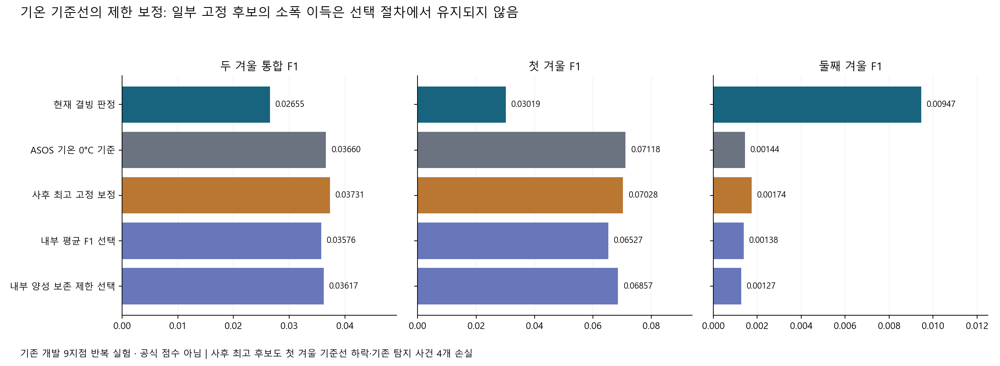

# 기온 기준선을 제한적으로 보정한 결빙 실험

**고정 후보 하나의 개발 F1은 기온 기준선보다 1.94% 높았지만, 다른 지역에서도 적용할 방법을 내부 검증으로 선택하는 절차는 기준선을 넘지 못했습니다.** 최고 후보도 첫 겨울과 기존 탐지 사건 보존에서 손실이 있어 제출 모델을 교체하지 않았습니다. 온도 v3·결빙 v2와 기존 v5 ZIP을 유지합니다.

[현재 상태](../STATUS.md) · [앞선 원인 분석](ICING_GAP_AND_SYNOPTIC_20261025.md) · [제설·센서·추가 지역 확보](ICING_ACQUISITION_20261025.md) · [실험 설정](../../config/icing_anchor_20261025.json)

## 무엇을 바꿨는가

앞선 직접 분류기는 내부 지역에서 좋아 보여도 33408 같은 새 지역에서 결빙을 거의 찾지 못했습니다. 이번에는 ASOS 기온이 0°C 이하이면 경보하는 단순 기준선을 출발점으로 두고, 모델이 바꿀 수 있는 온도 문턱의 폭을 제한했습니다. 예를 들어 보정 폭이 1°C이면 기온이 −1°C보다 낮거나 +1°C보다 높은 관측의 판정은 기준선과 같습니다.

모델 점수를 s, 보정 폭을 b라 하면 `보정 문턱 = b × (2s − 1)`이고, 기온이 이 문턱 이하일 때 경보합니다. 양쪽으로 보정하는 방법과 0°C보다 높은 기온에 경보를 추가하지 않고 기존 경보만 줄이는 방법을 비교했습니다. 이 수치는 **노면온도 예측값이나 보정된 결빙 확률이 아닙니다.**

| 구성 | 실제 비교 범위 |
| --- | --- |
| 새 모델 | ASOS 15변수 로지스틱 회귀. 행마다 같은 비중 / 지점·겨울·날짜·클래스 균형 비중의 2구성 |
| 학습·전처리 | 훈련 자료에서만 중앙값·결측 표시·표준화 적합. C=0.1, lbfgs, 최대 1,000회, 시드 고정 |
| 기존 모델 재사용 | 앞선 독립 검산을 통과한 HGB 5구성의 저장 점수 |
| 보정 정책 | 7모델 × 4폭(0.25·0.5·1·2°C) × 2방향 = 56개 |
| 단순 대조 | 고정 기온 문턱 8개와 원래 0°C 기준선 |
| 새 적합 횟수 | 지역 하나 제외 4회 + 둘 제외 6회, 2구성 합계 20회. 기존 HGB 50개 점수 파일 재사용 |
| 전체 결과표 | 고정 후보 64개 + 기온 기준선 + 선택 절차 3개 + 현재 판정 = 69행 |

15변수는 기온·지면온도·습도·강수·적설·운량·일사·풍속·이슬점·기압·시정·3시간 신적설·5cm 지중온도, 기온−이슬점과 지면온도−이슬점입니다. 새 회귀의 설명 변수에 도로 정답·지점번호를 넣지 않았습니다. 현재 모델과 공정하게 비교하기 위해 **평가 행의 가용 조건은 기존 AWS 포함 기준과 동일**하게 유지했습니다. ASOS만 쓰는 설명 변수와 평가 가용 조건은 별개입니다.

## 평가 지역을 보고 방법을 고르지 않았는가

기존 개발 9지점·두 겨울·4지역을 사용했습니다. 평가 지역 G의 두 겨울을 제외한 뒤, 내부 선택 지역 H도 동시에 뺀 모델로 H를 예측합니다. 세 H 지역을 모아 후보를 선택하고 G에 적용합니다. 외부 평가 지역의 정답으로 문턱·구성을 고르지 않습니다. 허용 대회 14지점은 훈련에만 들어갑니다.

세 선택 절차는 평균 F1 최대, 더 나쁜 겨울의 F1 최대, 양성 탐지 보존을 제한한 평균 F1 최대입니다. 마지막 절차는 내부 각 지역·겨울에서 기온 기준선이 잡은 실제 결빙 관측의 98% 이상을 보존하고 두 겨울 F1도 기준선 이상인 후보만 허용합니다. 적격 후보가 없으면 0°C 기준선으로 돌아갑니다. 동률은 오경보 수·복잡도·이름 순으로 처리합니다.

98%는 **내부 관측 행의 경험적 제한**입니다. 새 지역의 재현율 98% 보장, 사건 98% 보존, Neyman–Pearson의 확률적 오류 보장으로 부르지 않습니다. 실제로 선택 절차가 외부 지역에서 기존 탐지 사건을 잃었습니다.

지역 제외를 지켰어도 같은 개발 자료를 여러 연구에서 반복 사용했습니다. 아래 결과는 새 독립 검증이나 공식 대회 점수가 아닙니다. 이번에 확보한 추가 지역 기상 입력은 이 실험에 사용하지 않았으며 그 지역의 노면 정답도 아직 요청하지 않았습니다.

## 결과: 작은 고정 후보 이득과 선택 실패를 구별

F1·정밀도·재현율은 일별 지점 집계입니다. 관측 전체를 합친 행 단위 F1과 다르며, 평균 정밀도·재현율을 다시 조화평균해 표의 F1을 만들 수 없습니다. 모든 방법은 같은 유효 309,928행을 비교합니다.

| 방법 | F1 | 정밀도 | 재현율 | 첫 겨울 F1 | 둘째 겨울 F1 | 기존 탐지 사건 손실 |
| --- | ---: | ---: | ---: | ---: | ---: | ---: |
| 현재 결빙 v2 | 0.026554 | 0.040055 | 0.739628 | 0.030187 | 0.009466 | 0 |
| 기온 0°C 기준선 | 0.036601 | 0.033386 | 0.966799 | 0.071179 | 0.001444 | 0 |
| 고정 기온 −0.5°C 대조 | 0.036978 | 0.034972 | 0.958313 | 0.070417 | 0.001614 | 1 |
| ASOS 날짜 균형 회귀·1°C 경보 축소 | 0.037200 | 0.037044 | 0.924873 | 0.070075 | 0.001731 | 12 |
| 사후 최고 고정 HGB·1°C 경보 축소 | **0.037312** | 0.036909 | 0.952661 | 0.070282 | 0.001742 | 4 |
| 내부 평균 F1로 선택 | 0.035755 | 0.040272 | 0.946805 | 0.065273 | 0.001376 | 13 |
| 내부 최악 겨울 F1로 선택 | 0.035510 | 0.040133 | 0.905104 | 0.064863 | 0.001300 | 13 |
| 내부 양성 보존 제한 후 선택 | 0.036172 | 0.036213 | 0.960049 | 0.068568 | 0.001266 | 4 |

사후 최고는 `extra_free_pairwise_day_reject_only_1`입니다. 전체 F1은 기준선보다 0.000711, 상대적으로 1.94% 높습니다. 4지역의 통합 F1은 모두 기준선 이상이지만 첫 겨울이 0.071179 → 0.070282로 하락합니다. 현재 모델보다 정밀도가 낮고 둘째 겨울 F1도 훨씬 낮으며, 현재가 잡던 178개 사건 중 4개를 놓칩니다. 새로 찾은 사건은 131개지만 기존 손실 4개를 상쇄했다고 숨기지 않습니다.



내부 평균 F1로 선택한 구성은 지역마다 달랐습니다. 백양 지역을 평가할 때는 기온 +0.5°C, 서천·서상은 방향 제약 없는 HGB의 1°C 경보 축소, 금산은 방향 제약 HGB의 2°C 경보 축소가 선택됐습니다. 이 절차의 외부 F1은 0.035755로 기준선보다 낮습니다. 점수를 확인한 뒤 지역별 최고 결과를 조합하지 않았습니다.

또한 65개 고정 정책의 실제 외부 예측은 38종뿐입니다. 행 비중 로지스틱 회귀의 0.25·0.5°C 경보 축소는 각각 단순 기온 −0.25·−0.5°C 문턱과 **모든 예측이 동일**했습니다. 1·2°C 결과는 완전히 같지 않습니다. 복잡한 분류기의 작은 이득이 실제로 새로운 정보를 학습한 것인지 단순 문턱 대조와 구별해야 합니다.

## 채택 판단과 다음 실험의 조건

현재 대비 F1 1% 개선·정밀도·재현율·각 겨울·각 지점 비악화·기존 사건 보존·ASOS 기준선 초과의 사전 7기준을 전부 통과한 후보는 없습니다. 추가 확인인 ‘ASOS를 통합 F1에서 넘으면서 두 겨울도 각각 비악화’도 통과 후보가 없습니다. 결과를 본 뒤 채택 기준을 낮추지 않았습니다.

다음 우선순위는 같은 9곳에서 후보 수를 늘리는 것보다 새 지역의 기상 입력 품질을 확인하고, 비교할 소수 절차를 고정한 뒤 아직 보지 않은 정답으로 한 번 평가하는 것입니다. 현재 최고 HGB는 AWS도 필요하므로 새 ASOS 확보만으로 전체 제출 모델을 검증할 수 있는 것은 아닙니다. 제설 작업 시각과 센서 설치·교정·상태 판정 이력은 별도 확보 경로로 정리했습니다.

## 참고한 문헌·오픈소스와 적용 범위

| 출처 | 읽은 내용과 이번 적용 |
| --- | --- |
| [scikit-learn 1.6 LogisticRegression](https://scikit-learn.org/1.6/modules/generated/sklearn.linear_model.LogisticRegression.html) | 정규화·표본 가중치·최적화 문서. 기존 1.6.1 환경에서 허용 자료만으로 학습했고 외부 가중치는 도입하지 않음 |
| [Tong·Feng·Li, Neyman–Pearson classification, 2018](https://doi.org/10.1126/sciadv.aao1659) | 비대칭 오류를 제한하려는 접근과 경험적 제한·확률적 보장의 차이 참고. 이번 98% 규칙은 해당 알고리즘 구현이 아님 |
| [HNPclassifier, 2026-06-11 사전공개 논문](https://arxiv.org/abs/2606.13523) | 초록에서 순서가 있는 다중 클래스의 과소 분류 제어와 R 패키지 범위 확인. 우리 이진 결빙 문제·상관된 10분 관측에 그대로 적용할 근거가 없어 설치·코드 편입하지 않음 |

이전 [RoadSurf·센서 리뷰·Hugging Face 라이선스 검토](ADDITIONAL_ICING_SOURCES_20261025.md)도 이어서 참고했습니다. 최신 논문의 공개 자체를 대회 자료 사용 허가나 성능 보장으로 취급하지 않았습니다. 이번 제한 보정 코드는 자체 구현입니다.

## 재현과 검산

실행은 저장소 루트에서 합니다. 원자료·인증정보가 없는 공개 코드 복사본에서는 학습 명령을 실행할 수 없습니다. 완료 폴더는 덮어쓰지 않으므로 재현 시 새로운 출력 이름을 사용합니다.

```powershell
python scripts/evaluate_anchored_icing.py --output outputs/private/anchored_icing_20261025_v1
python scripts/audit_anchored_icing.py --study outputs/private/anchored_icing_20261025_v1 --output outputs/private/anchored_icing_audit_20261025_v1
python scripts/summarize_anchored_icing.py --study outputs/private/anchored_icing_20261025_v1 --audit outputs/private/anchored_icing_audit_20261025_v1 --output outputs/private/anchored_icing_summary_20261025_v1
```

별도 구현으로 새 20모델의 전체 예측·훈련 중앙값·표준화·가중치, 기존 점수 50파일의 해시, 내부 후보 지표 780건, 선택 12건, 외부 고정 정책 260건, 최종 지표 207건·사건 69건을 대조했습니다. 보호 정답 추가 열람 없이 기존 봉인 47개·549개를 보존했습니다.

| 근거 | 비공개 상대 경로 또는 해시 |
| --- | --- |
| 실험 요약 | `outputs/private/anchored_icing_20261025_v1/summary.json` |
| 요약 SHA-256 | `a20a4f09a435f7410fff3d1df057563aea8a639a2ce82c94736b011a85cd81fa` |
| 독립 검산 | `outputs/private/anchored_icing_audit_20261025_v1/receipt.json` |
| 전체 후보표·동일 예측 진단 | `outputs/private/anchored_icing_summary_20261025_v1/` |

표의 대표 행만으로 성공 후보를 숨기지 않도록 전체 69행 후보표와 탈락 조건을 함께 보존했습니다. 새 결과는 v5 ZIP 밖의 연구 산출물이며 제출 묶음을 갱신했다는 의미가 아닙니다.
