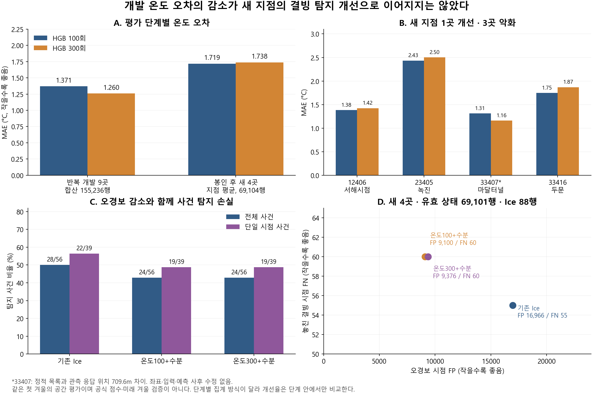

# 심사 관점 후속 연구·새 지점 평가 — 2026-10-10

> **읽는 범위:** 아래 내용은 해당 문서의 작성·실험 시점 기록입니다. 현재 모델·마감·완료 상태는 [진행 현황](../STATUS.md)을 기준으로 읽고, 약어와 지표는 [처음 읽는 안내](../START_HERE.md)에서 확인합니다.

**개발 자료의 온도 오차는 줄였지만 새 지점에서 개선이 재현되지 않았습니다. 새 온도 모델과 결빙 보정은 최종 채택하지 않습니다.** 공식 규칙 재확인, 온도 후보 6개·새 학습 60건, 일별 임계값 이전 2개 정책, 미사용 4개 지점의 예측 봉인·수집·일회 평가·독립 검산을 실제 수행했습니다. 수상 가능성을 뒷받침할 결빙 탐지 성능과 현장 효과는 아직 부족합니다.

[프로젝트 소개](../../README.md) · [현재 상태](../STATUS.md) · [실행 안내](../delivery/RUNBOOK.md) · [선행연구](REFERENCES.md)

이후 [미해결 사항의 순차 검토](UNRESOLVED_EVIDENCE_REVIEW_20261010.md)에서 21개 지점 좌표·96개 지표 조건·학습 입력 범위·두 겨울 지도 거리를 추가 검산했습니다. 아래 봉인 평가와 당시 판단은 보존합니다.

## 공식 기준과 심사 판단

현재 대회 소개의 심사 비중은 **창의성 20·우수성 50·효과성 30**입니다. 자료·분석·정확성의 설득력이 큰 비중을 차지합니다. 아래 판단은 그 기준에 대한 자체 검토이며 공식 점수·순위·수상 예측이 아닙니다. 2026년 소개 본문을 확인했으며 내용에 2025년 일정이 남아 있는 과거 상세 페이지를 현행 근거로 쓰지 않았습니다. [공식 대회 소개](https://aida.kisti.re.kr/competition/main/overview.do)

| 기준 | 확보한 근거 | 지금 제출할 때의 약점 | 필요한 다음 근거 |
| --- | --- | --- | --- |
| 창의성 20 | 무관측 도로의 기상 기반 추정, 시설·환경·두 겨울 노출, 봉인 후 공간 평가 | 열·수분 규칙 자체가 새로운 물리 모델은 아님 | 기존 방법 대비 새 기능의 기여를 같은 평가 조건에서 입증 |
| 우수성 50 | 그룹 제외·중첩 선택, 원문 및 모델 해시, 지점·일·사건별 검산 | 반복 개발 개선이 새 4곳에서 실패. 희소 Ice와 좌표 불일치 | 공식 지표 분모 확정, 연도별 센서·위치 정보 확인, 새 데이터에서 성능 재현 |
| 효과성 30 | 500m 843개·1km 423개 전북 구간과 오프라인 결과물 | 미탐 증가. 사고 감소·제설 비용 절감·시설별 위험 등급의 실측 근거 없음 | 제설 작업·마찰·통행 및 현장 확인과 연결한 사례 검증 |

문제 본문·설명·공지·참가 서약 및 Q&A 620·633·603·588·556·555를 재조회했습니다. 문제·규칙 원문은 직전 검토와 같고 633은 여전히 미답변입니다. `04` Ice만 양성, 보호 12410·33411·23402의 학습·참조·선택 제외, 외부 기상 허용, 일별 집계 뒤 지점 평균이라는 기존 조건을 유지했습니다. 부분 날짜·한쪽 Precision/Recall 미정의 처리는 미확정 사항으로 남깁니다. 코드 제출 의무를 대회 중 데이터·모델 공개 허용으로 해석하지 않습니다. [공식 문제](https://aida.kisti.re.kr/competition/main/problem/PROB_000000000004604/detail.do), [Q&A 633](https://aida.kisti.re.kr/competition/problem/PROB_000000000004604/detail/commuDetail.do?bbsId=BBSMSTR_000000000319&nttId=633), [제출 공지](https://aida.kisti.re.kr/competition/main/selectNotice.do?bbsId=BBSMSTR_AAAAAAAAAAAA&nttId=564)

재조회 원문·서약·URL·시각·SHA256는 비공개 `outputs/private/judge_followup_20261009_v1/`에 보존했습니다. 저장소 공개·대회 업로드는 수행하지 않았습니다.

## 연구를 실험으로 옮긴 범위

| 1차 자료 | 이번 작업에 적용한 내용 | 적용하지 않은 주장 |
| --- | --- | --- |
| [RoadSurf 1.1, Karsisto 2024](https://gmd.copernicus.org/articles/17/4837/2024/) | 기온 대비 잔차와 지면온도·운량·일사·강수·적설·습도·이슬점 차이를 비교 후보로 구현 | 완전한 열수지·물/눈/얼음 저장량·제빙 모델 구현이나 임의의 아스팔트 계수 도입 |
| [METRo, Crevier & Delage 2001](https://journals.ametsoc.org/view/journals/apme/40/11/1520-0450_2001_040_2026_manmfr_2.0.co_2.xml) | 열·수분과 관측 결합의 연구 맥락 확인 | 이번 조회에서 원문 직접 접근 제한. 전문을 모두 읽었다거나 논문의 성능을 재현했다고 주장하지 않음 |
| [Cawley & Talbot 2010](https://jmlr.org/papers/v11/cawley10a.html) | 반복 선택 편향을 고려해 새 지점의 정답 요청 전에 모델·입력·예측을 봉인 | 중첩 검증만으로 미지 공간·미래 성능 보장 |
| [scikit-learn 1.6 회귀](https://scikit-learn.org/1.6/modules/generated/sklearn.ensemble.HistGradientBoostingRegressor.html), [임계값 선택](https://scikit-learn.org/1.6/modules/classification_threshold.html) | 동일 입력에서 squared_error/absolute_error 및 100/300회 비교. 분류 점수 학습과 다른 그룹의 일별 임계값 선택 분리 | 실험하지 않은 최적 손실·최적 임계값 단정 |
| [MDSS 독립 자료 평가, 2024](https://rosap.ntl.bts.gov/view/dot/81833) | 6개 구간·13개 폭풍의 독립 기상·마찰·차량·제설 기록 비교를 참고해 일별/사건별 진단 강화 | 이 프로젝트에 제설·마찰·차량 실측이 있다고 표현 |
| [Mobile RWIS Phase II, 2026](https://rosap.ntl.bts.gov/view/dot/92061) | 센서 교정·연결 점검·운영 인력과 제설 작업의 중요성, 효과 확인 후 단계적 확장 원칙을 심사 판단에 반영 | 해외 소금 절감률·경제성을 국내 모델의 실현 효과로 전용 |
| [FHWA 교량 결빙 운영 사례](https://ops.fhwa.dot.gov/weather/resources/publications/tech_briefs/cs037.htm) | 도로 온도·수분·약품과 기상 입력의 현장 확인 필요성을 검토 | 교량 코드나 기온만으로 실제 Ice·사고 확률을 확정 |
| [기상청 지상기상관측지침, 2024.10](https://data.kma.go.kr/resources/images/publication/%EC%A7%80%EC%83%81%EA%B8%B0%EC%83%81%EA%B4%80%EC%B8%A1%EC%A7%80%EC%B9%A8.pdf) | 취약 지점·차로의 관측 대표성, 위치 변화·광학 센서 점검과 MTMS 기록 확인 경로 | 실제 지점의 이설·오염·장비 불량을 확인했다는 주장 |

2024 MDSS 보고서 PDF 28쪽 중 파일 4·17·23쪽, 2026 Mobile RWIS 보고서 PDF **97쪽** 중 파일 60·81·82·83쪽을 중점 검토했습니다. 본문을 추출하고 핵심 요약·권고 페이지를 이미지로 렌더해 확인했습니다. 2026 보고서의 인쇄 67–69쪽은 파일 81–83쪽에 해당합니다. 운영 연구가 강조한 센서·처리·현장 검증의 필요성은 참고 근거이며 이번 데이터의 원인을 확정하는 증거는 아닙니다.

## 온도 비교: 추가 입력보다 학습 길이가 개발에서는 유효

첫 겨울 23개 지점 397,173행을 사용했습니다. 외부 9개 지점을 4개 공간 그룹으로 묶고, 외부 평가 그룹과 내부 선택 그룹을 모두 학습에서 제외했습니다. 평가 155,257행 중 동일 유효 온도 **155,236행**, 관측 온도 −2–2°C **42,268행**에서 비교했습니다. 보호·다음 겨울 정답은 사용하지 않았습니다.

| 고정 후보 | 합산 MAE °C | 합산 RMSE °C | 판단 |
| --- | --- | --- | --- |
| 날씨14 직접 회귀·제곱 손실·100회 기준 | 1.370541 | 1.794299 | 비교 기준 |
| 날씨14 기온 대비 잔차 | 1.619685 | 2.107977 | 악화 |
| 열 관련24 직접 회귀 | 1.408605 | 1.867497 | 악화 |
| 열 관련24 기온 대비 잔차 | 1.596155 | 2.078414 | 악화 |
| 날씨14 절대 손실·100회 | 1.375833 | 1.801262 | 악화 |
| 날씨14 제곱 손실·300회 | 1.260003 | 1.674237 | 9곳 모두 MAE 감소. 새 봉인 평가 후보로만 사용 |
| 날씨14 절대 손실·300회 | 1.272911 | 1.675184 | 개발 개선 |

열 관련 입력 실험의 내부 선택 결과를 연결하면 MAE 1.450250으로 기준보다 나빠집니다. 손실·학습 길이 실험의 내부 선택 연결 결과는 1.307004로 기준보다 약 4.64% 낮지만 33207에서 3.21% 악화했습니다. 개발 전체에서 가장 낮은 1.260003을 **중첩 선택 정책의 성능이나 새 지점 성능으로 보고하지 않습니다.** 이 후보를 고른 다음 새 4개 지점으로 검증했습니다.

두 실험의 고유 새 학습은 각각 30건입니다. 별도 감사에서 모델 재추론 값 각각 1,863,084개, 지표 5개 변형, 내부 선택 4개를 대조했습니다. 결과는 `temperature_transfer_20261009_v1/`, `temperature_loss_20261010_v1/`에 있습니다.

## 공식 일별 집계 우선 임계값도 이전에 실패

기존 대회14 전용 분류 점수를 유지하고 다른 3개 공간 그룹에서만 403개 고정 임계값을 탐색했습니다. 일별 F1을 우선하는 정책과, 여기에 기존 음성 시점 FP율 이하라는 조건을 더한 정책을 비교했습니다. 평가 분모는 유효 상태 **155,118행**, 완전일 **1,060개**, 실제 Ice일 **124개**, 사건 **347개**입니다.

| 정책 | 잠정 일별 지점 평균 F1 | 합산 시점 F1 | FP / FN | 탐지 사건 / 347 | 탐지 단일 사건 / 118 |
| --- | --- | --- | --- | --- | --- |
| 기존 | 0.008073 | 0.024370 | 26,059 / 6,208 | 121 | 57 |
| 일별 F1 우선 | 0.003944 | 0.007156 | 69,416 / 6,338 | 89 | 44 |
| 일별 F1 + FP율 상한 | 0.006226 | 0.031642 | 9,563 / 6,351 | 80 | 36 |

FP율 상한 정책의 합산 F1 상승은 일별 F1·미탐·사건 손실을 상쇄하지 못합니다. 둘 다 미채택했습니다. 별도 날짜 정렬 방식으로 임계값 지점 **3,224개·선택 8개**와 사건 3개 정책을 검산했습니다. 기존 F1 정의일 647개와 후보 809개·318개의 차이도 숨기지 않았습니다. 결과는 `daily_primary_transfer_20261009_v1/`에 있습니다.

## 실제 미사용 4개 지점의 봉인 평가

정적 목록의 위치·노선·목표결빙 종류만으로 12406·23405·33407·33416을 골랐습니다. 이전 대회19·외부9·새8 지점과 중복되지 않으며 로컬 전체 요청 기록에서 네 지점의 과거 요청 부재를 먼저 확인했습니다. 새 정답·Ice 빈도·가용성으로 지점을 바꾸지 않았습니다.

2026-10-10 KST **00:09:58 예측 봉인 → 00:10:41 예측 감사 → 00:10:54 첫 요청 → 00:24:44 수집 완료 → 00:55:28 일회 평가** 순서를 확인했습니다. 첫 겨울 120일·4곳의 10분 격자 69,120행을 전부 먼저 예측했습니다. 같은 23개 개발 지점으로 100/300회 모델을 학습했고 두 모델의 입력은 같은 날씨14입니다.

| 지점 | 유효 온도 행 | 기준100 MAE °C | 후보300 MAE °C | Ice 행 | 판단 |
| --- | --- | --- | --- | --- | --- |
| 12406 서해시점 | 17,279 | 1.381421 | 1.423329 | 50 | 악화 |
| 23405 녹진 | 17,273 | 2.434301 | 2.501804 | 0 | 악화·결빙 탐지 평가 불가 |
| 33407 마달터널 | 17,279 | 1.312767 | 1.160308 | 38 | 온도 개선이나 좌표 확인 필요 |
| 33416 두문 | 17,273 | 1.746312 | 1.867463 | 0 | 6.94% 악화·사전 5% 상한 실패 |
| 지점 평균 | 69,104 합계 | 1.718700 | 1.738226 | 88 합계 | 1곳 개선·3곳 악화 |

지점 평균 RMSE도 2.090355→2.116723°C로 악화했습니다. 관측 −2–2°C 18,162행의 합산 MAE는 1.634169→1.699199°C입니다. 개발에서 9곳 모두 개선됐다는 사실로 채택하면 이 실패를 놓치게 됩니다. 기온 대비 잔차·열 관련 입력·손실·반복 횟수 중 어느 방법도 지금 새 지점의 안정성을 확보했다고 결론 내리지 않습니다.

### 결빙 보정의 파급

기존 임계값과 사전 0°C·이슬점/강수/적설 수분 규칙을 유지했습니다. 규칙이나 임계값을 새 정답에 맞춰 재선택하지 않았습니다. 유효 상태 **69,101행·Ice 88행**, 완전일 **477개**, 실제 Ice일 **21개**, 전체 사건 **56개·단일 사건 39개**입니다.

| 정책 | TP / FP / FN | 합산 시점 F1 | 잠정 일별 지점 평균 F1 | F1 정의일 | 사건 탐지 / 56 | 단일 탐지 / 39 |
| --- | --- | --- | --- | --- | --- | --- |
| 기존 Ice | 33 / 16,966 / 55 | 0.003863 | 0.003380 | 305 | 28 | 22 |
| 온도100 + 수분 | 28 / 9,100 / 60 | 0.006076 | 0.007018 | 144 | 24 | 19 |
| 온도300 + 수분 | 28 / 9,376 / 60 | 0.005900 | 0.006530 | 151 | 24 | 19 |

일별 F1은 올라가지만 포함 날짜가 달라지고 TP·사건 탐지는 줄었습니다. 실제 Ice일의 고정 F1도 함께 산출했지만 미탐 손실을 해소하지 못합니다. Ice 88행 중 실측 온도 >0°C가 **37행**이며 이것은 온도만으로 상태를 바꿀 수 없다는 관측입니다. 센서 고장·오라벨·약품 영향 중 무엇인지는 확인되지 않았고 해당 정답을 삭제하지 않았습니다.

### 감사 결과와 위치 문제

480개 하루 요청 구간은 큰 구간의 실패를 나눈 **510개 검증 원문**으로 복구됐습니다. 요청 시작은 총 **540회·간격 539개**, 최소 **1.300073초**, 계획한 1.3초 미만 **0개**입니다. 실패/분할 과정에서 응답 파일이 남지 않은 시작 30회도 구분합니다. 키와 인증 URL은 감사 기록에 넣지 않았습니다.

별도 파서로 원문·10분 표본·상태·온도·좌표를 다시 구성하고 69,120행과 대조했습니다. 봉인 입력·모델의 온도 예측 **138,240개**, 세 정책의 혼동행렬·일별/사건 지표, 같은 유효 온도 분모·사전 채택 조건을 별도 계산으로 검증했습니다. 기존 고정 파일 **보호47개·외부549개**도 보존됐습니다.

감사는 **지표 검산 통과 / 위치 확인 필요**입니다. 33407의 정적 목록 좌표 `(36.2266, 127.4836)`와 관측 응답 `(36.2208, 127.4869)`는 지표면 직선 거리 **709.6m** 차이입니다. 다른 세 지점은 약 0–11.1m 차이입니다. 이 지점 ID의 관측 수집과 지표 계산은 일치하지만 실제 설치 위치·연도별 이동·지도 대응은 미확인입니다. 입력·좌표·예측을 사후 수정하거나 위치 검증까지 통과했다고 기재하지 않습니다. 최초 감사 중단 기록도 보존했습니다.

기상청 2024.10 지침의 도로기상 장에서 취약 위치·차로를 골라 관측하는 특성과 설치 이후 환경·이설 검토, 광학 센서와 측정 위치의 점검을 확인했습니다. 점검 기록의 공식 확인 경로는 **기상관측종합관리시스템(MTMS) 등의 지점별 기록**입니다. 파일 186–196쪽(인쇄174–184쪽)을 읽고 센서 구성 표가 있는 파일190쪽을 렌더해 확인했습니다. 문서가 위치 차이의 원인을 설명한 것은 아니며 MTMS의 실제 지점 대장은 확보하지 못했습니다. [기상청 지침](https://data.kma.go.kr/resources/images/publication/%EC%A7%80%EC%83%81%EA%B8%B0%EC%83%81%EA%B4%80%EC%B8%A1%EC%A7%80%EC%B9%A8.pdf)

기존 Ice의 봉인 점수69,120개와 이진 판정69,120개도 원래 대회14 모델·임계값으로 다시 추론해 정확히 일치했습니다. 이 확인은 `original_ice_prediction_verification.json`에 별도로 기록했습니다.

결과는 `outputs/private/temperature_blind_20261010_v1/summary.json`과 `independent_verification.json`에 있습니다. 이 네 지점은 이제 개봉됐으므로 다음 후보의 새 독립 평가로 재사용할 수 없습니다. **같은 첫 겨울의 새 공간 평가이고 미래 겨울·공식 보호 평가가 아닙니다.**

## 제출물에 실제 반영한 변화와 다음 순서

`src/temperature_transfer.py`에 보호·시간·중복·입력/정답 분리와 회귀 비교를 구현하고, 중첩 평가·독립 감사·일별 임계값 평가·봉인 평가 CLI를 추가했습니다. 미추적 새 코드·문서도 검사하도록 두 저장소 검사 CLI에 `--include-untracked`를 추가했습니다. README·진행 현황·실행 안내·근거·AI 지원 기록은 이 평가를 먼저 안내하도록 갱신했습니다. 합성 데이터 테스트 **157개**를 통과했습니다.

수상 결과물을 목표로 할 때 다음 작업은 아래 근거를 순서대로 확보해야 합니다. 이미 개봉한 자료를 계속 조정해 새 독립 성능인 것처럼 보이는 접근은 사용하지 않습니다.

1. **관측 위치·측정 정의 확인:** 기상청 MTMS 등의 지점별 점검·설치 대장에서 33407의 연도별 좌표·장비/교정/설치 변경과 33408 상태 변화의 공식 이력을 확인합니다. 자료의 날짜와 센서 종류·제빙 처리 유무를 연결해야 온도/상태 불일치 원인을 좁힐 수 있습니다. 현재 접근 가능한 정적 목록·관측·문헌만으로 원인을 확정할 수 없습니다.
2. **공식 지표의 미정의 정책 확정:** Q&A 633 답변으로 부분 날짜·한쪽 미정의 지표 처리를 고정합니다. 현재 일별 지표는 잠정 구현이고 합산 시점 F1로 공식 점수를 대체하지 않습니다.
3. **개발군에서 실패 원인별 가설 한 번씩 검증:** 지역별 온도 편차, 공간 대표성, 센서·제빙 정보를 검토한 뒤 최소 후보를 사전 등록합니다. 물리 입력 추가와 300회 학습을 현재 성과로 승격하지 않습니다. 새 자료가 확보될 때 위치 확인까지 마친 대상에 예측을 먼저 봉인해야 합니다.
4. **현장 효과와 지도 대응 확인:** 공식 이정·시설 실제 범위를 연결하고 대표 사례에서 마찰·제설 처리·작업 시각·독립 관측과 대조합니다. 검증 전 구간 결과는 저온·수분 조건 노출과 조사 우선순위로 제시합니다. 사고 감소·비용 절감률이나 최종 위험 등급은 만들지 않습니다.

현재 가장 강한 결과는 **누수를 차단한 재현 가능한 연구와 잘못된 모델 승격을 막은 검증**입니다. 결빙 탐지의 안정성과 현장 효과를 갖춘 최종 제출물까지 완성했다고 판단할 수는 없습니다. 기존 제출 초안·연구 인계물·실패 결과·원본 데이터와 인증 설정은 보존했습니다.
