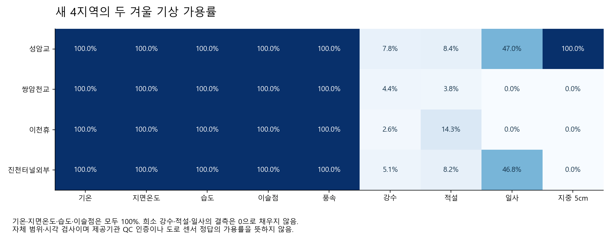
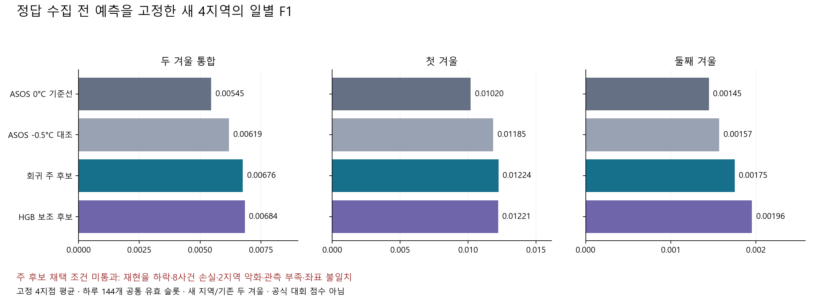

# 새 4지역 결빙 평가: 입력 검증·사전 봉인·일회 평가 결과

후속 원인 확인은 [성암교 좌표·진천터널외부 결측과 추가 탐지 실험](RWIS_CAUSE_AND_ADDITIVE_20261025.md)에 있습니다. 아래 사전 고정·원문·평가 수치는 당시 기록을 보존하며 새 분석으로 정답이나 점수를 고치지 않았습니다.

**새 4지역의 일회 평가를 완료했지만 주 후보는 채택하지 않습니다.** 일별 F1은 기온 기준선 0.005454 → 0.006758로 23.90% 높아졌지만 재현율이 0.764250 → 0.660669로 낮아지고, 기준선이 탐지한 8사건을 놓쳤습니다. 2지역의 F1 악화, 한 지역의 관측 부족과 다른 지역의 위치 불일치도 확인했습니다. 평균 점수 증가를 안정적인 결빙 탐지 개선으로 표현할 근거는 부족합니다.

이 연구는 이미 여러 번 비교한 개발 지역에서 얻은 작은 개선이 **처음 보는 도로 지역에서도 유지되는지** 확인합니다. 새 지역은 이천휴·진천터널외부·성암교·쌍암천교입니다. 위치 목록으로 선별했고, 도로 정답을 요청하기 전에 후보·모델·전처리·전체 예측·평가 코드를 고정했습니다. 기존 제출 v5의 온도 v3·결빙 v2는 그대로 보존합니다.

[현재 상태](../STATUS.md) · [앞선 모델 비교](ANCHORED_ICING_20261025.md) · [지역 확보 과정](ICING_ACQUISITION_20261025.md) · [공식 규정 확인](../competition/OFFICIAL_UPDATE_20261025.md)

## 무엇을 검증하는가

기존 연구는 허용 23지점으로 학습하고 외부 9지점을 네 지역으로 나눠 개발했습니다. 같은 지역을 반복 탐색했으므로 그 최고 점수를 새 지역의 성능으로 해석할 수 없습니다. 이번에는 과거에 도로 정답을 요청하지 않았던 4곳에서 두 겨울을 평가합니다. **새 지역 평가이며 새 미래 겨울 검증이나 공식 대회 점수는 아닙니다.** 두 겨울의 날씨와 다른 지역 정답은 기존 학습에 포함돼 있습니다.

| 새 도로 지점 | 연결 ASOS | 사전 목록 기준 도로–기상 거리 | 핵심 기상 가용률 | 고정 10분 예측 수 |
| --- | --- | ---: | ---: | ---: |
| 이천휴 33402 | 이천 203 | 10.14km | 100% | 34,560 |
| 진천터널외부 33406 | 청주 131 | 18.72km | 100% | 34,560 |
| 성암교 12213 | 목포 165 | 2.06km | 100% | 34,560 |
| 쌍암천교 23411 | 순천 174 | 3.98km | 100% | 34,560 |

핵심 기상은 기온·습도·이슬점·지면온도입니다. 두 겨울은 2024년 11월–2025년 2월과 2025년 11월–2026년 2월로, 각각 120일입니다. 기상 가용률이 높아도 센서 상태의 정확성, 도로 위치의 대표성, 당시 실시간 공개 지연까지 확인한 것은 아닙니다. **성암교의 사전 목록 위치와 실제 응답 위치가 달라 아래 별도 진단에 기록했습니다.** 위 2.06km를 검증된 실제 거리로 사용하면 안 됩니다.

## 입력 검증에서 확인한 것

새 ASOS 4곳의 원문 23,048행은 각 겨울 시작 전 1시간까지 포함합니다. 13개 관측을 범위·단위에 따라 정규화했고, 별도 `searchsorted` 시각 연결로 **1,797,120개 입력값**을 재검산했습니다. 목표 시각과 같은 시각의 관측은 사용하지 않고, 엄격히 과거이면서 60분 이내인 관측만 연결했습니다. 실제 -9°C는 보존하고 강수·적설처럼 음수가 불가능한 항목의 -9는 결측으로 남겼습니다. 결측 강수를 0mm로 간주하지 않았습니다.

학습에 연결되는 ASOS 6곳도 같은 API로 다시 받아 기존 제공본과 비교했습니다. 기대 34,572행 중 34,494행이 있었고 **78시간이 누락**됐습니다. 10개 요청은 모두 정상 응답·종료 표식을 갖췄으므로 응답 완료와 관측 격자 완전성을 구별합니다. 최초 수집기의 ‘모든 시간이 있어야 한다’ 검사는 중단됐고, 원문·요청 기록을 그대로 보존한 채 오프라인 복구로 실제 누락을 기록했습니다. 추가 다운로드나 임의 보간을 하지 않았습니다.

| 항목 | 공통 유효 관측 비교 | 결측 상태가 다른 행 수 |
| --- | --- | ---: |
| 기온 | 34,480값 전부 일치 | 39 |
| 지면온도 | 34,283값 전부 일치 | 237 |
| 강수량 | 2,029값 전부 일치 | 3 |
| 습도 | 34,450값 중 6값 차이, 최대 0.9%p | 39 |
| 일사 | 8,111값 전부 일치 | 0 |

여기에는 겨울 시작 전 추가 1시간의 12행도 포함됩니다. 따라서 결측 상태 차이 수를 전부 센서 오류 수로 읽으면 안 됩니다. 겨울철 API 강수량의 3시간 관측 설명을 확인했지만, 실제 공통 유효 강수값은 기존 캐시와 전부 일치했습니다. **‘시간 단위가 달라 모든 강수값이 틀렸다’는 결론은 근거가 없습니다.** 이번 학습과 새 지역은 동일한 API 정규화로 맞췄습니다.

원문에는 제공기관의 별도 QC 플래그가 없습니다. 자체 검사는 범위, 시간 중복·누락, 이슬점과 기온의 일관성, 시간당 급변을 다룹니다. 학습 ASOS 248의 2025-12-19 10시 2.0°C → 11시 12.2°C 급변 한 건은 제공본과 같고 12시에도 13.7°C가 이어져 보존했습니다. 이를 자동으로 오류라고 제거하거나 오류가 없다고 인증하지 않았습니다. 첫 준비 실행 `v1`의 중단 기록은 보존하고, 이 검토 후 도로 정답을 보기 전에 `v2` 입력을 확정했습니다.

## 사전에 고정한 비교

| 후보 | 판정 방법 | 역할 |
| --- | --- | --- |
| ASOS 0°C | 과거 ASOS 기온이 0°C 이하이면 결빙 경보 | 기준선 |
| ASOS -0.5°C | 기온이 -0.5°C 이하일 때 경보 | 학습 없는 단순 대조 |
| 날짜 균형 로지스틱 회귀 | 기상 점수로 기준선의 경보 문턱을 최대 1°C 낮춤 | **주 후보** |
| 날짜 균형 HGB | 같은 15변수의 나무 모델로 같은 범위에서 문턱을 낮춤 | 보조 후보 |

회귀와 HGB는 13개 기상 관측에 기온–이슬점, 지면온도–이슬점 차이를 더한 15변수를 사용합니다. 날짜·지점·겨울·양성/음성 클래스가 학습에 지나치게 불균형하게 기여하지 않도록 가중치를 적용했습니다. 최종 학습은 기존 23곳의 유효 792,335행이며, 새 4곳은 학습·중앙값 대체·표준화에 사용하지 않았습니다. 저장 모델의 전체 예측, 중앙값·표준화와 가중치를 별도 계산으로 대조했습니다.

회귀는 학습 중앙값 대체·결측 표시·표준화를 사용하고 HGB는 결측을 직접 처리합니다. 별도 재적합에서 두 모델의 저장 파일 해시와 각 138,240개 점수·판정이 원래 봉인본과 전부 같았습니다. 이 재현 과정도 기존 허용 학습 표와 새 지역의 기상 입력만 읽었습니다.

보정 문턱은 `min(0, 2 × 모델 점수 − 1)`°C입니다. 이 후보들은 ASOS 경보의 일부를 줄일 수 있지만 ASOS가 알리지 않던 양성 시점을 새로 찾을 수는 없습니다. 따라서 오경보 감소와 결빙 손실을 함께 평가해야 합니다. 새 정답에 따라 주 후보를 HGB로 바꾸거나 보정 폭을 고르지 않습니다. [기계판독 설정](../../config/blind_icing_20261025.json)

### 성공 기준과 분모

주 지표는 공통 유효 정답·예측이 하루 144개인 날짜의 F1을 지점별 평균한 뒤 **고정 4지점 평균**한 값입니다. 전 기간 F1이 미정의인 지점은 이 자체 비교에서 0으로 포함하고, 지점 수·양성 수·미정의 지표를 함께 공개합니다. Precision·Recall은 정의되는 날짜와 지점의 평균을 별도 표시합니다. 하루 최소 유효 슬롯 1·72·144의 민감도도 사전 고정했습니다. 이 분모 가정 중 공식 Q&A가 확정하지 않은 부분은 공식 점수로 표현하지 않습니다.

최소 증거는 4곳 모두 관측 존재, 각 지점·겨울의 공통 유효 비율 90% 이상, 양성이 있는 지점 3곳 이상, 양성 사건 20개 이상입니다. 주 후보 성공은 F1 1% 이상 개선, 두 겨울·각 지점 F1 비악화, 일별 Precision·Recall 비악화, ASOS가 탐지한 사건 손실 0을 모두 요구합니다. 응답 위치가 목록 위치와 위도·경도 각각 0.01° 이내인지도 평가 코드에 고정했습니다. 지점·날짜를 짝지은 2,000회 bootstrap 구간은 네 지역에 조건부이며 날짜 사이 상관과 적은 지역 수 때문에 지역 모집단의 보장을 뜻하지 않습니다.

## 봉인과 수집 순서

2026-10-25 **19:53:52 KST**에 전체 138,240행 예측·모델·설정·입력 서명·평가 및 감사 코드를 봉인했습니다. 첫 도로 요청은 사전 감사 통과 후 **19:54:38 KST**였습니다. 보호 12410·33411·23402와 기존 대회 지점은 새 요청 대상에서 제외했습니다. 로컬 시간과 해시 기록은 재현 근거이며 제3자의 타임스탬프 인증은 아닙니다.

봉인 SHA-256: `a6e83dd6d91ffab8faf6d7d42e1109cb987402ad29b53990feea80583e466853`.

수집은 4곳 × 240일 = 960개 날짜 구간이며 모두 완료했습니다. 이천휴의 긴 응답이 반복적으로 시간 초과되어 요청을 6시간 이하로 나누는 재개 도구를 추가했습니다. 다른 지점은 하루 단위이며 기존 전송기도 오류 시 더 짧게 분할합니다. 최대 4개 요청 작업을 처리하되 **모든 실제 요청 사이 최소 1.2초**를 공통 제한합니다. 변경 사유·도구 해시·요청 시각을 별도 기록했습니다. 지점·기간·후보·예측·평가 코드의 봉인은 변경하지 않았고 전체 수집 전 성능을 계산하지 않았습니다.

첫 재개 도구는 단일 `sleep` 호출의 Windows 타이머 오차로 기록된 최소 간격이 1.187초였습니다. 이전 코드와 요청 기록을 보존하고, 실제 경과시간을 반복 확인하는 방식으로 수정했습니다. 짧게 끝나는 타이머를 재현한 합성 테스트도 추가했습니다. 해당 변경은 전송 간격만 다루며 평가 봉인은 그대로입니다.

진행 기록 411건을 저장한 뒤 Windows 파일 잠금으로 임시 기록의 이름 변경이 한 번 실패했습니다. 기존 411건이 모두 같은지, 추가 1건의 관측 해시가 맞는지 확인해 412건으로 복구했습니다. 이전·임시 기록과 코드 사본을 보존하고 일시적인 이름 변경 실패 재시도를 추가했습니다. 관측을 덮어쓰거나 같은 지점을 다른 날짜로 대체하지 않았습니다.

### 정답 충돌에 대한 분석 전 보완 규칙

진천터널외부 2026-02-13 응답에서 같은 지점·분에 서로 다른 상태 코드가 두 번 나타났습니다. 1분만 다시 요청해도 재현됐습니다. **성능 계산 전인 20:59:53 KST에** 다음 규칙을 별도 기록하고 모든 지점·날짜에 동일 적용했습니다. 토큰까지 완전히 같은 원문 중복은 한 번만 남기고, 한 필드라도 다른 관측은 그 시각의 행을 전부 격리합니다. 양성·음성·유효 코드를 골라 살리지 않습니다.

이는 원래 수집 절차에 대한 **분석 전 자료 품질 보완**입니다. 처음부터 그 예외까지 봉인됐다고 주장하지 않습니다. 후보·예측·평가식·90% 관측 기준은 그대로이며, 격리 시각도 고정 예측 격자에 결측 정답으로 남습니다. 12개 응답에서 충돌 14,920분·29,840행을 격리했고 원문·정규화 응답·충돌 시각과 코드 해시를 보존했습니다. 관측 부족은 이 격리와 원관측 누락·미정의 코드가 함께 반영된 결과입니다.

## 새 지역에서 얻은 결과

일회 평가는 **21:04:49 KST**에 끝났습니다. 공통 유효 정답은 135,692행, Ice는 182행(0.1341%), 관측된 결빙 사건은 102개입니다. ‘사건’은 같은 지점에서 10분 간격으로 이어지는 Ice 관측으로, 관측 공백에서 분리됩니다. 실제 사고나 도로 전체의 결빙 사건 수를 뜻하지 않습니다.

| 사전 고정 후보 | 일별 F1 | 일별 정밀도 | 일별 재현율 | 탐지 사건 / 102 | ASOS가 찾던 사건 손실 |
| --- | ---: | ---: | ---: | ---: | ---: |
| ASOS 0°C 기준선 | 0.005454 | 0.003084 | 0.764250 | 83 | 0 |
| ASOS -0.5°C 대조 | 0.006185 | 0.003532 | 0.755411 | 82 | 1 |
| **회귀 주 후보** | **0.006758** | **0.003929** | **0.660669** | **75** | **8** |
| HGB 보조 후보 | 0.006837 | 0.003970 | 0.681503 | 76 | 7 |

F1·정밀도·재현율은 하루 144개 공통 유효 슬롯을 갖는 924개 날짜·지점 중 각 지표가 정의되는 날짜를 지점별로 평균합니다. 아래 행 합계와 사건 수는 일부 날짜도 포함한 **전체 공통 유효 135,692행**을 대상으로 하므로 일별 지표의 분모와 다릅니다.

| 후보 | 맞힌 결빙 TP | 오경보 FP | 미탐 FN | 모든 행 합산 F1 |
| --- | ---: | ---: | ---: | ---: |
| ASOS 0°C | 157 | 46,760 | 25 | 0.006667 |
| ASOS -0.5°C | 153 | 42,468 | 29 | 0.007149 |
| 회귀 주 후보 | 144 | 38,121 | 38 | 0.007491 |
| HGB 보조 후보 | 146 | 38,209 | 36 | 0.007577 |

| 지점 | 첫 겨울 정답 가용률 | 둘째 겨울 정답 가용률 | Ice 행 수 | ASOS 일별 F1 | 주 후보 일별 F1 |
| --- | ---: | ---: | ---: | ---: | ---: |
| 이천휴 | 99.94% | 99.99% | 12 | 0.000708 | 0.000773 |
| 진천터널외부 | 100% | **85.39%** | 15 | 0.001352 | **0.001141** |
| 성암교 | 100% | 99.95% | 134 | 0.017885 | 0.023925 |
| 쌍암천교 | 100% | 99.98% | 21 | 0.001872 | **0.001191** |

사전 성공 조건 11개 중 **5개를 통과하지 못했습니다.** 진천터널외부의 둘째 겨울 정답 가용률은 최소 90%보다 낮고, 성암교의 위치 일관성이 깨졌으며, 2지점 F1·전체 재현율·기존 탐지 사건 보존 조건도 실패했습니다. 유효 지점 수·양성 지점 수·사건 수·통합 F1 개선·두 겨울 F1·정밀도 조건은 통과했습니다. 관측 기준 미달 지역을 제거해 성공으로 바꾸지 않습니다.

회귀의 ASOS 대비 F1 차이는 +0.001303이며 사전 2,000회 재표집의 조건부 95% 구간은 [-0.000054, +0.003175]로 **0을 포함합니다.** 두 겨울 F1은 각각 0.010198 → 0.012241, 0.001450 → 0.001754였습니다. 하루 최소 유효 슬롯을 1·72·144로 바꾼 사전 민감도에서 회귀 F1은 0.006739·0.006739·0.006758이며, 이 완화로 실패 조건을 바꾸지 않습니다.

### 기상은 완전해도 위치·정답은 별도 검증이 필요하다

성암교의 사전 목록 좌표는 위도 34.8028·경도 126.3675지만 받은 관측 전체의 좌표는 34.9733·126.4961입니다. 거리는 **22.29km**입니다. 고정 연결한 목포 ASOS와의 거리도 목록상 2.06km에서 응답 좌표상 **20.25km**가 됩니다. 관측소 이동인지, 목록 오류인지, 응답 메타데이터 오류인지는 확인되지 않았습니다. 어느 좌표가 맞다고 단정하거나 사후에 ASOS를 바꾸지 않았습니다.

성암교는 전체 182개 Ice 중 134개를 차지하고 평균 F1 증가에도 가장 크게 기여합니다. 고정 4지점 평균에서 이 지역의 기여는 +0.001510이고 나머지 3곳의 합산 기여는 -0.000207입니다. 위치가 불확실한 지점에 개선 근거가 집중된 만큼, 이를 검증된 일반화 이득으로 해석하면 안 됩니다. 나머지 세 곳의 목록–응답 위치 차이는 약 9–14m였습니다.

회귀는 공통 유효 구간에서 오경보 8,639행을 줄이는 대신 양성 13행을 추가로 놓쳤습니다. 오경보만 있던 58일이 F1 미정의가 되면서 평균에 포함되는 날짜가 590일 → 532일로 줄었습니다. **기준선의 평가 날짜를 고정한 사후 진단 F1은 0.005455**로 기준선 0.005454와 거의 같습니다. 분모 효과만이 유일한 원인이라는 뜻은 아니지만, 보고된 +23.90%가 그대로 탐지 개선을 뜻하지는 않습니다. 이 보조 계산은 봉인한 주 지표를 대체하지 않습니다.

### 검산과 보존 결과

별도 구현으로 12개 지표 조합·4개 사건 집계를 재계산했습니다. 원문 1,687개를 다시 파싱해 유효 분 관측 1,357,227행에서 960개 날짜 파일의 10분 관측이 정확히 만들어졌는지 대조하고, 성공 조건 11개와 충돌 격리도 재계산했습니다. 수정 후 공통 속도 제한이 적용된 요청 1,579개의 최소 간격은 1.203초였습니다.

원래 감사 코드가 빈 관측 파일의 시각 열 자료형에서 중단된 기록도 보존했습니다. 별도 어댑터가 **메모리에 읽은 빈 표 12개의 시각 자료형만** 지정해 동일 감사 코드를 통과시켰습니다. 디스크 관측·예측·지표·평가 요약은 바뀌지 않았습니다. 이는 점수 재평가나 데이터 복원이 아닙니다.

완료 평가 요약 SHA-256: `45ebf8f83abc25857a085b84f76b292e34400364df0058d6355156ba16571a48`.

기존 봉인 47개·549개 파일과 v5 ZIP은 그대로입니다. ZIP SHA-256은 `0dcc1f5e2984ec3544b320f2bcec95ee4054a557dd2b320832de981c9d63e8e4`입니다. 이번 연구를 기존 제출 묶음에 이미 포함된 성능 향상으로 소개하지 않습니다.

전체 합성 테스트 **375개·하위 검사 7개**가 통과했습니다. 기존 pandas 자료형 관련 경고 1건은 남아 있습니다. 테스트는 새 자료형 보완·충돌 격리·요청 재개와 합성 4지점 평가를 포함하며, 비공개 실측 원문을 대조한 위 감사와 구별합니다.

## 다음 개선에 필요한 근거

1. **위치 이력과 센서 원자료 확인:** 성암교 목록–응답 불일치, 진천터널외부 중복 상태의 발생 원인·유효 기간·관측 장비 이력을 확인해야 합니다. 기관 문의 초안은 기존 자료 확보 문서에 있으며 실제 발송은 하지 않았습니다.
2. **판정 원인을 구별할 입력:** 작업 시각·구간·제설제 종류와 살포량이 있는 제설 이력, 센서 교정·상태 코드 변경 이력이 필요합니다. 공개 목록 존재와 실제 자료 확보·대회 적용 허용은 별개입니다.
3. **다음 연구의 새 평가 자료:** 이번 네 곳은 이미 결과를 본 평가 자료입니다. 정답 품질을 확인하더라도 이후 재튜닝에 쓰면 개발 자료가 되며, 새 후보의 독립 검증에는 다시 미조회 지역·기간이 필요합니다. 이번 결과를 보고 문턱만 다시 골라 같은 평가를 통과했다고 보고하지 않습니다.

현재 입력의 결측 처리·기온 문턱 축소를 반복하는 것만으로 기온 기준선을 안정적으로 넘어선다는 근거는 얻지 못했습니다. 구체적인 자료 결함과 평균 점수의 상승 원인을 분리한 것이 이번 평가의 성과이며, 모든 모델링 가능성을 소진했다는 결론은 아닙니다.

## 기존 지역에서의 입력 형식 통일 진단

새 지역 수집 중 **기존 개발 9지점만** 네 지역 제외로 다시 비교했습니다. 8개 모델을 추가 학습·재추론했고 전체 지표 12건과 사건을 별도 계산했습니다. 새 4곳의 도로 관측이나 점수는 읽지 않았으며 봉인 후보를 바꾸는 선택 단계가 아닙니다.

| 후보 | 기존 지역 일별 F1 | ASOS 대비 | ASOS가 찾던 사건 손실 |
| --- | ---: | ---: | ---: |
| ASOS 0°C | 0.036601 | 기준 | 0 |
| ASOS -0.5°C | 0.036978 | +1.03% | 15 |
| 회귀 주 후보 | 0.037200 | +1.63% | 34 |
| HGB 보조 후보 | 0.037282 | +1.86% | 28 |

총 386사건 중 ASOS가 330사건을 탐지했습니다. 앞선 연구에서 ‘현재 제출 판정 대비 손실’로 센 수와 이 표의 ‘ASOS 대비 손실’은 기준 모델이 다릅니다. 평균 F1의 작은 증가가 결빙 탐지 자체의 일관된 개선을 뜻하지 않는다는 점이 드러납니다.

### F1 상승은 어디에서 생겼는가

기존 지역에서 회귀 후보는 경보 19,172행을 줄였으며 그중 실제 Ice는 504행이었습니다. 동시에 오경보만 있던 118일을 경보 없는 날로 바꿨습니다. 이런 날의 F1은 원래 0이었다가 미정의가 되어 일별 평균의 분모에서 빠집니다. 기준선의 평가 날짜 1,495일은 회귀 후보에서 1,377일로 줄었습니다.

원래 기준선이 평가된 날짜를 고정하고, 후보의 새 미정의 날짜를 진단용 0으로 놓으면 회귀 F1은 **0.035206**으로 기준선 0.036601보다 낮습니다. HGB도 같은 보조 계산에서 0.035305입니다. 오경보 없는 날의 증가는 실제 개선 요소이지만, 보고된 작은 F1 증가를 ‘결빙을 더 잘 찾았다’는 말로 바꿀 수는 없습니다. 이 계산은 원인을 설명하는 보조 진단이며 사전 고정한 새 지역의 주 지표나 성공 기준을 교체하지 않습니다. [진단 코드](../../scripts/diagnose_asos_anchor_development.py)

## 참고한 원문과 적용 범위

| 출처 | 이번에 적용한 판단 | 이용·규정상 구분 |
| --- | --- | --- |
| [기상청 ASOS API 설명](https://apihub.kma.go.kr/apiList.do?seqApi=2)과 응답 필드 설명 | 단위·결측·시간 간격·엄격한 과거 연결 | 공개 기상 출처를 기록. 인증키·원문은 비공개 |
| [Roberts 외, Ecography 2017](https://doi.org/10.1111/ecog.02881) | 공간 의존성을 고려해 새 지역과 기존 개발을 분리 | 검증 원칙 참고. 논문 자료·코드 미반입 |
| [scikit-learn 데이터 누수 문서](https://scikit-learn.org/stable/common_pitfalls.html) | 대체·표준화는 학습 23곳에만 적합 | 기존 환경의 라이브러리 사용. 웹의 최신 버전으로 환경을 임의 갱신하지 않음 |
| [RoadSurf 1.1 원 논문](https://gmd.copernicus.org/articles/17/4837/2024/) | 물·얼음 저장량과 센서 Ice 분류의 차이, 복사·강수 입력 필요성 재확인 | 물리 모형 출력으로 대회 정답을 대체하지 않음 |
| [RoadSurf-Python 공식 코드](https://github.com/fmidev/RoadSurf-Python/tree/61b5ee1864e1d5b6e2cdafce67a2dc9544520335)·[MIT 원문](https://github.com/fmidev/RoadSurf-Python/blob/61b5ee1864e1d5b6e2cdafce67a2dc9544520335/LICENSE) | 2026-05-28 최신 커밋의 연구용 구현 범위를 확인 | 코드 MIT와 예제 자료의 출처·조건은 별개. 코드·가중치·외국 예제 자료를 이번 학습에 도입하지 않음 |

RoadSurf-Python은 물·얼음·눈 저장량과 온도를 계산하지만 도로 상태 분류 자체는 제외한다고 설명합니다. 장·단파 복사와 강수 강도가 필요한 물리 모형을 현재의 희소 입력만으로 실행해 완성된 Ice 탐지기라고 소개하지 않았습니다. 제설 원자료·센서 교정 이력은 여전히 미확보이며 공개 기상 허용 답변을 그 자료의 포괄 허가로 넓히지 않습니다.

공식 48응답·빈 참가서약은 10월 25일 **19:38 KST**에 재확인했고 변경이 없었습니다. 결과물 제출 날짜·경로는 별도 공지 예정입니다. 코드 제출 의무를 대회 중 공개 허가로 해석하지 않습니다. 저장소에는 자체 코드·설정·집계 문서만 반영하고 원자료·모델·예측은 비공개로 보존합니다.

## 재현과 보존

| 단계 | 스크립트 / 로컬 경로 |
| --- | --- |
| 학습 ASOS 형식 대조 | `scripts/fetch_training_asos_parity.py`, `outputs/private/asos_training_parity_20261025_v1/` |
| 입력·학습·봉인·수집·일회 평가 | `scripts/blind_icing_validation.py`, `outputs/private/blind_icing_20261025_v2/` |
| 요청 구간 분할·공통 속도 제한 재개 | `scripts/resume_blind_icing_transport.py` |
| 사전 예측·사후 결과 감사 | `scripts/audit_blind_icing.py` |
| 빈 관측 자료형만 보완한 완료 감사 | `scripts/audit_blind_icing_empty_adapter.py` |
| 중복 충돌 전체 격리 | `src/rwis_response_quality.py`, 비공개 `label_quality_amendment.json` |
| 허용 자료만으로 고정 모델 재학습 | `scripts/reproduce_blind_icing_models.py`, `outputs/private/blind_icing_refit_20261025_v1/` |
| 기존 지역 진단 | `scripts/evaluate_asos_parity_development.py`, `outputs/private/asos_parity_development_20261025_v1/` |
| 원문·요청 범위·성공 조건의 재검산 | `scripts/verify_blind_icing_completed.py` |
| 완료 결과의 위치·분모·미탐 진단 | `scripts/diagnose_blind_icing_result.py`, `outputs/private/blind_icing_diagnosis_20261025_v1/` |
| 입력 / 결과 그림 | `scripts/report_blind_icing.py`, 비공개 보고 폴더 `v1` / `v2` |

평가 완료 후 새 지점의 정답을 재학습·후보 선택에 사용하는 기능은 없습니다. 이미 수집한 지점에 새 블라인드 봉인을 시도하면 중단합니다. 완료 출력은 덮어쓰지 않으며 전체 수집 실패 시 같은 예측·같은 계획으로만 재개합니다. 이번 연구는 기존 제출 v5와 별도로 보존합니다.
