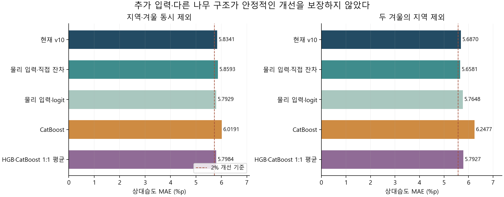

# 물리 입력·다른 나무 구조·서리 조건의 추가 검증

사용자의 1등 목표 재요청에 따라 v10 이후의 성능 가능성과 실행·검토 경로를 점검했습니다. **현재 습도 모형은 유지합니다.** 추가 36적합과 서리 규칙은 두 검증의 사전 채택 조건을 통과하지 못했습니다. F1 우선의 명시적 실행 후보와 실제 구간 기상 탐색 화면을 추가했으며 이 결과를 새로운 독립 성능으로 바꾸어 쓰지 않습니다.

[22쪽 통합 원고](../delivery/ANALYSIS_REPORT_V11_20261101.md) · [F1 우선·기존 v2 프로필](../delivery/COMPETITION_PROFILES_20261101.md) · [v11 검토 묶음](../delivery/REVIEW_BUNDLE_V11_20261101.md)

## 추가 실험을 고른 근거

[Zanetta et al. (2023)](https://arxiv.org/html/2212.04487v2)은 온습도와 이슬점의 관계를 후처리에 넣었습니다. [Casellas et al. (2026)](https://doi.org/10.1002/met.70237)은 기온·이슬점의 공동 확률분포와 파생 습도를 다룹니다. 여기서는 관측이 없는 도로의 결정적 공간 추정이라는 조건에 맞춰 물리 파생 입력과 출력 변환을 비교했습니다. 공동 제약 신경망이나 NWP 앙상블 논문의 재현이라고 부르지 않습니다.

저자 [pcpp-workflow](https://github.com/frazane/pcpp-workflow/tree/789264dfb5af69102f133f847a16a31f732bee3f)의 README·훈련 진입점·BSD-3-Clause 원문을 고정 커밋에서 대조했습니다. 이 구현은 지점 embedding·다중 목표를 사용합니다. 우리 실험에는 지점 ID·외부 모델·스위스 학습 자료를 반입하지 않았습니다. 공개 코드를 실행하지 않았고 검토 원문과 이용조건만 비공개 근거 폴더에 보존했습니다.

[ECMWF earthkit의 IFS 수식](https://earthkit-meteo.readthedocs.io/en/stable/autoapi/earthkit/meteo/thermo/saturation_vapour_pressure.html)과 [MetPy의 습도·이슬점 관계](https://unidata.github.io/MetPy/latest/api/generated/metpy.calc.relative_humidity_from_dewpoint.html)를 대조했습니다. 물·얼음 포화압을 구별하고 °C→K·Pa 단위를 명시했습니다. 저온 밖 얼음의 포화 부족량은 결측으로 두며, 범위 밖 입력을 0으로 채우지 않았습니다.

국내 [Ma et al. (2026)](https://www.mdpi.com/2076-3417/16/19/9487)의 높은 단기 예측 성능은 해당 지점의 과거 실제 노면온도를 사용한 조건입니다. 우리 미관측 도로에는 없는 정보를 가정하거나 그 RMSE를 공간 제외 MAE와 직접 비교하지 않았습니다. [Han et al. (2024)](https://arxiv.org/abs/2404.03310)의 다지점 온도·이슬점 부스팅 연구도 참고했습니다.

## 고정 설계와 자료

허용 23지점 중 기상 정답 13곳의 기존 자료만 사용합니다. 검증은 백양·서천·금산·서상의 4지역입니다. 보호 12410·33411·23402와 이미 개봉한 별도 33402·33406·12213·23411 정답을 학습·후보 선택에 사용하지 않았습니다. 현재 자료의 같은 개발 지역을 반복 사용한 결과라는 한계는 남습니다.

| 비교 | 고정한 차이 | 신규 학습 |
| --- | --- | --- |
| 물리 직접 잔차 | 기존 안정화 82 + 순간 물리 18 + 과거 물리 24 = 124입력 | 지역·겨울 8 + 지역 4 |
| 물리 logit 잔차 | 같은 124입력, 0.5–99.5% 연속성 보정과 목표 야코비안 가중치 | 8 + 4 |
| CatBoost | 기존 82입력, MAE 600회·깊이 6·대칭 나무 | 8 + 4 |
| HGB·CatBoost 평균 | 위 예측과 기존 v10을 0.5/0.5로 고정 | 추가 없음 |

물리 HGB는 기존 절대오차 300회·15잎·최소 200행·L2 10·학습률 0.05·시드 20261031을 유지합니다. logit 가중치는 물리 단위 L1의 국소 근사이며 정확한 동치 목적함수가 아닙니다. CatBoost는 설치된 1.2.8을 사용했고 무작위 강도 0·bootstrap 없음·분할 128·L2 10·학습률 0.05·CPU 2로 고정했습니다. [공식 알고리즘](https://catboost.ai/docs/en/concepts/algorithm-main-stages)·[결측 처리](https://catboost.ai/docs/en/concepts/algorithm-missing-values-processing)·[MAE 가중치](https://catboost.ai/docs/en/concepts/loss-functions-regression)를 확인했습니다.

양쪽 검증에서 전체 MAE 2% 감소, 두 겨울 비악화, 각 지역 악화 10% 이내, ASOS ±3°C 구간 비악화, 7일 날짜 블록 상한 0 미만을 모두 요구했습니다. 후보 순서와 평균 비중은 결과 확인 전에 고정했고 실패 후 바꾸지 않았습니다. 역방향 겨울 검증은 사후 복원이며 미래 예측이 아닙니다.

## 결과: 기존 습도 유지

| 모형 | 지역 제외 MAE (%p) | 지역·겨울 동시 제외 MAE (%p) |
| --- | ---: | ---: |
| 현재 v10 | 5.686973 | 5.834129 |
| 물리 입력·직접 잔차 | 5.658130 | 5.859290 |
| 물리 입력·logit | 5.764839 | 5.792880 |
| CatBoost | 6.247698 | 6.019081 |
| HGB·CatBoost 고정 평균 | 5.792669 | 5.798354 |

직접 물리 입력은 지역 제외 MAE가 약 0.51% 줄고 다른 공간 조건도 통과했지만 지역·겨울 동시 제외에서 악화했습니다. logit은 양 겨울과 날짜 블록 등에서 실패했습니다. CatBoost는 두 검증 모두 악화했고 고정 평균도 안정적인 개선을 보이지 못했습니다. 최종 습도·기온·풍속·노면온도 모형은 바꾸지 않습니다. 80행 CSV에 전체·겨울·지역·저온의 MAE·RMSE·BIAS·상관·R²를 함께 보존했습니다.

물리 특성 33,370,890값을 별도 C 단위 수식·rolling으로 검산하고 문맥 변경의 비트 일치를 확인했습니다. 24모형의 예측 549,800값, 지표 208건, 대표 4모형의 정확한 재학습을 확인했습니다. CatBoost는 12모형의 274,900값·지표 208건·대표 2재학습, 고정 평균의 전량 일치를 검산했습니다. 검산 횟수를 성능의 대체 근거로 사용하지 않습니다.

## 결빙: 새 서리 규칙도 실패

새 기상 추정값이 결빙에 도움이 되는지 별도로 반증했습니다. 지역을 제외해 학습한 기온·습도와 기존 v3 노면온도만 사용하고, 정답을 읽기 전에 예측·규칙을 봉인했습니다. 주 규칙은 `ASOS ≤ 0 OR (추정 노면온도 ≤ 0 AND 추정 노면온도 ≤ 추정 서리점)`입니다. 기온 기준선 경보를 모두 유지하며 새 정답으로 문턱을 선택하지 않습니다.

| 고정 규칙 | 일별 지점 F1 | TP | FP |
| --- | ---: | ---: | ---: |
| ASOS 0°C | 0.036601 | 5,870 | 117,723 |
| 기온 기준선 + 추정 서리 조건 | 0.036549 | 5,870 | 117,844 |
| 추정 서리 조건만 | 0.009514 | 113 | 1,475 |
| 수분 또는 서리·추정 노면온도 | 0.023938 | 1,702 | 26,385 |

주 규칙은 추가 정탐 0·오경보 121행으로 미채택입니다. 입력 부족 시 기존 기온 기준선으로 복귀하고 가용 범위를 후보별로 바꾸지 않았습니다. 별도 수식과 모형으로 2,486,216값·지표 324건·사건·날짜 블록을 검산했습니다. 서리점 계산이 가능한 것과 센서의 Ice=04를 정확히 분류하는 것은 다릅니다.

## 실제 추가한 실행·검토 기능

[명시적 F1 우선 프로필](../delivery/COMPETITION_PROFILES_20261101.md)은 알려진 단순 기온 기준선의 선택 목적을 드러냅니다. 보호 103,680행의 기존 온도·행키·18NA를 보존하고 실제 CLI 두 프로필 144행씩 정확히 확인했습니다. 새로운 학습 개선·독립 평가·공식 점수로 주장하지 않습니다.

새 기상 탐색 화면은 843구간의 두 겨울과 240일 시계열을 연결합니다. 1,632,048수치·실제 브라우저 126필터·CSV·지도 클릭·확대·상대 다운로드·모바일을 검증했습니다. 외부 요청과 JavaScript 오류는 0건이었습니다. 입력 범위 이탈·과거 문맥 부족·학습에 없던 ASOS 출처를 정확도나 확률로 바꾸어 표시하지 않습니다.

| 비공개 근거 폴더 | 내용 |
| --- | --- |
| `weather_thermodynamics_20261101_v1` | 고정 계획·124입력·24적합·독립 감사 |
| `weather_catboost_20261101_v1` | 82입력·12적합·고정 평균·독립 감사 |
| `frost_icing_20261101_v1` | 예측 봉인·고정 규칙·지표·반증 검산 |
| `competition_profile_review_20261101_v1` | 선택 목적·보호 예측·실제 CLI |
| `weather_explorer_20261101_v2` | 현재 오프라인 HTML·포함 자료 |
| `weather_explorer_validation_20261101_v4` | 실제 브라우저·수치·시각 검토 |
| `followup_review_20261101_v1` | 80+14행 지표 CSV·그림·노트북 |
| `thermodynamic_references_20261101_v1` | 참고 원문·고정 커밋·이용조건·차이 |

모두 `outputs/private/` 아래이며 모델자료에는 대용량 연구 특성·실패 모형 전체를 제외한 집계·감사·최종 실행 자료를 포함합니다. 현재 정보로 수상 순위를 보장하지 않습니다. 센서·제설 원자료, 새 독립 지역과 현장 검증은 계속 필요한 근거입니다.
