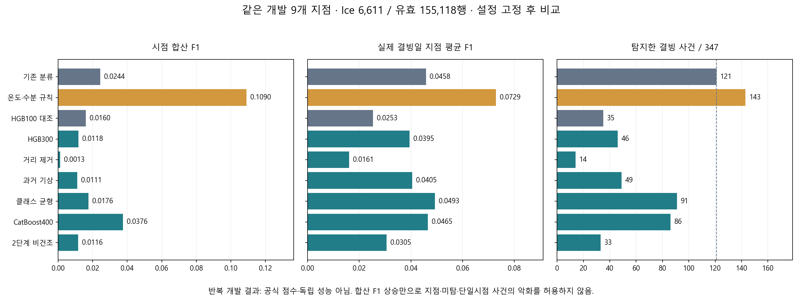
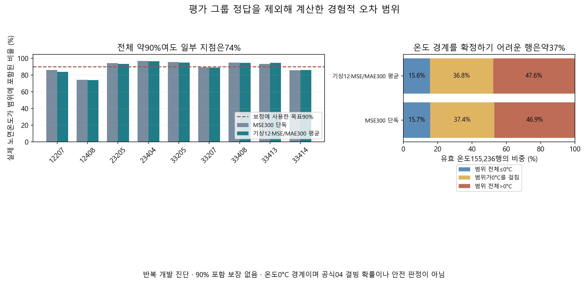

# 결빙 방법론 여섯 가지의 공간 비교 — 2026-10-10

기존 온도 블렌딩에서 남은 사건·지점 손실을 검토하기 위해 결빙 학습 길이, 거리 변수, 기상 이력, 클래스 가중치, 다른 트리 알고리즘과 2단계 분류를 같은 개발 자료에서 비교했습니다. 아래 수치는 반복 개발 결과이며 새 독립 평가나 공식 대회 점수가 아닙니다.

[문서 목록](../README.md) · [현재 상태](../history/PROJECT_STATUS.md) · [직전 블렌딩](METHOD_BLENDING_REVIEW_20261010.md) · [실행 안내](../delivery/RUNBOOK.md)

## 결과와 채택 판단

CatBoost의 시점 F1은0.024370→0.037552로54.1% 올랐고 FP는26,059→7,656행으로70.6% 줄었습니다. 그러나 FN은6,208→6,338행, 탐지 사건은121→86개, 단일 시점 탐지는57→42개로 악화했습니다. **여섯 방법 모두 채택 조건에 실패했고 네 그룹의 내부 선택은 기존 분류를 유지했습니다.** 모델 종류·학습 길이·가중치를 바꾸는 것만으로 탐지 병목을 해결하지 못했습니다.

| 방법 | TP | FP | FN | 시점 F1 | 실제 결빙일 F1 | 탐지 사건 | 단일 시점 탐지 |
| --- | ---: | ---: | ---: | ---: | ---: | ---: | ---: |
| 기존 분류 | 403 | 26,059 | 6,208 | 0.024370 | 0.045809 | 121 | 57 |
| 온도·수분 규칙 | 1,600 | 21,138 | 5,011 | 0.109033 | 0.072892 | 143 | 52 |
| HGB100 대조 | 101 | 5,877 | 6,510 | 0.016046 | 0.025349 | 35 | 20 |
| HGB300 | 122 | 13,881 | 6,489 | 0.011837 | 0.039450 | 46 | 24 |
| 거리 제거 | 20 | 25,093 | 6,591 | 0.001261 | 0.016112 | 14 | 11 |
| 과거 기상 | 125 | 15,842 | 6,486 | 0.011073 | 0.040465 | 49 | 30 |
| 클래스 균형 | 275 | 24,364 | 6,336 | 0.017600 | 0.049313 | 91 | 46 |
| CatBoost400 | 273 | 7,656 | 6,338 | 0.037552 | 0.046525 | 86 | 42 |
| 2단계 비건조 | 103 | 10,996 | 6,508 | 0.011632 | 0.030528 | 33 | 17 |

분모는 모든 행에서 동일하며 탐지 사건은347개, 단일 시점 사건은118개입니다. 실제 결빙일 F1은 완전 관측 Ice일을 지점 안에서 평균한 다음 지점 평균이며 시점 합산 F1과 다릅니다. 잠정 전체 일별 F1은 기존0.008073, CatBoost0.027005, 온도·수분0.030168입니다.

CatBoost는23404의 TP를246→112행으로 줄였고12207·12408은 각각1→0·3→0행이 됐습니다. 반면33408은139→147행으로 늘어 개선과 손실이 지점마다 달랐습니다. Ice6,611행 중6,340행이33408에 몰려 있어 합산 지표만으로 다른 도로의 탐지 보존을 판단하기 어렵습니다. 센서 고장이나 오라벨이 입증됐다는 뜻은 아닙니다.

기상 이력은 HGB100 대조보다 TP101→125·사건35→49·단일20→30으로 좋아졌지만 FP5,877→15,842행으로 증가했습니다. 클래스 균형의 실제 결빙일 F1도0.049313으로 기존보다 높으나 FN·사건 손실이 남았습니다. 2단계의 보조 상태 분리는 개선되지 않았습니다. 이번 설정에서의 결과이며 다른 모든 설정의 효과가 없다는 주장이나 이후 임계값 재선택의 근거가 아닙니다.

## 온도 점 추정에 경험적 오차 범위 추가

앞서 MAE1.232271°C를 얻은 기상12/MSE300/MAE300 평균과 MSE300 단독에 평가 그룹을 제외한 오차 범위를 붙였습니다. 외부 그룹G의 범위 반경은 G와 H를 모두 제외한 모델의 H 예측에서 계산한 절대 오차90분위수입니다. 지점마다 전체 가중치를 동일하게 두며, G의 온도 정답은 반경 선택에 넣지 않습니다. 반경·목표90%·두 후보를 고정한 뒤 실제 포함률을 계산했습니다. 새 모델 적합은0건입니다.

| 경험적 범위 진단 | MSE300 단독 | 고정 삼중 평균 |
| --- | ---: | ---: |
| 유효 온도 행 | 155,236 | 155,236 |
| 전체 실제 포함률 | 90.09% | 89.73% |
| 평균 범위 폭 | 5.5853°C | 5.4235°C |
| 관측 −2–2°C 포함률·42,268행 | 93.38% | 92.83% |
| 가장 낮은 지점 포함률·12408 | 74.51% | 73.91% |
| 범위가0°C를 걸친 행 | 58,058·37.40% | 57,068·36.76% |
| 범위 전체>0°C인데 실제≤0°C | 603 | 612 |

삼중 평균은 범위 폭과 구간 점수도 소폭 낮췄지만 전체·저온 포함률은 낮아졌습니다. **전체 약90%가 한 지점의90%를 뜻하지 않으며, 범위 전체가0°C 위에 있어도 실제 저온612행을 놓쳤습니다.** 결과물에 점 추정만 표시하기보다 범위·지점별 검증 수준·온도 경계의 애매함을 함께 표시할 필요를 확인했습니다. 이 범위는 노면온도에 대한 경험적 진단으로, 공식 `04` Ice 확률·위험 등급이나 안전 판정이 아닙니다.

[Angelopoulos·Bates의 불확실성 입문 원문](https://arxiv.org/abs/2107.07511)의 별도 보정 자료, 주변적·조건부 포함률과 분포 변화 논의를 참고했습니다. 51쪽 PDF의 관련 본문을 읽고 대표5쪽을 렌더해 확인했습니다. 현재 공간·시계열의 교환가능성과 동일 분포가 입증되지 않았고 OOF 보정 모델과 최종 모델의 학습 크기도 다릅니다. 지점 가중 경험분위수에 단순히 conformal의 포함 보장을 붙이지 않았습니다. **90% 포함 보장은 없고 독립 검증도 아닙니다.**

온도 범위의 독립 계산은8개 반경·621,028개 하한/상한·두 후보의 전체/지점/저온/경계 지표와 기존 봉인 일치를 확인했습니다. 구현은 `src/temperature_uncertainty.py`, `evaluate_temperature_uncertainty.py`, `audit_temperature_uncertainty.py`이며, 완료본은 `outputs/private/temperature_uncertainty_20261010_v1/`입니다. 그림 초안의 범례 겹침을 비공개로 보존하고 수정본을 육안 확인했습니다.

## 비교한 방법과 문헌의 실제 적용

| 후보 | 고정한 변경 | 확인하려는 질문 |
| --- | --- | --- |
| HGB300 | 기존 20개 입력·Ice 가중치20 유지, 학습100→300회 | 같은 입력에서 더 긴 비선형 학습이 지점 이전을 개선하는가? |
| 거리 제거 | 20개 입력 중 AWS/ASOS 거리2개 제거, HGB100 | 센서와 기상 참조 거리의 학습 관계가 새 도로 지점을 오도하는가? |
| 과거 기상 | 기존20개에 엄격한 과거 평균·변화량18개 추가, HGB100 | 현재 기상만으로 놓친 냉각·수분 이력을 활용할 수 있는가? |
| 클래스 균형 | 학습 자료에서만 계산한 `n / (2 × 클래스 행 수)`, HGB100 | 기존 양성 배율20과 다른 학습 손실이 Ice 순위를 개선하는가? |
| CatBoost400 | 같은20개 입력·양성 배율20, 깊이4·400회·L2 20 | 다른 트리 구조와 학습 구현이 개선을 주는가? |
| 2단계 비건조 | 먼저01 대 나머지 정의 상태, 다음 비01 행에서04 대 나머지 | 건조 구분과 Ice 구분을 분리하는 것이 직접 이진/다중 분류보다 유리한가? |

HGB 기준은 학습률0.05·최대 잎15·최소 잎100·L2 10·조기 종료 없음·시드20260923입니다. 클래스 균형은 [scikit-learn1.6 공식 식](https://scikit-learn.org/1.6/modules/generated/sklearn.ensemble.HistGradientBoostingClassifier.html)을 적용했으며 기존 지점·사건 균형 실험과 다른 변경입니다. 가중치의 총합과 클래스 비중도 바뀌므로 가중치 효과를 단일 원인의 인과 효과로 주장하지 않습니다.

과거 기상은 추정 노면온도·AWS 기온·습도·이슬점·15분 강수·풍속 각각의60/180분 평균과60분 변화량입니다. 평균의 범위는 `[t-window,t)`이며 필요한 슬롯의80% 이상이 유효해야 합니다. 변화량은 정확히60분 전 값이 있을 때만 계산합니다. 다른 지점·미래 시각·현재 시각을 과거 평균에 섞지 않습니다. 미정의 상태의 행도 기상 이력에 포함해 정답 유효 여부가 이력 결측 신호가 되는 문제를 피했습니다.

[FHWA 겨울 도로관리 지침](https://www.fhwa.dot.gov/reports/mopeap/mop0296a.htm)의 노면 열응답 지연, 강수·습기·처리 조건을 고려해야 한다는 설명에서 기상 이력 가설을 정했습니다. 제설·염분·도로 물성을 실제로 확보하거나 물리 열수지 모형을 구현한 것은 아닙니다. [scikit-learn의 시계열 입력 예제](https://scikit-learn.org/1.6/auto_examples/applications/plot_time_series_lagged_features.html)는 임의 행 분할의 낙관적 오차를 경고합니다. 이번 비교는 같은 겨울의 **새 위치 추정**이며 미래 시간 예보를 검증한 것은 아닙니다.

[CatBoost 원 논문](https://papers.neurips.cc/paper_files/paper/2018/file/14491b756b3a51daac41c24863285549-Paper.pdf)과 [공식 학습 설정](https://catboost.ai/en/docs/references/training-parameters/common)을 검토했습니다. 실행 모드는 `Plain`, 수치 입력20개이며 범주형 목표 통계나 `Ordered` 모드를 구현했다고 주장하지 않습니다. `nan_mode=Min`, 두 스레드, 고정 시드, 학습 중 최적 모델 선택 없음으로 설정했습니다.

2단계 비건조는 이번 연구 가설입니다. `01`을 제외한 정의 상태에는 `10`·`13`·`15`도 들어가므로 물리적인 수분 정답으로 부르지 않습니다. 첫 모델은 양성 배율1, 두 번째는 Ice 배율20이며 점수 두 개를 곱합니다. 목표 실제 상태는 **학습 정답으로만** 사용하며 예측 입력이나 과거 상태 이력에 넣지 않습니다. 두 모델의 곱·클래스 가중 점수 모두 보정된 결빙 확률로 해석하지 않습니다.

## 자료·분할·선택의 경계

첫 겨울23개 개발 지점397,173행을 사용합니다. 대회 개발14곳과 외부9곳이며, 외부4개 공간 그룹을 하나씩 제외해 결과를 계산합니다. 외부 결과의 유효 상태는155,118행·Ice6,611행, 완전일1,060개·실제 Ice일124개·양성 지점8개, 연속10분 사건347개·단일 시점 사건118개로 고정합니다.

외부 그룹G의 임계값·후보를 고를 때는 나머지 그룹H의 예측을 합칩니다. 이 예측의 분류 모델은 G와 H를 모두 제외한 자료로 학습합니다. 외부 G에 적용할 모델은 G를 제외해 다시 학습한 모델입니다. 네 단일 그룹·여섯 쌍 그룹으로 총10개 맥락이며, 맥락별 일곱 모델로 **새 분류 적합70건**을 실행했습니다. 2단계 분류의 두 모델을 각각 셉니다.

온도 입력은 독립 감사된 기존 `joint_surface`의 공간 교차 추정값입니다. 학습 지점의 추정 온도는 그 지점이 속한 보조 공간 블록과 G/H를 제외한 회귀에서 얻습니다. 새 온도 적합은0건이며, 정답 미정의 행의 이력 온도는 같은 기존 보조 모델로 보충합니다. 실제 목표 노면온도·상태·지점 ID·센서 종류·주변 실측 노면 관측은 새 예측 변수에 넣지 않습니다. 온도 후보를 동시에 바꾸는 효과는 이 비교에 포함되지 않습니다.

임계값은0, `geomspace(1e-6,1,401)`, 1보다 큰 다음 부동소수점 값으로403개를 고정했습니다. 내부 기존 분류의 FP/FN 예산을 모두 만족하는 범위에서 실제 결빙일 F1·시점 F1·높은 임계값 순으로 하나만 선택합니다. 양쪽 예산을 만족하는 값이 없으면 FP 예산의 최고값을 **진단용**으로 기록하며 채택하지 않습니다. 실패한 후보를 다른 임계값으로 재탐색하지 않습니다. 기존 교차 추정 온도를 입력으로 쓴 HGB100도 같은 임계값 선택으로 대조합니다.

채택에는 내부 기존 분류와 온도·수분 규칙 **양쪽**에 대해 FP/FN 비증가, 모든 양성 지점의 TP 비감소, 사건·단일 시점 탐지 비감소, 시점·지점·실제 결빙일·잠정 전체 일별 F1 비악화와 적어도 하나의 엄격한 개선을 요구합니다. 적격 후보가 없으면 기존 분류를 유지합니다. 결측 온도21행은 모든 후보에서 기존 분류로 돌아갑니다. 실패 결과를 본 뒤 정답 정의나 기준을 완화하지 않았습니다.

[Roberts등의 공간 검증](https://www.biom.uni-freiburg.de/mitarbeiter/dormann/roberts-et-al-2017-ecography.pdf/at_download/file)과 [Cawley·Talbot의 선택 편향](https://jmlr.org/papers/v11/cawley10a.html)을 참고했습니다. 같은 개발 자료를 반복 검토한 연구자 선택은 공간 OOF만으로 없어지지 않습니다. 보호3곳, 이미 개봉한 별도8/4/2곳과 다음 겨울 평가 정답을 이번 학습·후보 선택·점수 산출에서 제외했습니다.

## 별도 검산과 재현

별도 감사가70개 학습 기록, 대표7개 모델의 재적합, 새 모델 점수3,726,168개와 재사용 HGB100 점수621,028개를 확인했습니다. 학습 온도3,350,702행·쿼리 온도621,028행을 원래 보조/전체 모델로 재추정했고 과거 기상71,491,140개 값은 시간 경계 검색·누적합으로 검산했습니다. 고정 임계값11,284개·내부 선택4개·정책10개의 지표·지점·사건 결과가 일치했습니다.

실행 환경은 scikit-learn1.6.1·CatBoost1.2.8·NumPy2.2.6·pandas2.2.3, 최대 두 스레드입니다. 기존47개·외부549개 고정 파일과 이미 개봉한8/4/2 지점 평가의 세 봉인이 유지됐습니다. 온도 범위도 별도 감사를 통과했습니다. 전체 합성 테스트211개·추적/새 파일·로컬 GFM의 최종 검증 기록은 `outputs/private/ice_methodology_quality_checks_20261010_v1/`에 보존합니다.

설정은 `config/ice_methodology_experiment.json`, 구현은 `src/ice_methodology.py`와 `scripts/evaluate_ice_methodology.py`입니다. `audit_ice_methodology.py`는 학습에 사용한 rolling 구현을 부르지 않고 시간 경계 검색·누적합으로 이력을 검산하고 가중치·정답·예측·임계값·선택·사건을 별도 계산합니다. `tests/test_ice_methodology.py`는 현재/미래 정보 차단, 시간 공백, 지점 분리, 목표 값 미사용, 클래스 가중치, 04 정답과 허용 자료 경계를 확인합니다.

원문 모델·행별 입력·예측·임계값 표·실패 조건·해시는 `outputs/private/ice_methodology_20261010_v1/`에 보존합니다. 종료 후 진단 CSV는 선택 산출물과 분리해 기록합니다. 이전 품질 영수증과 원본ZIP·키·미커밋 작업을 보존했으며 제출 초안과 고정 평가 모델을 바꾸지 않았습니다. 재현은 기존 감사된 비공개 자료를 필요로 하며 [실행 안내](../delivery/RUNBOOK.md)를 따릅니다.

## 공식 규정·문헌 확인과 다음 실행 조건

[공식 문제](https://aida.kisti.re.kr/competition/main/problem/PROB_000000000004604/detail.do)는 최신 데이터20261007, 참가신청2026-09-15–11-06을 표시합니다. [제출 공지](https://aida.kisti.re.kr/competition/main/selectNotice.do?bbsId=BBSMSTR_AAAAAAAAAAAA&nttId=564)의 숨김 본문과 참가서약을 재확인했으며 서약은 기존 검토본과 같은 해시입니다. 실행 환경·재현 과정·데모영상·검토한 대안·실패와 참가자 판단 기록이 제출 준비에 필요합니다. 코드 제출 의무와 대회 중 공개 허용은 구별합니다.

[공식 게시판](https://aida.kisti.re.kr/competition/problem/PROB_000000000004604/detail/commuBoard.do)의6개 질문 중 일별 미정의 처리를 묻는633은 여전히 답변 `-`입니다. 잠정 진단 지표를 공식 F1로 소개하지 않습니다. 외부 연락·로그인·활용신청·대회 제출은 수행하지 않았습니다.

이번 익명 HTTP17건 중13건 성공, AMS·MDPI·NOAA PDF403과 NSSL 연결 실패도 보존했습니다. CatBoost11쪽 원문과 공간 검증17쪽 원문을 확보했으며 CatBoost 대표 페이지를 렌더해 확인했습니다. [NOAA 논문 소개](https://repository.library.noaa.gov/view/noaa/56154)는 웹에서 초록·서지를 확인했으나32.24MB PDF의 로컬403과 웹 크기 제한으로 전문은 확보하지 못했습니다. 초록은 동결 강수 조건의 평가 분리와 강수 형태 입력의 필요성을 설명하지만, 논문의 성능 수치를 이 프로젝트에 옮기거나 세부 구현을 재현했다고 주장하지 않습니다. [FHWA RWIS 설명](https://ops.fhwa.dot.gov/weather/faq.htm)의 노면 결빙점·화학 농도 등 실제 관측 항목도 현재 기상 입력의 한계를 판단하는 근거로 삼았습니다.

심사 관점에서 얻은 결과는 단일 최고 점수 모델의 교체가 아니라, **여섯 후보의 실제 실패 조건과 온도 추정의 지점별 오차 범위를 재현 가능한 형태로 구체화한 것**입니다. 수상 수준의 일반화·현장 유효성은 아직 입증되지 않았습니다.

1. 실제 기상 관측 확보를 우선합니다. 기존 고정 AWS614·647·730·914의 첫 겨울 원문과 관측 나이·단위를 검증한 다음 같은 분할에서 확장 효과를 비교합니다. 마지막 실제 API 요청의403은 이전 작업의 미해결 기록이며 이번에 키 재요청·로그인·신청을 하지 않았습니다.
2. 강수 형태, 제설 처리와 센서·설치·보정 이력을 확인할 수 있는 자료를 찾고 관측 의미를 검증합니다. 현재 입력만으로 센서 상태 차이를 충분히 설명한다는 근거는 부족합니다. `13`·`15`를04로 바꾸거나 센서 고장을 가정하지 않습니다.
3. 온도 범위는 현재 경험적 결과로 유지하고 전북 미개봉 지점에서 예측·보정 규칙·채택 기준을 먼저 봉인한 평가를 준비합니다. 전체90%에 맞춰 이미 확인한 지점의 반경을 사후 확대해 검증 성능으로 발표하지 않습니다.
4. 843개 도로 구간은 공식 이정·시설 대응과 현장 검증을 확보한 뒤 위험 등급과 연결합니다. 현재의 온도 경계·환경 노출·클래스 가중 점수를 최종 위험 확률로 치환하지 않습니다. 참가자가 판단해야 하는 입력 가용성·운영 목적과 공식 일별 규격 확인이 남아 있습니다.
