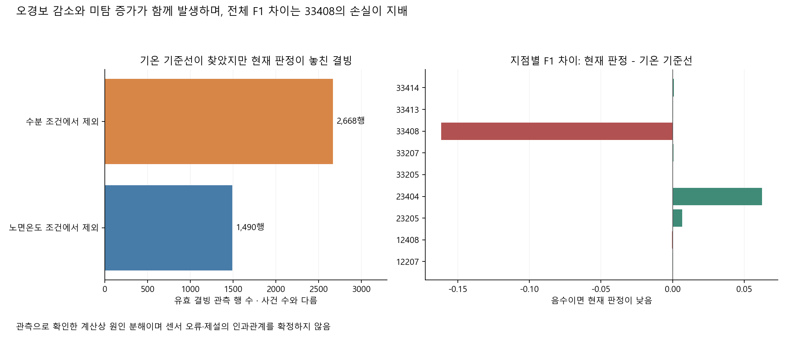
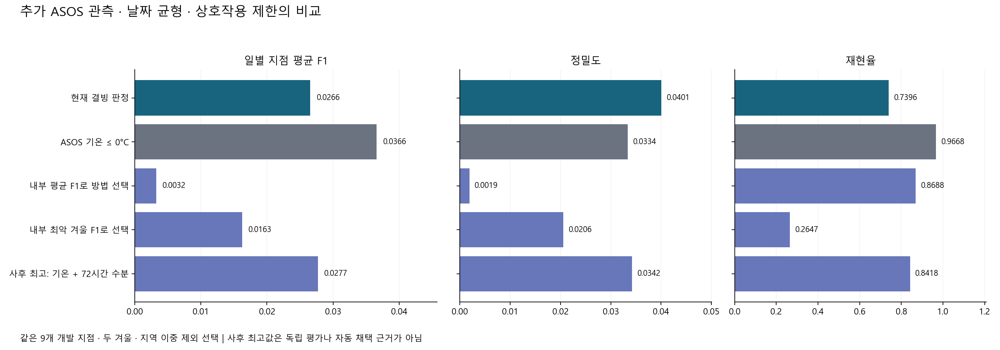

# 기온 기준선보다 결빙 F1이 낮은 이유와 추가 기상 실험

현재 결빙 판정은 **오경보를 줄이는 대신 기온 기준선이 찾은 실제 결빙도 많이 제외**합니다. 이 손실은 33408 지점에서 특히 크며 다른 지점의 개선을 넘어 전체 F1을 낮춥니다. 이에 기존 제공 자료의 미사용 ASOS 관측, 긴 수분 이력, 날짜별 학습 비중, 모델 형태 제한을 비교했습니다.

[현재 상태](../STATUS.md) · [자료·논문·라이선스 검토](ADDITIONAL_ICING_SOURCES_20261025.md) · [사전 실험 설정](../../config/icing_synoptic_20261025.json)

## 무엇을 같은 조건에서 비교했는가

비교 대상은 기존 9개 개발 지점의 두 겨울입니다. 현재 판정과 ASOS 기온 0°C 이하 기준선에 같은 입력 가용 조건·정답 유효 조건·날짜 집계를 적용했습니다. 일별 지점 평균 F1은 현재 **0.026554**, 기온 기준선 **0.036601**입니다. 이전 CSV 정책의 0.036392와 가용 범위가 다릅니다.

온도 v3가 더 정확하다는 결과와 현재 결빙 v2를 구별합니다. 아래 현재 판정의 노면온도는 결빙 v2가 사용해 온 `temperature_both`이며 새 온도 v3를 뜻하지 않습니다. 같은 조건의 일별 정밀도는 현재 0.040055·기온 기준선 0.033386, 재현율은 현재 0.739628·기온 기준선 0.966799입니다. 전체 행을 한꺼번에 합친 지표와도 다릅니다.

이 지점들은 여러 연구에서 반복 사용했습니다. 지역 제외 예측이어도 새 독립 검증이나 공식 점수는 아닙니다. 보호 12410·33411·23402의 정답은 추가 열람·학습·선택에 사용하지 않았고 기존 봉인 파일 47개·549개를 보존합니다.

## 1. 수분 조건과 온도 조건에서 놓치는 결빙

현재 방식은 예측 노면온도가 0°C 이하이고, 이슬점과의 관계·최근 강수·적설 중 하나가 수분 조건을 만족할 때 경보합니다. 기온 기준선은 ASOS 기온만 0°C 이하인지 봅니다. 아래는 유효 관측 **309,928행**을 두 방식의 차이로 나눈 표입니다. 한 행은 10분 관측으로 사건 수가 아닙니다.

| 두 판정의 관계 | 실제 결빙 | 실제 비결빙 | 해석 |
| --- | ---: | ---: | --- |
| 기온 기준선만 경보, 노면온도 조건에서 제외 | 1,490 | 31,188 | 현재 노면온도 문턱에서 경보하지 않음 |
| 기온 기준선만 경보, 수분 조건에서 제외 | 2,668 | 61,836 | 온도 문턱은 통과하지만 물기 증거가 부족함 |
| 두 방식 모두 경보 | 1,712 | 24,759 | 공통으로 맞히거나 오경보한 관측 |
| 현재 방식만 경보 | 0 | 582 | 이 개발 범위에서는 추가 결빙 탐지 이득 없음 |
| 두 방식 모두 경보하지 않음 | 817 | 184,876 | 공통 미탐·정상 판정 |

기온 기준선이 찾은 결빙 중 현재 방식이 놓친 **4,158행의 64.17%는 수분 조건, 35.83%는 온도 조건**에서 제외됐습니다. 그 과정에서 오경보 93,024행도 제거하므로 문턱을 무조건 없애면 모든 지표가 좋아지는 것은 아닙니다. 현재 방식만 추가한 582행은 모두 오경보였습니다.

수분 조건을 제거하는 진단 대조의 F1은 0.035084, ASOS 기온과 현재 수분 조건을 결합하면 0.028631입니다. 현재 판정과 기온 기준선의 합집합은 0.036488, 교집합은 0.027490입니다. **원인 확인용 반사실적 대조**이며 사후 진단 결과만으로 제출 모델에 편입하지 않았습니다.



## 2. 일별 지표의 분모와 특정 지점이 전체 차이에 미치는 영향

지점 F1은 경보 또는 실제 결빙이 있어 F1이 정의되는 날짜의 평균입니다. 오경보만 있던 날을 없애면 평균의 분모가 줄어 점수가 높아질 수 있지만, 결빙일의 탐지를 놓치면 분자가 낮아집니다. 현재 판정의 해당 날짜는 전체 487개, 기온 기준선은 1,495개입니다. 두 방식 모두 결빙·경보가 없는 날짜의 F1을 0으로 채워 계산하지 않습니다.

| 주요 지점 | 기온 기준선 F1 | 현재 F1 | 현재 − 기준선 |
| --- | ---: | ---: | ---: |
| 33408 | 0.300459 | 0.139026 | −0.161432 |
| 23404 | 0.024994 | 0.087330 | +0.062336 |
| 23205 | 0.002116 | 0.008901 | +0.006786 |

9곳 중 6곳은 개선, 1곳은 동일, 2곳은 악화지만 33408의 하락이 전체 평균을 지배합니다. 그 지점의 F1 변화는 일별 F1 합계 변화 효과 −0.311903과 평균에 포함되는 날짜 수 변화 효과 +0.150470으로 분해됩니다. 이는 대칭적인 대수 분해이며 두 효과의 합이 실제 차이 −0.161432와 일치합니다. 정밀도·재현율이 같은 날짜·지점에서 정의되는 것도 아니므로 평균 정밀도와 재현율을 다시 조화평균해 이 F1을 만들 수 없습니다.

계산식은 지점의 일별 F1 합을 S, 정의되는 날짜 수를 N이라 할 때 F = S/N입니다. 두 방식 c·a의 차이를 `0.5 × (Sc − Sa) × (1/Nc + 1/Na)`와 `0.5 × (Sc + Sa) × (1/Nc − 1/Na)`로 나눴습니다. 날짜가 없는 경우의 역수는 0으로 두며 실제 분해표도 보존합니다.

기존 진단에서 결빙 양성의 94.81%가 33408 첫 겨울에 집중됐고 일부 Ice 관측은 양의 노면온도와 함께 기록됐습니다. 이것만으로 센서 고장·제설 효과·정답 오류를 확정할 수 없습니다. 그 지점을 삭제하거나 `04` 정답 정의를 바꾸지 않았습니다. 지역을 제외하면 이런 관측 특성을 다른 지점에서 학습하기 어렵다는 일반화 문제가 남습니다.

## 3. 이번에 추가한 입력과 모델링

대회 제공 수정 ZIP의 ASOS 파일에서 아직 쓰지 않은 이슬점·증기압·현지기압·풍속·시정·하층운량·3시간 신적설·5cm 지중온도 **8개 열**을 추출했습니다. 목표 시각보다 엄격히 이른 60분 이내 관측만 연결했고, pandas 연결과 별도 NumPy 탐색의 **6,356,360값**이 결측까지 일치했습니다. 원래 입력·정답·행키는 유지했습니다.

추가 열이 없는 행은 그대로 결측으로 두었습니다. 모델은 결측을 처리하고 고정 규칙은 필요한 추가 입력이 없을 때 ASOS 기온 기준선으로 복귀합니다. 후보마다 유리한 행만 골라 평가하지 않도록 기존 가용 범위는 동일하게 유지합니다.

8개 열의 확보가 8개 모두 충분한 관측이라는 뜻은 아닙니다. 전체 794,545행 중 3시간 신적설은 1,404행(0.18%), 5cm 지중온도는 137,895행(17.36%)에만 값이 있습니다. 다른 추가 열도 지점·겨울별 가용 수를 별도 표로 보존했습니다. 드문 관측이나 결측 패턴이 지역의 특징을 대신 학습할 수 있다는 한계가 있습니다.

수분 증거는 강수·적설 또는 높은 습도와 이슬점 조건으로 만들고, 24·72시간 안에 있었는지 기록했습니다. 10분 연속성이 끊기거나 관측이 유효하지 않거나 기온이 2°C를 넘으면 과거 상태를 초기화합니다. 물리 모형 RoadSurf의 개념에서 출발했지만 물 저장량·실제 결빙 확률을 계산하는 모형은 아닙니다.

| 구성 | 입력 | 학습 비중 | 형태 제한 |
| --- | --- | --- | --- |
| `base_additive_day` | 기존 기상 12개 | 지점·겨울·날짜 균형 | 방향 제한, 변수 간 상호작용 없음 |
| `extra_additive_row` | 추가 관측·수분 이력·이슬점 차이를 포함한 24개 | 관측 행마다 동일 | 방향 제한, 상호작용 없음 |
| `extra_additive_day` | 24개 | 날짜 균형 | 방향 제한, 상호작용 없음 |
| `extra_pairwise_day` | 24개 | 날짜 균형 | 방향 제한, 두 변수 상호작용 |
| `extra_free_pairwise_day` | 24개 | 날짜 균형 | 방향 제한 없이 두 변수 상호작용 |

날짜 균형은 학습 지점·겨울의 총 비중을 맞춘 뒤 날짜별 비중을 맞추고, 각 날짜에 실제 존재하는 클래스에 균등 비중을 줍니다. 긴 결빙 기간이나 비결빙 행이 학습을 지배하는 문제를 완화하려는 설계입니다. 실제 F1의 직접 최적화나 Group DRO 구현은 아닙니다. 방향 제한도 한 변수를 고정적으로 바꿨을 때의 모델 제약이며 실제 물리 법칙이 확인됐다는 뜻이 아닙니다.

5구성 각각 지역 하나 제외 4회·지역 두 개 제외 6회로 총 **50개 모델**을 학습합니다. 내부에서는 평균 F1 또는 더 나쁜 겨울 F1로 고정 64개 임계값을 선택합니다. ASOS 기온·지면온도와 0·24·72시간 수분 증거를 결합한 고정 6규칙도 비교합니다. 전체 방법을 내부에서 선택하는 두 절차까지 포함해 기준선과 함께 **20행**을 보고합니다.

결과 확인 전에 [설정](../../config/icing_synoptic_20261025.json)을 저장했습니다. 평가 지역 G의 두 겨울은 학습에서 제외하며 내부 선택 지역 H도 동시에 제외합니다. 지점별 사후 최고 조합이나 평가 지역 정답으로 정한 임계값을 채택하지 않습니다.

## 4. 결과와 채택 판단

**기온 기준선을 넘은 후보가 없어 온도 v3·결빙 v2를 유지합니다.** 추가 입력·날짜 균형·형태 제한만으로 새 지역의 결빙 일반화를 해결하지 못했습니다. 아래는 같은 개발 지점에서 얻은 결과이며 점수가 높은 행을 사후 선택한 것을 새 성능으로 주장하지 않습니다.

| 대표 방법 | F1 | 정밀도 | 재현율 | 기존 탐지 사건 중 새로 놓침 |
| --- | ---: | ---: | ---: | ---: |
| 현재 결빙 판정 | 0.026554 | 0.040055 | 0.739628 | 0 |
| ASOS 기온 기준선 | 0.036601 | 0.033386 | 0.966799 | 0 |
| 기온 + 72시간 수분 이력 | 0.027704 | 0.034212 | 0.841824 | 1 |
| 방법까지 내부 평균 F1로 선택 | 0.003217 | 0.001886 | 0.868750 | 73 |
| 방법까지 내부 최악 겨울 F1로 선택 | 0.016252 | 0.020566 | 0.264710 | 146 |

기온 + 72시간 수분 이력은 현재 F1보다 약 4.33% 높지만 정밀도가 낮고 기존 사건 하나를 잃습니다. 첫 겨울 F1은 0.030187 → 0.036515, 둘째 겨울은 0.009466 → 0.004246으로 악화합니다. 같은 자료의 ASOS 기준선보다도 낮아 채택하지 않았습니다.

ASOS 기준선도 함께 공개하는 이유는 현재 방식의 한계를 감추지 않기 위해서입니다. 통합 F1은 더 높지만 첫 겨울 0.071179·둘째 겨울 0.001444로 겨울별 차이가 큽니다. 현재 방식의 둘째 겨울 F1과 정밀도를 희생하는 단순 교체가 새 보호 지역에서도 이득일지는 이 자료로 확인할 수 없습니다.



### 전체 20행의 F1 비교

다음 표의 각 숫자는 하나의 비교 행입니다. 5개 학습 구성·방법 선택의 두 경로 12행과 고정 규칙 6행·기준선 2행을 모두 포함합니다.

| 학습 구성 또는 선택 절차 | 내부 평균 F1로 임계값 선택 | 내부 최악 겨울 F1로 임계값 선택 |
| --- | ---: | ---: |
| 기존 12변수·날짜 균형·상호작용 없음 | 0.002217 | 0.015106 |
| 추가 24변수·행 균등·상호작용 없음 | 0.001927 | 0.002529 |
| 추가 24변수·날짜 균형·상호작용 없음 | 0.002464 | 0.004071 |
| 추가 24변수·날짜 균형·두 변수 상호작용 | 0.002382 | 0.005917 |
| 추가 24변수·날짜 균형·방향 제한 없는 두 변수 상호작용 | 0.002456 | 0.004103 |
| 방법 자체도 내부에서 선택 | 0.003217 | 0.016252 |

| 고정 규칙 | F1 |
| --- | ---: |
| 기온 + 현재 수분 증거 | 0.027042 |
| 기온 + 24시간 수분 이력 | 0.027297 |
| 기온 + 72시간 수분 이력 | 0.027704 |
| ASOS 지면온도 + 현재 수분 증거 | 0.012047 |
| ASOS 지면온도 + 24시간 수분 이력 | 0.013644 |
| ASOS 지면온도 + 72시간 수분 이력 | 0.014410 |
| ASOS 기온 기준선 | 0.036601 |
| 현재 결빙 판정 | 0.026554 |

평균 F1로 방법까지 선택하면 세 지역에서 ASOS 기준선을 고르지만, 33408이 속한 통영 금산 지역을 제외한 내부 자료에서는 `extra_additive_row`를 고릅니다. 이 방법의 내부 F1은 0.044467이지만 외부 33408 F1은 0입니다. 내부 자료의 최고 방법이 결빙이 집중된 새 지역으로 이전되지 않는 문제를 직접 확인했습니다. 이 결과를 보고 33408만 기온 기준선을 쓰도록 바꾸면 평가 정답을 이용한 선택이 되므로 그렇게 하지 않았습니다.

채택 조건은 현재 대비 F1 1% 개선, 정밀도·재현율·각 겨울·각 지점 비악화, 기존 사건 보존, 기온 기준선 F1 초과입니다. 이는 이전부터 고정한 **자체 위험 관리 기준이며 공식 수상 조건이 아닙니다.** 모든 조건을 동시에 요구하는 만큼 작은 평균 이득의 채택을 막을 수 있다는 한계도 명시합니다. 이번에는 그 조건과 별개로 어느 새 후보도 기온 기준선 F1을 넘지 못했습니다.

## 독립 검산과 코드 검사

| 확인 대상 | 실제 완료한 검사 |
| --- | --- |
| 추가 ASOS 연결 | 별도 시각 탐색으로 6,356,360값 일치, 원래 입력·정답·행키 보존 |
| 저장 모델 | 50개 재추론 점수 전량 일치, 지역 제외·두 겨울 학습 범위·해시 확인 |
| 학습 비중 | 50개 학습 집합을 별도 Counter 구현으로 재계산해 가중치·양성 비중 일치 |
| 방향 제한 | 제한 모델의 고정 표본에서 449개 조건부 증가·감소 대조 통과. 전 입력 공간의 실측 물리 검증은 아님 |
| 수분 이력 | 별도 상태 사전 구현의 2,383,635값과 6개 고정 규칙 일치 |
| 지표·사건 | 전체·각 겨울의 지표 묶음 60건, 사건 집계 20건 일치 |
| 중첩 선택 | 48개 선택의 내부 지표·동률 처리·지역 분리·외부 예측 재구성 일치 |
| 원인 분해 | 같은 원 예측에서 진단 5분류의 행수·양성·음성 및 두 기준선 F1 일치 |
| 코드 | 전체 테스트 354개·하위 검사 7개 통과. 기존 pandas 경고 1개 유지 |

독립 감사는 지표·수분 이력·학습 가중치·선택 점수를 별도 방식으로 계산했다는 뜻입니다. 모델의 숫자 재현은 같은 라이브러리의 저장 모델을 다시 실행해 확인했으며, 독립 데이터셋으로 성능을 검증했다는 뜻은 아닙니다.

현재 근거는 실험 `v2/summary.json` SHA-256 `3e5efab0564d75b2382e2ba7afb008df12a1384aee074f51328d29b324748e69`, 예측 SHA-256 `c147241b7646ef0124f05ba8deea9f3f5732712fc121557cd83207e4a0de8b4c`와 감사 영수증에 연결됩니다. 원본·모델·예측을 GitHub에 올리지는 않습니다.

## 다음 개선의 우선순위

추가 관측·가중치·제약을 시도한 결과는 단순한 모델 용량 확대보다 **지역 간 관측 차이를 설명하는 근거**가 필요함을 시사합니다. 다음 우선순위는 적격 독립 지역 확보, 센서 상태 판정·교정 이력, 시각과 구간이 맞는 제설 이력입니다. 이는 원인 가설이며 아직 확보·검증된 입력은 아닙니다. 접근 가능성·라이선스·대회 적용 범위는 [추가 자료 검토](ADDITIONAL_ICING_SOURCES_20261025.md)에 정리했습니다.

현재 개발 정답만 더 반복 탐색하면 선택 편향이 커질 수 있습니다. 보호 정답을 열거나 지점별 임계값을 사후 조정하는 대신, 추가 자료 확보 후 같은 지역 제외 절차로 효과를 확인해야 합니다. 이번 실패는 모든 모델링 가능성이 소진됐거나 입상이 불가능하다는 결론이 아닙니다.

## 실행과 근거 파일

저장소 루트·기존 연구 환경과 비공개 원본·선행 캐시가 필요합니다. 새 출력 경로를 사용하며 기존 완료 폴더를 덮어쓰지 않습니다.

```powershell
python scripts/diagnose_icing_baseline_gap.py --output outputs/private/icing_gap_diagnosis_20261025_v1
python scripts/prepare_synoptic_icing.py --output outputs/private/synoptic_icing_inputs_20261025_v1
python scripts/evaluate_synoptic_icing.py --output outputs/private/synoptic_icing_20261025_v2
python scripts/audit_synoptic_icing.py --study outputs/private/synoptic_icing_20261025_v2 --output outputs/private/synoptic_icing_audit_20261025_v1
python scripts/summarize_synoptic_icing.py --study outputs/private/synoptic_icing_20261025_v2 --audit outputs/private/synoptic_icing_audit_20261025_v1 --output outputs/private/synoptic_icing_summary_20261025_v2
```

원인 분해의 `summary.json`·`daily_denominator_decomposition.csv`, 입력 연결의 `receipt.json`·`availability.csv`, 실험의 모델별 영수증·`decisions.json`·`summary.json`, 독립 감사의 `receipt.json`, 요약의 전체 후보표를 구분해 보존합니다. GitHub에는 코드·설정·이 문서·집계 그림만 반영합니다. 새 연구 결과가 기존 봉인된 v5 ZIP에 자동으로 들어가는 것은 아닙니다.

최초 50개 학습은 실험 폴더 `v1`에서 완료했습니다. 저장 파일을 재개할 때 DataFrame 내부 행 번호가 달라질 수 있는 문제를 수정하고, 해시가 같은 150개 모델·점수·영수증 파일을 `v2`로 복사해 재학습 없이 전체 선택·집계를 다시 실행했습니다. 모든 예측·20행 보고·선택 결정은 최초 실행과 정확히 같았습니다. `v2/resume_origin.json`과 `synoptic_resume_check_20261025_v1/receipt.json`에 원 실행·수정 전 코드·변경 범위·양쪽 결과 해시를 보존했습니다. 100개 모델을 새로 학습한 것이 아닙니다. 재현 시에는 존재하지 않는 새 출력 경로를 사용합니다.
