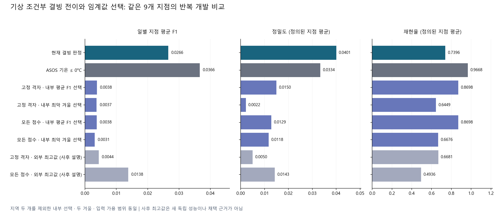

# 결빙 전이·임계값 정밀 탐색 결과

기상 조건에 따라 결빙이 시작·유지·해제되는 과정을 학습하면 새 지역의 결빙 탐지가 나아지는지 확인했습니다. **30개 모델을 학습하고 임계값 선택 방법까지 비교했지만 기존 판정을 넘지 못했습니다.** 온도 v3·결빙 v2를 유지하고, 새 결과·최신 공식 확인·읽기 안내를 제출 검토 묶음 v5에 추가합니다.

[처음 읽는 안내](../START_HERE.md) · [현재 상태](../STATUS.md) · [참고 논문·오픈소스](ICING_REFERENCES_20261025.md) · [최신 규정·마감 확인](../competition/OFFICIAL_UPDATE_20261025.md)

## 무엇을 개선하려 했는가

현재 결빙 판정은 실제 결빙을 놓치지 않도록 설계했지만 오경보가 많습니다. 기온만 0°C 이하인지 보는 기준선보다 F1이 낮습니다. 노면온도 오차가 줄어든 것만으로 결빙이 잘 잡힌다고 판단할 수 없어, 결빙 시작과 지속을 직접 학습하는 대안을 검토했습니다.

풍력 설비의 결빙 상태 연구에서는 시간에 따라 상태가 이어진다는 발상을 참고했습니다. 도로 결빙 조건 연구의 저자 코드에서는 임계값 간격에 따른 선택 차이를 확인했습니다. 도메인·입력·평가가 달라 논문의 성능을 우리 성능으로 인용하지 않았고, 저자 관측자료·코드·가중치는 가져오지 않았습니다. 직접 작성한 두 방법을 기존 자료에서 검증했습니다.

## 자료와 비교 조건

| 항목 | 이번 실험의 범위 |
| --- | --- |
| 학습에 허용된 지점 | 대회 비보호 14곳 + 비대회 9곳, 총 23곳 |
| 기간 | 2024년 11월–2025년 2월, 2025년 11월–2026년 2월 |
| 외부 개발 비교 | 비대회 9곳·4개 지역, 310,777행 |
| 공간 분리 | 평가 지역 G의 두 겨울을 학습에서 제외. 내부 선택용 지역 H도 함께 제외 |
| 결빙 정답 | 관측 상태 `04` Ice. 미정의·결측을 비결빙으로 바꾸지 않음 |
| 입력 가용성 | 현재 판정·새 후보·ASOS 기준선을 같은 가용 입력 범위에서 비교 |
| 지표 | 하루 144개 유효쌍을 기본으로 일별 F1을 계산한 뒤 지점 평균. 오경보·미탐·겨울·지점·사건도 확인 |
| 보호 정답 | 12410·33411·23402는 새 학습·임계값 선택·검산에서 읽지 않음 |
| 해석 범위 | 이미 여러 번 사용한 개발 지점의 비교. 새 독립 평가·공식 대회 점수가 아님 |

F1은 결빙 탐지의 정밀도와 재현율을 함께 보는 지표이며 높을수록 좋습니다. 실제·예측 결빙이 모두 없는 날짜와 결측일의 처리, 지점 평균의 분모는 [평가 규약](../validation/VALIDATION_PROTOCOL.md)을 따릅니다. 공식 Q&A로 아직 완전히 확정되지 않은 세부 분모가 있어 공식 점수라고 부르지 않습니다.

## 두 가지 변경을 시험한 방법

### 1. 기상 조건부 전이

학습 중에는 같은 지점의 정확히 10분 전 유효 정답을 사용해 ‘앞 시각이 비결빙일 때’와 ‘결빙일 때’의 현재 결빙 점수를 각각 학습합니다. 평가·추론에서는 실제 이전 정답을 받지 않고, 모델이 계산한 앞 시각의 점수만 전달합니다. 시간 공백·기상 결측·겨울 경계에서는 학습 양성 비율로 초기화합니다. 미래 정보나 보호 정답은 필요하지 않습니다.

열 이력 22변수, 태양 위치 등을 포함한 63변수, 지점·겨울·전이 종류의 불균형을 보정한 63변수의 세 구성을 비교했습니다. 각 구성에서 4개 단일 지역 제외와 6개 두 지역 제외를 학습해 총 30회 적합했습니다. 상태 전달 강도는 0·0.5·1로 고정했습니다. 이 구현은 기상 조건부 전이 분류기이며, HMM의 관측 방출분포·EM·Viterbi 학습을 구현한 것으로 표현하지 않습니다. 출력 점수의 확률 보정도 주장하지 않습니다.

### 2. 임계값의 모든 변화 지점 탐색

고정된 임계값 64개만 비교하면 두 값 사이의 유효한 판정이 빠질 수 있습니다. 동일한 내부 예측에서 모든 고유 점수를 정렬하고, 같은 점수를 한꺼번에 바꾸면서 일별 F1을 정확히 갱신했습니다. 36개 내부 검색에서 약 7.7만–13.8만 개의 경계값을 비교했으며 모델을 다시 학습하지 않았습니다.

‘전체 평균 F1’과 ‘성능이 낮은 겨울의 F1’ 두 목적을 각각 사용했습니다. 임계값과 구성 선택은 내부 지역 H로만 수행했고 외부 지역 G의 정답으로 고르지 않았습니다. 같은 조건의 세 가지 모형 × 상태 전달 세 가지 × 목적 두 가지 = 18행에, 구성까지 내부에서 고르는 절차 2행과 기준선 2행을 더해 탐색법별 22행, 전체 44행을 남겼습니다. **44행은 독립적인 새 모델 44개를 뜻하지 않습니다.**

실험 계획은 [전이 설정](../../config/icing_transition_20261025.json)과 [정확 탐색 설정](../../config/icing_threshold_refinement_20261025.json)에 결과 확인 전에 기록했습니다.

## 실제 결과와 채택 판단

| 비교 | 일별 지점 평균 F1 | 해석 |
| --- | ---: | --- |
| 현재 결빙 판정 | 0.026554 | 유지한 기준 |
| ASOS 기온 ≤ 0°C | 0.036601 | 동일 입력 가용 범위의 단순 기준선 |
| 고정 격자·내부 평균 F1로 선택 | 0.003835 | 새 지역에서 개선하지 못함 |
| 고정 격자·내부 최악 겨울로 선택 | 0.003714 | 새 지역에서 개선하지 못함 |
| 모든 점수·내부 평균 F1로 선택 | 0.003773 | 정밀 탐색도 개선하지 못함 |
| 모든 점수·내부 최악 겨울로 선택 | 0.003092 | 정밀 탐색도 개선하지 못함 |
| 고정 격자 후보 중 외부 최고값 | 0.004388 | 결과를 본 뒤 설명하는 값. 선택 근거로 사용하지 않음 |
| 모든 점수 후보 중 외부 최고값 | 0.013765 | 결과를 본 뒤 설명하는 값. 현재 판정보다 낮음 |



최고값을 낸 정확 탐색 후보도 기존에 잡던 사건 116개를 놓치고 6개를 새로 찾았습니다. 관측 사건 386개 중 현재 판정이 잡은 사건은 178개, 이 후보는 68개입니다. 따라서 F1만이 아니라 사건 보존 기준에도 실패합니다. 모든 후보가 채택 기준을 통과하지 못했으며 기준을 사후에 완화하지 않았습니다.

점수의 세밀한 절단 위치보다 지역 간 전이 특성 차이가 더 큰 문제라는 해석을 지지합니다. 다만 센서 오류·제설·노면 물성 중 무엇이 원인인지는 확인하지 못했습니다. 높은 재현율만 보고 후보를 채택하면 오경보 증가를 놓칠 수 있습니다. ASOS 기준선의 더 높은 F1 역시 공개하며, 정밀도·사건 손실 등을 함께 개선하지 못한 현재 결빙 모델의 한계로 남깁니다.

## 검산과 실행 근거

저장된 30개 모델을 다시 불러 전이 점수를 대조했습니다. 다른 구현으로 상태 전달 11,187,972값을 검산했고 최대 절대 차이는 `2.22e-16`이었습니다. 두 탐색법 각각 지표 66건·사건 22건·내부 선택 80건도 별도로 재계산했습니다. 파일 해시가 실제 검산 대상과 일치하는지 함께 확인했습니다.

합성 데이터 테스트는 **345개·하위 검사 7개 통과**입니다. 새 검사는 모든 임계값의 단순 전수 계산과 빠른 누적 계산의 일치, 미래값 불변성, 지점·겨울·결측 경계, 정답 입력 거부를 포함합니다. 첫 실행의 Windows 임시 폴더 접근 실패는 작업 폴더 내 임시 경로로 해결했고 실패 로그도 보존했습니다. 기존 pandas 경고 1건은 그대로 기록했습니다.

| 비공개 산출물 | 역할 |
| --- | --- |
| `outputs/private/icing_transition_20261025_v1/` | 30개 모델·고정 격자 예측·지표·선택 기록 |
| `outputs/private/icing_threshold_refinement_20261025_v1/` | 모든 점수의 임계값 선택·예측·지표 |
| `outputs/private/icing_transition_audit_20261025_v1/receipt.json` | 저장 모델·상태·지표·선택 검산 결과 |
| `outputs/private/icing_transition_comparison_20261025_v1/` | 44행 후보표·집계 그림 |
| `outputs/private/icing_transition_tests_20261025_retry1.log` | 전체 테스트 성공 로그 |

코드만 받은 경우 전체 연구 입력과 학습 가중치는 없습니다. 실제 연구는 위 비공개 자료가 있는 원 작업 공간에서 수행했습니다. 아래 명령은 각 실행 인자를 확인합니다. 완료된 출력 경로는 덮어쓰지 않으며 재실행하려면 새 출력 경로를 사용하고 설정·스크립트의 입력 경로도 대조해야 합니다.

```powershell
python scripts/evaluate_icing_transition.py --help
python scripts/refine_icing_thresholds.py --help
python scripts/audit_icing_transition.py --help
python scripts/summarize_icing_transition.py --help
```

## 문서·제출 검토 묶음과 남은 조건

처음 읽는 사람을 위해 [문제·지표·버전 안내](../START_HERE.md)를 추가했습니다. 기존 Markdown 69개를 확인하고 51개 과거 문서에는 당시 범위를 표시했습니다. 현재 상태를 가리키던 링크 30개를 현행 문서로 고쳤으며 과거 수치·기록은 유지했습니다. 루트·문서 목록·규정·실행·AI 사용 기록은 현재 판단을 먼저 읽도록 정리했습니다.

v5는 `outputs/private/submission_candidate_20261025_v5/`와 같은 이름의 ZIP입니다. v4의 온도 v3·결빙 v2 모델, 예측·CSV·8쪽 보고서·노트북·구간 탐색·실제 브라우저 조작 영상은 보존하고 이번 연구·공식 확인·최신 안내를 추가합니다. 보존·실행 검사는 `validation/icing_review_delivery.json`, ZIP 전량 해시 검사는 상위 폴더의 `.receipt.json`이 근거입니다. 미채택 연구 모델 가중치는 원 작업 공간에 보존합니다.

공식 응답 48개와 참가서약을 다시 확인했습니다. **10월 25일 현재 결과물 제출 날짜·방법은 별도 공지 예정**입니다. 11월 6일은 참가신청 종료일, 11월 25일은 소개 페이지의 시상식 날짜입니다. 새로운 데모 답변은 별도 시스템 구축 없이 모델 테스트·실행 결과와 간단한 설명이 가능하다고 안내합니다. 현재 조작 영상과 실제 모델 실행 검증은 서로 다른 증거임을 구별합니다. [원문·확인 범위](../competition/OFFICIAL_UPDATE_20261025.md)

현재의 다음 성능 개선에는 아직 사용하지 않은 적격 지역, 센서·제설·노면 물성 근거 또는 허용된 추가 기상 자료가 필요합니다. 보호 입력 부족 18행은 계속 NA입니다. 이번 방법의 실패가 모든 개선 가능성의 소진이나 입상 가능성의 확정을 뜻하지 않습니다. 대회 접수·외부 공개는 수행하지 않았으며 GitHub에는 비공개 코드·설정·집계 문서만 반영합니다.
