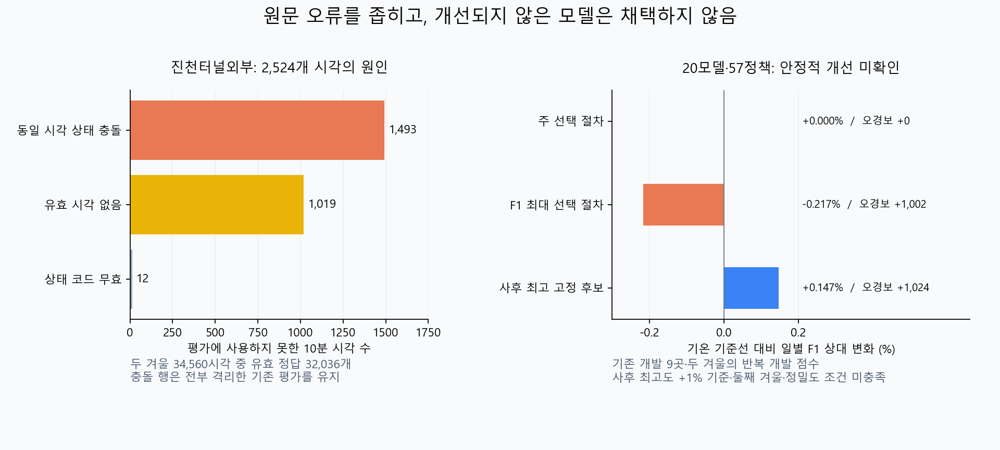

# 성암교·진천터널외부 원문 진단과 추가 결빙 탐지 실험

성암교의 좌표 불일치는 공식 PDF와 API 사이의 문제이고, 진천터널외부의 관측 부족은 API가 내보내는 결측 시각·중복 상태에서 재현됐습니다. 새로 확보한 CCTV 시설 목록은 노선과 이정을 교차 확인하는 근거입니다. 추가 모델 20개도 실험했지만 기온 기준선을 안정적으로 넘지 못해 제출 모델을 교체하지 않았습니다.

[현재 상태](../STATUS.md) · [처음 읽는 안내](../START_HERE.md) · [앞선 4지역 일회 평가](BLIND_ICING_20261025.md) · [자료 요청 초안과 수령 조건](RWIS_DATA_REQUEST_20261025.md)

## 이번에 완료한 일과 남은 한계

| 질문 | 확인한 결과 | 아직 확정할 수 없는 것 |
| --- | --- | --- |
| 성암교 좌표를 잘못 읽었는가? | 원 PDF의 12213 행 자체가 API와 다름. PDF 1·3쪽을 이미지로 렌더링해 확인 | 실제 설치 좌표·이전 이력·어느 원문이 잘못됐는지 |
| 진천터널외부의 누락이 다운로드 실패인가? | HTTP 200 단일 시각 요청에서도 `TM=0` 결측 행 반환 | 센서·수집기·전송·DB 중 어느 단계의 장애인지 |
| 상태 충돌이 로컬 병합 오류인가? | CSV·공백 구분 두 응답 모두 동일 시각에 `-999`와 `2` 반환 | 원 제공기관의 중복 생성 원인과 공식 우선순위 |
| 새 자료를 실제 받았는가? | 도로공사 CCTV 시설 CSV 2,999건 확보 | 과거 영상·노면 상태 정답·센서 정비 이력·제설 원자료는 미확보 |
| 모델을 개선했는가? | 기준선 경보를 보존하는 새 20모델·57정책·2선택 절차 평가 완료 | 안정적 성능 향상은 미확인, 새 모델 미채택 |

## 성암교: 로컬 추출 오류는 제외했지만 실측 위치는 미확정

기상청 [도로 기상 API 안내](https://apihub.kma.go.kr/apiList.do?seqApi=971&seqApiSub=293)의 관측지점 목록을 다시 내려받았습니다. 141,070바이트 PDF는 앞선 보존본과 해시가 같습니다. 원문을 이미지로 확인해 행·열을 잘못 추출한 가능성을 배제했습니다.

| 근거 | 12213 성암교 좌표 또는 위치 | 해석 |
| --- | --- | --- |
| 공식 관측지점 PDF | 위도 34.8028, 경도 126.3675 | 사전 후보 선별에 사용한 목록과 동일 |
| 두 겨울 API의 유효 시각 원문 345,528행 | 위도 34.9733, 경도 126.4961 | 전부 같은 좌표. 두 끝 시점의 소량 재요청도 동일 |
| 새 CCTV 시설 목록 | 서해안선 19.831km, 목포 방향, 성암교 | 위·경도는 없으며 RWIS 장비와 같은 지점이라는 보장은 없음 |

두 좌표의 거리는 22.29km입니다. 사전 고정한 목포 ASOS와의 거리도 PDF 기준 2.06km에서 API 기준 20.25km로 달라집니다. 과거 관측 응답에 현재의 정적 위치 메타데이터가 붙을 수 있으므로, API 좌표가 두 겨울 내내 같다는 사실로 **장비가 이전하지 않았다고 결론내리지 않습니다.** 현재 자료만으로 어느 좌표가 참인지 정하지 않았고, ASOS 연결·고정 예측·완료 평가를 수정하지 않았습니다.

CCTV 목록에는 청주영덕선 93.700km에도 성암교가 있습니다. 이름만으로 결합하면 잘못된 교량을 연결할 수 있으므로 노선번호·방향·이정·좌표 이력을 함께 받아야 합니다. 진천터널외부의 목록/API 좌표는 약 11m 차이로 성암교와 같은 큰 불일치는 없습니다.

## 진천터널외부: 부족한 2,524개 시각을 원문까지 분해

두 지점의 기존 원문 파일 489개를 해시 검증 후 다시 읽었습니다. 진천터널외부는 두 겨울 240일, 10분 격자 34,560시각이 대상입니다. 아래 범주는 서로 겹치지 않습니다.

| 원문 분류 | 첫 겨울 | 둘째 겨울 | 두 겨울 합계 |
| --- | ---: | ---: | ---: |
| 유효 정답 | 17,280 | 14,756 | 32,036 |
| 서로 다른 상태를 가진 중복 시각: 전부 격리 | 0 | 1,493 | 1,493 |
| 유효한 관측 시각 자체가 없음 | 0 | 1,019 | 1,019 |
| 시각은 있지만 상태가 무효 | 0 | 12 | 12 |
| 예정 격자 | 17,280 | 17,280 | 34,560 |

첫 겨울은 2024년 11월–2025년 2월, 둘째 겨울은 2025년 11월–2026년 2월입니다. 둘째 겨울 정답 가용률은 85.39%입니다. 1,019개 시각의 부재는 18개 날짜에 걸쳐 있고, 11월 30일·12월 1일·12월 14일·12월 15일은 하루 144개 시각이 모두 없습니다. `TM=0`인 원문 행은 총 10,169개로, 유효 시각도 결빙 음성도 아닙니다.

분 단위 상태 충돌은 14,920시각입니다. `-999`와 `2`가 함께 있는 시각 13,907개, `-999`와 `1`이 함께 있는 시각 1,013개입니다. 모든 충돌에서 다른 관측 필드는 같고 `SFS`만 다릅니다. 공식 상태 코드표의 `01`은 Dry, `02`는 Wet, `04`만 Ice입니다. 따라서 이번 충돌은 **결측과 건조·젖음의 중복**이며, Ice와 비결빙의 대립으로 부르지 않습니다. 첫 충돌은 2026-02-13 00:01, 마지막은 2026-02-24 09:00 KST이며 그 사이 전체가 연속 충돌했다는 뜻은 아닙니다.

이미 개봉한 기간·두 지점만 대상으로 8회 소량 재요청했습니다. 전부 HTTP 200이었으며 다음 현상이 재현됐습니다.

- 2025-11-30 12:00, 12-15 12:00: `TM=0`과 결측 관측값을 가진 행 반환.
- 2026-02-13 00:10: CSV와 공백 구분 모두 두 행. `SFS=-999/2`, `TR1=-1.3`이며 나머지 필드도 동일.
- 2026-02-24 08:55–09:05: 11개 고유 시각에 17행. 09:00까지 6개 충돌 시각, 이후 단일 행. 같은 날 12:00도 단일 행.

이는 현재 API 원문 단계에서 문제를 재현한 증거입니다. 센서 고장·교체·통신 단절·서버 결합 오류 가운데 하나로 단정하지 않습니다. 이미 정한 ‘동일 시각 값이 다르면 전부 격리’ 원칙을 유지했고, 지금 유효값만 고르는 방식으로 정답을 복구하거나 성능을 다시 계산하지 않았습니다.

## 자료 확보: 실제 파일과 접근 경로를 구별

| 자료 | 실제 확인·확보 | 활용과 제한 |
| --- | --- | --- |
| [도로공사 CCTV 현황, 2026-04-23](https://www.data.go.kr/data/15102134/fileData.do) | 정상 다운로드 절차에서 CAPTCHA 불필요 응답을 확인한 뒤 CSV 140,664바이트·2,999행 확보. CP949, 7열 | 노선번호·노선명·CCTV명·이정·방향·설치목적·운영상태만 있음. 소개문에 있는 모든 항목이 실제 파일에 있는 것은 아님 |
| 성암교·진천터널외부 CCTV | 서해안선 성암교 19.831km, 중부선 진천터널외부1 272.300km·외부2 274.000km | RWIS의 시각별 상태나 위·경도 자료가 아님. ‘정상’은 이 CCTV 목록의 운영상태이지 과거 RWIS 정상 작동 증거가 아님 |
| [일자별 제설작업](https://www.data.go.kr/data/15045677/fileData.do)·[도로공사 T5](https://data.ex.co.kr/portal/fdwn/view?type=ETC&num=T5&requestfrom=dataset) | 공식 설명·2024/2025년 파일 목록 재확인. 실제 다운로드에는 로그인·이용자 정보 필요 | 제설 원자료는 아직 없음. 공개 설명의 일자·노선·시종점·제설제 사용량만으로 작업 시작·종료 시각을 알 수 없음 |
| 과거 제설 OpenAPI 주소 `15012002` | 페이지 404, 공개 카탈로그 응답도 해당 자료 없음 | 검색 결과가 남아 있어도 현재 이용 가능한 API라고 소개하지 않음 |
| [도로공사 OpenAPI 안내](https://data.ex.co.kr/openapi/intro/introduce01) | 별도 인증키 발급 절차 확인. 공개 목록 페이지·JS는 열렸으나 JS의 목록 조회는 400/404 | 활성 제설 API를 확인하지 못함. KMA 키를 다른 제공기관에 전달하지 않음 |
| ROADPLUS 공개 CCTV 좌표 경로 | 이번 요청은 400 | 예전 성공 기록으로 현재 좌표를 확보했다고 주장하지 않음 |
| 센서 제조사 문서 | 특정 제조사 매뉴얼 URL은 실제 PDF 대신 HTML로 이동 | 장비 모델 미확정. 그 문서를 대상 센서의 교정·결측 규칙으로 적용하지 않음 |

CCTV 목록은 포털의 이용허락범위 제한 없음 표시와 별도로 대회 적용 범위를 검토합니다. 두 겨울이 끝난 뒤의 시설 현황이므로 이번에는 위치 문의의 보조 근거로만 사용했습니다. 학습 입력·정답·성능 평가에 사용하지 않았고 원본을 저장소에 올리지 않습니다. 센서 이력·제설 작업 시각은 [보내지 않은 구체적 자료 요청 초안](RWIS_DATA_REQUEST_20261025.md)으로 정리했습니다.

## 모델링: 기존 경보를 보존하고 양의 기온에서만 추가 탐지

앞선 후보들은 기준선이 찾던 결빙을 제거하는 문제가 있었습니다. 이번에는 ASOS 기온이 0°C 이하인 경보는 모두 유지하고, **0°C 초과 구간에서 놓친 결빙을 더 찾을 수 있는지** 실험했습니다. 자료 결측 시각은 동일하게 유지합니다.

[고정 설정](../../config/additive_icing_20261025.json)의 주요 조건은 다음과 같습니다.

1. 기존 허용 23곳의 같은 API 형식 ASOS 입력만 사용합니다. 공식 보호 3곳과 앞서 개봉한 새 4곳은 학습·전처리·후보 선택·성능 비교에서 제외합니다.
2. `0 < ASOS 기온 ≤ 4°C`의 유효 학습 행으로 로지스틱 회귀와 작은 HGB를 적합합니다. 기상 15변수를 사용하며 도로 온도·상태는 입력에 넣지 않습니다. 클래스 균형 학습 점수는 실제 결빙 확률로 해석하지 않습니다.
3. 기온 상한 4개와 점수 문턱 7개, 2모델을 조합한 56정책과 기온 기준선, 합계 57정책을 고정했습니다.
4. 개발 9곳을 네 지역으로 묶어 한 지역을 외부 평가에서 제외합니다. 그 지역을 보지 않은 모델로 나머지 3지역의 내부 검증도 만들기 위해 외부·내부 지역을 함께 제외합니다. 단일 제외 4세트·이중 제외 6세트에 2모델씩, 총 20회 학습했습니다.
5. 주 선택 절차는 내부 F1 1% 개선, 두 겨울·각 지점 F1·정밀도 비악화를 모두 요구하고 없으면 기온 기준선으로 돌아갑니다. 보조 절차는 내부 F1만 최대화합니다. 각 절차의 선택 기록을 저장한 뒤 외부 점수를 집계했습니다.

이미 여러 번 사용한 개발 지역의 반복 실험이며 새로운 독립 검증이 아닙니다. 단순 모델 수 증가를 검증 근거로 삼지 않습니다.

### 결과: 주 선택은 네 지역 모두 기준선으로 복귀

| 방법 | 일별 지점 F1 | 정밀도 | 재현율 | 추가 오경보 행 | 추가 탐지 사건 |
| --- | ---: | ---: | ---: | ---: | ---: |
| ASOS 0°C 기준선 | 0.036601 | 0.033386 | 0.966799 | 0 | 0 |
| 주 선택 절차 | 0.036601 | 0.033386 | 0.966799 | 0 | 0 |
| 내부 F1 최대 선택 절차 | 0.036522 | 0.033341 | 0.966799 | 1,002 | 0 |
| 사후 최고 고정 정책: HGB·상한 0.5°C·문턱 0.1 | 0.036655 | 0.033260 | 0.968284 | 1,024 | 2 |

F1·정밀도·재현율은 유효한 완전 날짜의 지표를 지점별로 평균합니다. 전체 행을 합친 혼동행렬로 재계산한 비율과 다릅니다. 기준선은 TP 5,870·FP 117,723·FN 817이고, 관측 결빙 386사건 중 330사건을 찾았습니다. 모든 정책이 기존 경보를 보존하므로 기존 사건 손실은 0입니다.

사후 최고 정책도 F1 상대 증가가 0.147%로 1% 기준에 못 미칩니다. 둘째 겨울 F1은 0.001444 → 0.001426, 정밀도도 낮아집니다. 추가 TP는 2행뿐이며 추가 FP는 1,024행입니다. 미리 고르는 절차의 외부 점수는 더 낮습니다. **이 고정 정책을 ‘성능 개선 모델’로 채택하지 않았습니다.** 온도 v3·결빙 v2·v5 ZIP은 유지합니다.

### 온난 구간의 양성이 특정 지점에 집중

기존 23곳에서 기온이 0°C 초과 4°C 이하인 학습 가능 결빙은 844행입니다. 이 중 780행(92.4%)이 금산 지역 33408에 집중됩니다. 해당 지역을 제외하면 64행만 남습니다. 이 현상은 새 기상 모델이 다른 지역의 양의 기온 결빙을 학습하기 어렵다는 자료상의 제한입니다. 센서 오류라고 확정하거나 해당 지점을 삭제할 근거는 아닙니다. 과거에도 해당 지점 영향이 컸으므로, 그 결과에 맞춘 추가 복잡화보다 센서 정의·제설 시각·새 독립 지역 확보를 우선합니다.

## 논문·오픈소스 참고와 적용 판단

| 공식 원문 | 이번 작업에 준 근거 | 채택 범위 |
| --- | --- | --- |
| [Li 외, GMD 2026-09-24, LSTM·stacking 노면온도](https://gmd.copernicus.org/articles/19/9035/2026/) | 노면온도 이력과 기상, 내부 예측을 이용한 결합 방법 검토 | 현장 과거 노면온도에 의존하는 온도 예측이며 현재 미관측 대상의 결빙 분류와 다름. 그 입력·외부 가중치·자료를 도입하지 않음 |
| [SURFEX-TEB 교통 영향, GMD 2025](https://gmd.copernicus.org/articles/18/9945/2025/gmd-18-9945-2025.html) | 교통·제설·서로 다른 관측 방식이 해석에 중요함 | 센서 방식과 작업 이력을 구체적으로 요청하는 근거. 우리 장비의 고장을 입증하는 논문은 아님 |
| [도시 도로 얼음·눈 과정, GMD 2025](https://gmd.copernicus.org/articles/18/3453/2025/index.html) | 물리적 상태 변화의 입력 요건 검토 | 복사·제설·물성 등 미확보 입력이 있어 이번 제출 모델에 직접 이식하지 않음 |
| [scikit-learn 임계값 조정](https://scikit-learn.org/stable/modules/classification_threshold.html)·[중첩 검증](https://scikit-learn.org/stable/auto_examples/model_selection/plot_nested_cross_validation_iris.html) | 모델 학습·문턱 선택·외부 평가의 분리 | 기존 설치 환경에서 자체 정책·지역 이중 제외 구현. 외부 데이터·사전학습 가중치 미도입 |

관련 공개 구현과 Hugging Face의 이용조건 검토는 [앞선 출처 검토](OPEN_SOURCE_REVIEW_20261024.md)와 [추가 자료 검토](ADDITIONAL_ICING_SOURCES_20261025.md)에 보존합니다. 이번에 새 외부 코드·모델을 복사하지 않았으며 논문 제목이나 공개 여부만으로 대회 사용 허용을 가정하지 않았습니다.

## 규정·검증·재현 근거

10월 25일 **21:34 KST**의 공식 48응답과 빈 참가서약 재확인에서 변경이 없었습니다. 결과물 날짜·접수 경로는 계속 별도 공지 예정입니다. 11월 6일은 참가신청 종료일이며 11월 25일은 소개 페이지의 시상식 날짜입니다. 공개 기상자료 활용 안내를 제설 행정자료·센서 이력의 포괄 허용으로 해석하지 않습니다. [공식 원문과 범위](../competition/OFFICIAL_UPDATE_20261025.md)

- 새 모델 20개를 저장 후 전량 재추론했고 전처리·가중치·학습 지역 분리를 별도 구현으로 대조했습니다. 내부 지표 2,679건·선택 8건, 최종 지표 525건·사건 59건이 일치했습니다.
- 원문 489개·240날짜·14,920충돌 시각·좌표와 CCTV 2,999행을 별도 CSV 집계로 검산했습니다. 일별 원문 분류는 이미 완료된 평가의 결측 수와 일치했습니다.
- 전체 합성 테스트 380개·하위 검사 7개 통과. 기존 pandas 미래 동작 경고 1건은 남으며 이번 실험 실패나 새 경고는 아닙니다. 비공개 원자료를 써야 하는 실제 연구 재현은 합성 테스트와 구별합니다.
- 모델 감사 초회는 별도 지표 함수에 없는 지점별 반환 키를 요청해 중단했습니다. 감사 쪽에서 지점별로 따로 계산하도록 수정한 뒤 통과했으며 학습·후보·예측·요약은 바꾸지 않았습니다. 원문 감사의 주석 수정 전 영수증도 보존하고 최종 코드로 재검산했습니다.
- 기존 47+549개 봉인·새 4지역 봉인·완료 요약·v5 ZIP을 보존했습니다. 새 4지역 요약 SHA-256은 `45ebf8f83abc25857a085b84f76b292e34400364df0058d6355156ba16571a48`로 같습니다.

| 로컬 비공개 경로 | 내용 |
| --- | --- |
| `outputs/private/rwis_anomaly_sources_20261025_v1/` | 공식 PDF·원문·다운로드 상태·해시·PDF 렌더 |
| `outputs/private/rwis_anomaly_reprobe_20261025_v1/` | 8회 진단 요청의 사전 범위·원문·응답 영수증 |
| `outputs/private/rwis_anomaly_diagnosis_20261025_v1/` | 일별 원인 분류·489개 입력 해시·요약·독립 검산 |
| `outputs/private/rwis_anomaly_additional_sources_20261025_v1/` | 실제 CCTV CSV·정상 다운로드 확인·공개 API 경로 조사 |
| `outputs/private/additive_icing_20261025_v1/` | 고정 계획·20모델·내부 선택표·전체 예측·요약·별도 감사 |
| `outputs/private/official_updates_20261025_v8/` | 21:34 공식 재확인. v7 네트워크 실패 기록과 구별 |

원문·모델·예측·ZIP·키는 GitHub에 포함하지 않습니다. 실행 방법은 [스크립트 안내](../../scripts/README.md)에 있습니다. 이번 연구가 이전에 봉인한 v5 ZIP 안에 포함된 것은 아닙니다.

## 다음 판단에 필요한 증거

성암교의 시점별 설치 좌표·노선·이정과 진천터널외부의 SFS 중복 생성 원인을 제공기관에서 확인해야 합니다. 제설 일자 합계만으로 같은 날 과거 시각에 제설이 완료됐다고 가정하지 않습니다. 실제 시작·종료·수신 시각, 장비 교정 이력, 대회 활용 조건을 받으면 [수령 조건](RWIS_DATA_REQUEST_20261025.md)에 따라 먼저 검증합니다. 새 독립 평가가 필요하면 아직 정답을 보지 않은 지역·기간을 별도로 정하고 후보·예측부터 고정해야 합니다. 이번 결과는 모든 개선 가능성을 소진했다는 뜻이 아닙니다.
