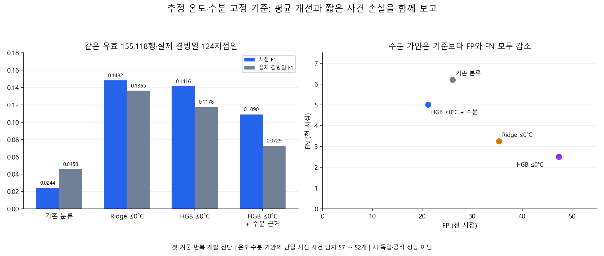

# 추정 온도·수분 결빙 가안과 완료된 다음 겨울 검증 — 2026-10-09

첫 겨울에서 추정 온도·수분 고정 기준은 기존 분류보다 FP와 FN을 함께 줄였다. 같은 정답의 F1은 0.024370→0.109033, FP 26,059→21,138, FN 6,208→5,011이었다. 그러나 단일 시점 사건과 일부 지점은 악화했고, 개선 대부분은 33408에서 나왔다. 다음 개발의 비교 기준 후보로 보존하며 최종 모델로 채택하지 않았다.

[문서 목록](../README.md) · [현재 상태](../history/PROJECT_STATUS.md) · [실행 안내](../delivery/RUNBOOK.md)

후속 [온도 교차 추정·상태 분류 비교](JOINT_SURFACE_REVIEW_20261009.md)는 완료했으며 두 새 후보는 미채택입니다. 이 문서의 온도·수분 가안은 다음 개발의 비교 기준으로 유지합니다.

별도로, 사전에 고정한 **기존 모델**의 다음 겨울 수집·일회 평가·독립 감사를 완료했다. 그 모델의 다음 겨울 F1은 0.008725였다. 새 온도·수분 가안의 다음 겨울 점수가 아니다. 외부 9개 지점 Ice가 6,611→76건, 33408은 6,340→14건으로 바뀌어 강한 겨울별 분포 차이가 확인됐다. 개발 성능을 수상·운영 성능으로 옮겨 해석하지 않는다.

> 이 문서는 같은 날 수행한 이전 개발 단계의 기록입니다. 본문의 후속 계획·미실행 표기는 당시 상태이며, 이후 보정 실험·새 지점 평가·구간 분석의 완료 여부는 [최신 연구 인계](../delivery/RESEARCH_DELIVERY_REVIEW_20261009.md)에서 확인합니다.

## 고정 물리 가안을 실제 비교한 방법

앞선 [기상 단독 온도 비교](WEATHER_FALLBACK_REVIEW_20261009.md)의 외부 그룹 제외 예측을 사용했다. 각 그룹의 HGB는 해당 그룹 전체를 학습·전처리·모델 선택에서 제외했다. 온도 모델 선택에는 다른 세 그룹의 온도 정답만 사용했다. 목표 실제 온도·상태·Ice는 물리 가안의 입력에 넣지 않았다.

세 가안을 분류 정답 집계 전에 고정했다. 첫째는 기존 Ridge의 추정 온도≤0°C, 둘째는 새 HGB의 추정 온도≤0°C, 셋째는 HGB의 추정 온도≤0°C이면서 다음 중 한 조건이 있는 경우다: 추정 노면온도≤AWS 이슬점, 이전 3시간 15분 강수 최대>0, ASOS 적설>0. 마지막 조건은 기상 기반 수분 근거이며 목표 도로의 수막이나 염도를 측정한 값이 아니다.

온도 추정이 없으면 기존 분류기로 돌아간다. 수분 가안은 세 수분 입력이 모두 결측일 때도 기존 분류기로 돌아가며 결측을 건조로 단정하지 않는다. 이번 대체 행은 모두 21개다. 전체 유효 상태 155,118행을 그대로 평가했다. 04만 양성이고 13·15 등 정의된 다른 상태는 음성, 0/-999와 미정의는 제외했다. 정답 삭제·온도에 따른 정답 변경·평활화는 하지 않았다.

0°C는 이번 고정 물리 기준이며 공식 최적 임계값이나 도로의 실제 결빙점이 아니다. 제빙제·수막·센서 차이는 이 기준이 다루지 못한다. 임계값 탐색이나 정답을 보고 지점별 기준 변경은 수행하지 않았다. 가안들의 실험 결과를 보고 논의하는 것은 반복 개발 분석이며 새로운 독립 검증이 아니다. 자동 후보 선택은 하지 않았다.

## 같은 첫 겨울 정답의 결과

| 개발 가안 | 시점 F1 | TP | FP | FN | 실제 결빙일 F1 | 무결빙일 오경보일 |
|---|---:|---:|---:|---:|---:|---:|
|기존 분류|0.024370|403|26,059|6,208|0.045809|523|
|Ridge 추정온도≤0°C|0.148235|3,359|35,350|3,252|0.136520|552|
|HGB 추정온도≤0°C|0.141580|4,108|47,312|2,503|0.117755|607|
|HGB 추정온도≤0°C + 수분 근거|0.109033|1,600|21,138|5,011|0.072892|260|

완전 관측 1,060개 지점일, 실제 결빙이 있는 124개 지점일·8개 지점을 모든 가안에서 고정했다. 실제 결빙일 F1은 날짜별 F1을 지점 안에서 평균한 뒤 지점 평균이며 공식 미확정 세부 규격을 대체하지 않는 잠정 지표다. 결빙·예측 결빙이 모두 없는 날짜의 F1은 미정의다.

온도≤0°C만으로 판정하면 F1이 더 높지만 FP와 무결빙일 오경보가 늘었다. 온도 모델의 MAE가 낮아졌다고 결빙 F1이 자동으로 높아지는 것도 아니다: HGB 단순 저온 가안의 F1은 Ridge 가안보다 낮다. 물리적 저온과 공식 상태 04를 구분해야 한다.

수분 가안은 Precision 1.523%→7.037%, Recall 6.096%→24.202%다. FP 4,921건·FN 1,197건 감소, 무결빙일 오경보 523→260일이지만 여전히 오경보 21,138건·미탐 5,011건이 남았다. 보정된 결빙 확률이나 현장 경보 정책으로 표현하지 않는다. 분류의 순위 점수 AP는 이 고정 이진 판정의 비교 지표로 추가하지 않았다.

## 지점과 사건에서 남은 손실

수분 가안의 지점 F1은 5곳 개선·3곳 악화·1곳 동일이다. 33408의 TP 139→1,338, FN 6,201→5,002, Recall 2.19%→21.10%로 개선됐지만, 여전히 이 지점 Ice의 78.9%를 놓친다. 나머지 8개 지점의 TP는 264→262건이었다. 전체 개선은 대부분 33408에서 얻었으므로 모든 지점의 탐지가 개선된 것으로 말하지 않는다.

12408은 양성 5건 중 TP 3→1·Recall 60%→20%,33207은 3건 중 TP 3→2였다. 23205는 10건 중 TP 10→9,23404는 246건 중 TP 246→243이었다. 33414는 5건 중 TP 0→5로 개선했다. 오경보는 33207·33413·33414에서 오히려 늘었다. 양성이 매우 적은 지점의 비율은 불안정하므로 건수를 함께 보고한다.

347개 사건 중 한 시점 이상 잡은 사건은 121→143개(34.87%→41.21%)였다. 연속 229개 사건은 64→91개지만 **단일 시점 118개 사건은 57→52개**로 줄었다. 이 손실을 삭제·평활화로 숨기지 않는다.

수분 가안의 오경보 상태는 Dry 7,179·Wet 4,727·Damp 3,425·Chemically wet 2,391·Snow/ice 2,539·Snow 830·Critically wet 47건이다. 기상 수분 근거가 있어도 실제 도로가 건조하거나 제빙제가 작용하거나 상태 04와 다른 노면일 수 있다. 이 구분을 위한 상태 보조 예측과 관측 체계 근거가 다음 과제다.

## 다음 겨울 기존 고정 평가를 완료했다

기존 예측 155,520행·모델·임계값·입력·소스 파일 549개을 2026-10-09 06:12:13 UTC에 고정한 뒤, 06:13:56 UTC에 수집을 시작했다. 2,160개 요청의 완료는 09:31:17 UTC, 일회 평가 완료는 09:35:10 UTC였다. 준비된 별도 감사가 09:36:33 UTC에 지점·시각·판정·점수·온도 예측의 일치, 상태 04 정의, 지표·분모·그룹/지점/관측 커버리지를 재검산했다. 보호 3개 지점은 요청하지 않았다.

| 기존 고정 모델의 2025–2026 겨울 | 결과 |
|---|---:|
|계획 예측 행|155,520|
|실제 정확 10분 관측 행|155,488|
|유효 상태 행|155,464|
|실제 Ice|76|
|TP / FP / FN|64 / 14,530 / 12|
|시점 F1|0.008725|
|Recall / Precision|84.21% / 0.4385%|
|Average Precision|0.032627|
|잠정 일별 지점 평균 F1|0.002311|
|실제 결빙일 F1|0.076506|
|무결빙일 오경보일|498|
|완전 상태 관측일 / 부분·미정의일|1,049 / 31|

기존 내부 선택에서 분류 4개 그룹 모두 기준 모델을 유지했으므로 `baseline`과 `selected`의 다음 겨울 분류 예측은 같다. F1 0.008725는 새 가안의 점수가 아니다. 이미 평가한 정답으로 새 가안의 모델·0°C 기준·수분 규칙을 바꾸거나 추가 점수를 계산하지 않았다.

고정 온도 보강 모델의 동일 154,855행 MAE는 1.48347→1.46070°C(1.54% 감소), RMSE는 2.01884→2.01624°C, BIAS는 +0.62426→+0.21470°C였다. 지점별 3곳 개선·4곳 악화·2곳 동일이며 33413은 1.01351→1.21344°C로 악화했다. 새 HGB의 MAE 1.37054°C는 첫 겨울 개발 결과이며 이 표의 모델과 다르다.

이는 외부 9개 지점의 독립 겨울 진단이며 공식 보호 3개 지점의 대회 점수가 아니다. 공식 3개 지점의 기존 평가·정답은 다시 읽거나 변경하지 않았다. 기존 고정 파일 47개와 제출 초안도 보존했다.

## 완료 정답의 분포 변화와 해석

| 같은 9개 지점 | 첫 겨울 개발 | 다음 겨울 고정 평가 |
|---|---:|---:|
|유효 상태 행|155,118|155,464|
|Ice|6,611|76|
|Ice 비율|4.2619%|0.04889%|
|실제 노면온도≤0°C 비율|34.60%|29.86%|
|33408 Ice|6,340|14|
|33408 Ice 비율|36.72%|0.0810%|
|33408 실제 온도≤0°C 비율|38.43%|33.46%|

33408의 Dry는 5,322→14,443행, Wet은 4,269→2,272행, Snow/ice는 1,090→68행이었다. 저온 비율의 변화보다 상태 04 빈도의 변화가 훨씬 크다. 그래도 기상·수분·제설·장비·판정/처리 중 원인이 무엇인지 이 집계만으로 확정할 수 없다. 실제 온도는 완료 평가의 분포 기술용으로만 사용했으며 예측 입력이나 새 선택 조건으로 넣지 않았다.

가장 시급한 확인은 33408·33409의 두 겨울 장비·판정·측정 위치·점검·제설 이력과 상태 코드 처리의 일관성이다. 공식 관리 자료를 얻지 못한 항목은 원인 미확정으로 유지한다. 다음 겨울 정답은 이후 새 모델의 학습·보정·후보 선택에 재사용하지 않는다. 새 독립 성능 평가에는 아직 정답을 열지 않은 별도 지점·기간과 예측 사전 고정이 필요하다.

## 완료 검증·산출물

고정 물리 가안의 합성 테스트 3개와 가안 4개·지점/가안 행 36개·일별 행 4,240개·사건 347개·사건 집단 44개 검산을 통과했다. 다음 겨울 감사는 고정 예측 155,520행의 정확한 일치, 분류·온도·입력 가용성, 동점 AP, 지점·그룹 보고를 재검산했다. 새 모델 적합·추가 예측·고정 평가 재실행은 수행하지 않았다. 온도 회귀의 별도 합성 테스트 4개, 학습 기록 32개, HGB 재적합 검증은 [이전 보고](WEATHER_FALLBACK_REVIEW_20261009.md)와 검증 기록에 보존했다.

- 고정 물리 가안 요약 (로컬 전용: `outputs/private/thermal_ice_diagnostics_20261009_v1/summary.json`)
- 가안 독립 검산 (로컬 전용: `outputs/private/thermal_ice_diagnostics_20261009_v1/independent_verification.json`)
- 가안 지점별 결과 (로컬 전용: `outputs/private/thermal_ice_diagnostics_20261009_v1/station_metrics.csv`)
- 비교 그림 (로컬 전용: `outputs/private/thermal_ice_diagnostics_20261009_v1/thermal_ice_rules_review.png`)
- 기존 다음 겨울 일회 평가 (로컬 전용: `outputs/private/releases/20261007/outputs/private/external_reserved_assessment_v1/summary.json`)
- 다음 겨울 독립 감사 (로컬 전용: `outputs/private/releases/20261007/outputs/private/external_reserved_result_audit_v1/summary.json`)
- 두 겨울 분포 진단 (로컬 전용: `outputs/private/completed_reserved_shift_20261009_v1/summary.json`)

이번 결과는 개발 가안의 가능성과 기존 모델의 일반화 한계를 함께 보여준다. 당시 다음 단계는 추정 온도·수분·12/13/15 보조 예측을 그룹 제외 OOF로 결합하고 짧은 사건·오경보를 함께 보는 분류 가안이었다. 센서·제설 근거와 새 독립 검증 없이 현재 모델을 최종 위험 지도·제출 모델로 채택하지 않는다. 공식 04 규칙과 일별 집계의 미확정 사항은 [공식 검토](../competition/OFFICIAL_TABS_REVIEW_20261007.md)를 따른다.

## 집계 결과 그림

