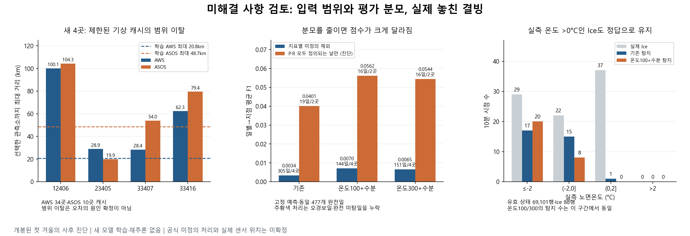

# 미해결 사항의 위치와 평가 분모 및 입력 범위 검토

> **읽는 범위:** 아래 내용은 해당 문서의 작성·실험 시점 기록입니다. 현재 모델·마감·완료 상태는 [진행 현황](../STATUS.md)을 기준으로 읽고, 약어와 지표는 [처음 읽는 안내](../START_HERE.md)에서 확인합니다.

2026년 10월 10일 기준으로 **좌표 대조와 평가 집계의 검산을 완료했고, 새 지점에서 기상 입력 거리가 학습 범위를 벗어나는 문제를 확인했습니다.** 센서 설치 이력·공식 미정의 지표 정책·공식 이정과 시설 경계는 아직 확보해야 합니다. 이번 결과는 이미 개봉한 첫 겨울 자료의 원인 진단이며 새로운 독립 성능 평가가 아닙니다. 기존 모델 채택 보류 판단을 유지합니다.

[현재 상태](../STATUS.md) · [앞선 봉인 평가](AWARD_READINESS_REVIEW_20261010.md) · [실행 안내](../delivery/RUNBOOK.md) · [문헌 목록](REFERENCES.md)

## 미해결 사항별 판단

| 순서 | 검토한 문제 | 이번 증거 | 현재 판단 |
| --- | --- | --- | --- |
| 1 | 위치 차이와 센서 이력 | 개봉 외부 21곳·362,617행 좌표 대조. 한 곳만 709.6m 차이. MTMS 승인 구조 확인 | 위치 차이의 범위 확인 완료. 실제 이설·교정 이력은 기관 자료 필요 |
| 2 | 부분 날짜와 미정의 지표 | 고정 판정 8개·관측일 4조건·미정의 3정책, 총 96개 집계 별도 검산 | 처리 차이의 영향 확인 완료. 공식 정책은 Q&A 633 답변 필요 |
| 3 | 새 지점 온도·결빙 실패 | 학습 입력 14개 범위·새 4곳 비교. 위치 변경 입력 비교와 온도별 탐지 분석 | 제한된 기상망과 지점 편차로 후속 가설을 좁힘. 원인 확정·승격은 아님 |
| 4 | 지도와 현장 효과 | 두 겨울의 같은 843개 구간 거리 점검·별도 표 생성 | 먼 관측소 문제를 전북 지도 전체에 일반화하지 않음. 이정·시설·효과 검증은 남음 |

공식 문제·자료 설명·공지·서약과 Q&A6건은 앞선 저장본과 본문 해시가 같습니다. 게시판에는 기존 6개 글이 있고 633번은 미답변, 나머지 5개는 완료로 표시됩니다. 게시판 페이지 해시는 달라졌지만 조회 수도 바뀔 수 있으므로 새 규정의 증거로 사용하지 않습니다. [공식 게시판](https://aida.kisti.re.kr/competition/problem/PROB_000000000004604/detail/commuBoard.do)

## 센서 위치와 이력

외부 개발 9곳·앞선 평가 8곳·이번 평가 4곳을 합친 21곳에서 각 지점의 유효 응답 좌표 쌍은 하나였습니다. 마달터널 33407의 정적 목록 `(36.2266, 127.4836)`과 응답 `(36.2208, 127.4869)`는 **709.622485m**, 나머지 20곳은 **0–14.360304m** 차이입니다. 20m 비교 허용치는 좌표의 작은 차이를 검토하기 위한 자체 기준이며 실제 설치 위치를 인증하지 않습니다. 첫 겨울 전후의 이설 여부도 이 자료만으로 판단할 수 없습니다.

새 4곳 모두 응답 좌표만 적용해 입력을 별도 재구축했습니다. AWS 후보·실제 선택 지점, ASOS, 주변 RWIS와 수분 참조 지점은 바뀌지 않았고 날씨 14 중 거리 변수만 달라졌습니다. 33407의 AWS 거리 변화는 최대 **0.590094km**, ASOS는 **0.327822km**였습니다. 봉인 입력·좌표·모델·예측·정답은 보존했고 새 모델 추론은 하지 않았습니다. 거리 변화의 모델 출력 영향과 실제 위치는 별개의 확인 사항입니다.

[기상청 2024.10 관측지침](https://data.kma.go.kr/resources/images/publication/%EC%A7%80%EC%83%81%EA%B8%B0%EC%83%81%EA%B4%80%EC%B8%A1%EC%A7%80%EC%B9%A8.pdf)은 측정 위치·차로·환경 변화와 센서 점검을 다룹니다. [FHWA ESS 메타데이터 지침](https://ops.fhwa.dot.gov/publications/ess05/ess0505.htm)도 위치·주변 노출·점검 및 변경 이력의 기록을 요구합니다. 두 문헌이 이번 위치 차이의 원인을 확인한 것은 아닙니다.

[MTMS 가입 화면](https://mtms.kma.go.kr/registUser.do)은 소속기관·업체 선택, 업무 구분과 관리자 승인을 요구합니다. 공개 화면으로는 실제 지점 대장을 열람하지 못했습니다. [도로기상 API 설명](https://apihub.kma.go.kr/apiList.do?seqApi=971&seqApiSub=293)의 관측 응답·정적 지점 목록도 설치·교정 이력과 구별해야 합니다. 기관 확인에 필요한 자료는 다음과 같으며 외부 문의는 발송하지 않았습니다.

- **33407:** 두 좌표 각각의 적용 기간, 주소·차로·방향·공식 이정, 설치·이설·측정 영역 변경일.
- **33408:** 두 겨울 사이 센서 교체·펌웨어·상태 코드 처리·교정·청소·장애와 정상화 기록.
- **공통:** 실제 장비 모델·측정 방식, 온도/상태 측정 위치의 대응, 제빙제 종류·작업 시각·살포량과 점검 결과.

## 일별 평가 분모의 민감도

같은 예측을 유지하고 유효 상태 시점의 최소 개수를 **1·72·130·144개/일**로 바꿨습니다. 실제 결빙과 예측 결빙이 모두 0인 날짜는 모든 변형에서 제외합니다. 나머지는 지표별 미정의 제외, 미정의 0 채움, P·R이 모두 정의되는 날만 남김으로 구분했습니다. 날짜→지점 순서로 평균을 계산하고 정의되는 지점만의 평균과 미정의 지점을 0으로 놓은 고정 지점 평균을 각각 저장했습니다.

F1은 `2TP / (2TP + FP + FN)`으로 직접 계산합니다. 실제 결빙을 전부 놓친 날은 P가 미정의여도 F1은 0입니다. 오경보만 있는 날도 R이 미정의여도 F1은 0입니다. P·R이 모두 정의되는 날만 남기면 두 종류의 실패일이 빠집니다. [scikit-learn 1.6.1 F1 정의](https://scikit-learn.org/1.6/modules/generated/sklearn.metrics.f1_score.html)

새 4곳의 **완전일 477개·실제 Ice일 21개**에서의 비교입니다.

| 고정 판정 | 지표별 제외 F1 / 정의일 / 지점 | P·R 모두 정의되는 날의 F1 / 일 / 지점 | 뒤 처리에서 빠지는 날짜 |
| --- | --- | --- | --- |
| 기존 Ice | 0.003380 / 305 / 4 | 0.040126 / 19 / 2 | 오경보만 284일 + 전부 놓친 Ice 2일 |
| 온도 100+수분 | 0.007018 / 144 / 4 | 0.056169 / 16 / 2 | 오경보만 123일 + 전부 놓친 Ice 5일 |
| 온도 300+수분 | 0.006530 / 151 / 4 | 0.054369 / 16 / 2 | 오경보만 130일 + 전부 놓친 Ice 5일 |

**뒤 처리의 큰 점수를 성능 개선으로 보고하지 않습니다.** 개발 9곳에서도 기존 F1 0.008073→0.050115, 일별 우선 정책 0.003944→0.052658로 정책 순서까지 뒤집힙니다. 공식 규격 확인 전에 큰 숫자를 기준으로 후보를 고르면 실패일 누락의 영향을 받습니다.

지표별 제외와 미정의 0 채움의 F1은 같지만 P·R은 다릅니다. 새 4곳의 기존 모델에서 일별 지점 평균 R은 **0.506410→0.051639**, 집계 날짜는 **21→305일**입니다. 서로 다른 분모의 P·R 평균으로 F1을 다시 계산하지 않습니다.

유효 시점 1개 이상과 144개 완전일을 비교하면 개발 9곳의 기존 F1은 **0.007975→0.008073**, 앞선 8곳은 **0.001486→0.001489**, 이번 4곳은 반올림 6자리에서 **0.003380→0.003380**입니다. 이번 표본에서는 P·R 교집합 처리가 더 큰 차이를 만들었지만 다른 자료에도 같다는 보장은 없습니다. [Q&A 633](https://aida.kisti.re.kr/competition/problem/PROB_000000000004604/detail/commuDetail.do?bbsId=BBSMSTR_000000000319&nttId=633)의 답변 전까지 기존 잠정 지표를 유지합니다.

## 기상 입력 범위와 탐지 실패

봉인 회귀 모델의 학습 행은 **397,126개·23개 지점**입니다. 입력 캐시는 대회 배포 자료의 **AWS 34곳·ASOS 10곳**으로 제한돼 있으며 전국의 가장 가까운 모든 관측소를 사용하는 구성이 아닙니다. 학습 AWS 거리는 **3.955939–20.817856km**, ASOS는 **3.517680–48.673373km**입니다. 범위와 1/99백분위는 학습 입력에서만 계산했습니다.

| 새 지점 | AWS 실제 입력 거리 km | ASOS 거리 km | 온도 100 예측−실측 평균 °C |
| --- | --- | --- | --- |
| 12406 서해시점 | 100.084 | 104.259 | −0.586884 |
| 23405 녹진 | 21.935–28.896 | 19.927 | −1.930044 |
| 33407 마달터널 | 28.368 | 53.992 | +1.088757 |
| 33416 두문 | 62.308 | 79.430 | −1.285163 |

네 곳 모두 유효 AWS 거리 입력이 학습 최대값보다 큽니다. 23405는 초과 폭이 비교적 작고, 세 곳의 온도 편차는 음수지만 33407은 양수입니다. **먼 관측소가 실패의 유일한 원인이라고 결론 내릴 수 없습니다.** 지역·그늘·포장·구조물·센서와 처리 이력도 확인해야 합니다. 14개 입력 중 하나라도 결측인 비율은 각각 0.382%·0.069%·0.752%·0.046%입니다. 범위 이탈·결측을 안전 상태로 치환하지 않습니다.

[Meyer·Pebesma의 공간 적용 범위 연구](https://arxiv.org/abs/2005.07939)는 학습 조건과 다른 공간에서의 예측 한계를 다룹니다. 이번 개별 변수의 min/max·백분위 비교는 논문의 다변량 AOA 구현이 아니며 범위 안이라는 이유로 정확도를 보장하지 않습니다. [Barber 등의 비교환 자료 conformal 연구](https://arxiv.org/abs/2202.13415)는 시간·공간 조건 변화에서 불확실성 보장에도 별도 가정이 필요함을 보여줍니다. 현재 모델 민감도 범위에 90% 신뢰도 같은 수치를 붙이지 않습니다.

Ice 88행 중 실측 온도 `(0,2]°C`는 37행이며 기존은 1행, 온도 100/300+수분은 0행을 탐지했습니다. 특히 12406의 해당 34행은 세 판정 모두 놓쳤습니다. 33407의 실측 `(-2,0]°C` Ice 11행은 기존 9행→보정 2행으로 줄었고 `≤−2°C` Ice 24행은 12→15행으로 늘었습니다. 결빙점 근처의 손실이 더 낮은 온도의 이득을 상쇄합니다. 양의 온도 정답도 유지하며 센서 오류로 단정하지 않습니다.

[Li 등의 ILES 연구](https://gmd.copernicus.org/articles/19/9035/2026/)는 2026년 9월 24일 발표됐습니다. 과거 대상 노면온도를 입력으로 쓰고 추가 두 지점에서도 각 지점 자료로 별도 학습합니다(3.5·4.4절). 무관측 지점의 기상 입력으로 공간 이전하는 현재 과제에 해당 성능 수치를 가져올 수 없습니다. 계절 단위 검증·시간 누수 차단·기상 체계별 오차 분석을 참고하며 대상 과거 온도를 새 입력으로 넣는 방식은 제외합니다.

## 전북 지도와 현장 검증

기존 두 겨울 각각의 500m **843개 구간**은 AWS 최대 거리와 ASOS 거리 모두 학습 최대값을 넘지 않았습니다. 최대 AWS 거리는 **16.892km**, ASOS는 **41.126km**입니다. 새 4곳의 먼 관측소 문제를 전북 지도 전체의 동일한 문제로 일반화하지 않습니다.

학습 최소 거리보다 가까운 요약은 AWS 83개·ASOS 73개·합집합 156개 구간에서 나타났습니다. 가까운 관측소라는 사실이 위험하다는 뜻은 아닙니다. 거리 변수도 학습 범위 밖에 놓일 수 있으므로 후속 검증에서 별도로 점검합니다. 구간별 AWS 최대값만으로 모든 시점의 거리 범위나 14개 입력 전체를 인증하지 않습니다.

공식 이정 검증과 실제 시설 범위 검증은 각각 **0/843개**입니다. 기존 419.637km는 양 방향 후보 선형 유지 길이이며 검증된 위험 구간 총연장이 아닙니다. 두 겨울 거리 확인표를 별도 CSV로 남겼고 기존 GIS·HTML·제출 초안을 보존했습니다. [구간 산출물의 정의](SEGMENT_EXPOSURE_REVIEW_20261009.md)

현장 효과는 독립 마찰·노면 관측, 제빙 작업과 통행 조건을 같은 방향·구간·시간에 연결해야 평가할 수 있습니다. [2024 MDSS 평가](https://rosap.ntl.bts.gov/view/dot/81833)와 [2026 MRWIS 운영 연구](https://rosap.ntl.bts.gov/view/dot/92061)의 비교 기록·교정·운영 절차를 검증 설계에 사용하며 해외 절감률을 국내 결과로 보고하지 않습니다.

## 후속 실행 조건과 검증 기록

다음 개발 비교는 첫 겨울 개발군 안에서 **기상망 확장과 거리 변수 제거를 각각 분리한 최소 비교**로 설계합니다. 확장 관측소는 공식 좌표·가용 기간·관측 시각·권한을 확인하고 공간 그룹마다 참조 선택도 분리해야 합니다. 둘을 동시에 바꾸거나 개봉 4곳을 채택 기준으로 사용하지 않습니다. 새 독립 평가에는 위치·입력 범위를 확인한 미개봉 대상, 고정 후보·참조 정책, 정답 요청 전 예측 봉인이 필요합니다. 이번 추가 검토에서는 새 학습·모델 재추론·채택을 수행하지 않았습니다.

전체 합성 테스트 **167개**가 통과했습니다. 별도 날짜 루프가 96개 집계, 독립 구면 거리 계산이 21곳, 별도 배열 계산이 학습 14개 변수 범위와 새 4곳의 56개 변수별 지원 표를 검산했습니다. 보호 47개·외부 549개 고정 파일, 두 평가 봉인과 입력 파일 4,363개의 해시를 보존했습니다.

비공개 원문 19개와 출처·시각·해시는 `outputs/private/unresolved_review_20261010_v1/source_manifest.json`에 있습니다. `analysis/`에는 계획·좌표·96개 지표·입력 범위·위치 입력 변화·실패 분석·해시를, `verification/`에는 별도 검산과 두 겨울 지도 거리 확인표를 보존했습니다. 원시 자료·관측 행·모델·키를 공유 문서에 포함하지 않습니다.
