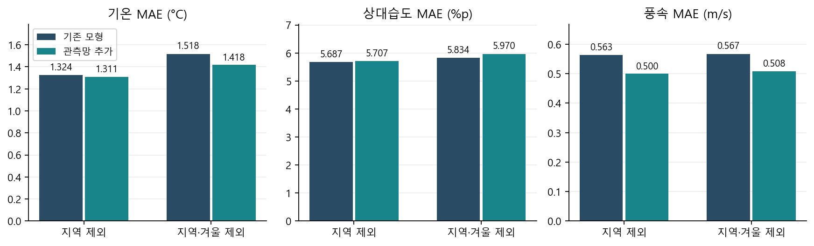
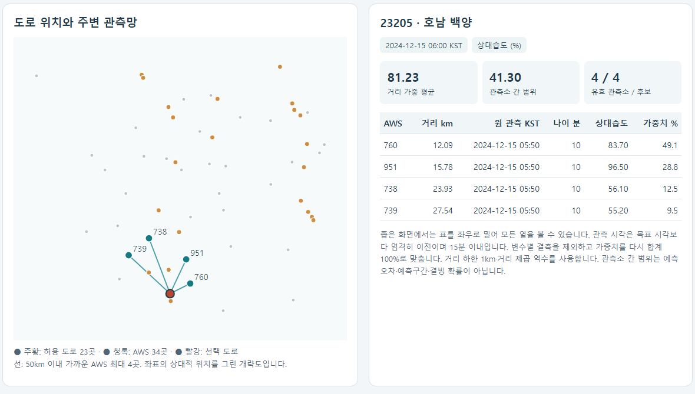

# AWS 관측망 정보의 통제 비교와 입력 점검

2026-11-01. 풍속 MAE를 지역 제외0.563455→0.499955m/s(11.27% 추가 감소), 지역·겨울 동시 제외0.567465→0.508379m/s(10.41%)로 개선했습니다. 별도 실행·전체 재학습을 검증했으며 기존 기온·습도·노면온도·결빙과843구간 지도는 보존합니다.

## 13. 주변 AWS 관측망으로 풍속 추정을 추가 개선했다

최근접 관측소에 의존하는 입력에 새로운 공간 정보를 추가했다. 50km 안 가까운 AWS 최대 4곳의 엄격한 과거 15분 관측을 거리 제곱 역수로 결합했다. 기온·습도·풍속·15분 강수·이슬점 각각의 평균·표준편차·범위·현재 AWS와 차이·개수·가중 거리·유효 개수, 총 35특성을 더했다. 미터 단위가 불명확한 대회 DEM을 역정규화하거나 관측 높이·일정한 고도감률을 가정하지 않았다.

openAMUNDSEN [1]의 거리 가중 보간과 결측 처리, 시간별 복합지형 보간 [2], 2026년 일기온 잔차 보간 [3]을 대조했다. 원 연구의 고도 추세·공분산 모형·성능 수치를 가져오지 않았다. 공개 구현 [4]은 읽기만 했고 실행하거나 모델·자료를 가져오지 않았다.

기온·풍속 34특성, 현재 습도 82특성에 각각 35개를 추가했다. 모형 설정·평가 분모는 유지했다. 3목표×(지역 4회+지역·겨울 8회)=36개를 적합했고, 현재 저장 모형과 단순 IDW를 같은 행에서 비교했다.

| 대상·검증 | 기존 MAE | 관측망 MAE | 판단 |
| --- | ---: | ---: | --- |
| 기온·지역 (°C) | 1.323764 | 1.310500 | 미채택 |
| 기온·지역+겨울 (°C) | 1.517731 | 1.417596 | 미채택 |
| 상대습도·지역 (%p) | 5.686973 | 5.707344 | 미채택 |
| 상대습도·지역+겨울 (%p) | 5.834129 | 5.969507 | 미채택 |
| 풍속·지역 (m/s) | 0.563455 | 0.499955 | 채택 |
| 풍속·지역+겨울 (m/s) | 0.567465 | 0.508379 | 채택 |

목표별 두 검증 모두 전체 2% 이상 개선, 각 겨울 비악화, 각 지역 악화 10% 이내, 저온 비악화, 날짜 블록 차이 상한 0 미만을 요구했다. 풍속만 두 검증의 모든 조건을 통과했다. 지역 MAE는11.27%, 지역·겨울은10.41% 추가 감소했다. 기온·습도는 유지한다. 같은 개발 지역의 반복 비교이며 새로운 독립 평가나 공식 성적이 아니다.

## 14. 입력의 출처·지연·결측을 도로별로 검토한다

도로 23곳과 AWS 34곳의 연결을 보는 별도 오프라인 화면을 추가했다. 두 겨울에서 고정한 16예시 시각과 5변수를 선택하면 원 관측 시각·거리·관측 나이·변수별 유효 가중치가 표시된다. 실제 도로 기상·노면온도·결빙 정답은 포함하지 않았다.

전체 입력 달력의 두 겨울 평균 유효 관측소 수·유효 개수·가중 거리·관측소 범위를 도로별로 확인하고, 선택 원천·전체 품질 CSV를 내려받는다. 화면의 16예시를 전체 시계열 검증으로 확대하지 않는다. 기존 843구간·240일 기상 탐색과 함께 사용한다.

별도 merge_asof로 공간 입력 27,809,075개 값을 재계산했고, 저장 예측 1,650,312개·지표 1,464건과 대표 6모형의 정확한 재학습을 확인했다. 화면은 1,472원천행·12,880표시값·1,840선택조합·실제 SVG선택·4행 CSV·390px 모바일을 검증했다. 외부 요청과 JavaScript 오류는 0이다.

새 풍속은 허용13기상 지점의 두 겨울 전체로 학습한 독립 실행 묶음이다. 별도 위치에서 API·실제 CLI·전체 재학습의432행 일치를 확인했다. 전체 과거와 예제 원천 문맥도 정확히 같다. 기존843구간 풍속 지도는 앞선 모형 결과로 보존하며 이 새 모형 적용 지도로 표시하지 않는다. 기존 기온·습도·노면온도·결빙은 바꾸지 않는다.

대회 자산 없는 저장소 사본의 실행 검사와 Git 이력1,120개 파일 내용의 실제 키·토큰 검사를 수행했다. 키 검출은0이었다. 이는 데이터 없는 학습 전체 재현을 뜻하지 않는다. 원자료·모형·예측·신청서·인증정보는 비공개 GitHub에도 올리지 않는다.

참고: [1] [openAMUNDSEN v1.0](https://gmd.copernicus.org/articles/17/6775/2024/) 및 [공식 처리 문서](https://doc.openamundsen.org/des/meteo). [2] [Frey & Frei (2025), 시간별 기온 보간](https://rmets.onlinelibrary.wiley.com/doi/full/10.1002/joc.8796). [3] [Zhejiang 일기온 잔차 보간 (2026)](https://link.springer.com/article/10.1007/s00704-026-06521-3). [4] [공개 코드 고정 버전](https://github.com/openamundsen/openamundsen/blob/fb65b34ca24829ceaa3ea7e7930535c129461048/openamundsen/interpolation.py), MIT.
