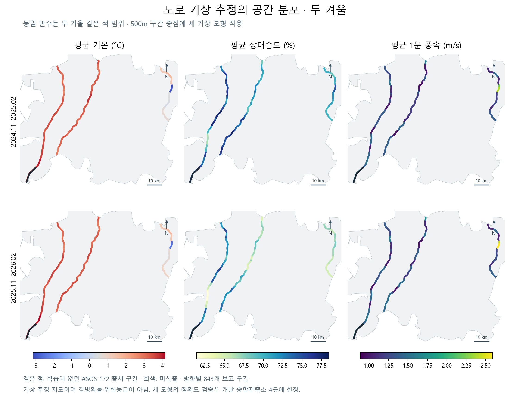

# 500m 구간의 기온·습도·풍속 추정 · 2026-10-31

기상 추정의 지역 제외 검증·단순 학습 기준선 비교를 통과한 세 모형을 방향별 843개 500m 구간 중점에 적용했습니다. 기존 노면온도 v3·결빙 v2·저온 수분 조건 노출·위험 기준은 변경하지 않았습니다. [모형 성능과 한계](ROAD_WEATHER_TRANSFER_20261031.md) · [재학습·추론 방법](../delivery/WEATHER_SUPPLEMENT_20261031.md)

## 계산 범위와 출처

2024.11.01–2025.02.28과 2025.11.01–2026.02.28의 각 120일을 10분 간격으로 계산했습니다. 29,134,080행의 구간 추론, 202,320행의 일별 요약, 1,686행의 구간·겨울 통계입니다. 도로 중점은 EPSG:5179 도형에서 구했고, 위경도로 변환해 기상 연결과 태양 위치를 계산했습니다. 500m 분할 수는 독립 기상 관측의 수가 아닙니다.

대회 제공 ASOS·AWS 기상에 공개 ASOS의 바람·이슬점·현지 기압·시정·3시간 신적설·5cm 지중온도를 연결했습니다. ASOS는 목표 시각보다 엄격히 이른 60분 이내, AWS는 15분 이내 자료만 모형에 사용합니다. 미래 보간·누락 강수의 0 대체·도로 정답의 입력 사용은 없습니다. 가까운 ASOS와 가까운 AWS 세 후보의 조합은 68개입니다.

동일 입력 구축기를 허용 23곳에 적용한 22,247,260개 원 입력 값을 기존 학습 입력과 대조했고 최대 차이는 0이었습니다. 기존 공개 기상 6곳에 도로 공간 적용에서 필요한 ASOS 172의 5,762시간을 추가했습니다. 10개 요청의 응답과 원문·파일 해시는 비공개 입력 기록에 보존했고 인증키는 산출물에 남기지 않았습니다. 보호 도로 관측 정답을 요청한 작업이 아닙니다.

## 새 출처와 입력 범위 표시

50구간은 도로 기상 학습에 등장하지 않은 ASOS 172 출처입니다. `new_asos_source_domain`과 지도 검은 점으로 표시했습니다. 학습의 28개 원 입력 중 유한값이 전체 학습 최솟값·최댓값을 벗어나면 `outside_training_input_range`를 기록합니다. 범위 이탈률은 새 출처 여부와 다른 개념입니다. 이 표시는 예측오차 추정·통계적 신뢰구간·결빙확률이 아닙니다. 원 입력 범위 안이라고 정확도가 보장되는 것도 아닙니다.

## 두 겨울의 공간 분포

노선별 수치는 방향별 구간 길이로 가중한 겨울 평균입니다. 같은 변수에 대해 두 겨울을 동일한 색 범위로 표시했습니다. 바람은 도로 장비의 1분 풍속 목표를 추정한 것이며 관측 높이를 임의로 통일하지 않았습니다.

| 겨울 | 노선 | 기온 °C | 상대습도 % | 풍속 m/s | 입력 범위 이탈 |
| --- | --- | ---: | ---: | ---: | ---: |
| 2024/25 | 서해안고속국도 | 3.429 | 73.696 | 1.316 | 22.49% |
| 2024/25 | 통영-대전고속국도 | 0.449 | 70.779 | 1.365 | 8.73% |
| 2024/25 | 호남고속국도 | 3.246 | 72.773 | 1.214 | 21.76% |
| 2025/26 | 서해안고속국도 | 3.525 | 70.971 | 1.336 | 22.50% |
| 2025/26 | 통영-대전고속국도 | 0.661 | 66.343 | 1.402 | 8.77% |
| 2025/26 | 호남고속국도 | 3.275 | 68.699 | 1.286 | 28.40% |

길이 가중 유효 시간 비율은 기온 99.901%, 습도 99.812%, 풍속 99.785%입니다. 각 일별 평균과 함께 목표마다 유효한 10분 수를 제공하므로 결측 일자를 전체 관측 일자로 처리하지 않습니다. 겨울 요약에는 평균·10/50/90백분위와 세 변수 사이의 Pearson 상관·공통 유효 수가 있습니다. 이 상관은 추정값끼리의 기술통계로 실제 결빙 인과효과가 아닙니다.

## 검산과 기존 결과 보존

독립 검사 코드에서 도형 중점 843개·기상 출처 선택 1,686건을 확인했습니다. 전체 29,134,080행의 시간축·해시·일별 및 겨울별 요약을 검산하고, 노선·방향별 처음·중간·끝과 새 출처의 고정 대표 19구간에서 세 모형 1,969,920값을 재추론했습니다. 집계 검사 수는 1,451,646개입니다. GeoPackage 두 레이어의 도형도 원본과 대조했습니다.

기존 v8의 노면온도 평균·저온 수분 노출·기상 입력 묶음 식별자를 구간·겨울 1,686행에서 정확히 보존했습니다. 과거 완료 평가의 보호 봉인 47+549개와 개봉 평가 봉인을 유지했습니다. 이 실행 검산은 도로 전 구간의 실제 정확도를 검증한 새 독립 평가가 아닙니다.

## 파일과 재현

비공개 원 결과: `outputs/private/weather_segment_projection_20261031_v1/`. `weather_segments_500m.csv`는 겨울 통계, `weather_segment_daily.csv.gz`는 일별 평균·유효 수, `weather_and_preserved_road_estimates.csv`는 기존 노면온도·조건 노출 연결, `weather_segments.gpkg`는 `winter_2024`·`winter_2025` 레이어입니다. `points/`에는 구간별 10분 Parquet와 출처·해시가 있습니다.

제출 ZIP에는 요약 CSV·일별 gzip CSV·GIS·검산 기록을 넣고 29,134,080행의 전체 구간 캐시는 용량 때문에 제외합니다. 기상 검증 4곳의 10분 예측은 별도로 포함합니다. `scripts/project_weather_segments.py`와 `scripts/audit_weather_segments.py`는 원 비공개 입력과 고정 설정을 사용합니다. 전체 구간 입력 재구축과 달리, 최종 세 모형의 재학습·예제 추론은 별도 보완 묶음 안의 자료만으로 확인했습니다.
