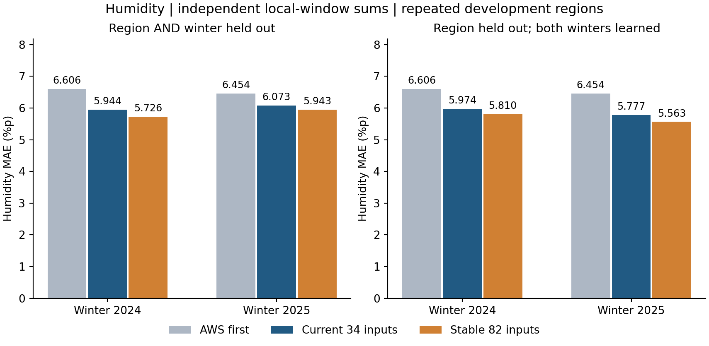

# 습도 이력의 공간·겨울 검증과 수치 안정성

2026-11-01. **습도만 과거 기상 이력 모형으로 고도화했습니다.** 지역 제외 MAE는 5.875898→5.686973%p로 3.22%, 지역·겨울 동시 제외에서는 6.008156→5.834129%p로 2.90% 감소했습니다. 기존 기온·풍속·노면온도·결빙 모형과 보호 평가를 보존합니다. 반복 사용한 개발 자료의 결과로 공식 성적이나 새로운 독립 표본이 아닙니다.

[최신 통합 원고](../delivery/ANALYSIS_REPORT_V10_20261101.md) · [새 습도 실행 묶음](../delivery/HUMIDITY_HISTORY_20261101.md) · [v10 검토 안내](../delivery/REVIEW_BUNDLE_V10_20261101.md)

## 검토 결과와 우선순위

기존 프로젝트는 노면온도 MAE 1.145698°C, 세 기상값의 지역 추정, 두 겨울 지도·공식 취약구간 비교·재현 묶음을 확보했습니다. 반면 결빙 F1 0.026554는 ASOS 기온 기준선 0.036601보다 낮고, 여러 손실·재분석·누적 조건 실험이 이 한계를 해결하지 못했습니다. 같은 임계값을 더 탐색하는 대신 채택 기상 모형의 겨울 전이를 점검하고 실제 정보가 추가되는 기상 이력을 통제 비교했습니다.

첫 비교는 3목표×4지역×2겨울×2입력의 48적합입니다. 평가 지역의 두 겨울과 평가 겨울의 모든 지역을 학습에서 제외했습니다. 이력은 습도에서만 사전 기준을 통과했습니다. 기온·습도는 대회와 같은 두 겨울 지역 제외 조건으로 각각 4모형을 추가했습니다. 기온의 평균 개선은 약 0.37%이고 첫 겨울이 악화해 채택하지 않았습니다. 풍속 이력은 지역·겨울 동시 제외에서 악화해 추가 고도화 대상으로 선택하지 않았습니다.

## 자료와 입력

기상 목표는 허용 23지점 중 실제 기온·습도·풍속이 있는 13곳입니다. 개발 평가의 기상 종합관측소는 백양·서천·금산·서상의 4곳이며 습도 공통 유효 쌍은 137,450개입니다. 노면 상태만 있는 나머지 개발 지점을 습도 평가 표본으로 부풀리지 않았습니다. 보호 12410·33411·23402와 이미 평가한 별도 33402·33406·12213·23411의 새 정답은 읽지 않았습니다.

기존 ASOS·AWS·시간·거리·태양 위치 34특성에 ASOS 기온·지면온도·습도·풍속·일사와 AWS 기온·습도·풍속의 과거 평균·현재 대비 차이·가용 비율을 더했습니다. 8변수×2창×3통계=48개가 추가되어 총 82특성입니다. 창은 `(t-3h,t]`, `(t-24h,t]`이며 원 기상도 이미 목표보다 엄격히 과거인 ASOS 60분·AWS 15분 이내 입력입니다. 유효 입력이 각각 6·48행 이상일 때 평균을 제공하고 결측을 0으로 채우지 않습니다.

목표 도로의 과거 실제 습도·노면온도·Ice, 지점 번호·연도는 특성에 넣지 않습니다. 지점·겨울은 이력 분리·분할·역빈도 가중치에만 사용합니다. HGB 절대오차 손실·300회·15잎·최소 200행·L2 10·학습률 0.05·시드 20261031은 기존 모형과 같습니다.

## 최종 결과

| 검증 | 기존 MAE (%p) | 최종 MAE (%p) | 감소 |
| --- | ---: | ---: | ---: |
| 두 겨울 지역 전체 제외 | 5.875898 | 5.686973 | 3.22% |
| 지역·겨울 동시 제외 | 6.008156 | 5.834129 | 2.90% |
| 지역 제외·ASOS 기온 ±3°C | 5.841444 | 5.610078 | 3.96% |

지역 제외 RMSE는 7.950451→7.747100%p, BIAS는 +2.446025→+2.061275%p, R²는 0.841654→0.849650입니다. AWS 우선의 MAE 6.530284%p 대비 감소율은 기존 10.02%에서 12.91%가 됐습니다. 전체 MAE는 공통 유효 행의 평균입니다. 지역·겨울별 수치도 제공하며 공식 보호 3지점 평균과 구별합니다.

| 지역 | 기존 MAE | 최종 MAE | 해석 |
| --- | ---: | ---: | --- |
| 백양 | 4.939195 | 4.528809 | 개선 |
| 서천 | 5.513134 | 5.576702 | 1.15% 악화 |
| 금산 | 5.119334 | 4.965218 | 개선 |
| 서상 | 7.917464 | 7.663631 | 개선했지만 BIAS +6.772757%p 잔존 |

사전 기준은 전체 MAE 2% 이상 감소, 두 겨울 비악화, 각 지역 악화 10% 이내, 저온 구간 비악화, 7일 날짜 블록 2,000회 재표집 차이의 상한 0 미만입니다. 두 검증 모두 다섯 조건을 통과했습니다. 지역 제외 차이의 2.5–97.5백분위는 [−0.227743, −0.152968]%p, 지역·겨울 동시 제외는 [−0.216418, −0.135412]%p입니다. 이는 네 개발 지역의 날짜 구성 민감도이며 지역 모집단 신뢰구간이 아닙니다. 역방향 2025→2024는 사후 재현이며 미래 예측 성능으로 해석하지 않습니다.

## 실제 추론에서 잡은 수치 문제

초기 과거 이력의 지역 제외 MAE는 5.692577%p였지만 실행 묶음 검사에서 같은 24시간 입력 앞에 더 오래된 기상을 붙이면 432행 중 4행이 달라졌습니다. 최대 차이는 약 0.117%p였습니다. 과거 창의 약 1e-13 부동소수점 차이가 나무 분기를 바꾸는 문제로 진단했습니다. 예측 허용오차를 넓히지 않았습니다.

최종 `stable_temporal_features`는 빈 시각을 결측으로 놓은 10분 달력에서 각 18·144슬롯 창을 독립 합산합니다. 이전 누적·보상 상태를 이어받거나 값을 반올림하지 않습니다. 특성의 정의·창·가용 기준·학습 설정·채택 기준을 유지한 채 지역·겨울 8개와 지역 4개를 다시 학습했습니다. 앞 표는 이 수정판의 수치입니다.

원 56모형과 수정판 12모형을 구분해 보존했습니다. 수정판 시작 시 재사용 기준 모형을 잘못 포함한 20 카운터는 실제 12로 바로잡았고 원 코드와 세 문자열의 교정만 허용했습니다. 완료 포장의 보존 메타데이터 키 오류도 학습·예측을 바꾸지 않고 수정했습니다. 실패 묶음과 원본 코드를 삭제하지 않았으며 각 교정은 영수증에서 추적할 수 있습니다.

## 검산과 실행

수정판은 특성 65,152,690개 값의 수학적 동치, 문맥 변경 188,928개 값의 비트 단위 일치, 예측·기준값 549,800개, 지표 392건, 대표 4모형의 정확한 재학습을 통과했습니다. 초기 56모형 검산도 보존합니다. 별도 위치에서 새 최종 습도 모형 전체 재학습·Jupyter 3코드 셀·실제 CLI 432행의 정확한 일치를 확인했습니다. 더 긴 전체 과거와 48시간 입력의 선택일 예측 차이는 정확히 0입니다.

최종 학습은 허용 기상 정답 13지점의 유효 447,794행입니다. `weather_history_supplement_20261101_v2`에는 학습 자료·기존 기온/풍속 모형·새 습도 모형·환경·학습 및 추론 코드·노트북이 있습니다. 추론은 전체 과거 문맥을 받은 뒤 출력 날짜를 선택합니다. `partial_24h`와 학습 범위 이탈 표시는 입력 진단이며 정확도·확률을 뜻하지 않습니다.

500m 843구간의 두 겨울 29,134,080개 10분 시점을 새 습도로 계산했습니다. 일별 202,320행·겨울별 1,686행·GeoPackage에 연결하며 기존 기온·풍속·노면온도·저온 수분 조건을 보존합니다. 구간별 정확도를 새로 관측한 결과는 아닙니다. 전량 집계·보존·대표 19구간 API 검산의 상태와 해시는 `outputs/private/weather_history_segment_projection_20261101_v1/independent_verification.json`이 기준입니다.

## 보존과 한계

보호 봉인 47+549개, 이미 평가한 별도 4지역, 기존 v9 ZIP을 보존합니다. 노면온도 v3·결빙 v2는 유지합니다. 결빙 F1의 기준선 미달, 센서·제설 이력, 관측 위치 불일치·상태 충돌, ASOS 172 출처 50구간의 외삽은 남아 있습니다. 새 습도·지도·실험 횟수를 결빙 성능이나 수상 순위로 대신하지 않습니다.

이번 공식 확인은 [11월 1일 기록](../competition/OFFICIAL_UPDATE_20261101.md)에 있습니다. 사용자가 알려 준 11월 6일을 작업 마감 기준으로 적용하며, 마지막 성공한 상세·서약 대조는 10월 31일입니다. 실제 제출·외부 발송·공개는 수행하지 않았습니다.
